# 05 | 如何用向量和坐标系描述点和线段？

 

你好，我是月影。

为什么你做了很多可视化项目，解决了一个、两个、三个甚至多个不同类型的图表展现之后，还是不能系统地提升自己的能力，在下次面对新的项目时依然会有各种难以克服的困难？这是因为你陷入了细节里。

什么是细节？简单来说，细节就是各种纯粹的图形学问题。在可视化项目里，我们需要描述很多的图形，而描述图形的顶点、边、线、面、体和其他各种信息有很多不同的方法。并且，如果我们使用不同的绘图系统，每个绘图系统又可能有独特的方式或者特定的 API，去解决某个或某类具体的问题。

正因为有了太多可以选择的工具，我们也就很难找到最恰当的那一个。而且**如果我们手中只有解决具体问题的工具，没有统一的方法论，那我们也无法一劳永逸地解决问题的根本**。

因此，我们要建立一套与各个图形系统无关联的、简单的基于向量和矩阵运算的数学体系，用它来描述所有的几何图形信息。这就是我在数学篇想要和你讨论的主要问题，也就是**如何建立一套描述几何图形信息的数学体系，以及如何用这个体系来解决我们的可视化图形呈现的问题**。

那这一节课，我们先学习用坐标系与向量来描述基本图形的方法，从如何定义和变换图形的直角坐标系，以及如何运用向量表示点和线段这两方面讲起。

## 坐标系与坐标映射

首先，我们来看看浏览器的四个图形系统通用的坐标系分别是什么样的。

HTML 采用的是窗口坐标系，以参考对象（参考对象通常是最接近图形元素的 position 非 static 的元素）的元素盒子左上角为坐标原点，x 轴向右，y 轴向下，坐标值对应像素值。

SVG 采用的是视区盒子（viewBox）坐标系。这个坐标系在默认情况下，是以 svg 根元素左上角为坐标原点，x 轴向右，y 轴向下，svg 根元素右下角坐标为它的像素宽高值。如果我们设置了 viewBox 属性，那么 svg 根元素左上角为 viewBox 的前两个值，右下角为 viewBox 的后两个值。

Canvas 采用的坐标系我们比较熟悉了，它默认以画布左上角为坐标原点，右下角坐标值为 Canvas 的画布宽高值。

WebGL 的坐标系比较特殊，是一个三维坐标系。它默认以画布正中间为坐标原点，x 轴朝右，y 轴朝上，z 轴朝外，x 轴、y 轴在画布中范围是 -1 到 1。

尽管这四个坐标系在原点位置、坐标轴方向、坐标范围上有所区别，但都是**直角坐标系**，所以它们都满足直角坐标系的特性：不管原点和轴的方向怎么变，用同样的方法绘制几何图形，它们的形状和相对位置都不变。

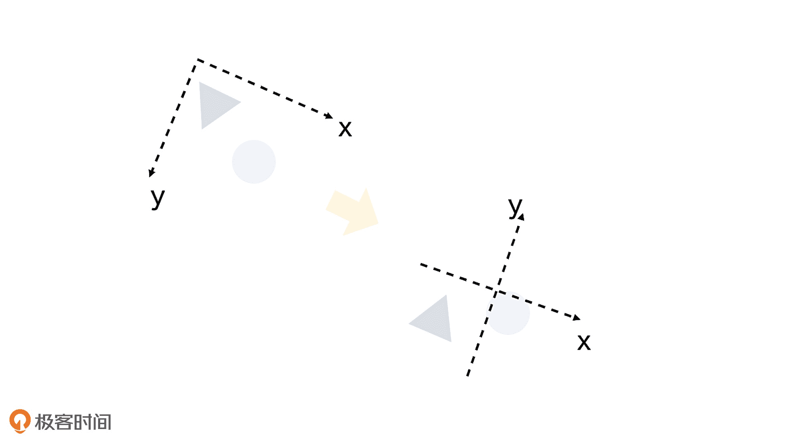

为了方便处理图形，我们经常需要对坐标系进行转换。转换坐标系可以说是一个非常基础且重要的操作了。正因为这四个坐标系都是直角坐标系，所以它们可以很方便地相互转化。其中，HTML、SVG 和 Canvas 都提供了 transform 的 API 能够帮助我们很方便地转换坐标系。而 WebGL 本身不提供 tranform 的 API，但我们可以在 shader 里做矩阵运算来实现坐标转换，WebGL 的问题我们在后续课程会有专门讨论，今天我们先来说说其他三种。那接下来我们就以 Canvas 为例，来看看用 transform API 怎样进行坐标转换。

## 如何用 Canvas 实现坐标系转换？

假设，我们要在宽 512 * 高 256 的一个 Canvas 画布上实现如下的视觉效果。其中，山的高度是 100，底边 200，两座山的中心位置到中线的距离都是 80，太阳的圆心高度是 150。

当然，在不转换坐标系的情况下，我们也可以把图形绘制出来，但是要经过顶点换算，下面我们就来说一说这个过程。

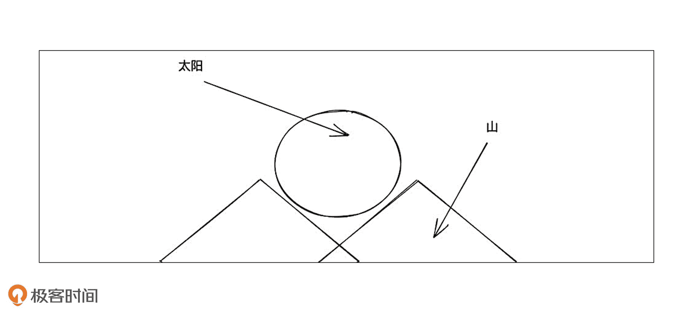

首先，因为 Canvas 坐标系默认的原点是左上角，底边的 y 坐标是 256，而山的高度是 100，所以山顶点的 y 坐标是 256 - 100 = 156。而因为太阳的高度是 150，所以太阳圆心的 y 坐标是 256 - 150 = 106。

然后，因为 x 轴中点的坐标是 512 / 2 = 256，所以两座山顶点的 x 坐标分别是 256 - 80 和 256 + 80，也就是 176 和 336。又因为山是等腰三角形，它的底边是 200，所以两座山底边的 x 坐标计算出来，分别是 76、276、236、436（176 - 100 =76、176 + 100=276、336 - 100=236、 336 + 100=436）。

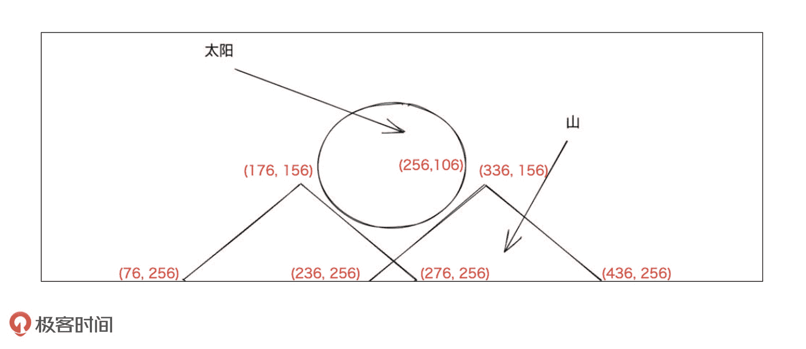

计算出这些坐标之后，我们很容易就可以将这个图画出来了。不过，为了增加一些趣味性，我们用一个Rough.js的库，绘制一个手绘风格的图像（Rough.js 库的 API 和 Canvas 差不多，绘制出来的图形比较有趣）。绘制的代码如下所示：

```
const rc = rough.canvas(document.querySelector('canvas'));  
const hillOpts = {roughness: 2.8, strokeWidth: 2, fill: 'blue'};  
rc.path('M76 256L176 156L276 256', hillOpts);  
rc.path('M236 256L336 156L436 256', hillOpts);  
rc.circle(256, 106, 105, {  
  stroke: 'red',  
  strokeWidth: 4,  
  fill: 'rgba(255, 255, 0, 0.4)',  
  fillStyle: 'solid',  
});
```

最终，我们绘制出的图形效果如下所示：

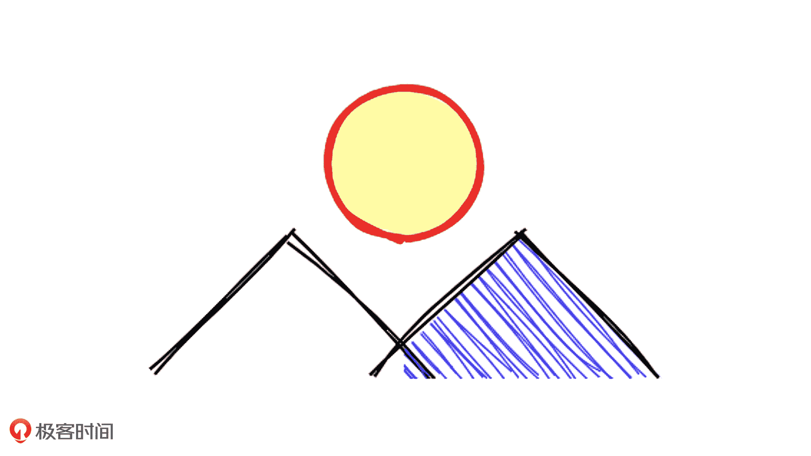

到这里，我们通过简单的计算就绘制出了这一组图形。但你也能够想到，如果每次绘制都要花费时间在坐标换算上，这会非常不方便。所以，为了解决这个问题，我们可以采用坐标系变换来代替坐标换算。

这里，我们给 Canvas 的 2D 上下文设置一下 transform 变换。我们经常会用到两个变换：translate 和 scale。

首先，我们通过 translate 变换将 Canvas 画布的坐标原点，从左上角 (0, 0) 点移动至 (256, 256) 位置，即画布的底边上的中点位置。接着，以移动了原点后新的坐标为参照，通过 scale(1, -1) 将 y 轴向下的部分，即 y>0 的部分沿 x 轴翻转 180 度，这样坐标系就变成以画布底边中点为原点，x 轴向右，y 轴向上的坐标系了。

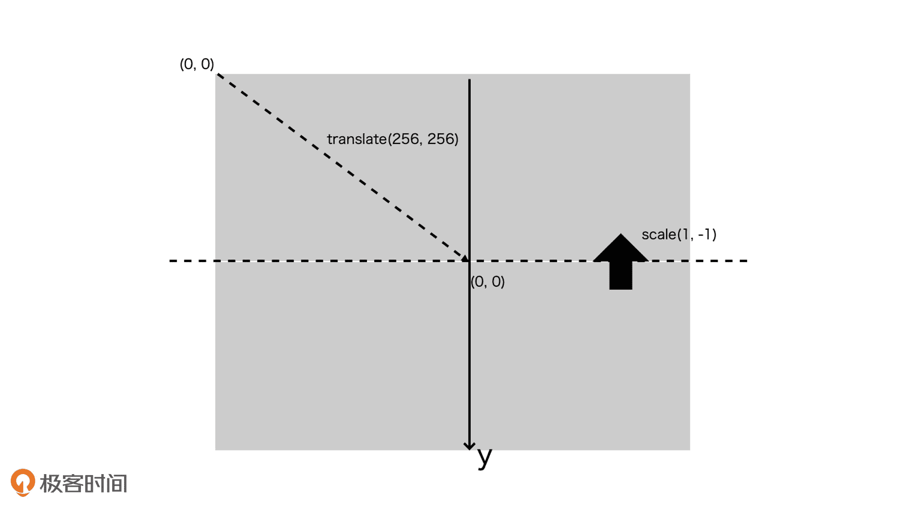

坐标系

执行了这个坐标变换，也就是让坐标系原点在中间之后，我们就可以更方便、直观地计算出几个图形元素的坐标了。

两个山顶的坐标就是 (-80, 100) 和 (80, 100)，山脚的坐标就是 (-180, 0)、(20, 0)、(-20, 0)、(180, 0)，太阳的中心点的坐标就是 (0, 150)。那么更改后的代码如下所示。

```
const rc = rough.canvas(document.querySelector('canvas'));  
const ctx = rc.ctx;  
ctx.translate(256, 256);  
ctx.scale(1, -1);  
  
const hillOpts = {roughness: 2.8, strokeWidth: 2, fill: 'blue'};  
  
rc.path('M-180 0L-80 100L20 0', hillOpts);  
rc.path('M-20 0L80 100L180 0', hillOpts);  
  
rc.circle(0, 150, 105, {  
  stroke: 'red',  
  strokeWidth: 4,  
  fill: 'rgba(255,255, 0, 0.4)',  
  fillStyle: 'solid',  
});
```

好了，现在我们就完成了坐标变换。但是因为这个例子要绘制的图形很少，所以还不太能体现使用坐标系变换的好处。不过，你可以想一下，在可视化的许多应用场景中，我们都要处理成百上千的图形。如果这个时候，我们在原始坐标下通过计算顶点来绘制图形，计算量会非常大，很麻烦。那采用坐标变换的方式就是一个很好的优化思路，**它能够简化计算量，这不仅让代码更容易理解，也可以节省 CPU 运算的时间**。

理解直角坐标系的坐标变换之后，我们再来说说直角坐标系里绘制图形的方法。**那不管我们用什么绘图系统绘制图形，一般的几何图形都是由点、线段和面构成。其中，点和线段是基础的图元信息，因此，如何描述它们是绘图的关键**。

## 如何用向量来描述点和线段？

那在直角坐标系下，我们是怎么表示**点和线段的呢**？我们一般是用向量来表示一个点或者一个线段。

前面的例子因为包含 x、y 两个坐标轴，所以它们构成了一个绘图的平面。因此，我们可以用二维向量来表示这个平面上的点和线段。二维向量其实就是一个包含了两个数值的数组，一个是 x 坐标值，一个是 y 坐标值。

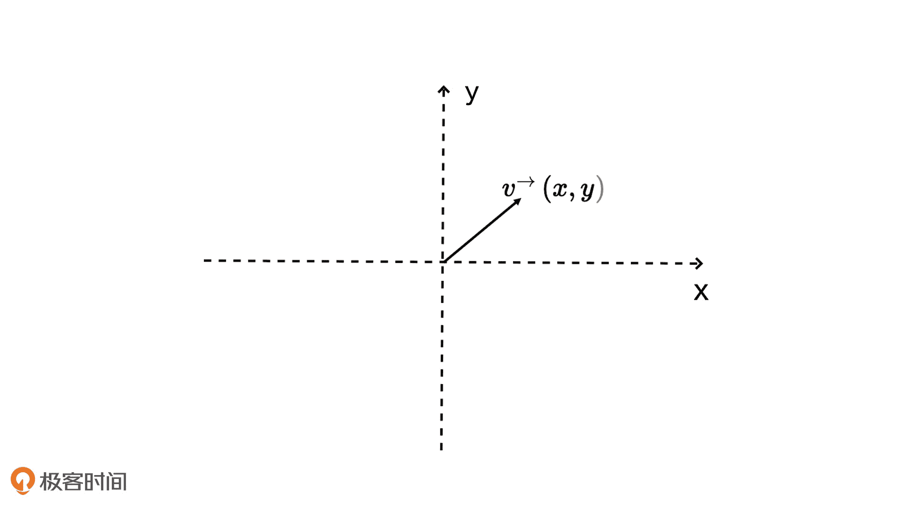

假设，现在这个平面直角坐标系上有一个向量 v。向量 v 有两个含义：一是可以表示该坐标系下位于 (x, y) 处的一个点；二是可以表示从原点 (0,0) 到坐标 (x,y) 的一根线段。

接下来，为了方便你理解，我们先来回顾一下关于向量的数学知识。

**首先，向量和标量一样可以进行数学运算。**举个例子，现在有两个向量，v1和 v2，如果让它们相加，其结果相当于将 v1向量的终点（x1, y1），沿着 v2向量的方向移动一段距离，这段距离等于 v2向量的长度。这样，我们就可以在平面上得到一个新的点（x1 + x2, y1 + y2），一条新的线段[(0, 0), (x1 + x2, y1 + y2)]，以及一段折线：[(0, 0), (x1, y1) , (x1 + x2, y1 + y2)]。

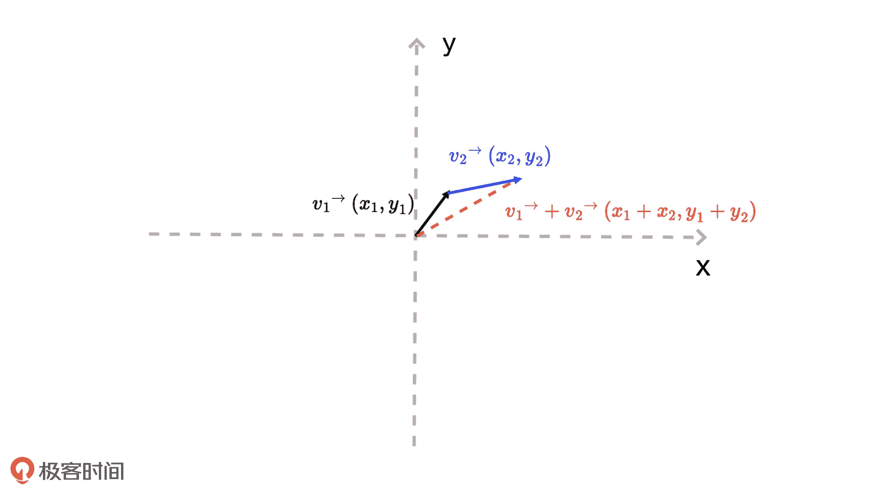

**其次，一个向量包含有长度和方向信息**。它的长度可以用向量的 x、y 的平方和的平方根来表示，如果用 JavaScript 来计算，就是：

```
v.length = function(){return Math.hypot(this.x, this.y)};
```

它的方向可以用与 x 轴的夹角来表示，即：

```
v.dir = function() { return Math.atan2(this.y, this.x);}
```

在上面的代码里，Math.atan2 的取值范围是 -π到π，负数表示在 x 轴下方，正数表示在 x 轴上方。

最后，根据长度和方向的定义，我们还能推导出一组关系式：

```
v.x = v.length * Math.cos(v.dir);  
v.y = v.length * Math.sin(v.dir);  

```

这个推论意味着一个重要的事实：我们可以很简单地构造出一个绘图向量。也就是说，如果我们希望以点 (x0, y0) 为起点，沿着某个方向画一段长度为 length 的线段，我们只需要构造出如下的一个向量就可以了。

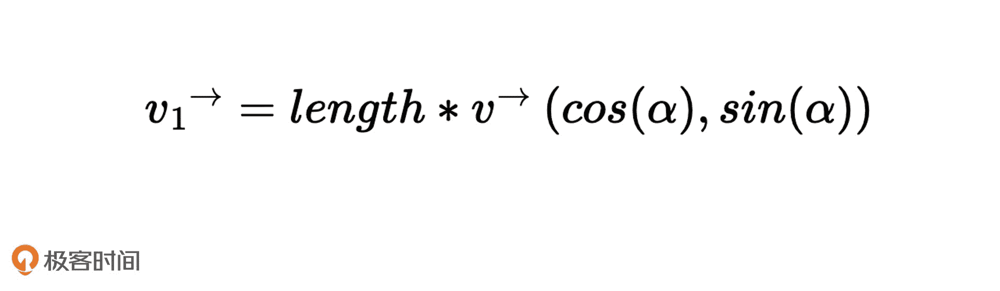

这里的α是与 x 轴的夹角，v 是一个单位向量，它的长度为 1。然后我们把向量 (x0, y0) 与这个向量 v1相加，得到的就是这条线段的终点。这么讲还是比较抽象，我们看一个例子。

## 实战演练：用向量绘制一棵树

我们用前面学到的向量知识来绘制一棵随机生成的树，想要生成的效果如下：

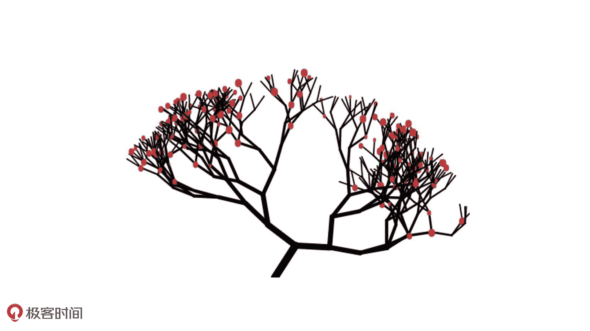

我们还是用 Canvas2D 来绘制。首先是坐标变换，原理前面讲过，我就不细说了。这里，我们要做的变换是将坐标原点从左上角移动到左下角，并且让 y 轴翻转为向上。

```
ctx.translate(0, canvas.height);  
ctx.scale(1, -1);  
ctx.lineCap = 'round';
```

然后，我们定义一个画树枝的函数 drawBranch。

```
function drawBranch(context, v0, length, thickness, dir, bias) {  
  ...  
}
```

这个函数有六个参数：

1. context 是我们的 Canvas2D 上下文
2. v0是起始向量
3. length 是当前树枝的长度
4. thickness 是当前树枝的粗细
5. dir 是当前树枝的方向，用与 x 轴的夹角表示，单位是弧度。
6. bias 是一个随机偏向因子，用来让树枝的朝向有一定的随机性

因为 v0是树枝的起点坐标，那根据前面向量计算的原理，我们创建一个单位向量 (1, 0)，它是一个朝向 x 轴，长度为 1 的向量。然后我们旋转 dir 弧度，再乘以树枝长度 length。这样，我们就能计算出树枝的终点坐标了。代码如下：

```
 const v = new Vector2D(1, 0).rotate(dir).scale(length);  
 const v1 = v0.copy().add(v);
```

向量的旋转是向量的一种常见操作，对于二维空间来说，向量的旋转可以定义成如下方法（这里我们省略了数学推导过程，有兴趣的同学可以去看一下数学原理）。这个方法我们后面还会经常用到，你先记一下，后续我们讲到仿射变换的时候，会有更详细的解释。

```
class Vector2D {  
  ...    
  rotate(rad) {  
    const c = Math.cos(rad),  
      s = Math.sin(rad);  
    const [x, y] = this;  
  
    this.x = x * c + y * -s;  
    this.y = x * s + y * c;  
  
    return this;  
  }  
}
```

我们可以从一个起始角度开始递归地旋转树枝，每次将树枝分叉成左右两个分枝：

```
  if(thickness > 2) {  
    const left = dir + 0.2;  
    drawBranch(context, v1, length * 0.9, thickness * 0.8, left, bias * 0.9);  
    const right = dir - 0.2;  
    drawBranch(context, v1, length * 0.9, thickness * 0.8, right, bias * 0.9);  
  }  

```

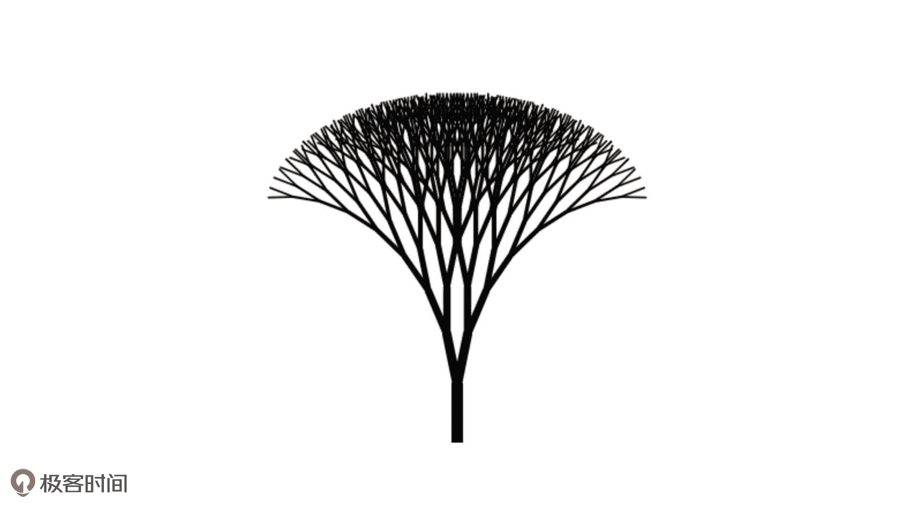

这样，我们得到的就是一棵形状规律的树。

接着我们修改代码，加入随机因子，让迭代生成的新树枝有一个随机的偏转角度。

```
  if(thickness > 2) {  
    const left = Math.PI / 4 + 0.5 * (dir + 0.2) + bias * (Math.random() - 0.5);  
    drawBranch(context, v1, length * 0.9, thickness * 0.8, left, bias * 0.9);  
    const right = Math.PI / 4 + 0.5 * (dir - 0.2) + bias * (Math.random() - 0.5);  
    drawBranch(context, v1, length * 0.9, thickness * 0.8, right, bias * 0.9);  
  }
```

这样，我们就可以得到一棵随机的树。

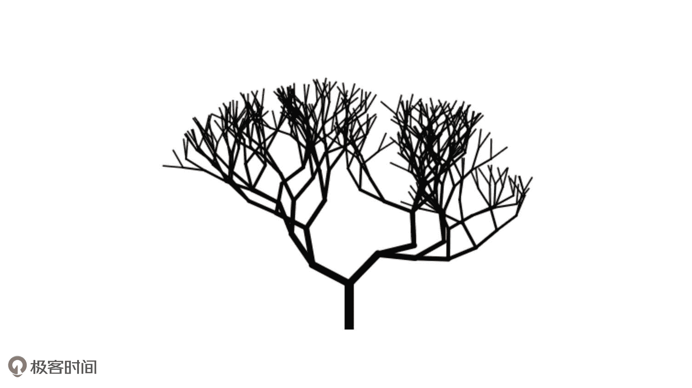

最后，为了美观，我们再随机绘制一些花瓣上去，你也可以尝试绘制其他的图案到这棵树上。

```
  if(thickness < 5 && Math.random() < 0.3) {  
    context.save();  
    context.strokeStyle = '#c72c35';  
    const th = Math.random() * 6 + 3;  
    context.lineWidth = th;  
    context.beginPath();  
    context.moveTo(...v1);  
    context.lineTo(v1.x, v1.y - 2);  
    context.stroke();  
    context.restore();  
  }
```

这样，我们就实现了绘制一棵随机树的方法。

它的完整代码在GitHub 仓库，你可以研究一下。这里面最关键的一步就是前面的向量操作，为了实现向量的 rotate、scale、add 等方法，我封装了一个简单的库 Vector2d.js，你也可以在代码仓库中找到它。

## 向量运算的意义

实际上，在我们的可视化项目里，直接使用向量的加法、旋转和乘法来构造线段绘制图形的情形并不多。这是因为，在一般情况下，数据在传给前端的时候就已经计算好了，我们只需要拿到数据点的信息，根据坐标变换进行映射，然后直接用映射后的点来绘制图形即可。

既然这样，为什么我们在这里又要强调向量操作的重要性呢？虽然我们很少直接使用向量构造线段来完成绘图，但是向量运算的意义并不仅仅只是用来算点的位置和构造线段，这只是最初级的用法。我们要记住，**可视化呈现依赖于计算机图形学，而向量运算是整个计算机图形学的数学基础。**

而且，在向量运算中，除了加法表示移动点和绘制线段外，向量的点乘、叉乘运算也有特殊的意义。课后我会给你出一道有挑战性的思考题 ，让你能更深入地理解向量运算的现实意义，在下一节课里我会给你答案。

## 要点总结

这一节课， 我们以 Canvas 为例学习了坐标变换，以及用向量描述点和线段的原理和方法。

一般来说，采用平面直角坐标系绘图的时候，对坐标进行平移等线性变换，并不会改变坐标系中图形的基本形状和相对位置，因此我们可以利用坐标变换让我们的绘图变得更加容易。Canvas 坐标变换经常会用到 translate 和 scale 这两个变换，它们的操作和原理都很简单，我们根据实际需求来设置就好了。

在平面直角坐标系中，我们可以定义向量来绘图。向量可以表示绘图空间中的一个点，或者连接原点的一条线段。两个向量相加，结果相当于将被加向量的终点沿着加数向量的方向移动一段距离，移动的距离等于加数向量的长度。利用向量的这个特性，我们就能以某个点为起点，朝任意方向绘制线段，从而绘制各种较复杂的几何图形了。

## 小试牛刀

1. 我们已经知道如何用向量来定义一个线段，你知道如何判断两个线段的位置关系吗？假设有两个线段 l1和 l2，已知它们的起点和终点分别是[(x10, y10),(x11, y11)]、[(x20, y20),(x21, y21)]，你能判断它们的关系吗（小提示：两个线段之间的关系有**平行、垂直**或既不平行又不垂直）？
2. 已知线段[(x0, y0)、(x1, y1)]，以及一个点 (x2, y2)，怎么求点到线段的距离？
3. 一个平面上放置了一个扫描器，方向延 y 轴方向（该坐标系 y 轴向上），扫描器的视角是 60 度。假设它可以扫描到无限远的地方，那对于平面上给定的任意一个点 (x,y)，我们该如何判断这个点是否处于扫描范围内呢？

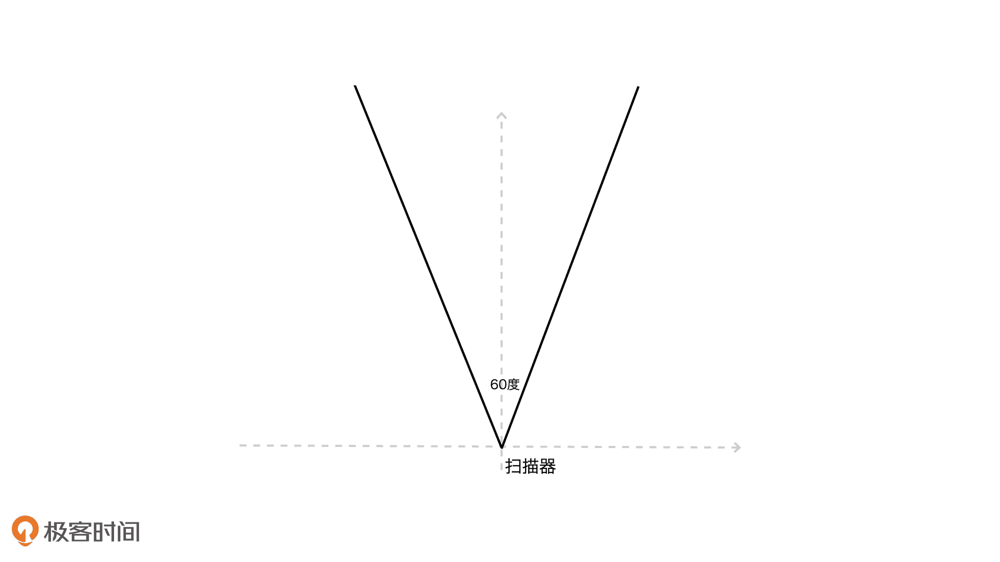

欢迎在留言区和我讨论，分享你的答案和思考，也欢迎你把这节课分享给你的朋友，我们下节课见！

## 源码

 [1]绘制随机树的源代码

[2]坐标变换的源代码

## 推荐阅读

[1] 二维旋转矩阵与向量旋转推荐文档

[2] 一个有趣的绘图库：Rough.js

[3] Vector2d.js 模块文档
