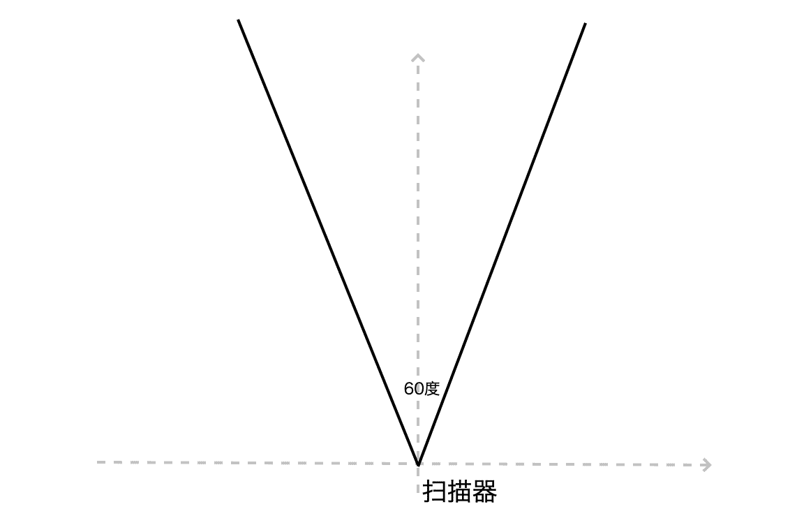
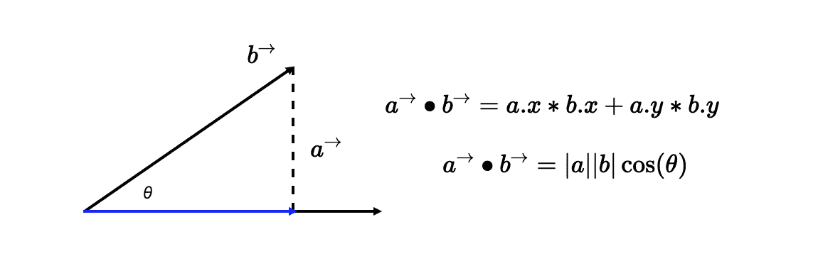
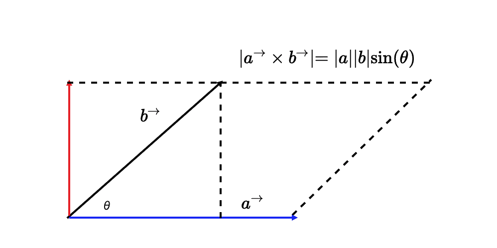
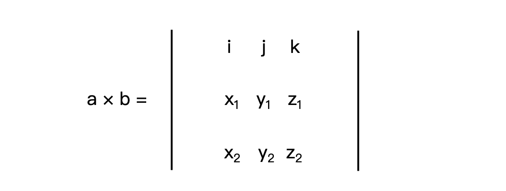
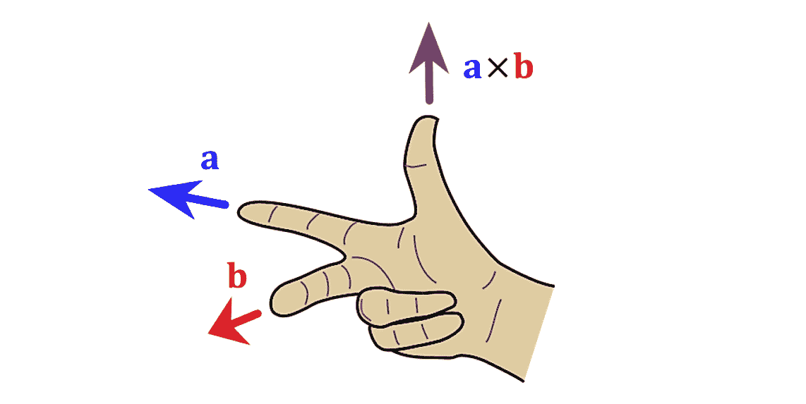
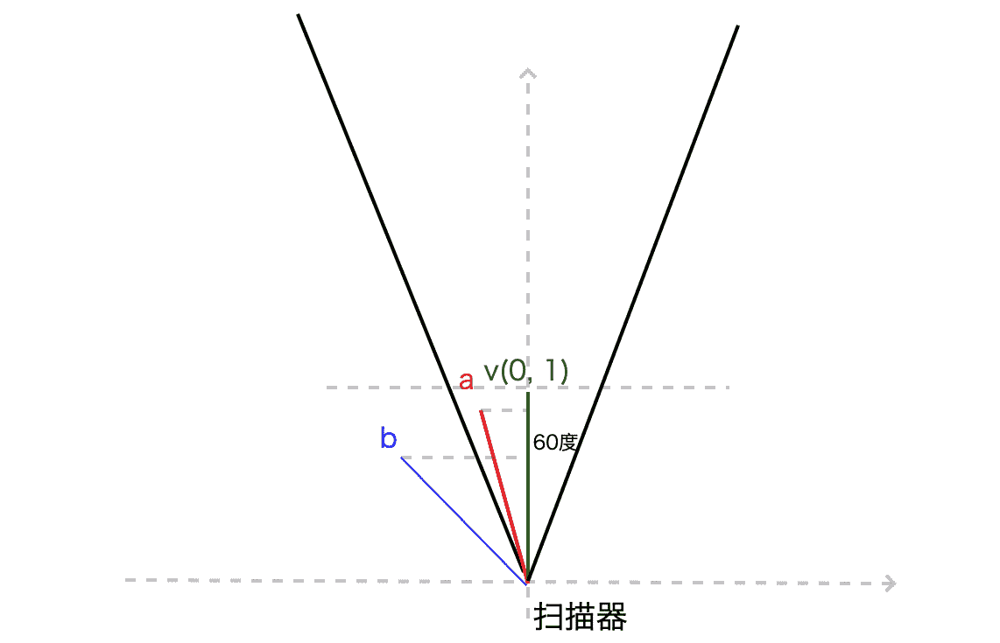

# 06 | 可视化中你必须要掌握的向量乘法知识

 

你好，我是月影。

上一节课，我们学习了 Canvas 实现坐标系转换的方法，以及利用向量描述点和线段来绘制基本图形的方法。接下来，我们继续学习和向量有关的绘图知识，教你用数学语言描述曲线。

不过，在讨论如何描述曲线之前，还有一些关于向量乘法的前置知识需要你掌握。虽然它们和如何描述曲线并没有直接的关系，但是使用它们可以计算曲线的控制点、判断曲线的方向以及对曲线进行变换。

因此，向量的乘法在可视化中也是非常重要并且实用的内容。比如，上节课的思考题 3：给你一个任意点，让你判断这个点在不在这个扫描器范围内。这道题可以用我们前面学过的知识解决，但用向量乘法可以更轻松解决。接下来就让我们从这一道题开始今天的学习吧！



如果利用我们前面学过的知识来解题，你可能是直接使用向量的方向定义来做的，代码如下所示。

```
v.dir = function() {return Math.atan2(this.y, this.x)}
```

没错，这道题我们可以使用向量的方向来解。因为这里的 dir 是由向量与 x 轴夹角决定的，所以判断点是否在扫描器范围内，我们只需要计算点坐标对应的向量的 dir 值，是否在扫描器的范围内就可以了。代码如下：

```
const isInRange = v0.dir > Math.PI / 3 && v0.dir < 2 * Math.PI / 3;
```

这是一个很简单、直观的解法，但是它不够完美，因为这个判断和扫描器的方向有关。什么意思呢？从上面的图中你可以看到，现在它正对着 y 轴正方向，所以角度在π/3 和 2π/3 之间。但如果将它的方向旋转，或者允许它朝向任意的方向，我们就必须要修改对应的角度值了。这个时候就会非常麻烦。

因此，我们会使用一个更通用的解法，也就是利用向量的乘法来解。那具体怎么做呢？别着急，我先带你来复习一下我们高中学过的向量乘法的知识，如果你记得不是特别清楚，正好可以借着这个机会来加深印象。

我们知道，向量乘法有两种，一种是点乘，一种是叉乘，它们有着不同的几何和物理含义。下面，我们一一来看。

## 向量的点乘

首先，我们来看向量的点乘。

假设，现在有两个 N 维向量 a 和 b，a = [a1, a2, …an]，b = [b1, b2, …bn]，那向量的点积代码如下：

```
a•b = a1*b1 + a2*b2 + ... + an*bn
```

在 N 维线性空间中，a、b 向量点积的几何含义，是 a 向量乘以 b 向量在 a 向量上的投影分量。它的物理含义相当于 a 力作用于物体，产生 b 位移所做的功。点积公式如下图所示：



好了，现在你已经知道 a、b 向量点积的定义了。那关于还有两个比较特殊的情况，你需要掌握。第一种是，当 a、b 两个向量平行时，它们的夹角就是 0°，那么 a·b=|a|*|b|，用 JavaScript 代码表示就是：

```
a.x * b.x + a.y * b.y === a.length * b.length；
```

第二种是，当 a、b 两个向量垂直时，它们的夹角就是 90°，那么 a·b=0，用 JavaScript 代码表示就是：

```
a.x * b.x + a.y * b.y === 0;

## 向量的叉乘

叉乘和点乘有两点不同：首先，向量叉乘运算的结果不是标量，而是一个向量；其次，两个向量的叉积与两个向量组成的坐标平面垂直。怎么理解呢？我们接着往下看。
```

以二维空间为例，向量 a 和 b 的叉积，就相当于向量 a（蓝色带箭头线段）与向量 b 沿垂直方向的投影（红色带箭头线段）的乘积。那如下图所示，二维向量叉积的几何意义就是向量 **a、b 组成的平行四边形的面积**。



那叉乘在数学上该怎么计算呢？假设，现在有两个三维向量 a(x1, y1, z1) 和 b(x2, y2, z2)，那么，a 与 b 的叉积可以表示为一个如下图的行列式：



其中 i、j、k 分别是 x、y、z 轴的单位向量。我们把这个行列式展开，就能得到如下公式：

```
a X b = [y1 * z2 - y2 * z1, - (x1 * z2 - x2 * z1), x1 * y2 - x2 * y1]
```

我们计算这个公式，得到的值还是一个三维向量，它的方向垂直于 a、b 所在平面。因此，我们刚才说的二维空间中，向量 a、b 的叉积方向就是垂直纸面朝向我们的。那有什么办法可以很容易，就确定出 a、b 的叉积方向呢？

还记得吗？第 2 节课我们提到过左手系和右手系，其中 x 轴向右、y 轴向下的坐标系是右手系。在右手系中求向量 a、b 叉积的方向时，我们可以把右手食指的方向朝向 a，把右手中指的方向朝向 b，那么大拇指所指的方向就是 a、b 叉积的方向，这个方向是垂直纸面向外（即朝向我们）。因此，右手系中向量叉乘的方向就是右手拇指的方向，那左手系中向量叉乘的方向自然就是左手拇指的方向了。



在二维空间里，由于 z 的值为 0，因此我们得到的向量 a X b 的数值，就等于 x1 * y2 - x2 * y1。那它的物理意义是什么呢？二维空间中向量叉乘的物理意义就是 **a 和 b 的力矩**（力矩你可以理解为一个物体在力的作用下，绕着一个轴转动的趋向。它是一个向量，等于力臂 L 和力 F 的叉乘。这个概念你记住就好了，我们今天不会用到，后面用到的时候我会再详细来讲）。

还记得上一节课的思考题 2，求点到线段的距离吗？在了解了向量叉积的几何意义之后，我们通过向量叉积得到平行四边形面积，再除以底边长，就能得到点到向量所在直线的距离了。是不是很简单？

同样，向量叉积也可以解决思考题 3。那具体该怎么做呢？

首先，对于任意一点 v0，我们先将它**归一化**。简单来说归一化就是，用 v0的 x、y 分别除以它的绝对值。归一化后的向量方向不变，长度为 1。归一化是向量运算中一个非常重要的操作，用处也非常多。比如说，在向量乘法里，如果 a、b 都是长度为 1 的归一化向量，那么|a X b| 的结果就是 a、b 夹角的**正弦值**，而|a • b|的结果就是 a、b 夹角的**余弦值。**这个特性在图形学里用处非常大，你一定要记住它。

好了，再说回来，我们把归一化的向量 a 叉乘扫描器中线上的 v(0,1)，由于扫描器关于 y 轴对称，所以扫描器边缘与 y 轴的夹角是正负 30 度。那么在与单位向量求叉积的时候，就会出现 2 种情况：

1. 点在扫描范围内，如向量 a，就一定满足： |a X v| <= ||a||v|sin(30°)| = |sin(30°)| = 0.5；
2. 点不在扫描范围内，如向量 b，就一定满足：|b X v| > ||b||v|sin(30°)| = |sin(30°)| = 0.5。



因此，只要任意一点所在的向量与单位向量的叉积结果的绝对值不大于 0.5（即 sin30°），就说明这个点在扫描范围内。所以我们可以用如下代码来判断：

```
const isInRange = Math.abs(new Vec2(0, 1).cross(v0.normalize())) <= 0.5; // v0.normalize()即将v0归一化
```

好了，关于向量乘法的内容，我们就全部复习完了，相信你已经很好地掌握它们了。不过，我还想再多说几句 ，对于图形学来说，向量运算是基础中的基础，非常重要。所以，我们不仅要熟练掌握，还要学会用向量的思路去解决问题。只有这样，你才能学好图形学，从而成为优秀的可视化工程师。

## 要点总结

这一节课，我们学习了向量的乘法，包括点乘与叉乘。

其中点乘的几何意义是向量 a 与它在向量 b 所在的轴的投影向量的乘积，物理意义是力向量产生的位移向量所做的功。叉乘的几何意义是向量 a 和向量 b 构成的平行四边形的面积，物理意义是力产生的力矩。

最后，我们还要记住，把向量归一化以后，我们就可以通过向量的点乘与叉乘快速求出向量夹角的正弦和余弦值。

## 小试牛刀

让我们延续上一节课的第 2 道思考题。已知，平面上有一点 P，它的坐标是 (x0, y0)，还有一条直线，直线上有两个点 Q(x1, y1) 和 R(x2, y2)。你能求出点 P 到直线的距离，以及点 P 到线段 QR 的距离吗？这里面，P、Q、R 这三个值可以是任意的。你可以要试着用一段 JavaScript 代码把计算的过程写出来，最好还能把直线、点和距离在 Canvas 上给直观地绘制出来。

欢迎在留言区和我讨论，分享你的答案和思考，也欢迎你把这节课分享给你的朋友，我们下节课见！
