# 07 | 如何用向量和参数方程描述曲线？

 

你好，我是月影。

曲线是图形系统的基本元素之一，它可以构成几何图形的边，也可以描述点和几何体的运动轨迹，还可以控制像素属性的变化。不论我们用什么图形系统绘图，图形的呈现都离不开曲线。因此，对于可视化而言，掌握如何描述曲线是非常重要的。

今天，我们就来学习两种常见的描述曲线的方法，也就是用向量和参数方程来描述曲线。

## 如何用向量描述曲线？

我们先来说第一种方法，用向量来描述曲线。

我们知道，曲线是可以用折线来模拟的。因此，我们第 5 节课中用向量来绘制折线的方法，同样可以应用于曲线。具体怎么做呢？下面，我就详细来说说。

首先，我们用向量绘制折线的方法来绘制正多边形，我们定义一个函数 regularShape，代码如下：

```
function regularShape(edges = 3, x, y, step) {  
  const ret = [];  
  const delta = Math.PI * (1 - (edges - 2) / edges);  
  let p = new Vector2D(x, y);  
  const dir = new Vector2D(step, 0);  
  ret.push(p);  
  for(let i = 0; i < edges; i++) {  
    p = p.copy().add(dir.rotate(delta));  
    ret.push(p);  
  }  
  return ret;  
}
```

我们在 regularShape 函数中，给定边数 edges、起点 x, y、一条边的长度 step，就可以绘制一个正多边形了。绘制的思路和我们上一节课的思路类似，也就是通过 rotate 旋转向量，然后通过向量加法来计算顶点位置。

具体来说就是，我们定义初始点为 new Vector2D(x, y)，初始方向为 x 轴方向 new Vector2D(step, 0)。然后循环计算正多边形的顶点位置，也就是从初始点开始，每次将方向向量旋转 delta 角度，delta 角度是根据正多边形内角公式计算出来的。最后，我们将当前点和方向向量相加，就得到下一个顶点坐标了。

有了这个方法，我们就可以计算出要绘制的多边形的每一个顶点坐标，然后调用图形系统的 API 将图形绘制出来了。我在下面给出了绘制三角形、六边形、十一边形和六十边形的参数，你可以看一看，也可以试着自己动手绘制一下。

```
draw(regularShape(3, 128, 128, 100));  // 绘制三角形  
draw(regularShape(6, -64, 128, 50));  // 绘制六边形  
draw(regularShape(11, -64, -64, 30));  // 绘制十一边形  
draw(regularShape(60, 128, -64, 6));  // 绘制六十边形  

```

这些图形用 Canvas2D 绘制出来的结果如下图所示，详细的代码我放在了GitHub 仓库。

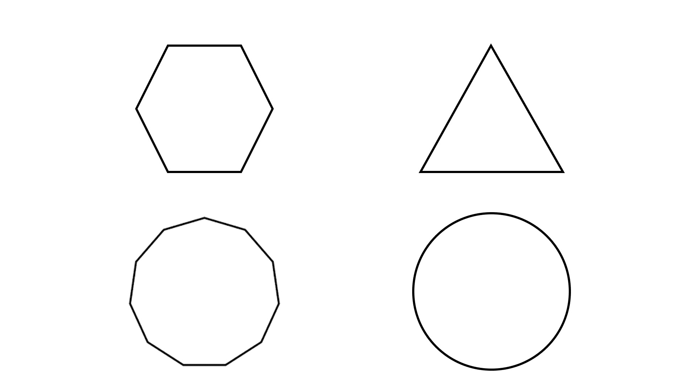

从上面的例子中可以看出，当多边形的边数非常多的时候，这个图形就会接近圆。所以，只要利用 regularShape 函数，将多边形的边数设置得很大，我们就可以绘制出圆形了。不过，这个做法虽然能够绘制出圆这样的曲线，但它还有一些缺点。

首先，regularShape 定义边数、起点、一条边的长度，这就和我们通常的使用习惯，也就是定义边数、中心和半径不符。如果我们按照现在这种定义方式绘图，是很难精确对应到图形的位置和大小的。那你可能要说了，不是还可以换算吗？确实可以，但是计算的过程比较繁琐，也很容易出错。

其次，regularShape 可以画圆，改进一下也可以画圆弧，但是对于椭圆、抛物线、贝塞尔曲线等其他曲线的绘制就无能为力了。

那么，为了更简单地绘制出更多的曲线样式，我们需要用更好的模型来描述。

## 如何用参数方程描述曲线？

接下来，我们就来讨论用参数方程描述曲线的方法。通过这个方法，我们不仅可以描述常见的圆、椭圆、抛物线、正余弦等曲线，还能描述更具有一般性的曲线，也就是没有被数学公式预设好的曲线，比如贝塞尔曲线，或者 Catmull–Rom 曲线等等。

说到参数方程，接下来我在每次用它来画图之前，还是会先带你一起回顾相关的数学知识，这样对你后面的学习也会很方便。那我们先从最简单的曲线，也就是圆形开始，来看看它是如何用参数方程绘制的。

### 1. 画圆

首先，圆可以用一组参数方程来定义。如下所示的参数方程，定义了一个圆心在（x0,y0），半径为 r 的圆。

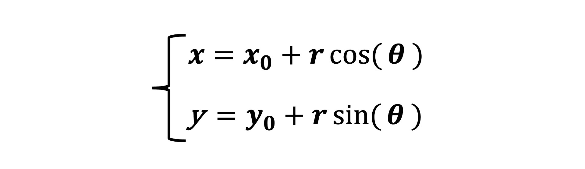

知道了方程，下面我们来说一下计算圆顶点的方法。首先，我们实现一个画圆弧的函数 arc，代码如下所示。我们设置圆心为 x0、y0，半径为 radius，起始角度为 startAng，结束角度是 endAng。然后，我们就可以用 draw(arc(0, 0, 100)) 这样的方式在 (0,0) 点绘制一个半径为 100 的圆了。

```
const TAU_SEGMENTS = 60;  
const TAU = Math.PI * 2;  
function arc(x0, y0, radius, startAng = 0, endAng = Math.PI * 2) {  
  const ang = Math.min(TAU, endAng - startAng);  
  const ret = ang === TAU ? [] : [[x0, y0]];  
  const segments = Math.round(TAU_SEGMENTS * ang / TAU);  
  for(let i = 0; i <= segments; i++) {  
    const x = x0 + radius * Math.cos(startAng + ang * i / segments);  
    const y = y0 + radius * Math.sin(startAng + ang * i / segments);  
    ret.push([x, y]);  
  }  
  return ret;  
}  
  
draw(arc(0, 0, 100));
```

这个时候你可能想问，在第 2 节课利用 Canvas2D 画圆的时候，我们使用的 context.arc 方法和我们自己实现的这个函数很像，既然已经有了现成的 API，我们为什么还要自己实现呢？关于这一点，我就要再啰嗦几句了。不是所有的图形系统都提供了画圆的 API，比如 WebGL 中就没有默认的画圆 API。因此，在没有提供画圆的 API 的时候，我们上面实现的函数就可以派上用场了。

### 2. 画圆锥曲线

除了画圆，参数方程还可以描述很多其他的圆锥曲线。比如椭圆的参数方程。它其实和圆的参数方程很接近。其中，a、b 分别是椭圆的长轴和短轴，当 a = b = r 时，这个方程是就圆的方程式。所以，圆实际上就是椭圆的特例。

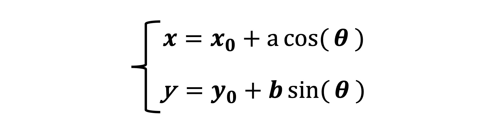

再比如，抛物线的参数方程。其中 p 是常数，为焦点到准线的距离。


我们修改上面的 arc 方法中的对应参数，就能同样实现椭圆和抛物线的绘制了。修改的操作非常简单，我就在下面直接给出这两个函数的代码了。

首先是椭圆，它的函数代码如下所示。

```
const TAU_SEGMENTS = 60;  
const TAU = Math.PI * 2;  
function ellipse(x0, y0, radiusX, radiusY, startAng = 0, endAng = Math.PI * 2) {  
  const ang = Math.min(TAU, endAng - startAng);  
  const ret = ang === TAU ? [] : [[x0, y0]];  
  const segments = Math.round(TAU_SEGMENTS * ang / TAU);  
  for(let i = 0; i <= segments; i++) {  
    const x = x0 + radiusX * Math.cos(startAng + ang * i / segments);  
    const y = y0 + radiusY * Math.sin(startAng + ang * i / segments);  
    ret.push([x, y]);  
  }  
  return ret;  
}  
  
draw(ellipse(0, 0, 100, 50));
```

其次是抛物线，它的函数代码如下所示。

```
const LINE_SEGMENTS = 60;  
function parabola(x0, y0, p, min, max) {  
  const ret = [];  
  for(let i = 0; i <= LINE_SEGMENTS; i++) {  
    const s = i / 60;  
    const t = min * (1 - s) + max * s;  
    const x = x0 + 2 * p * t ** 2;  
    const y = y0 + 2 * p * t;  
    ret.push([x, y]);  
  }  
  return ret;  
}  
  
draw(parabola(0, 0, 5.5, -10, 10));

### 3. 画其他常见曲线

除了前面说的圆锥曲线，应用参数方程我们还可以绘制许多比较有趣的曲线，这些曲线在实际工作中，常常用来构建各种几何图形。
```

不过，如果我们为每一种曲线都分别对应实现一个函数，就会非常笨拙和繁琐。那为了方便，我们可以用函数式的编程思想，封装一个更简单的 JavaScript 参数方程绘图模块，以此来绘制出不同的曲线。这个绘图模块的使用过程主要分为三步。

第一步，我们实现一个叫做 parametric 的高阶函数，它的参数分别是 x、y 坐标和参数方程。

第二步，parametric 会返回一个函数，这个函数会接受几个参数，比如，start、end 这样表示参数方程中关键参数范围的参数，以及 seg 这样表示采样点个数的参数等等。在下面的代码中，当 seg 默认 100 时，就表示在 start、end 范围内采样 101（seg+1）个点，后续其他参数是作为常数传给参数方程的数据。

第三步，我们调用 parametric 返回的函数之后，它会返回一个对象。这个对象有两个属性：一个是 points，也就是它生成的顶点数据；另一个是 draw 方法，我们可以利用这个 draw 方法完成绘图。

这个过程的代码如下：

```
// 根据点来绘制图形  
function draw(points, context, {  
  strokeStyle = 'black',  
  fillStyle = null,  
  close = false,  
} = {}) {  
  context.strokeStyle = strokeStyle;  
  context.beginPath();  
  context.moveTo(...points[0]);  
  for(let i = 1; i < points.length; i++) {  
    context.lineTo(...points[i]);  
  }  
  if(close) context.closePath();  
  if(fillStyle) {  
    context.fillStyle = fillStyle;  
    context.fill();  
  }  
  context.stroke();  
}  
  
export function parametric(xFunc, yFunc) {  
  return function (start, end, seg = 100, ...args) {  
    const points = [];  
    for(let i = 0; i <= seg; i++) {  
      const p = i / seg;  
      const t = start * (1 - p) + end * p;  
      const x = xFunc(t, ...args); // 计算参数方程组的x  
      const y = yFunc(t, ...args);  // 计算参数方程组的y  
      points.push([x, y]);  
    }  
    return {  
      draw: draw.bind(null, points),  
      points,  
    };  
  };  
}
```

利用绘图模块，我们就可以绘制出各种有趣的曲线了。比如，我们可以很方便地绘制出抛物线，代码如下：

```
// 抛物线参数方程  
const para = parametric(  
  t => 25 * t,  
  t => 25 * t ** 2,  
);  
  
// 绘制抛物线  
para(-5.5, 5.5).draw(ctx);
```

再比如，我们可以绘制出阿基米德螺旋线，代码如下：

```
const helical = parametric(  
  (t, l) => l * t * Math.cos(t),  
  (t, l) => l * t * Math.sin(t),  
);  
  
helical(0, 50, 500, 5).draw(ctx, {strokeStyle: 'blue'});
```

以及，我们还可以绘制星形线，代码如下：

```
const star = parametric(  
  (t, l) => l * Math.cos(t) ** 3,  
  (t, l) => l * Math.sin(t) ** 3,  
);  
  
star(0, Math.PI * 2, 50, 150).draw(ctx, {strokeStyle: 'red'});
```

同时绘制三条曲线后的效果，如下图所示。详细的代码，我都放到了GitHub 仓库。你可以自己动手试一试，看看怎么把它们组合成更多有趣的图形。

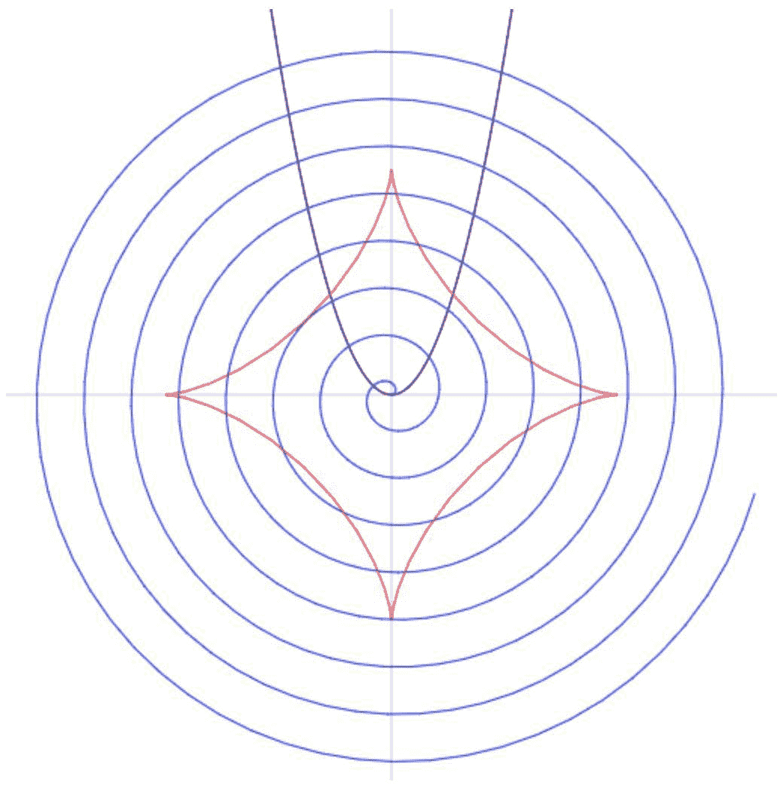

### 4. 画贝塞尔曲线

前面我们说的这些曲线都比较常见，它们都是符合某种固定数学规律的曲线。但生活中还有很多不规则的图形，无法用上面这些规律的曲线去描述。那我们该如何去描述这些不规则图形呢？**贝塞尔曲线**（Bezier Curves）就是最常见的一种解决方式。它在可视化领域中也是一类非常常用的曲线，它通过起点、终点和少量控制点，就能定义参数方程来生成复杂的平滑曲线，所以它通常被用来构建数据信息之间连接线。

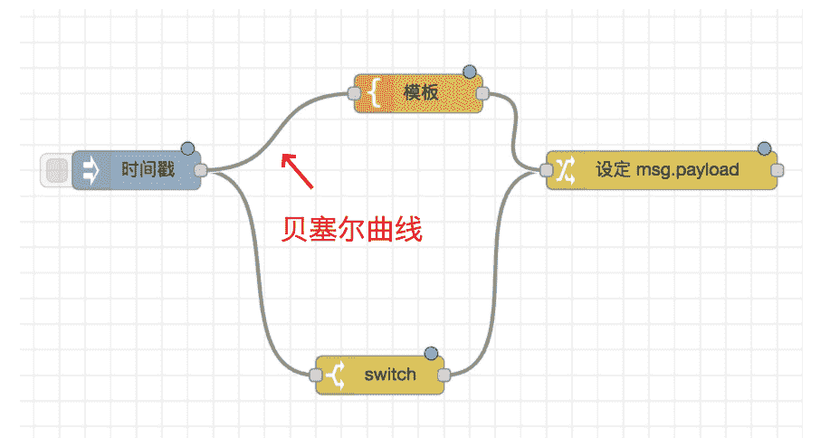

贝塞尔曲线示意图

贝塞尔曲线又分为**二阶贝塞尔曲线**（Quadratic Bezier Curve）和**三阶贝塞尔曲线**（Qubic Bezier Curve）。顾名思义，二阶贝塞尔曲线的参数方程是一元二次多项式，那么三阶贝塞尔曲线的参数方程是一元三次多项式。接下来，我们就分别说说它们的公式和描述曲线的方法

其中，二阶贝塞尔曲线由三个点确定，P0是起点，P1是控制点，P2是终点，示意图如下：

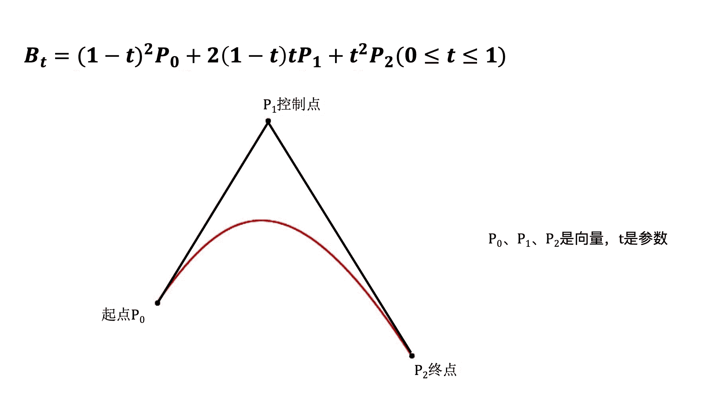

我们可以用 parametric 构建并绘制二阶贝塞尔曲线，代码如下所示：

```
const quadricBezier = parametric(  
  (t, [{x: x0}, {x: x1}, {x: x2}]) => (1 - t) ** 2 * x0 + 2 * t * (1 - t) * x1 + t ** 2 * x2,  
  (t, [{y: y0}, {y: y1}, {y: y2}]) => (1 - t) ** 2 * y0 + 2 * t * (1 - t) * y1 + t ** 2 * y2,  
);  
  
const p0 = new Vector2D(0, 0);  
const p1 = new Vector2D(100, 0);  
p1.rotate(0.75);  
const p2 = new Vector2D(200, 0);  
const count = 30;  
for(let i = 0; i < count; i++) {  
  // 绘制30条从圆心出发，旋转不同角度的二阶贝塞尔曲线  
  p1.rotate(2 / count * Math.PI);  
  p2.rotate(2 / count * Math.PI);  
  quadricBezier(0, 1, 100, [  
    p0,  
    p1,  
    p2,  
  ]).draw(ctx);  
}
```

在上面的代码中，我们绘制了 30 个二阶贝塞尔曲线，它们的起点都是 (0,0)，终点均匀分布在半径 200 的圆上，控制点均匀地分布在半径 100 的圆上。最终，实现的效果如下图所示。详细的代码，你可以访问GitHub 仓库：

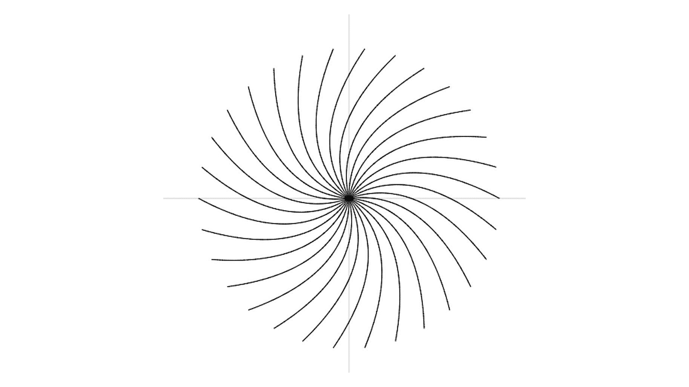

二阶贝塞尔曲线效果图

三阶贝塞尔曲线的参数方程为：

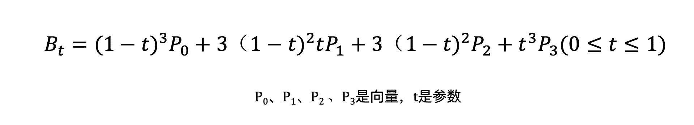

可以看到，与二阶贝塞尔曲线相比，三阶贝塞尔曲线有 4 个点，其中 P0和 P3是起点和终点，P1、P2是控制点，所以三阶贝塞尔曲线有两个控制点。

[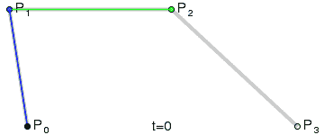](http://math001.com/bezier_curve/)
三阶贝塞尔曲线的原理示意图

我们同样可以用 parametric 构建并绘制三阶贝塞尔曲线：

```
const cubicBezier = parametric(  
  (t, [{x: x0}, {x: x1}, {x: x2}, {x: x3}]) => (1 - t) ** 3 * x0 + 3 * t * (1 - t) ** 2 * x1 + 3 * (1 - t) * t ** 2 * x2 + t ** 3 * x3,  
  (t, [{y: y0}, {y: y1}, {y: y2}, {y: y3}]) => (1 - t) ** 3 * y0 + 3 * t * (1 - t) ** 2 * y1 + 3 * (1 - t) * t ** 2 * y2 + t ** 3 * y3,  
);  
  
const p0 = new Vector2D(0, 0);  
const p1 = new Vector2D(100, 0);  
p1.rotate(0.75);  
const p2 = new Vector2D(150, 0);  
p2.rotate(-0.75);  
const p3 = new Vector2D(200, 0);  
const count = 30;  
for(let i = 0; i < count; i++) {  
  p1.rotate(2 / count * Math.PI);  
  p2.rotate(2 / count * Math.PI);  
  p3.rotate(2 / count * Math.PI);  
  cubicBezier(0, 1, 100, [  
    p0,  
    p1,  
    p2,  
    p3,  
  ]).draw(ctx);  
}
```

三阶贝塞尔曲线控制点比二阶贝塞尔曲线多，这有什么优势呢？因为控制点越多，曲线能够模拟出更多不同的形状，也能更精确地控制细节。比如说，在上面的代码中，我们绘制了 30 个三阶贝塞尔曲线，它们的起点都为 (0,0)，终点均匀分布在半径 200 的圆上，控制点 1 均匀分布在半径为 100 的圆上，控制点 2 均匀分布半径 150 的圆上。它和我们之前实现的二阶贝塞尔曲线相比，控制得更细致，形成的图案信息更丰富。

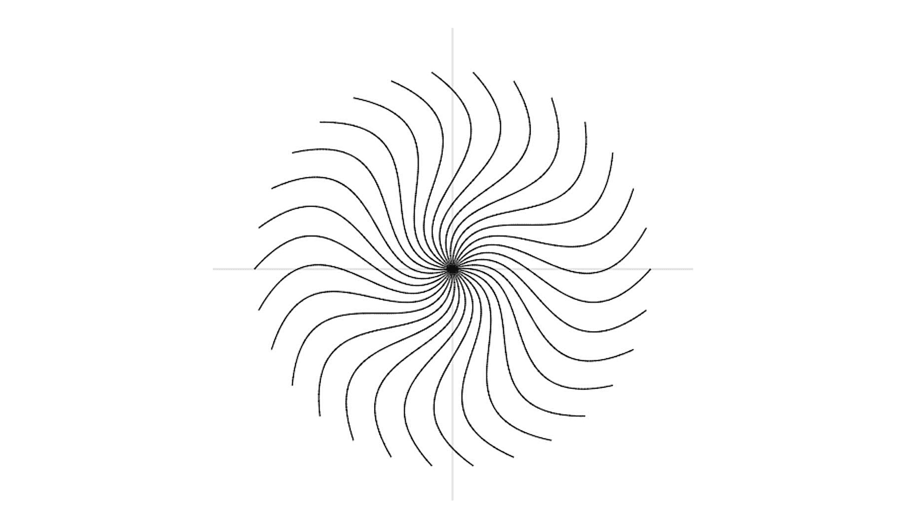

三阶贝塞尔曲线效果图

总的来说，贝塞尔曲线对于可视化，甚至整个计算机图形学都有着极其重要的意义。因为它能够针对一组确定的点，在其中构造平滑的曲线，这也让图形的实现有了更多的可能性。而且，贝塞尔曲线还可以用来构建 Catmull–Rom 曲线。Catmull–Rom 曲线也是一种常用的曲线，它可以平滑折线，我们在数据统计图表中经常会用到它。

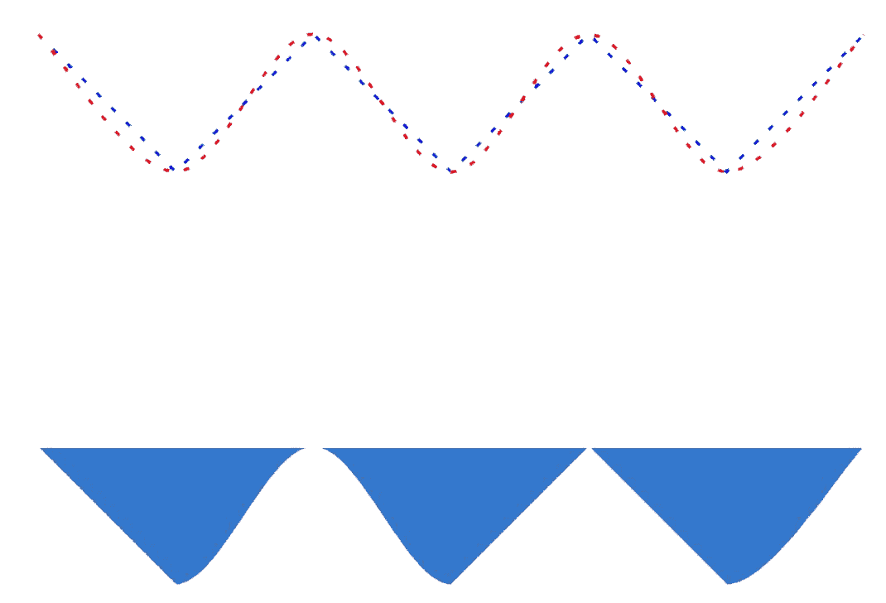

使用Catmull–Rom曲线绘制的折线、曲线和部分平滑折线

实际上 Canvas2D 和 SVG 都提供了直接绘制贝塞尔曲线的 API，比如在 Canvas2D 中，我们可以通过创建 Path2D 对象，使用 Path2D 支持的 SVGPath 指令添加贝塞尔曲线。即使如此，我们依然需要掌握贝塞尔曲线的基本原理。因为在 WebGL 这样的图形系统里，我们还是需要自己实现贝塞尔曲线的绘制，而且贝塞尔曲线除了绘制曲线之外，还有其他的用处，比如构建平滑的轨迹动画、属性插值等等。这些内容，我们也会在后续课程中会深入讨论。

## 要点总结

这一节课我们讨论了用曲线和参数方程描述曲线的方法。

用向量描述比较简单直接，先确定起始点和起始向量，然后通过旋转和向量加法来控制形状，就可以将曲线一段一段地绘制出来。但是它的缺点也很明显，就是数学上不太直观，需要复杂的换算才能精确确定图形的位置和大小。

使用参数方程能够避免向量绘制的缺点，因此是更常用的绘制方式。使用参数方程绘制曲线时，我们既可以使用有规律的曲线参数方程来绘制这些规则曲线，还可以使用二阶、三阶贝塞尔曲线来在起点和终点之间构造平滑曲线。

## 小试牛刀

1. Canvas2D 和 SVG 中都提供了画圆、椭圆、贝塞尔曲线的指令，你可以尝试直接使用这些指令来绘制圆、椭圆和贝塞尔曲线，然后比较一下使用这些指令和使用我们课程中讲过的方法有什么不同。
2. 除了圆和椭圆这些常见的参数方程，你还能自己创造出一些参数方程吗？如果可以，你可以使用 parametric.js 把它们绘制出来。
3. 我在课程中，画了两个最基础的贝塞尔曲线。你能试着修改 parametric.js 的代码，调整一下贝塞尔曲线控制点参数，画出更有趣的图形吗？

欢迎在留言区和我讨论，分享你的答案和思考，也欢迎你把这节课分享给你的朋友，我们下节课见！

## 源码

[1]绘制圆锥曲线完整代码.

[2]绘制其他曲线完整代码.

[3]绘制贝塞尔曲线完整代码.

## 推荐阅读

 Parametric.js
