# 08 | 如何利用三角剖分和向量操作描述并处理多边形？

 

你好，我是月影。

在图形系统中，我们最终看到的丰富多彩的图像，都是由多边形构成的。换句话说，不论是 2D 图形还是 3D 图形，经过投影变换后，在屏幕上输出的都是多边形。因此，理解多边形的基本性质，了解用数学语言描述并且处理多边形的方法，是我们在可视化中必须要掌握的内容。

那今天，我们就来说说，不同的图形系统是如何用数学语言描述并处理多边形。首先，我们来说说图形学中的多边形是什么。

## 图形学中的多边形是什么？

多边形可以定义为由三条或三条以上的线段首尾连接构成的平面图形，其中，每条线段的端点就是多边形的顶点，线段就是多边形的边。

多边形又可以分为**简单多边形**和**复杂多边形**。我们该怎么区分它们呢？如果一个多边形的每条边除了相邻的边以外，不和其他边相交，那它就是简单多边形，否则就是复杂多边形。一般来说，我们在绘图时，要尽量构建简单多边形，因为简单多边形的图形性质比较简单，绘制起来比较方便。

而简单多边形又分为凸多边形和凹多边形，我们主要是看简单多边形的内角来区分的。如果一个多边形中的每个内角都不超过 180°，那它就是凸多边形，否则就是凹多边形。

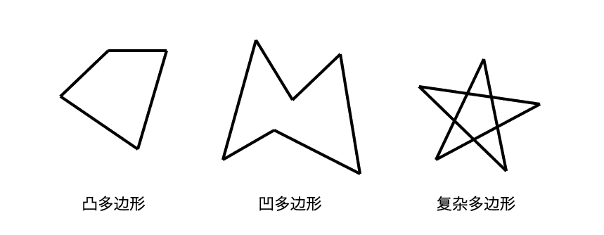

在图形系统中绘制多边形的时候，最常用的功能是填充多边形，也就是用一种颜色将多边形的内部填满。除此之外，在可视化中用户经常要用鼠标与多边形进行交互，这就要涉及多边形的边界判定。所以今天，我们就来重点讨论**多边形的填充和边界判定**。首先，我们来看多边形的填充。

## 不同的图形系统如何填充多边形？

不同的图形系统会用不同的方法来填充多边形。比如说，在 SVG 和 Canvas2D 中，就都内置了填充多边形的 API。在 SVG 中，我们可以直接给元素设置 fill 属性来填充，那在 Canvas2D 中，我们可以在绘图指令结束时调用 fill() 方法进行填充。而在 WebGL 中，我们是用三角形图元来快速填充的。由于 SVG 和 Canvas2D 中的填充方法类似，因此今天，我们就主要说说 Canvas2D 和 WebGL 是怎么填充多边形的。

### 1. Canvas2D 如何填充多边形？

我们先来说说 Canvas2D 填充多边形的具体方法，可以总结为五步。

第一步，构建多边形的顶点。这里我们直接构造 5 个顶点，代码如下：

```
const points = [new Vector2D(0, 100)];  
for(let i = 1; i <= 4; i++) {  
  const p = points[0].copy().rotate(i * Math.PI * 0.4);  
  points.push(p);  
}
```

第二步，绘制多边形。我们要用这 5 个顶点分别绘制正五边形和正五角星。显然前者是简单多边形，后者是复杂多边形。那在 Canvas 中，只需将顶点构造出来，我们就可以通过 API 绘制出多边形了。具体绘制代码如下：

```
const polygon = [  
  ...points,  
];  
  
// 绘制正五边形  
ctx.save();  
ctx.translate(-128, 0);  
draw(ctx, polygon);  
ctx.restore();  
  
const stars = [  
  points[0],  
  points[2],  
  points[4],  
  points[1],  
  points[3],  
];  
  
// 绘制正五角星  
ctx.save();  
ctx.translate(128, 0);  
draw(ctx, stars);  
ctx.restore();
```

如上面代码所示，我们用计算出的 5 个顶点创建 polygon 数组和 stars 数组。其中，polygon 数组是正五边形的顶点数组。stars 数组是我们把正五边形的顶点顺序交换之后，构成的五角星的顶点数组。

接着，我们将这些点传给 draw 函数，在 draw 函数中完成具体的绘制。在 draw 函数中绘制过程的时候，我们是调用 context.fill 来完成填充的。

这里，我要补充一点，不管是简单多边形还是复杂多边形，Canvas2D 的 fill 都能正常填充。并且，Canvas2D 的 fill 还支持两种填充规则。其中，默认的规则是“nonzero”，也就是说 不管有没有相交的边，只要是由边围起来的区域都一律填充。在下面的代码中，我们就是用“nonzero”规则来填充的。

```
function draw(context, points, {  
  fillStyle = 'black',  
  close = false,  
  rule = 'nonzero',  
} = {}) {  
  context.beginPath();  
  context.moveTo(...points[0]);  
  for(let i = 1; i < points.length; i++) {  
    context.lineTo(...points[i]);  
  }  
  if(close) context.closePath();  
  context.fillStyle = fillStyle;  
  context.fill(rule);  
}
```

我们最终绘制出的效果如下图所示：

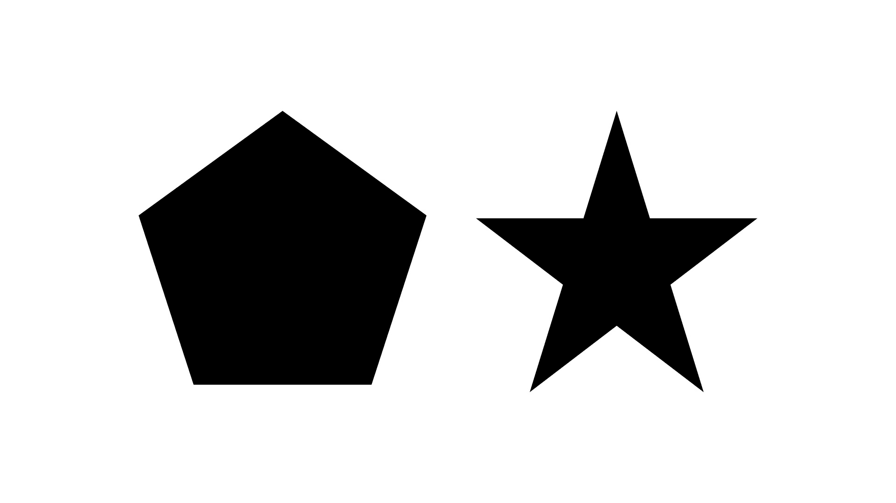

简单多边形a和b

除了“nonzero”，还有一种规则叫做“evenodd”，它是根据重叠区域是奇数还是偶数来判断是否填充的。那当我们增加了 draw 方法的参数，将五角星的填充规则改成“evenodd”之后，简单多边形没有变化，而复杂多边形由于绘制区域存在重叠，就出导致图形中心有了空洞的特殊效果。

```
draw(ctx, stars, {rule: 'evenodd'});
```

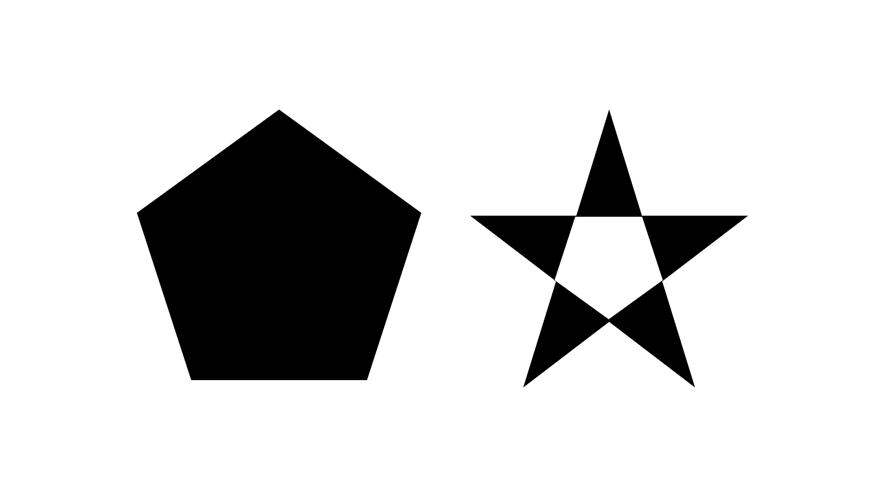

使用evenodd之后得到的填充图形a和b

总之，Canvas2D 的 fill 非常实用，它可以自动填充多边形内部的区域，并且对于任何多边形都能判定和填充，你可以自己去尝试一下。

### 2. WebGL 如何填充多边形？

在 WebGL 中，虽然没有提供自动填充多边形的方法，但是我们可以用三角形这种基本图元来快速地填充多边形。因此，在 WebGL 中填充多边形的第一步，就是将多边形分割成多个三角形。

这种将多边形分割成若干个三角形的操作，在图形学中叫做**三角剖分**（Triangulation）。

[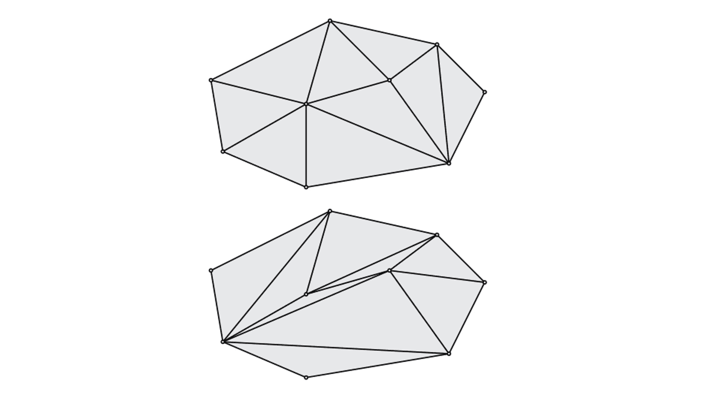](http://wikipedia.org)
同一个多边形的两种三角剖分方法

三角剖分是图形学和代数拓扑学中一个非常重要的基本操作，也有很多不同的实现算法。对简单多边形尤其是凸多边形的三角剖分比较简单，而复杂多边形由于有边的相交和面积重叠区域，所以相对困难许多。

那因为这些算法讲解起来比较复杂，还会涉及很多图形学的底层数学知识，你可能很难理解，所以我就不详细说三角剖分的具体算法了。如果你有兴趣学习，可以自己花一点时间去看一些参考资料。

这里，我们就直接利用 GitHub 上的一些成熟的库（常用的如Earcut、Tess2.js以及cdt2d），来对多边形进行三角剖分就可以了。具体怎么做呢？接下来，我们就以最简单的 Earcut 库为例，来说一说 WebGL 填充多边形的过程。

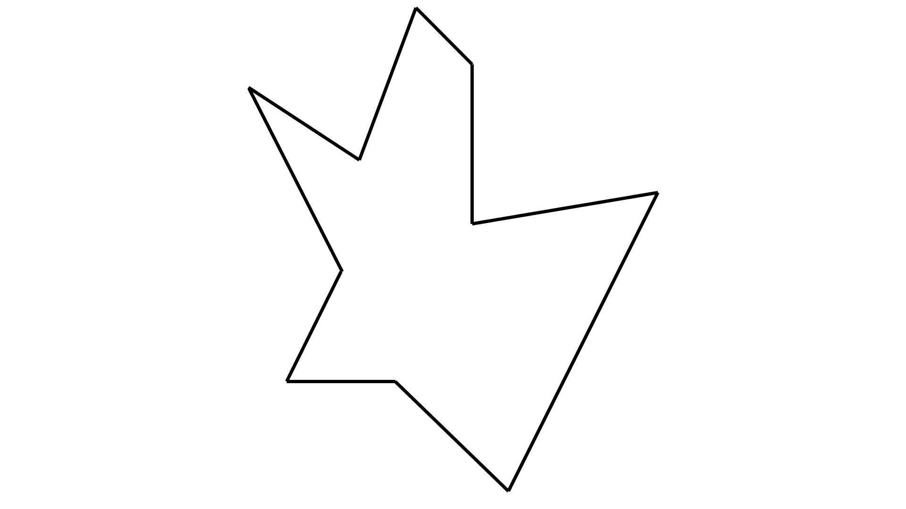

简单多边形c

假设，我们要填充一个如上图所示的不规则多边形，它的顶点数据如下：

```
const vertices = [  
  [-0.7, 0.5],  
  [-0.4, 0.3],  
  [-0.25, 0.71],  
  [-0.1, 0.56],  
  [-0.1, 0.13],  
  [0.4, 0.21],  
  [0, -0.6],  
  [-0.3, -0.3],  
  [-0.6, -0.3],  
  [-0.45, 0.0],  
];
```

首先，我们要对它进行三角剖分。使用 Earcut 库的操作很简单，我们直接调用它的 API 就可以完成对多边形的三角剖分，具体代码如下：

```
import {earcut} from '../common/lib/earcut.js';  
  
const points = vertices.flat();  
const triangles = earcut(points);
```

因为 Earcut 库只接受扁平化的定点数据，所以我们先用了数组的 flat 方法将顶点扁平化，然后将它传给 Earcut 进行三角剖分。这样返回的结果是一个数组，这个数组的值是顶点数据的 index，结果如下：

```
 [1, 0, 9, 9, 8, 7, 7, 6, 5, 4, 3, 2, 2, 1, 9, 9, 7, 5, 4, 2, 9, 9, 5, 4]
```

这里的值，比如 1 表示 vertices 中下标为 1 的顶点，即点 (-0.4, 0.3)，每三个值可以构成一个三角形，所以 1、0、9 表示由 (-0.4, 0.3)、(-0.7, 0.5) 和 (-0.45, 0.0) 构成的三角形。

然后，我们将顶点和 index 下标数据都输入到缓冲区，通过 gl.drawElements 方法就可以把图形显示出来。具体的代码如下：

```
const position = new Float32Array(points);  
const cells = new Uint16Array(triangles);  
  
  
const pointBuffer = gl.createBuffer();  
gl.bindBuffer(gl.ARRAY_BUFFER, pointBuffer);  
gl.bufferData(gl.ARRAY_BUFFER, position, gl.STATIC_DRAW);  
  
  
const vPosition = gl.getAttribLocation(program, 'position');  
gl.vertexAttribPointer(vPosition, 2, gl.FLOAT, false, 0, 0);  
gl.enableVertexAttribArray(vPosition);  
  
  
const cellsBuffer = gl.createBuffer();  
gl.bindBuffer(gl.ELEMENT_ARRAY_BUFFER, cellsBuffer);  
gl.bufferData(gl.ELEMENT_ARRAY_BUFFER, cells, gl.STATIC_DRAW);  
  
  
gl.clear(gl.COLOR_BUFFER_BIT);  
gl.drawElements(gl.TRIANGLES, cells.length, gl.UNSIGNED_SHORT, 0);
```

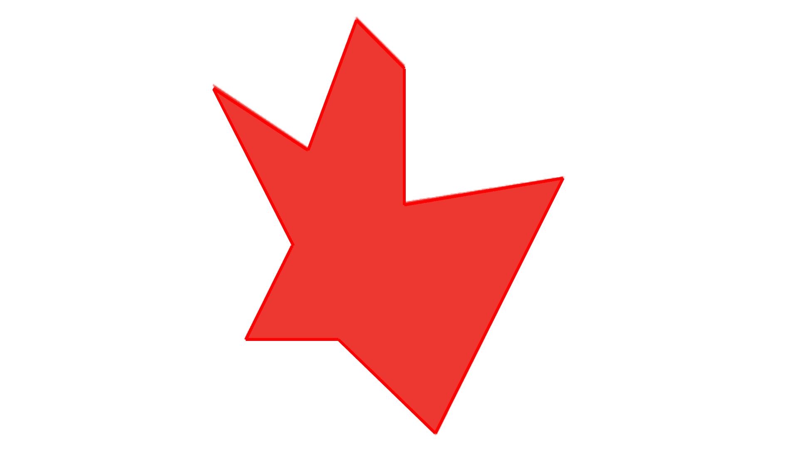

你会发现，通过上面的步骤，整个多边形都被 WebGL 渲染并填充为了红色。这么一看，好像三角剖分并没有什么作用。但实际上，WebGL 是对这个多边形三角剖分后的每个三角形分别进行填充的。为了让你看得更清楚，我们用描边代替填充，具体操作就是，修改一下 gl.drawElements 的渲染模式，将 gl.TRIANGLES 改成 gl.LINE_STRIP。这样，我们就可以清晰地看出，经过 Earcut 处理的这个多边形被分割成了 8 个三角形。

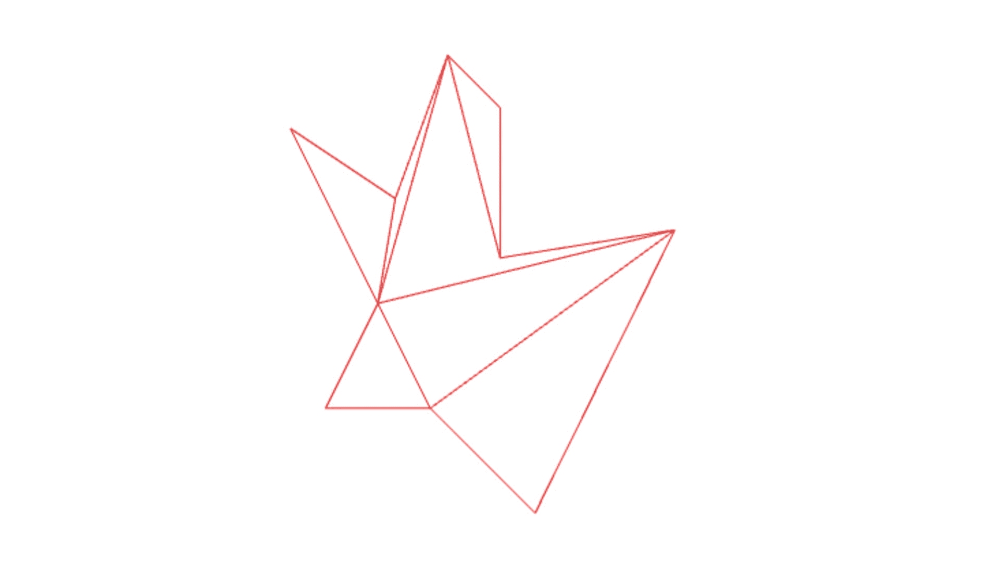

到这里，我们就讲完了 2D 图形的三角剖分。那针对 3D 模型，WebGL 在绘制的时候，也需要使用三角剖分，而 3D 的三角剖分又被称为**网格化**（Meshing）。

不过，因为 3D 模型比 2D 模型更加复杂，顶点的数量更多，所以针对复杂的 3D 模型，我们一般不在运行的时候进行三角剖分，而是通过设计工具把图形的三角剖分结果直接导出进行使用。也就是说，在 3D 渲染的时候，我们一般使用的模型数据都是已经经过三角剖分以后的顶点数据。

那如果必须要在可视化项目中实时创建一些几何体的时候，我们该怎么办呢？这部分内容，我们会在视觉篇详细来讲，不过在那之前呢，你也可以自己先想想。

总的来说，无论是绘制 2D 还是 3D 图形，WebGL 都需要先把它们进行三角剖分，然后才能绘制。因此，三角剖分是 WebGL 绘图的基础。

## 如何判断点在多边形内部？

接下来，我们通过一个简单的例子来说说多边形的交互。这个例子要实现的效果其实就是，当用户的鼠标移动到某一个图形上时，我们要让这个图形变色。在这个例子中，我们要解决的核心问题是：判定鼠标所在位置是否在多边形的内部。

那么问题来了，不同的图形系统都是如何判断点在多边形内部的呢？

在 SVG 这样的图形系统里，由于多边形本身就是一个元素节点，因此我们直接通过 DOM API 就可以判定鼠标是否在该元素上。而对于 Canvas2D，我们不能直接通过 DOM API 判定，而是要通过 Canvas2D 提供的 isPointInPath 方法来判定。所以下面，我们就以多边形 c 为例，来详细说说这个过程。

### 1. Canvas2D 如何判断点在多边形内部？

首先，我们先改用 Canvas2D 来绘制并填充这个多边形。

然后，我们在 canvas 上添加 mousemove 事件，在事件中计算鼠标相对于 canvas 的位置，再将这个位置传给 isPointInPath 方法，isPointInPath 方法就会自动判断这个位置是否位于图形内部。代码如下：

```
const {left, top} = canvas.getBoundingClientRect();  
  
canvas.addEventListener('mousemove', (evt) => {  
  const {x, y} = evt;  
  // 坐标转换  
  const offsetX = x - left;  
  const offsetY = y - top;  
  
  ctx.clearRect(-256, -256, 512, 512);  
  
  if(ctx.isPointInPath(offsetX, offsetY)) {  
    draw(ctx, poitions, 'transparent', 'green');  
  } else {  
    draw(ctx, poitions, 'transparent', 'red');  
  }  
});
```

最后，上面代码运行效果如下图：

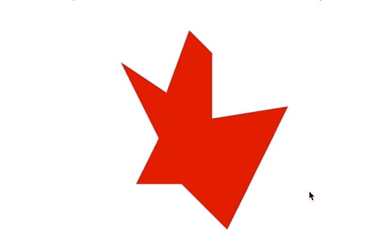

这个运行结果是没有问题的，但 isPointInPath 这个方法实际上并不好用。因为 isPointInPath 方法只能对当前绘制的图形生效。这是什么意思呢？我来举个例子。

假设，我们要在 Canvas 中绘制多边形 c 和小三角形。那我们先绘制多边形 c，再绘制小三角形。绘制代码如下：

```
draw(ctx, poitions, 'transparent', 'red');  
draw(ctx, [[100, 100], [100, 200], [150, 200]], 'transparent', 'blue');  
  
const {left, top} = canvas.getBoundingClientRect();  
  
canvas.addEventListener('mousemove', (evt) => {  
  const {x, y} = evt;  
  // 坐标转换  
  const offsetX = x - left;  
  const offsetY = y - top;  
    
  ctx.clearRect(-256, -256, 512, 512);  
    
  // 判断 offsetX、offsetY 的坐标是否在多边形内部  
  if(ctx.isPointInPath(offsetX, offsetY)) {  
    draw(ctx, poitions, 'transparent', 'green');  
    draw(ctx, [[100, 100], [100, 200], [150, 200]], 'transparent', 'orange');  
  } else {  
    draw(ctx, poitions, 'transparent', 'red');  
    draw(ctx, [[100, 100], [100, 200], [150, 200]], 'transparent', 'blue');  
  }  
});
```

这里，我们还通过 isPointInPath 方法判断点的位置，这样得到的结果如下图：

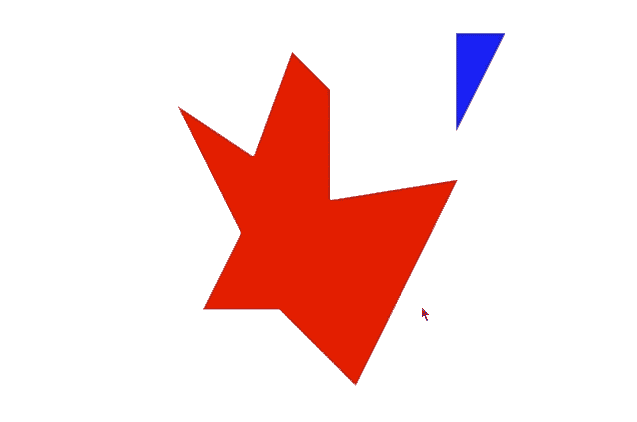

你会看到，当我们将鼠标移动到中间大图时，它的颜色并没有发生变化，只有移动到右上角的小三角形时，这两个图形才会同时变色。这就是因为，isPointInPath 仅能判断鼠标是否在最后一次绘制的小三角形内，所以大多边形就没有被识别出来。

要解决这个问题，一个最简单的办法就是，我们自己实现一个 isPointInPath 方法。然后在这个方法里，重新创建一个 Canvas 对象，并且再绘制一遍多边形 c 和小三角形。这个方法的核心，其实就是在绘制的过程中获取每个图形的 isPointInPath 结果。代码如下：

```
function isPointInPath(ctx, x, y) {  
  // 我们根据ctx重新clone一个新的canvas对象出来  
  const cloned = ctx.canvas.cloneNode().getContext('2d');  
  cloned.translate(0.5 * width, 0.5 * height);  
  cloned.scale(1, -1);  
  let ret = false;  
  // 绘制多边形c，然后判断点是否在图形内部  
  draw(cloned, poitions, 'transparent', 'red');  
  ret |= cloned.isPointInPath(x, y);  
  if(!ret) {  
    // 如果不在，在绘制小三角形，然后判断点是否在图形内部  
    draw(cloned, [[100, 100], [100, 200], [150, 200]], 'transparent', 'blue');  
    ret |= cloned.isPointInPath(x, y);  
  }  
  return ret;  
}
```

但是，这个方法并不通用。因为一旦我们修改了绘图过程，也就是增加或者减少了绘制的图形，isPointInPath 方法也要跟着改变。当然，我们也有办法进行优化，比如将每一个几何图形的绘制封装起来，针对每个图形提供单独的 isPointInPath 判断，但是这样也很麻烦，而且有很多无谓的 Canvas 绘图操作，性能会很差。

### 2. 实现通用的 isPointInPath 方法

那一个更好的办法是，我们不使用 Canvas 的 isPointInPath 方法，而是直接通过点与几何图形的数学关系来判断点是否在图形内。但是，直接判断一个点是不是在一个几何图形内还是比较困难的，因为这个几何图形可能是简单多边形，也可能是复杂多边形。

这个时候，我们完全可以把视线放在最简单的多边形，也就是三角形上。因为对于三角形来说，我们有一个非常简单的方法可以判断点是否在其中。

这个方法就是，已知一个三角形的三条边分别是向量 a、b、c，平面上一点 u 连接三角形三个顶点的向量分别为 u1、u2、u3，那么 u 点在三角形内部的充分必要条件是：u1 X a、u2 X b、u3 X c 的符号相同。

你也可以看我下面给出的示意图，当点 u 在三角形 a、b、c 内时，因为 u1到 a、u2到 b、u3到 c 的小角旋转方向是相同的（这里都为顺时针），所以 u1 X a、u2 X b、u3 X c 要么同正，要么同负。当点 v 在三角形外时，v1到 a 方向是顺时针，v2到 b 方向是逆时针，v3到 c 方向又是顺时针，所以它们叉乘的结果符号并不相同。

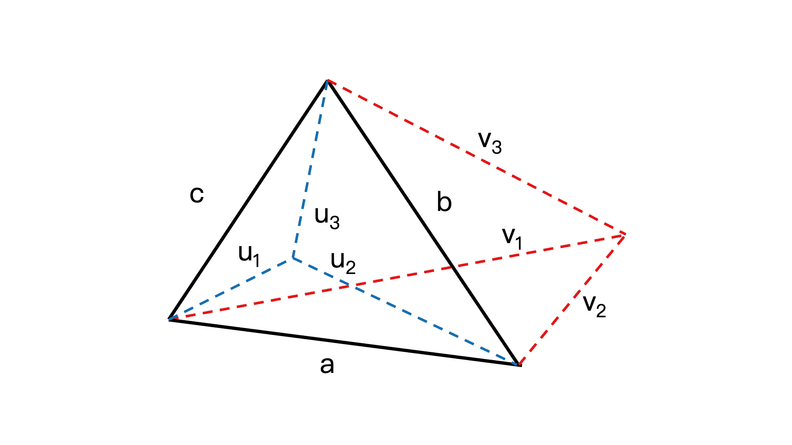

根据这个原理，我们就可以写一个简单的判定函数了，代码如下：

```
function inTriangle(p1, p2, p3, point) {  
  const a = p2.copy().sub(p1);  
  const b = p3.copy().sub(p2);  
  const c = p1.copy().sub(p3);  
  
  const u1 = point.copy().sub(p1);  
  const u2 = point.copy().sub(p2);  
  const u3 = point.copy().sub(p3);  
  
  const s1 = Math.sign(a.cross(u1));  
  const s2 = Math.sign(b.cross(u2));  
  const s3 = Math.sign(c.cross(u3));  
  
  return s1 === s2 && s2 === s3;  
}
```

你以为到这里就结束了吗？还没有。上面的代码还有个 Bug，它虽然可以判定点在三角形内部，但却不能判定点恰好在三角形某条边上的情况。这又该如何优化呢？

在学习了向量乘法之后，我们知道。如果一个点 u 在三角形的一条边 a 上，那就会需要满足以下 2 个条件：

1. a.cross(u1) === 0
2. 0 <= a.dot(u1) / a.length ** 2 <= 1

第一个条件很容易理解，我就不细说了，我们重点来看第二个条件。下面，我就分别讨论一下点 u 和 a 在一条直线上和不在一条直线上这两种情况。

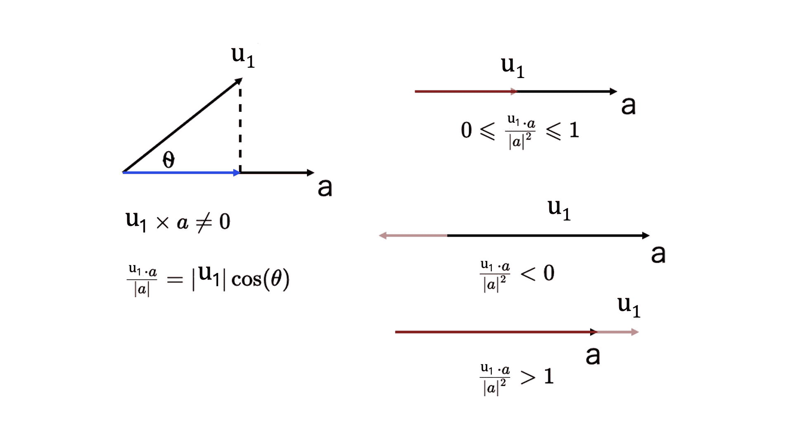

左图是点u和a不在一条直线上，右图是点u和a在一条直线上

当向量 u1与 a 不在一条直线上时，u1与 a 的叉乘结果不为 0，而 u1与 a 的点乘的值除以 a 的长度，相当于 u1在 a 上的投影。

当向量 u1与 a 在一条直线上时，u1与 a 的叉乘结果为 0，u1与 a 的点乘结果除以 a 的长度的平方，正好是 u1与 a 的比值。

u1与 a 的比值也有三种情况：当 u1在 a 上时，u1和 a 比值是介于 0 到 1 之间的；当 u1在 a 的左边时，这个比值是小于 0 的；当 u1 在 a 的右边时，这个比值是大于 1 的。

因此，只有当 u1 和 a 的比值在 0 到 1 之间时，才能说明点在三角形的边上。

好了，那接下来，我们可以根据得到的结果修改一下代码。我们最终的判断逻辑如下：

```
function inTriangle(p1, p2, p3, point) {  
  const a = p2.copy().sub(p1);  
  const b = p3.copy().sub(p2);  
  const c = p1.copy().sub(p3);  
  
  const u1 = point.copy().sub(p1);  
  const u2 = point.copy().sub(p2);  
  const u3 = point.copy().sub(p3);  
  
  const s1 = Math.sign(a.cross(u1));  
  let p = a.dot(u1) / a.length ** 2;  
  if(s1 === 0 && p >= 0 && p <= 1) return true;  
  
  const s2 = Math.sign(b.cross(u2));  
  p = b.dot(u1) / b.length ** 2;  
  if(s2 === 0 && p >= 0 && p <= 1) return true;  
  
  const s3 = Math.sign(c.cross(u3));  
  p = c.dot(u1) / c.length ** 2;  
  if(s3 === 0 && p >= 0 && p <= 1) return true;  
  
  return s1 === s2 && s2 === s3;  
}
```

这样我们就判断了一个点是否在某个三角形内部。那如果要判断一个点是否在任意多边形的内部，我们只需要在判断之前将它进行三角剖分就可以了。代码如下：

```
function isPointInPath({vertices, cells}, point) {  
  let ret = false;  
  for(let i = 0; i < cells.length; i += 3) {  
    const p1 = new Vector2D(...vertices[cells[i]]);  
    const p2 = new Vector2D(...vertices[cells[i + 1]]);  
    const p3 = new Vector2D(...vertices[cells[i + 2]]);  
    if(inTriangle(p1, p2, p3, point)) {  
      ret = true;  
      break;  
    }  
  }  
  return ret;  
}

## 要点总结

本节课，我们学习了使用三角剖分来填充多边形以及判断点是否在多边形内部。
```

不同的图形系统有着不同的处理方法，Canvas2D 的处理很简单，它可以使用原生的 fill 来填充任意多边形，使用 isPointInPath 来判断点是否在多边形内部。但是，三角剖分是更加通用的方式，WebGL 就是使用三角剖分来处理多边形的，所以我们要牢记它的操作。

首先，在使用三角剖分填充多边形时，我们直接调用一些成熟库的 API 就可以完成，这并不难。而当我们要实现图形和用户的交互时，也就是要判断一个点是否在多边形内部时，也需要先对多边形进行三角剖分，然后判断该点是否在其中一个三角形内部。

## 小试牛刀

1. 在课程中，我们使用了 Earcut 对多边形进行三角剖分。但是 tess2.js 是一个比 Earcut 更强大的三角剖分库，使用 tess2.js 可以像原生的 Canvas2D 的 fill 方法那样，实现 evenodd 的填充规则。你能试着把代码中的 earcut 换成 tess2.js，从而实现 evenodd 填充规则吗？动手之前，你可以先去读一下 tess2.js 的项目文档。
2. 今天我们用三角剖分实现了不规则多边形。那你能试着利用三角剖分的原理，通过 WebGL 画出椭圆图案、菱形的星星图案（✦），以及正五角星吗？

欢迎在留言区和我讨论，分享你的答案和思考，也欢迎你把这节课分享给你的朋友，我们下节课见！

## 源码

使用三角剖分填充多边形、判断点在多边形内部的完整代码

## 推荐阅读

 tess2.js 官方文档
