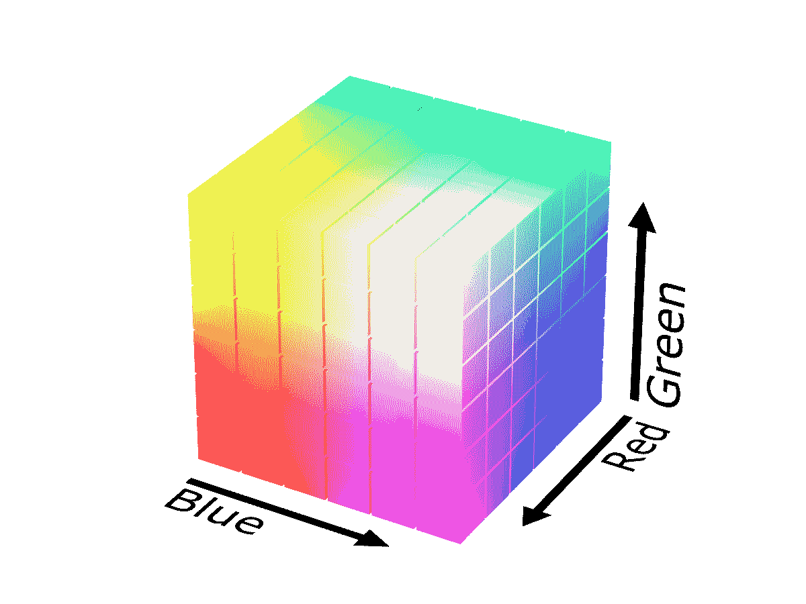
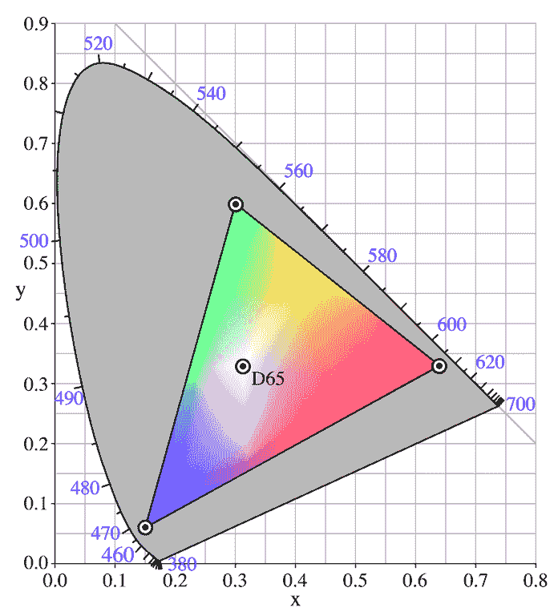
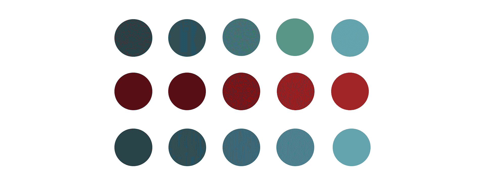
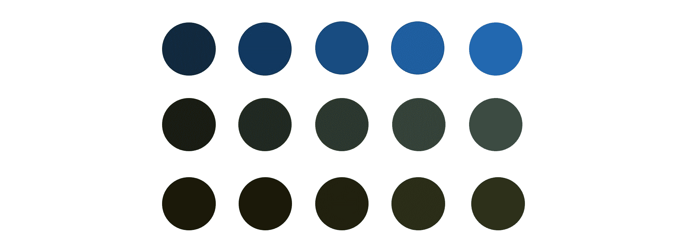
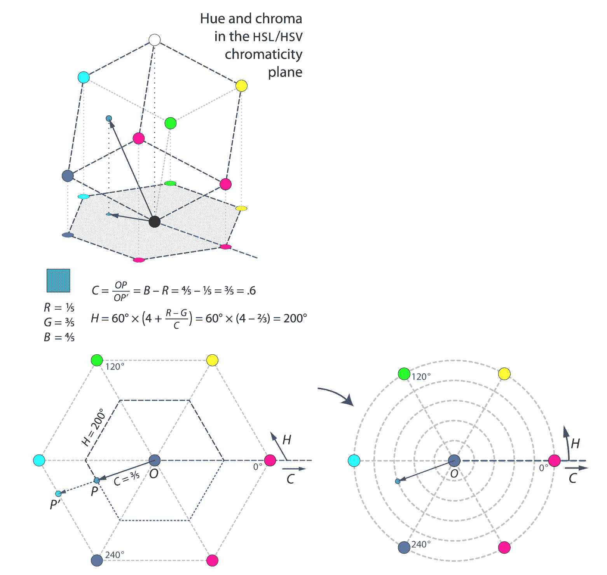
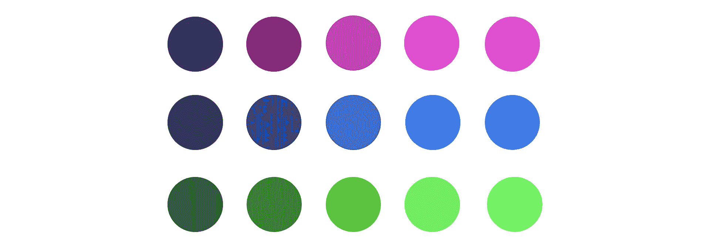
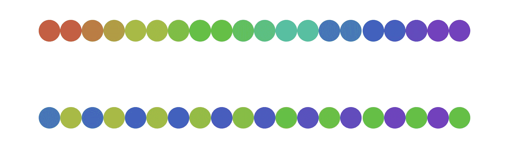
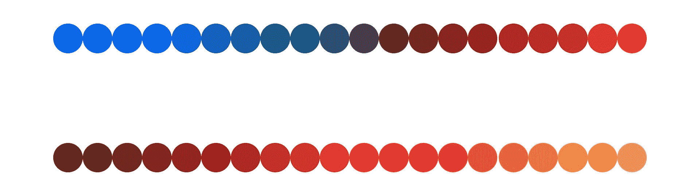
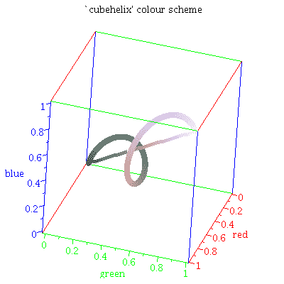

# 10 | 图形系统如何表示颜色？

 

你好，我是月影。从这一节课开始，我们进入一个全新的模块，开始学习视觉基础。

在可视化领域中，图形的形状和颜色信息非常重要，它们都可以用来表达数据。我们利用基本的数学方法可以绘制出各种各样的图形，通过仿射变换还能改变图形的形状、大小和位置。但关于图形的颜色，虽然在前面的课程中，我们也使用片元着色器给图形设置了不同的颜色，可这只是颜色的基本用法，Web 图形系统对颜色的支持是非常强大的。

所以这一节课，我们就来系统地学习一下，Web 图形系统中表示颜色的基本方法。我会讲四种基本的颜色表示法，分别是 RGB 和 RGBA 颜色表示法、HSL 和 HSV 颜色表示法、CIE Lab 和 CIE Lch 颜色表示法以及 Cubehelix 色盘。

不过，因为颜色表示实际上是一门非常复杂的学问，与我们自己的视觉感知以及心理学都有很大的关系，所以这节课我只会重点讲解它们的应用，不会去细说其中复杂的算法实现和规则细节。但我也会在课后给出一些拓展阅读的链接，如果你有兴趣，可以利用它们深入来学。

## RGB 和 RGBA 颜色

作为前端工程师，你一定对 RGB 和 RGBA 颜色比较熟悉。在 Web 开发中，我们首选的颜色表示法就是 RGB 和 RGBA。那我们就先来说说它的应用。

### 1. RGB 和 RGBA 的颜色表示法

我们在 CSS 样式中看到的形式如 #RRGGBB 的颜色代码，就是 RGB 颜色的十六进制表示法，其中 RR、GG、BB 分别是两位十六进制数字，表示红、绿、蓝三色通道的**色阶**。色阶可以表示某个通道的强弱。

因为 RGB(A) 颜色用两位十六进制数来表示每一个通道的色阶，所以每个通道一共有 256 阶，取值是 0 到 255。RGB 的三个通道色阶的组合，理论上一共能表示 224 也就是一共 16777216 种不同的颜色。因此，RGB 颜色是将人眼可见的颜色表示为**红、绿、蓝**三原色不同色阶的混合。我们可以用一个三维立方体，把 RGB 能表示的所有颜色形象地描述出来。效果如下图：



RGB的所有颜色

那 RGB 能表示人眼所能见到的所有颜色吗？事实上，RGB 色值只能表示这其中的一个区域。如下图所示，灰色区域是人眼所能见到的全部颜色，中间的三角形是 RGB 能表示的所有颜色，你可以明显地看出它们的对比。



人眼看到的颜色vsRGB能表示的颜色

尽管 RGB 色值不能表示人眼可见的全部颜色，但它可以 表示的颜色也已经足够丰富了。一般的显示器、彩色打印机、扫描仪等都支持它。

在浏览器中，CSS 一般有两种表示 RGB 颜色值的方式：一种是我们前面说的 #RRGGBB 表示方式，另一种是直接用 rgb(red, green, blue) 表示颜色，这里的“red、green、blue”是十进制数值。RGB 颜色值的表示方式，你应该比较熟悉，我就不多说了。

好，理解了 RGB 之后，我们就很容易理解 RGBA 了。它其实就是在 RGB 的基础上增加了一个 Alpha 通道，也就是透明度。一些新版本的浏览器，可以用 #RRGGBBAA 的形式来表示 RGBA 色值，但是较早期的浏览器，只支持 rgba(red, green, blue, alpha) 这种形式来表示色值（注意：这里的 alpha 是一个从 0 到 1 的数）。所以，在实际使用的时候，我们要注意这一点。

WebGL 的 shader 默认支持 RGBA。因为在 WebGL 的 shader 中，我们是使用一个四维向量来表示颜色的，向量的 r、g、b、a 分量分别表示红色、绿色、蓝色和 alpha 通道。不过和 CSS 的颜色表示稍有不同的是，WebGL 采用归一化的浮点数值，也就是说，WebGL 的颜色分量 r、g、b、a 的数值都是 0 到 1 之间的浮点数。

### 2. RGB 颜色表示法的局限性

RGB 和 RGBA 的颜色表示法非常简单，但使用起来也有局限性（因为 RGB 和 RGBA 本质上其实非常相似，只不过后者比前者多了一个透明度通道。方便起见，我们后面就用 RGB 来代表 RGB 和 RGBA 了）。

因为对一个 RGB 颜色来说，我们只能大致直观地判断出它偏向于红色、绿色还是蓝色，或者在颜色立方体的大致位置。所以，在对比两个 RGB 颜色的时候，我们只能通过对比它们在 RGB 立方体中的相对距离，来判断它们的颜色差异。除此之外，我们几乎就得不到其他任何有用的信息了。

也就是说，**当要选择一组颜色给图表使用时，我们并不知道要以什么样的规则来配置颜色，才能让不同数据对应的图形之间的对比尽可能鲜明**。因此，RGB 颜色对用户其实并不友好。

这么说可能还是比较抽象，我们来看一个简单的例子。这里，我们在画布上显示 3 组颜色不同的圆，每组各 5 个，用来表示重要程度不同的信息。现在我们给这些圆以随机的 RGB 颜色，代码如下：

```
import {Vec3} from '../common/lib/math/vec3.js';  
const canvas = document.querySelector('canvas');  
const ctx = canvas.getContext('2d');  
  
function randomRGB() {  
  return new Vec3(  
    0.5 * Math.random(),  
    0.5 * Math.random(),  
    0.5 * Math.random(),  
  );  
}  
  
ctx.translate(256, 256);  
ctx.scale(1, -1);  
  
for(let i = 0; i < 3; i++) {  
  const colorVector = randomRGB();  
  for(let j = 0; j < 5; j++) {  
    const c = colorVector.clone().scale(0.5 + 0.25 * j);  
    ctx.fillStyle = `rgb(${Math.floor(c[0] * 256)}, ${Math.floor(c[1] * 256)}, ${Math.floor(c[2] * 256)})`;  
    ctx.beginPath();  
    ctx.arc((j - 2) * 60, (i - 1) * 60, 20, 0, Math.PI * 2);  
    ctx.fill();  
  }  
}
```

通过执行上面的代码，我们生成随机的三维向量，然后将它转成 RGB 颜色。为了保证对比，我们在每一组的 5 个圆中，依次用 0.5、0.75、1.0、1.25 和 1.5 的比率乘上我们随机生成的 RGB 数值。这样，一组圆就能呈现不同的亮度了。总体上颜色是越左边的越暗，越右边的越亮。得到的效果如下：



但是，这么做有两个缺点：首先，因为这个例子里的 RGB 颜色是随机产生的，所以行与行之间的颜色差别可能很大，也可能很小，我们无法保证具体的颜色差别大小；其次，因为无法控制随机生成的颜色本身的亮度，所以这样生成的一组圆的颜色有可能都很亮或者都很暗。比如，下图中另一组随机生成的圆，除了第一行外，后面两行的颜色都很暗，区分度太差。



因此，在需要**动态构建视觉颜色效果**的时候，我们很少直接选用 RGB 色值，而是使用其他的颜色表示形式。这其中，比较常用的就是 HSL 和 HSV 颜色表示形式。

## HSL 和 HSV 颜色

与 RGB 颜色以色阶表示颜色不同，HSL 和 HSV 用色相（Hue）、饱和度（Saturation）和亮度（Lightness）或明度（Value）来表示颜色。其中，Hue 是角度，取值范围是 0 到 360 度，饱和度和亮度 / 明度的值都是从 0 到 100%。

虽然 HSL 和 HSV 在表示方法上有一些区别，但它们能达到的效果比较接近。所以就目前来说，我们并不需要深入理解它们之间的区别，只要学会 HSL 和 HSV 通用的颜色表示方法就可以了。

### 1. HSL 和 HSV 的颜色表示方法

HSL 和 HSV 是怎么表示颜色的呢？实际上，我们可以把 HSL 和 HSV 颜色理解为，是将 RGB 颜色的立方体从直角坐标系投影到极坐标的圆柱上，所以它的色值和 RGB 色值是一一对应的。



HSL和HSV的产生原理

从上图中，你可以发现，它们之间色值的互转算法比较复杂。不过好在，CSS 和 Canvas2D 都可以直接支持 HSL 颜色，只有 WebGL 需要做转换。所以，如果你有兴趣深入了解这个转换算法，可以去看一下我课后给出的推荐阅读。那在这里，你只需要记住我下面给出的这一段 RGB 和 HSV 的转换代码就可以了，后续课程中我们会用到它。

```
vec3 rgb2hsv(vec3 c){  
  vec4 K = vec4(0.0, -1.0 / 3.0, 2.0 / 3.0, -1.0);  
  vec4 p = mix(vec4(c.bg, K.wz), vec4(c.gb, K.xy), step(c.b, c.g));  
  vec4 q = mix(vec4(p.xyw, c.r), vec4(c.r, p.yzx), step(p.x, c.r));  
  float d = q.x - min(q.w, q.y);  
  float e = 1.0e-10;  
  return vec3(abs(q.z + (q.w - q.y) / (6.0 * d + e)), d / (q.x + e), q.x);  
}  
  
vec3 hsv2rgb(vec3 c){  
  vec3 rgb = clamp(abs(mod(c.x*6.0+vec3(0.0,4.0,2.0), 6.0)-3.0)-1.0, 0.0, 1.0);  
  rgb = rgb * rgb * (3.0 - 2.0 * rgb);  
  return c.z * mix(vec3(1.0), rgb, c.y);  
}
```

好，记住了转换代码之后。下面，我们直接用 HSL 颜色改写前面绘制三排圆的例子。这里，我们只要把代码稍微做一些调整。

```
function randomColor() {  
  return new Vec3(  
    0.5 * Math.random(), // 初始色相随机取0~0.5之间的值  
    0.7,  // 初始饱和度0.7  
    0.45,  // 初始亮度0.45  
  );  
}  
  
ctx.translate(256, 256);  
ctx.scale(1, -1);  
  
const [h, s, l] = randomColor();  
for(let i = 0; i < 3; i++) {  
  const p = (i * 0.25 + h) % 1;  
  for(let j = 0; j < 5; j++) {  
    const d = j - 2;  
    ctx.fillStyle = `hsl(${Math.floor(p * 360)}, ${Math.floor((0.15 * d + s) * 100)}%, ${Math.floor((0.12 * d + l) * 100)}%)`;  
    ctx.beginPath();  
    ctx.arc((j - 2) * 60, (i - 1) * 60, 20, 0, Math.PI * 2);  
    ctx.fill();  
  }  
}
```

如上面代码所示，我们生成随机的 HSL 颜色，主要是随机色相 H，然后我们将 H 值的角度拉开，就能保证三组圆彼此之间的颜色差异比较大。

接着，我们增大每一列圆的饱和度和亮度，这样每一行圆的亮度和饱和度就都不同了。但要注意的是，我们要同时增大亮度和饱和度。因为根据 HSL 的规则，亮度越高，颜色越接近白色，只有同时提升饱和度，才能确保圆的颜色不会太浅。



### 2. HSL 和 HSV 的局限性

不过，从上面的例子中你也可以看出来，即使我们可以均匀地修改每组颜色的亮度和饱和度，但这样修改之后，有的颜色看起来和其他的颜色差距明显，有的颜色还是没那么明显。这是为什么呢？这里我先卖个关子，我们先来做一个简单的实验。

```
for(let i = 0; i < 20; i++) {  
  ctx.fillStyle = `hsl(${Math.floor(i * 15)}, 50%, 50%)`;  
  ctx.beginPath();  
  ctx.arc((i - 10) * 20, 60, 10, 0, Math.PI * 2);  
  ctx.fill();  
}  
  
for(let i = 0; i < 20; i++) {  
  ctx.fillStyle = `hsl(${Math.floor((i % 2 ? 60 : 210) + 3 * i)}, 50%, 50%)`;  
  ctx.beginPath();  
  ctx.arc((i - 10) * 20, -60, 10, 0, Math.PI * 2);  
  ctx.fill();  
}
```

如上面代码所示，我们绘制两排不同的圆，让第一排每个圆的色相间隔都是 15，再让第二排圆的颜色在色相 60 和 210 附近两两交错。然后，我们让这两排圆的饱和度和亮度都是 50%，最终生成的效果如下：



先看第一排圆你会发现，虽然它们的色相相差都是 15，但是相互之间颜色变化并不是均匀的，尤其是中间几个绿色圆的颜色比较接近。接着我们再看第二排圆，虽然这些圆的亮度都是 50%，但是蓝色和紫色的圆看起来就是不如偏绿偏黄的圆亮。这都是由于人眼对不同频率的光的敏感度不同造成的。

因此，HSL 依然不是最完美的颜色方法，我们还需要建立一套针对人类知觉的标准，这个标准在描述颜色的时候要尽可能地满足以下 2 个原则：

1. 人眼看到的色差 = 颜色向量间的欧氏距离
2. 相同的亮度，能让人感觉亮度相同

于是，一个针对人类感觉的颜色描述方式就产生了，它就是 CIE Lab。

## CIE Lab 和 CIE Lch 颜色

CIE Lab 颜色空间简称 Lab，它其实就是一种符合人类感觉的色彩空间，它用 L 表示亮度，a 和 b 表示颜色对立度。RGB 值也可以 Lab 转换，但是转换规则比较复杂，你可以通过wikepadia.org来进一步了解它的基本原理。

CIE Lab 比较特殊的一点是，目前还没有能支持 CIE Lab 的图形系统，但是css-color level4规范已经给出了 Lab 颜色值的定义。

```
lab() = lab( <percentage> <number> <number> [ / <alpha-value> ]? )
```

而且，一些 JavaScript 库也已经可以直接处理 Lab 颜色空间了，如d3-color。下面，我们通过一个代码例子来详细讲讲，d3.lab 是怎么处理 Lab 颜色的。如下面代码所示，我们使用 d3.lab 来定义 Lab 色彩。这个例子与 HSL 的例子一样，也是显示两排圆形。这里，我们让第一排相邻圆形之间的 lab 色值的欧氏空间距离相同，第二排相邻圆形之间的亮度按 5 阶的方式递增。

```
/* global d3 */  
for(let i = 0; i < 20; i++) {  
  const c = d3.lab(30, i * 15 - 150, i * 15 - 150).rgb();  
  ctx.fillStyle = `rgb(${c.r}, ${c.g}, ${c.b})`;  
  ctx.beginPath();  
  ctx.arc((i - 10) * 20, 60, 10, 0, Math.PI * 2);  
  ctx.fill();  
}  
  
for(let i = 0; i < 20; i++) {  
  const c = d3.lab(i * 5, 80, 80).rgb();  
  ctx.fillStyle = `rgb(${c.r}, ${c.g}, ${c.b})`;  
  ctx.beginPath();  
  ctx.arc((i - 10) * 20, -60, 10, 0, Math.PI * 2);  
  ctx.fill();  
}
```

代码最终的运行效果如下：



你会发现，在以 CIELab 方式呈现的色彩变化中，我们设置的数值和人眼感知的一致性比较强。

而 CIE Lch 和 CIE Lab 的对应方式类似于 RGB 和 HSL 和 HSV 的对应方式，也是将坐标从立方体的直角坐标系变换为圆柱体的极坐标系，这里就不再多说了。CIE Lch 和 CIE Lab 表示颜色的技术还比较新，所以目前我们也不会接触很多，但是因为它能呈现的色彩更贴近人眼的感知，所以我相信它会发展得很快。作为技术人，这些新技术，我们也要持续关注。

## Cubehelix 色盘

最后，我们再来说一种特殊的颜色表示法，Cubehelix 色盘（立方螺旋色盘）。简单来说，它的原理就是在 RGB 的立方中构建一段螺旋线，让色相随着亮度增加螺旋变换。如下图所示：



Cubehelix色盘的原理

我们还是直接来看它的应用。接下来，我会直接用 NPM 上的cubehelix模块写一个颜色随着长度变化的柱状图，你可以通过它来看看 Cubehelix 是怎么应用的。效果如下：


它的实现代码也非常简单，我来简单说一下思路。

首先，我们直接使用 cubehelix 函数创建一个 color 映射。cubehelix 函数是一个高阶函数，它的返回值是一个色盘映射函数。这个返回函数的参数范围是 0 到 1，当它从小到大依次改变的时候，不仅颜色会依次改变，亮度也会依次增强。然后，我们用正弦函数来模拟数据的周期性变化，通过 color§获取当前的颜色值，再把颜色值赋给 ctx.fillStyle，颜色就能显示出来了。最后，我们用 rect 将柱状图画出来，用 requestAnimationFrame 实现动画就可以了 。

```
import {cubehelix} from 'cubehelix';  
  
const canvas = document.querySelector('canvas');  
const ctx = canvas.getContext('2d');  
  
ctx.translate(0, 256);  
ctx.scale(1, -1);  
  
const color = cubehelix(); // 构造cubehelix色盘颜色映射函数  
const T = 2000;  
  
function update(t) {  
  const p = 0.5 + 0.5 * Math.sin(t / T);  
  ctx.clearRect(0, -256, 512, 512);  
  const {r, g, b} = color(p);  
  ctx.fillStyle = `rgb(${255 * r},${255 * g},${255 * b})`;  
  ctx.beginPath();  
  ctx.rect(20, -20, 480 * p, 40);  
  ctx.fill();  
  window.ctx = ctx;  
  requestAnimationFrame(update);  
}  
  
update(0);
```

到这里，我们关于颜色表示的讨论就告一段落了。这 4 种颜色方式的具体应用你应该已经掌握了，那我再来说说在实际工作中，它们的具体使用场景，这样你就能记得更深刻了。

在可视化应用里，一般有两种使用颜色的方式：第一种，整个项目的 UI 配色全部由 UI 设计师设计好，提供给可视化工程师使用。那在这种情况下，设计师设计的颜色是多少就是多少，开发者使用任何格式的颜色都行。第二种方式就是根据数据情况由前端动态地生成颜色值。当然不会是整个项目都由开发者完全自由选择，而一般是由设计师定下视觉基调和一些主色，开发者根据主色和数据来生成对应的颜色。

在一般的图表呈现项目中，第一种方式使用较多。而在一些数据比较复杂的项目中，我们经常会使用第二种方式。尤其是当我们希望连续变化的数据能够呈现连续的颜色变换时，设计师就很难用预先指定的有限的颜色来表达了。这时候，我们就需要使用其他的方式，比如，HLS、CIELab 或者 Cubehelix 色盘，我们会把它们结合数据变量来动态生成颜色值。

## 要点总结

这一节课，我们系统地学习了 Web 图形系统表示颜色的方法。它们可以分为 2 大类，分别是 RGB、HSL 和 HSV、CIELab 和 CIELch 等颜色空间的表示方法，以及 Cubehelix 色盘的表示方法。

首先，RGB 用三原色的色阶来表示颜色，是最基础的颜色表示法，但是它对用户不够友好。而 HSL 和 HSV 是用色相、饱和度、亮度（明度）来表示颜色，对开发者比较友好，但是它的数值变换与人眼感知并不完全相符。

CIELab 和 CIELch 与 Cubehelix 色盘，这两种颜色表示法还比较新，在实际工作中使用得不是很多。其中，CIELab 和 CIELch 是与人眼感知相符的色彩空间表示法，已经被纳入 css-color level4 规范中。虽然还没有被浏览器支持，但是一些如 d3-color 这样的 JavaScript 库可以直接处理 Lab 颜色空间。而如果我们要呈现颜色随数据动态改变的效果，那 Cubehelix 色盘就是一种非常更合适的选择了。

最后，我还想再啰嗦几句。在可视化中，我们会使用图形的大小、高低、宽窄、颜色和形状这些常见信息来反映数据。一般来说，我们会使用一种叫做二维强化的技巧，来叠加两个维度的信息，从而加强可视化的视觉呈现效果。

比如，柱状图的高低表示了数据的多少，但是如果这个数据非常重要，那么我们在给柱状图设置不同高低的同时，再加上颜色的变化，就能让这个柱状图更具视觉冲击力。这也是我们必须要学会熟练运用颜色的原因。

所以，颜色的使用在可视化呈现中非常重要，在之后的课程中，我们还会继续深入探讨颜色的用法。

## 小试牛刀

我在课程中给出了 hsv 和 rgb 互转的 glsl 代码。你能尝试用 WebGL 画两个圆，让它们的角度对应具体的 HUE 色相值，让其中一个圆的半径对应饱和度 S，另一个圆的半径对应明度 V，将 HSV 色盘绘制出来吗？

欢迎在留言区和我讨论，分享你的答案和思考，也欢迎你把这节课分享给你的朋友，我们下节课见！

## 源码

 本节课示例代码完整版

## 推荐阅读

颜色也是可视化非常重要的内容，所以这节课的知识点比较多，参考资料也很多。如果你有兴趣深入研究，我建议你一定要认真看看我给的这些资料。

[1] CSS Color Module Level 4

[2] RGB color model

[3] HSL 和 HSV 色彩空间

[4] 色彩空间中的 HSL、HSV、HSB 的区别

[5] 用 JavaScript 实现 RGB-HSL-HSB 相互转换的方法

[6] Lab 色彩空间维基百科

[7] Cubehelix 颜色表算法

[8] Dave Green’s `cubehelix’ colour scheme

[9] d3-color 官方文档
