# 11｜图案生成：如何生成重复图案、分形图案以及随机效果？

 

你好，我是月影。

图案生成是可视化中非常重要的基础。有多重要呢？我们知道，可视化中的几何图形是用来表达数据的，那图案就是用来修饰这些几何图形，强化视觉效果的，所以图案一般是指几何图形上的花纹。这些花纹有的简单，有的复杂，有的规律明显，有的看上去比较随机。也正是因为图案可以如此的不同，它们才能更好地增强视觉效果。

这一节课，我们就来聊一聊图案生成的基本原理和方法论。不过，因为可视化中的图案非常多，所以今天我们主要来讲三种最常用的，分别是重复图案、分形图案和随机图案。

首先，我们来看重复图案。

## 如何绘制大批量重复图案

在可视化应用中，我们经常会使用重复图案。比如说，我们在显示图表的时候，经常会给背景加上一层网格，这样可以辅助用户阅读和理解图表数据。

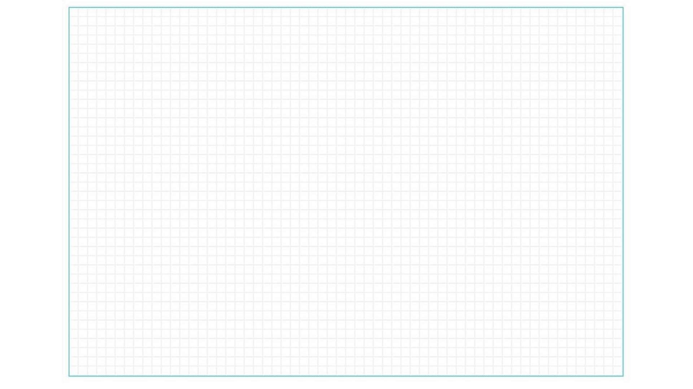

带有网格背景的画布

那像网格这样经典的重复图案，我们应该怎样绘制它呢？这些网格看起来像是由一条一条线段组成的，是不是利用绘制线段的方式，比如我们之前学过的 Canvas2D 的绘图指令来绘制就可以了？如果你是这么想的，就把问题想得太简单了。

举个例子，如果我们将网格绘制在 Canvas2D 画布上，那网格的线条就会很多，这也就意味着我们要用大量的绘图指令来绘制。这个时候，一旦 Canvas2D 的画面改变了，我们就需要重绘全部的网格，这会大大消耗系统的性能。而且，如果将大量的时间都浪费在绘制这种重复图案上，那我们实现的代码性能可能就会很差。

那我们该怎么办呢？你可能会想到准备两个 Canvas2D 画布，一个用来绘制网格，另一个用来绘制其他会变化的图形。能想到这个办法还是不错的，说明你动了脑筋，它确实解决了图案重绘的问题。不过，我们第一次绘图的开销仍然存在。因此，我们的解决思路不能局限在使用 Canvas2D 的绘图指令上。

### 1. 使用 background-image 来绘制重复图案

我们有更巧妙的办法来“绘制”这种网格图案，那就是使用 CSS 的 background-image 属性。代码如下：

```
canvas {  
  background-image: linear-gradient(to right, transparent 90%, #ccc 0),  
    linear-gradient(to bottom, transparent 90%, #ccc 0);  
  background-size: 8px 8px, 8px 8px;  
}
```

以防你对 CSS 的 linear-gradient 属性还不太熟悉，我这里简单解释一下它。CSS 的 linear-gradient 属性可以定义线性渐变，在这个例子里，to right 表示颜色过渡是从左到右的，其中 0% 到 90% 的区域是透明的，90% 到 100% 的区域是 #ccc 颜色。另外，在 linear-gradient 中定义颜色过渡的时候，如果后一个过渡颜色的区域值和前面相同，我们可以把它简单写为 0。

因为浏览器将渐变属性视为图片，所以我们可以将渐变设置在任何可以接受图片的 CSS 属性上。在这里，我们就可以把渐变设置在 background-image 上，也就是作为背景色来使用。

如上面的代码所示，我们一共给 background-image 设置了两个 linear-gradient，一个是横向的（to right），一个是纵向的（to bottom）。因为 css 的 background-repeat 默认值是 repeat，所以我们给背景设置一下 background-size。这样，我们利用浏览器自己的 background-repeat 机制，就可以实现我们想要的网格背景了。

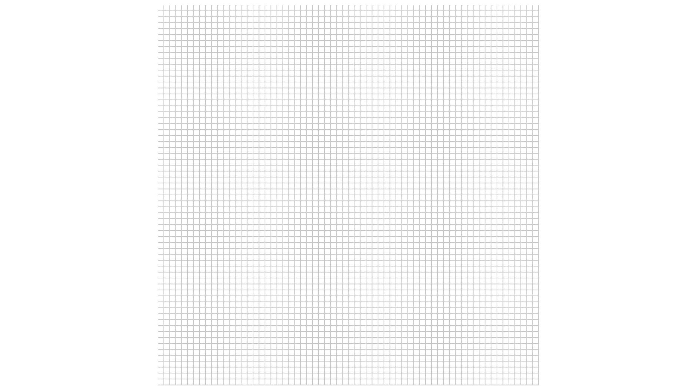

网格图案效果

总结来说，这种利用了 CSS 属性设置重复网格背景的技巧，在一般情况下能够满足我们的需要，但也会有一些限制。首先，因为它设置的是 Canvas 元素的背景，所以它和直接绘制在画布上的其他图形就处于不同的层，我们也就没法将它覆盖在这些图形上了。其次，当我们用坐标变换来缩放或移动元素时，作为元素背景的网格是不会随着缩放或移动而改变的。

### 2. 使用 Shader 来绘制重复图案

那如果是用 WebGL 来渲染的话，我们还有更简单的做法，就是利用 GPU 并行计算的特点，使用着色器来绘制背景网格这样的重复图案。

这里，我直接给出了顶点着色器和片元着色器中的代码，你可以看看。

```
//顶点着色器:  
  
attribute vec2 a_vertexPosition;  
attribute vec2 uv;  
varying vec2 vUv;  
  
  
void main() {  
  gl_PointSize = 1.0;  
  vUv = uv;  
  gl_Position = vec4(a_vertexPosition, 1, 1);  
  
  
//片元着色器:  
  
  
#ifdef GL_ES  
precision mediump float;  
#endif  
varying vec2 vUv;  
uniform float rows;  
  
void main() {  
  vec2 st = fract(vUv * rows);  
  float d1 = step(st.x, 0.9);  
  float d2 = step(0.1, st.y);  
  gl_FragColor.rgb = mix(vec3(0.8), vec3(1.0), d1 * d2);  
  gl_FragColor.a = 1.0;  
}  

```

那这两段 Shader 代码的具体行为是什么呢？你可以先自己想一想，这里我先卖个关子，一会儿再详细解释，我们先来看看 WebGL 绘制重复图案的过程。

我们知道，直接用 WebGL 来绘图比较繁琐，所以从这一节课开始，我们不采用原生的底层 WebGL 绘图了，而是采用一个基础库gl-renderer。gl-renderer 在 WebGL 底层的基础上进行了一些简单的封装，以便于我们将重点放在提供几何数据、设置变量和编写 Shader 上，不用因为创建 buffer 等细节而分心。

gl-renderer 的使用方法十分简单，基本上和第 4 节课 WebGL 三角形的过程一致，一共分为五步，唯一的区别是 gl-renderer 对每一步的代码进行了封装。我把这五步都列出来了，我们一起来看看。

**步骤一和步骤二分别是创建 Renderer 对象和创建并启用 WebGL 程序**，过程非常简单，你直接看我给出的代码就可以理解了。

```
//第一步:  
const canvas = document.querySelector('canvas');  
const renderer = new GlRenderer(canvas);  
  
//第二步:  
const program = renderer.compileSync(fragment, vertex);  
renderer.useProgram(program);
```

步骤三和步骤四是最核心的两个步骤，我来重点说说。

**步骤三是设置 uniform 变量。**这里，我们设置了一个 rows 变量，表示每一行显示多少个网格。然后我们会在片元着色器中使用它。

```
renderer.uniforms.rows = 64;
```

**步骤四是将顶点数据送入缓冲区。**

```
renderer.setMeshData([{  
  positions: [  
    [-1, -1],  
    [-1, 1],  
    [1, 1],  
    [1, -1],  
  ],  
  attributes: {  
    uv: [  
      [0, 0],  
      [0, 1],  
      [1, 1],  
      [1, 0],  
    ],  
  },  
  cells: [[0, 1, 2], [2, 0, 3]],  
}]);
```

在上面的代码中，我们一共设置了三个数据。首先，我们设置了 positions 也就是顶点。这里我们一共设置了四个顶点，这四个顶点坐标正好覆盖了整个 Canvas 画布。接着是 uv，也就是**纹理坐标**。它和纹理设置有关，不过你先不用理解什么是纹理设置，只要知道这个坐标系的左下角为 0,0，右上角为 1,1 就可以了。

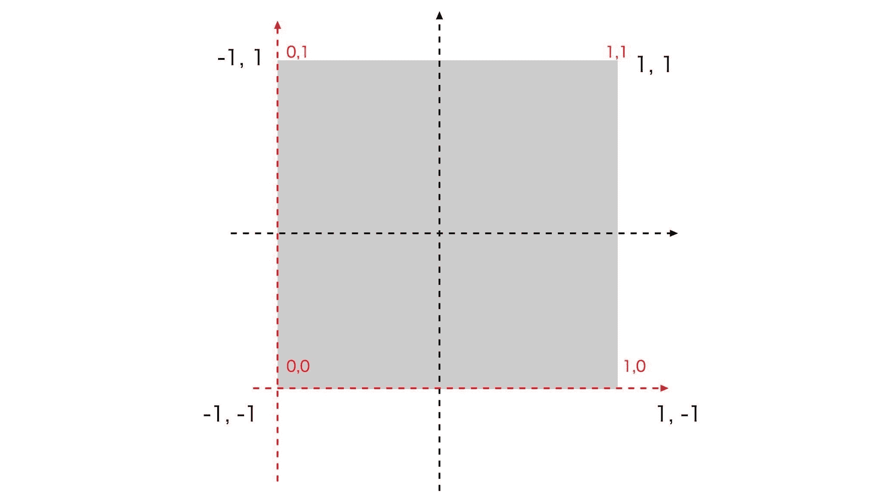

顶点坐标和uv坐标

第三个是 cells，顶点索引。我们知道，WebGL 只能渲染经过三角剖分之后的多边形。那利用 cells: [(0, 1, 2), (2, 0, 3)]，我们就能将这个矩形画布剖分成两个三角形，这两个三角形的顶点下标分别是 (0, 1, 2) 和 (2, 0, 3)。

最后，我们将顶点送入缓冲区后，执行 renderer.render() 渲染，网格就被渲染出来了。

接下来，我们重点看一下片元着色器中的代码，来理解一下渲染过程。

```
void main() {  
  vec2 st = fract(vUv * rows);  
  float d1 = step(st.x, 0.9);  
  float d2 = step(0.1, st.y);  
  gl_FragColor.rgb = mix(vec3(0.8), vec3(1.0), d1 * d2);  
  gl_FragColor.a = 1.0;  
}
```

首先，我们要获得重复的 rows 行 rows 列的值 st。这里我们要用到一个函数 fract，它在 Shader 中非常常用，可以用来获取一个数的小数部分。当一个数从 0~1 周期性变化的时候， 我们只要将它乘以整数 N，然后再用 fract 取小数，就能得到 N 个周期的数值。

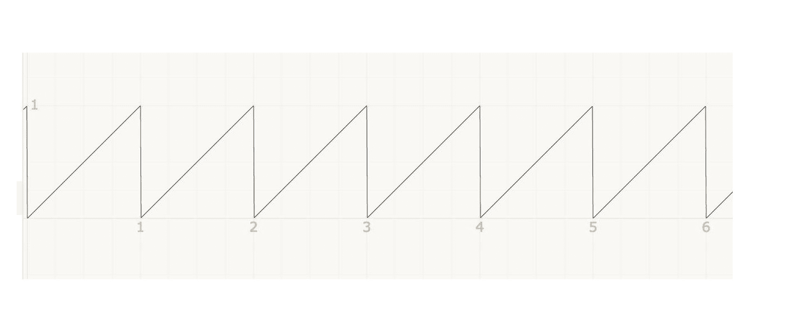

y = fract(x) 在整数区间内周期重复示意图

所以，这里我们用 vUv 也就是由顶点着色器传来的 uv 属性（纹理坐标）乘上 rows 值，然后用 fract 取小数部分，就能得到 st 了。

接着，我们处理 st 的 x 和 y。因为 WebGL 中的片元着色器线性插值，所以现在它们默认是线性变化的，而我们要的是阶梯变化。那要实现阶梯变化，我们可以使用 step 函数，step 函数是 Shader 中另一个很常用的函数，它就是一个阶梯函数。它的原理是：当 step(a, b) 中的 b < a 时，返回 0；当 b >= a 时，返回 1。

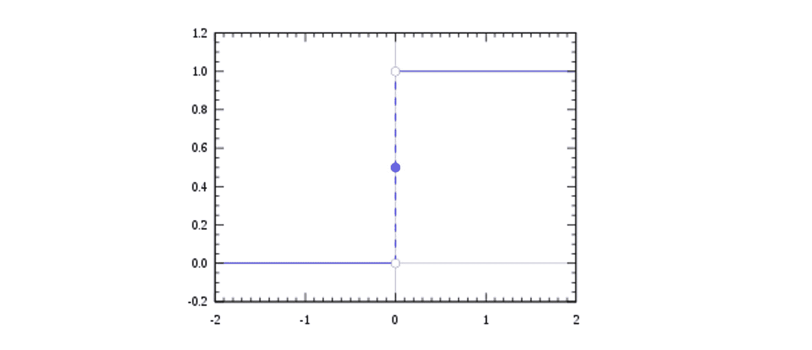

Step函数

因此，d1 和 d2 分别有 2 种取值情况。

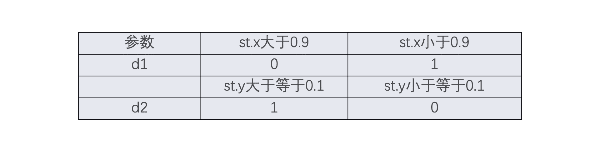

最后，我们要根据 d1 * d2 的值，决定背景网格使用哪个颜色来绘制。要实现这个目的，我们就要使用到第三个函数 mix。mix 是线性插值函数，mix(a, b, c) 表示根据 c 是 0 或 1，返回 a 或者 b。

比如在上面的代码中，当 st.x 小于 0.9 且 st.y 大于 0.1，也就是 d1 * d2 等于 1 的时候，mix(vec3(0.8), vec3(1.0), d1 * d2) 的结果是 vec3(1.0)，也就是白色。否则就是 vec3(0.8)，也就是灰色。

最后，因为 rows 决定网格重复的次数，所以最终的效果和 rows 的取值有关。为了让你有更直观的感受，我把 row 分别取 1、4、16、32、64 时的效果都绘制出来了，你可以看看。


rows为1、4、16、32、64的效果

这就是我们用 Shader 实现重复图案的完整过程。它的优势在于，不管我们给 rows 取值多少，图案都是一次绘制出来的，并不会因为 rows 增加而消耗性能。所以，使用 Shader 绘制重复图案，不管绘制多么细腻，图案重复多少次，绘制消耗的时间几乎是常量，不会遇到性能瓶颈。

## 如何绘制分形图案

说完了重复图案，我们再来说分形。它不仅是自然界中存在的一种自然现象，也是一种优美的数学模型。通俗点来说，一个分形图案可以划分成无数个部分，而每个部分的形状又都和这个图案整体具有相似性。所以，典型的分形效果具有局部与整体的自相似性以及无限细节（分形可以无限放大），能产生令人震撼的视觉效果。

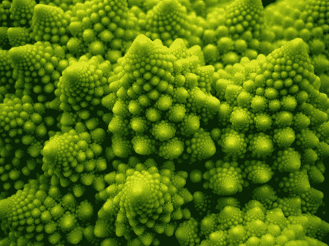

自然界中的分形：罗马花椰菜

实际上，分形在实践中偏向于视觉和 UI 设计。虽然它在实际的可视化项目中不太常用，但总能够起到画龙点睛的作用。所以，了解分形在视觉呈现中的实现技巧还是很有必要的。下面，我们就来详细讲讲分形是怎么实现的。

首先，我们来认识一下分形公式，Mandelbrot Set，也叫曼德勃罗特集。它是由美国数学家曼徳勃罗特教授发现的迭代公式构成的分形集合。这个公式中 Zn和 Zn+1是复数，C 是一个实数常量。


这个迭代公式使用起来非常简单，只要我们给定一个初始值，它就能产生许多有趣的图案。接下来，我们就一起来看一个有趣的例子。

首先我们实现一个片元着色器，代码如下：

```
#ifdef GL_ES  
precision mediump float;  
#endif  
varying vec2 vUv;  
uniform vec2 center;  
uniform float scale;  
  
vec2 f(vec2 z, vec2 c) {  
  return mat2(z, -z.y, z.x) * z + c;  
}  
  
void main() {  
    vec2 uv = vUv;  
    vec2 c = center + 4.0 * (uv - vec2(0.5)) / scale;  
    vec2 z = vec2(0.0);  
  
    bool escaped = false;  
    int j;  
    for (int i = 0; i < 65536; i++) {  
      if(i > iterations) break;  
      j = i;  
      z = f(z, c);  
      if (length(z) > 2.0) {  
        escaped = true;  
        break;  
      }  
    }  
  
    gl_FragColor.rgb = escaped ? vec3(float(j)) / float(iterations) : vec3(0.0);  
    gl_FragColor.a = 1.0;  
}
```

我们设置了初始的 z 和 c，然后执行迭代。理论上曼德勃罗特集应该是无限迭代的，但是我们肯定不能让它无限循环，所以我们要给一个足够精度的最大迭代次数，比如 65536。在迭代过程中，如果 z 的模大于 2，那它就结束计算，否则就继续迭代，直到达到循环次数。

我们把 (0, 0) 设置为图案中心点，放大系数初始设为 1，即原始大小，然后开始渲染，代码如下：

```
const program = renderer.compileSync(fragment, vertex);  
renderer.useProgram(program);  
renderer.uniforms.center = [0, 0];  
renderer.uniforms.scale = 1;  
renderer.uniforms.iterations = 256;  
  
renderer.setMeshData([{  
  positions: [  
    [-1, -1],  
    [-1, 1],  
    [1, 1],  
    [1, -1],  
  ],  
  attributes: {  
    uv: [  
      [0, 0],  
      [0, 1],  
      [1, 1],  
      [1, 0],  
    ],  
  },  
  cells: [[0, 1, 2], [2, 0, 3]],  
}]);  
  
renderer.render();
```

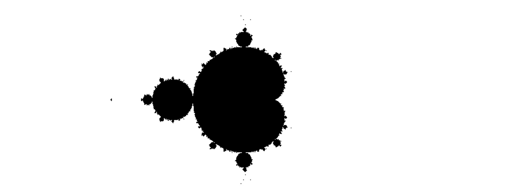

画布上最终的渲染结果

这个图案本身似乎没有什么特别的效果，我们可以修改一下 Shader 中的代码，改变渲染颜色的规则，根据迭代次数和迭代深度的比值来渲染不同的颜色，然后将它局部放大，就能得到非常有趣的图案了。

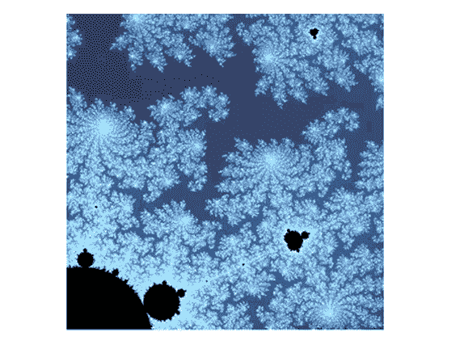

## 如何给图案增加随机效果

那分形图案为什么这么吸引人呢？如果你多看几个，就会发现，它们的无限细节里同时拥有重复和随机这两个规律。那对于其他非分形的图案，如果也想让它变得吸引人，我们其实可以给它们增加**随机效果**。

不知道，你还记得我们开篇词中的那个抽奖程序吗？实际上它就是一个随机效果的应用。

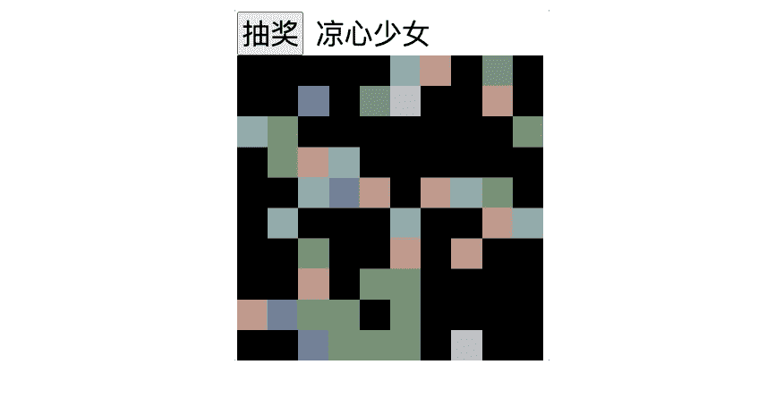

产生随机色块的抽奖程序

要想实现类似这样的随机效果，在 Shader 中，我们可以使用伪随机函数。下面，我以一个常用的伪随机函数为例，来讲讲随机效果是怎么生成的。代码如下：

```
float random (vec2 st) {  
    return fract(sin(dot(st.xy,  
                         vec2(12.9898,78.233)))*  
        43758.5453123);  
}
```

这个伪随机函数的原理是，取正弦函数偏后部的小数部分的值来模拟随机。如果我们传入一个确定的 st 值，它就会返回一个符合随机分布的确定的 float 值。

我们可以测试一下这个伪随机函数，代码如下：

```
#ifdef GL_ES  
precision highp float;  
#endif  
  
varying vec2 vUv;  
  
float random (vec2 st) {  
    return fract(sin(dot(st.xy,  
                        vec2(12.9898,78.233)))*  
        43758.5453123);  
}  
  
void main() {  
    gl_FragColor.rgb = vec3(random(vUv));  
    gl_FragColor.a = 1.0;  
}
```

它的执行结果是一片噪点，效果如下图所示。

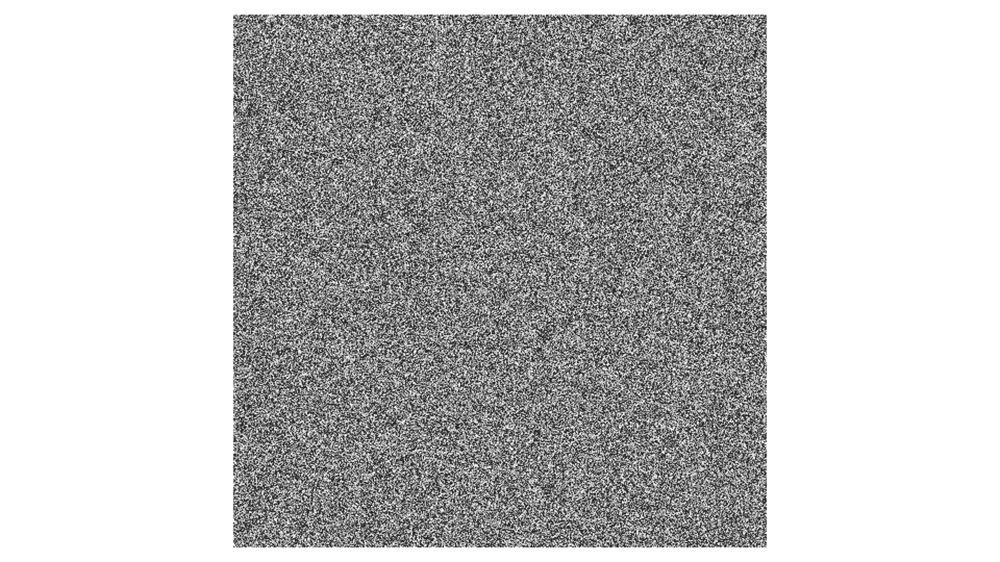

这些噪点显然不能满足我们想要的随机效果，因为它们只有一个像素，而且太小了。所以下一步，我们可以用 floor 取整函数，来生成随机的色块。

```
  #ifdef GL_ES  
  precision highp float;  
  #endif  
  
  varying vec2 vUv;  
  float random (vec2 st) {  
      return fract(sin(dot(st.xy,  
                          vec2(12.9898,78.233)))*  
          43758.5453123);  
  }  
  
  void main() {  
      vec2 st = vUv * 10.0;  
      gl_FragColor.rgb = vec3(random(floor(st)));  
      gl_FragColor.a = 1.0;  
  }
```

floor 函数和 JavaScript 的 Math.floor 一样，都是向下取浮点数的整数部分，不过，glsl 的 floor 可以直接对向量使用。我们通过 floor(st) 实际上取到了 0,0 到 9,9，一共 10 行 *10 列 =100 个方块。然后我们通过 random 函数给每一个方块随机一个颜色，最终实现的结果如下：

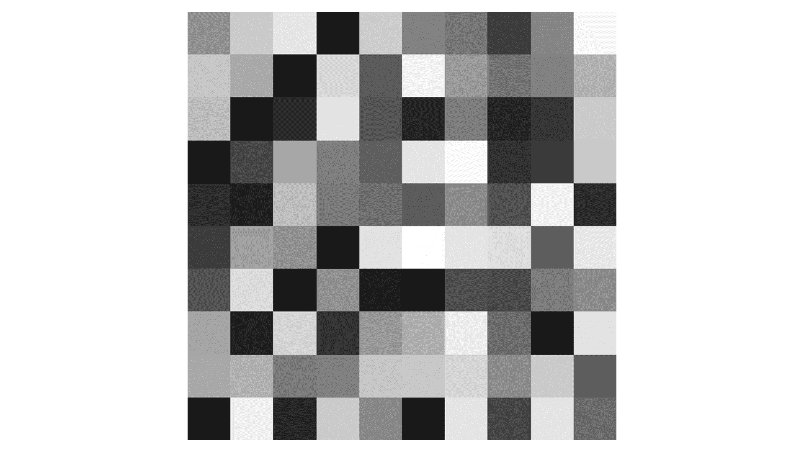

此外，我们还可以结合随机和动态效果。具体的方法就是传入一个代表时间的 uTime 变量，实际代码和最终效果如下：

```
#ifdef GL_ES  
precision highp float;  
#endif  
  
varying vec2 vUv;  
  
uniform float uTime;  
  
float random (vec2 st) {  
    return fract(sin(dot(st.xy,  
                        vec2(12.9898,78.233)))*  
        43758.5453123);  
}  
  
void main() {  
    vec2 st = vUv * vec2(100.0, 50.0);  
  
    st.x -= (1.0 + 10.0 * random(vec2(floor(st.y)))) * uTime;  
  
    vec2 ipos = floor(st);  // integer  
    vec2 fpos = fract(st);  // fraction  
  
    vec3 color = vec3(step(random(ipos), 0.7));  
    color *= step(0.2,fpos.y);  
  
    gl_FragColor.rgb = color;  
    gl_FragColor.a = 1.0;  
}
```

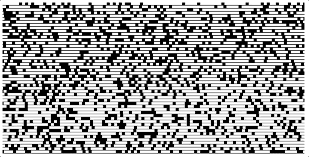

除此之外，我们用 Shader 来实现网格类的效果也特别方便。比如，下面我们就在 Shader 中用 smoothstep 函数生成可以随机旋转方向的线段，从而生成一个迷宫。

```
#ifdef GL_ES  
precision mediump float;  
#endif  
  
#define PI 3.14159265358979323846  
  
varying vec2 vUv;  
uniform vec2 u_resolution;  
uniform int rows;  
  
float random (in vec2 _st) {  
    return fract(sin(dot(_st.xy,  
                        vec2(12.9898,78.233)))*  
        43758.5453123);  
}  
  
vec2 truchetPattern(in vec2 _st, in float _index){  
    _index = fract(((_index-0.5)*2.0));  
    if (_index > 0.75) {  
        _st = vec2(1.0) - _st;  
    } else if (_index > 0.5) {  
        _st = vec2(1.0-_st.x,_st.y);  
    } else if (_index > 0.25) {  
        _st = 1.0-vec2(1.0-_st.x,_st.y);  
    }  
    return _st;  
}  
  
void main() {  
    vec2 st = vUv * float(rows);  
    vec2 ipos = floor(st);  // integer  
    vec2 fpos = fract(st);  // fraction  
  
    vec2 tile = truchetPattern(fpos, random( ipos ));  
    float color = 0.0;  
  
    color = smoothstep(tile.x-0.3,tile.x,tile.y)-  
            smoothstep(tile.x,tile.x+0.3,tile.y);  
  
    gl_FragColor = vec4(vec3(color),1.0);  
}
```

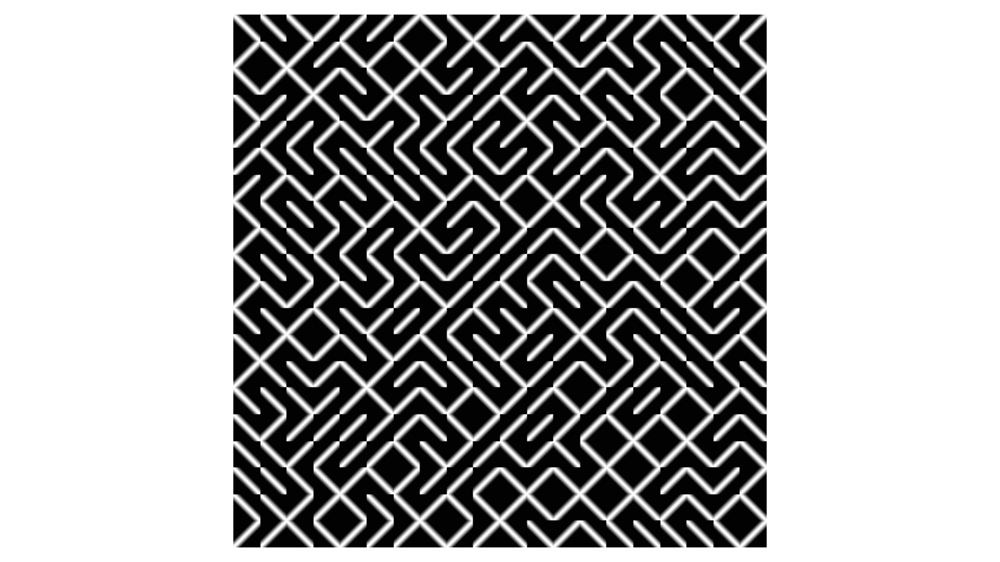

## 要点总结

今天，我们讲了可视化中三种常用图案的生成原理。

第一种，批量重复图案。一般来说，在绘制批量重复图案的时候，我们可以采用 2 种方案。首先是使用 CSS 的 background-image 属性，利用 backgroud-repeat 快速重复绘制。其次，我们可以使用片元着色器，利用 GPU 的并行渲染的特点来绘制。

第二种，分形图案。绘制分形图案有一个可以直接的公式，曼德勃罗特集。我们可以使用它来绘制分形图案。

第三种是在重复图案上增加随机性，我们可以在片元着色器中使用伪随机函数，来给重复图案实现随机效果。

虽然我们说几何图形是用来承载数据信息，图案是来强化视觉效果的，但实际上，它们也并没有绝对的界限，有时候我们也可以将图案与数据信息一起管理。比如说，在上面那个动态效果的例子中，我们可以调整动态参数，让图形的运动速度或者黑白块的分布和数据量或者信息内容联系起来。这会大大强化可视化的视觉效果，从而加深用户对信息的理解。

在这一节课，我们讲了大量关于 WebGL 的片元着色器的知识。这是因为，片元着色器是最适合生成和绘制这些图案的技术，但这也并不意味着用其他图形系统，比如 SVG 或者 Canvas 就没法很好地生成并绘制这些图案了。

实际上，它们的基本原理是相同的，所以用 SVG 或 Canvas 同样可以绘制这些图案。只不过，因为 SVG 和 Canvas 渲染不能深入控制 GPU 底层，所以就没法做到像 WebGL 这样并行高效地渲染这些图案。那如果在选择 SVG 和 Canvas 的可视化应用中，需要绘制大量的这些图案，就必然会导致性能瓶颈，这也是为什么我们一定要了解和掌握 WebGL 技术，只有这样，我们才能真正掌握绘制极有视觉冲击力的复杂图案的能力。

最后，我还要啰嗦几句，如果你对片元着色器应用还不是很熟悉，对上面的代码还有疑问或者不是很理解，那也没有关系，你可以花一点时间，仔细研究一下GitHub 仓库的源代码。要记住，动手实践永远是我们最好的学习方式，没有之一。

另外，在接下来的课程里，我们还会大量使用片元着色器创建更多有趣、炫酷的视觉效果。所以，我也建议你去从头看看这份关于片元着色器的学习资料，The Book of Shaders，相信你会非常有收获。

## 小试牛刀

1. 在前面的例子里，我们实现了一个 10*10 的灰色块方阵，这里我们使用的是灰度颜色，你能够渲染出彩色方块吗？你可以尝试将随机数映射成 HSV 坐标中的 H，然后绘制出不同的彩色方阵。
2. 在实现抽奖程序的时候，我们在 Shader 中使用的是伪随机函数 random。那如果要实现真正的随机数，我们该怎么做呢？如果我们希望实现的迷宫图案，在我们每次刷新网页的时候都不相同，这个功能你可以实现吗？你可以 fork GitHub 仓库的代码，然后把伪随机迷宫图案修改成真正随机迷宫图案，然后把你的代码和实际效果分享出来。
3. 我们知道，使用 background-image 的弊端是，当我们用坐标变换来缩放或移动图形的时候，作为元素背景的网格是不会随着缩放或移动而改变的。但使用 Shader，我们就能够避免这个问题了。

不过，我们在课程中没有给出缩放和移动图形的例子。你能够扩展我给出的例子，实现图案随着图形的缩放和移动变化的效果吗（这里，我再给你一个小提示，你可以使用顶点着色器和仿射变换矩阵来实现）？

欢迎在留言区和我讨论，分享你的答案和思考，也欢迎你把这节课分享给你的朋友，我们下节课见！

## 源码

课程示例代码

## 推荐阅读

 [1]基于 WebGL 底层简单封装的基础库 [gl-renderer]的官方文档 (https://github.com/akira-cn/gl-renderer) ，它可以大大简化 WebGL 代码的书写难度

 [2]很棒的学习片元着色器的教程 The Book of Shaders .
