# 15 | 如何用极坐标系绘制有趣图案？

 

你好，我是月影。

在前面的课程中，我们一直是使用直角坐标系来绘图的。但在图形学中，除了直角坐标系之外，还有一种比较常用的坐标系就是极坐标系。

[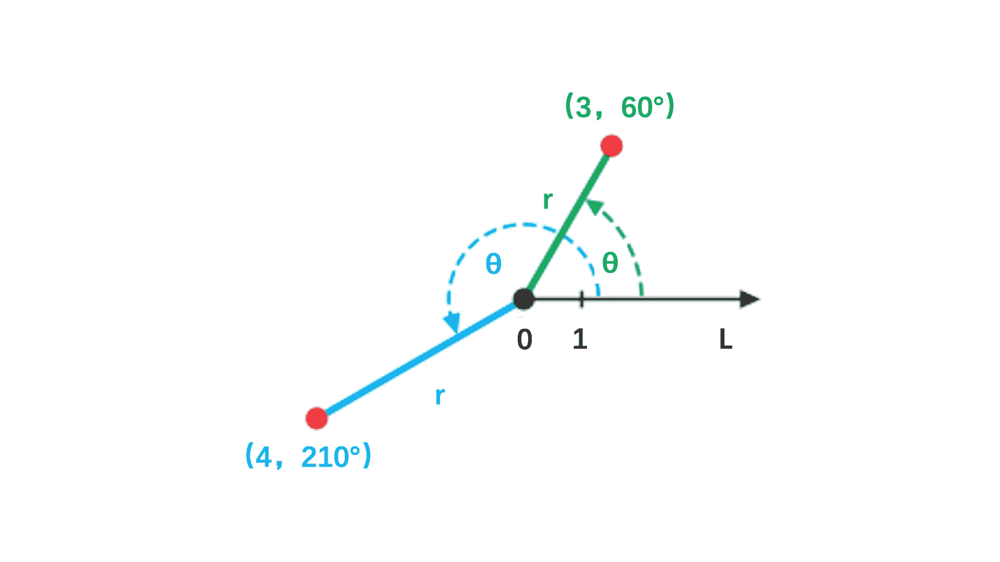](http://zh.wikipedia.org)
极坐标示意图

你对极坐标系应该也不陌生，它是一个二维坐标系。与二维直角坐标系使用 x、y 分量表示坐标不同，极坐标系使用相对极点的距离，以及与 x 轴正向的夹角来表示点的坐标，如（3，60°）。

在图形学中，极坐标的应用比较广泛，它不仅可以简化一些曲线方程，甚至有些曲线只能用极坐标来表示。不过，虽然用极坐标可以简化许多曲线方程，但最终渲染的时候，我们还是需要转换成图形系统默认支持的直角坐标才可以进行绘制。在这种情况下，我们就必须要知道直角坐标和极坐标是怎么相互转换的。两个坐标系具体转换比较简单，我们可以用两个简单的函数，toPolar 和 fromPolar 来实现，函数代码如下：

```
// 直角坐标影射为极坐标  
function toPolar(x, y) {  
  const r = Math.hypot(x, y);  
  const θ= Math.atan2(y, x);  
  return [r, θ];  
}  
  
// 极坐标映射为直角坐标  
function fromPolar(r, θ) {  
  const x = r * cos(θ);  
  const y = r * sin(θ);  
  return [x, y];  
}  

```

那今天，我们就通过参数方程结合极坐标，来绘制一些不太好用直角坐标系绘制的曲线，让你认识极坐标的优点，从而帮助你掌握极坐标的用法。

## 如何用极坐标方程绘制曲线

在第 6 节课中，为了更方便地绘制曲线，我们用 parametric.js 函数实现了一个参数方程的绘图模块，它非常方便。所以在使用极坐标方程绘制曲线的时候，我们也要用到 parametric.js 函数。不过，在使用之前，我们还要对它进行扩展，让它支持坐标映射。这样，我们就可以写出对应的坐标映射函数，从而将极坐标映射为绘图需要的直角坐标了。

具体的操作就是，给 parametric 增加一个参数 **rFunc**。rFunc 是一个坐标映射函数，通过它我们可以将任意坐标映射为直角坐标，修改后的代码如下：

```
export function parametric(sFunc, tFunc, rFunc) {  
  return function (start, end, seg = 100, ...args) {  
    const points = [];  
    for(let i = 0; i <= seg; i++) {  
      const p = i / seg;  
      const t = start * (1 - p) + end * p;  
      const x = sFunc(t, ...args);  
      const y = tFunc(t, ...args);  
      if(rFunc) {  
        points.push(rFunc(x, y));  
      } else {  
        points.push([x, y]);  
      }  
    }  
    return {  
      draw: draw.bind(null, points),  
      points,  
    };  
  };  
}
```

看到这里，你可能想问，直角坐标和极坐标转换的函数，我们在一开始不是已经讲过了吗？为什么这里又要拓展一个 rFunc 参数呢？其实啊，开头我给出的函数虽然足够简单，但不够灵活，也不便于扩展。而先使用 rFunc 来抽象坐标映射，再把其他函数作为 rFunc 参数传给 parametric，是一种更通用的坐标映射方法，它属于函数式编程思想。

说到这，我再多说几句。虽然函数式设计思想不是我们这个课程的核心，但它对框架和库的设计很重要，所以，我讲它也是希望你能通过这个例子，尽可能地理解代码中的精髓，学会使用最佳的设计方法和思路去解决问题，获得更多额外的收获，而不只是去理解眼前的基本概念。

那接下来，我们用极坐标参数方程画一个半径为 200 的半圆。在这里，我们把 fromPolar 作为 rFunc 参数传给 parametric，就可以使用极坐标的参数方程来绘制图形了，代码如下所示。

```
const fromPolar = (r, θ) => {  
  return [r * Math.cos(θ), r * Math.sin(θ)];  
};  
  
const arc = parametric(  
  t => 200,  
  t => t,  
  fromPolar,  
);  
  
arc(0, Math.PI).draw(ctx);  

```

此外，我们还可以添加其他的极坐标参数方程来绘制更多曲线，比如玫瑰线、心形线或者双纽线。因为这些操作都比较简单，我就直接在下面给出代码了。

```
const rose = parametric(  
  (t, a, k) => a * Math.cos(k * t),  
  t => t,  
  fromPolar,  
);  
  
rose(0, Math.PI, 100, 200, 5).draw(ctx, {strokeStyle: 'blue'});  
  
const heart = parametric(  
  (t, a) => a - a * Math.sin(t),  
  t => t,  
  fromPolar,  
);  
  
heart(0, 2 * Math.PI, 100, 100).draw(ctx, {strokeStyle: 'red'});  
  
const foliumRight = parametric(  
  (t, a) => Math.sqrt(2 * a ** 2 * Math.cos(2 * t)),  
  t => t,  
  fromPolar,  
);  
  
const foliumLeft = parametric(  
  (t, a) => -Math.sqrt(2 * a ** 2 * Math.cos(2 * t)),  
  t => t,  
  fromPolar,  
);  
  
foliumRight(-Math.PI / 4, Math.PI / 4, 100, 100).draw(ctx, {strokeStyle: 'green'});  
foliumLeft(-Math.PI / 4, Math.PI / 4, 100, 100).draw(ctx, {strokeStyle: 'green'});
```

最终，我们能够绘制出如下的效果：

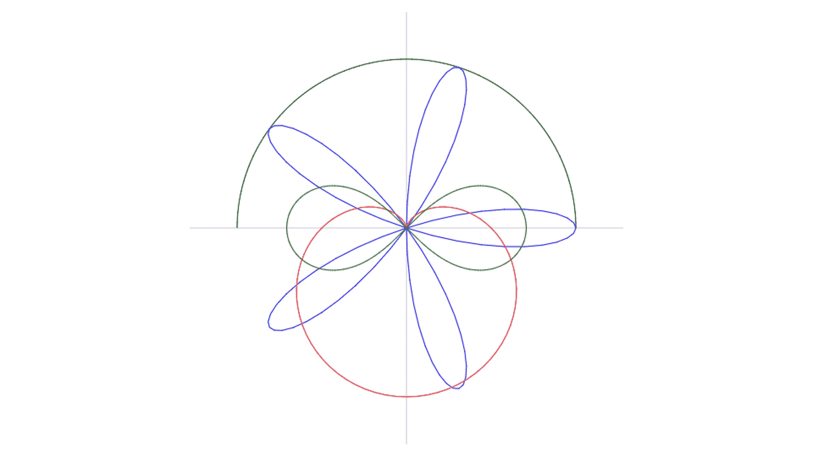

总的来说，我们看到，使用极坐标系中参数方程来绘制曲线的方法，其实和我们学过的直角坐标系中参数方程绘制曲线差不多，唯一的区别就是在具体实现的时候，我们需要额外增加一个坐标映射函数，将极坐标转为直角坐标才能完成最终的绘制。

## 如何使用片元着色器与极坐标系绘制图案？

在前面的例子中，我们主要还是通过参数方程来绘制曲线，用 Canvas2D 进行渲染。那如果我们使用 shader 来渲染，又该怎么使用极坐标系绘图呢？

这里，我们还是以圆为例，来看一下用 shader 渲染，再以极坐标画圆的做法。你可以先尝试自己理解下面的代码，然后再看我后面的讲解。

```
#ifdef GL_ES  
precision highp float;  
#endif  
  
varying vec2 vUv;  
  
vec2 polar(vec2 st) {  
  return vec2(length(st), atan(st.y, st.x));  
}  
  
void main() {  
  vec2 st = vUv - vec2(0.5);  
  st = polar(st);  
  gl_FragColor.rgb = smoothstep(st.x, st.x + 0.01, 0.2) * vec3(1.0);  
  gl_FragColor.a = 1.0;  
}
```

在上面的代码中，我们先通过坐标转换公式实现 polar 函数。这个函数作用是将直角坐标转换为极坐标，相当于课程一开始，我们用 JavaScript 写的 toPolar 函数。这里有一个细节需要注意，我们使用的是 GLSL 内置的 float atan(float, float) 方法，对应的方法是 Math.atan，而在 JavaScript 版本的 toPolar 函数中，对应的方法是 Math.atan2。

然后，我们将像素坐标转换为极坐标：st = polar(st); ，转换后的 st.x 实际上是极坐标的 r 分量，而 st.y 就是极坐标的θ分量。

我们知道，对于极坐标下过极点的圆，实际上的 r 值就是一个常量值，对应圆的半径，所以我们取 smoothstep(st.x, st.x + 0.01, 0.2)，就能得到一个半径为 0.2 的圆了。这一步，我们用的还是上节课的**距离场**方法。只不过，在直角坐标系下，点到圆心的距离 d 需要用 x、y 平方和的开方来计算，而在极坐标下，点的极坐标 r 值正好表示了点到圆心的距离 d，所以计算起来就比直角坐标系简单了很多。

其实，我们无论是用直角坐标还是极坐标来画图，方法都差不多。但是，一些其他的曲线用极坐标绘制会很方便。比如说，要绘制玫瑰线，我们就可以用以下代码：

```
void main() {  
  vec2 st = vUv - vec2(0.5);  
  st = polar(st);  
  float d = 0.5 * cos(st.y * 3.0) - st.x;  
  gl_FragColor.rgb = smoothstep(-0.01, 0.01, d) * vec3(1.0);  
  gl_FragColor.a = 1.0;  
}
```

这样，在画布上绘制出来的结果是三瓣玫瑰线：

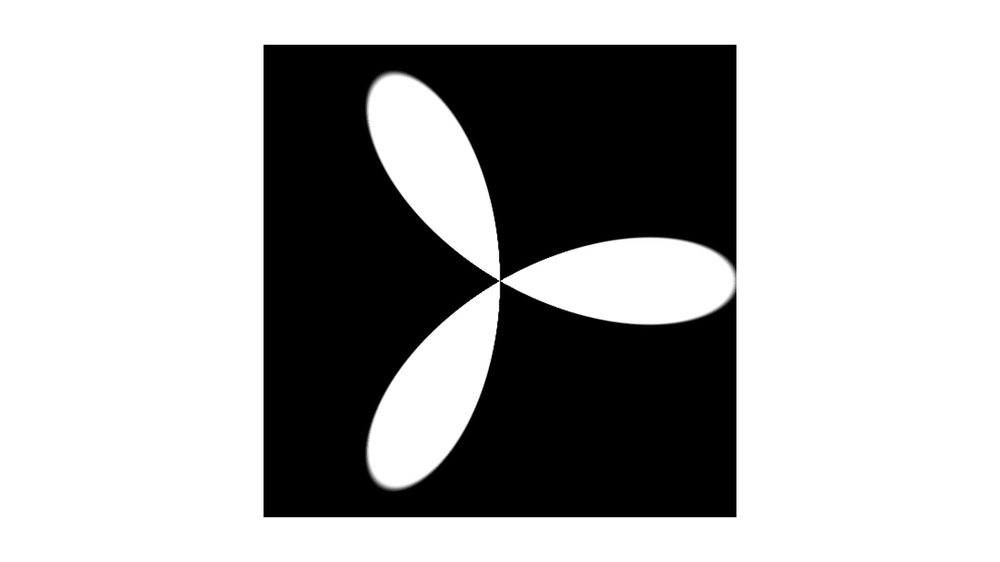

可能你还是会有疑问，为什么 d = 0.5 * cos(st.y * 3.0) - st.x; 绘制出的图形就是三瓣玫瑰线的图案呢？

这是因为玫瑰线的极坐标方程 r = a * cos(k * θ)，所以玫瑰线上的所有点都满足 0 = a * cos(k * θ) - r 这个方程式。如果我们再把它写成距离场的形式：d = a * cos(k * θ) - r。这个时候就有三种情况：玫瑰线上点的 d 等于 0；玫瑰线围出的图形外的点的 d 小于 0，玫瑰线围出的图形内的点的 d 大于 0。

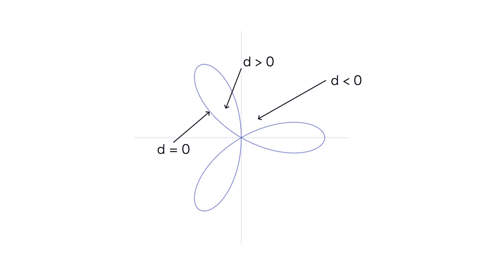

因此，smoothstep(-0.01, 0.01, d) 能够将 d >= 0，也就是玫瑰线内的点选出来，这样也就绘制出了三瓣图形。

那玫瑰线有什么用呢？它是一种很有趣图案，我们只要修改 u_k 的值，并且保证它是正整数，就可以绘制出不同瓣数的玫瑰线图案。

```
uniform float u_k;  
  
void main() {  
  vec2 st = vUv - vec2(0.5);  
  st = polar(st);  
  float d = 0.5 * cos(st.y * u_k) - st.x;  
  gl_FragColor.rgb = smoothstep(-0.01, 0.01, d) * vec3(1.0);  
  gl_FragColor.a = 1.0;  
}  
  
  
renderer.uniforms.u_k = 3;  
  
setInterval(() => {  
  renderer.uniforms.u_k += 2;  
}, 200);
```

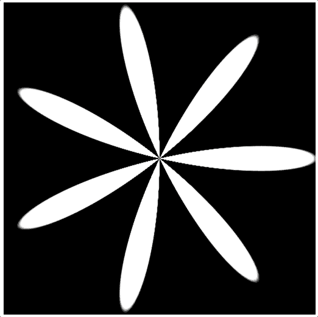

类似的图案还有花瓣线：

```
void main() {  
  vec2 st = vUv - vec2(0.5);  
  st = polar(st);  
  float d = 0.5 * abs(cos(st.y * u_k * 0.5)) - st.x;  
  gl_FragColor.rgb = smoothstep(-0.01, 0.01, d) * vec3(1.0);  
  gl_FragColor.a = 1.0;  
}
```

在 u_k=3 的时候，我们可以得到如下图案：

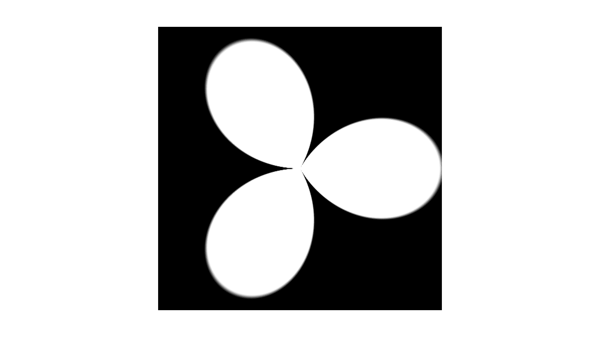

有趣的是，它和玫瑰线不一样，u_k 的取值不一定要是整数。这让它能绘制出来的图形更加丰富，比如说我们可以取 u_k=1.3，这时得到的图案就像是一个横放的苹果。

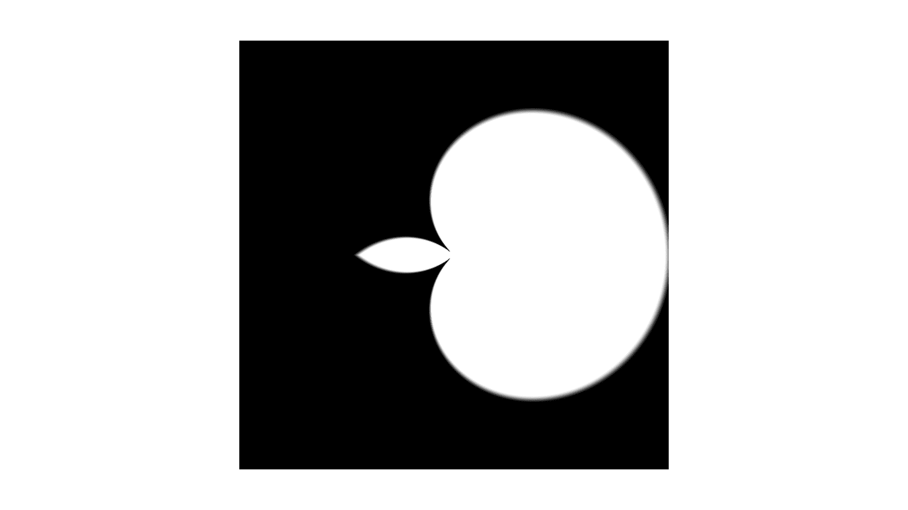

在此基础上，我们还可以再添加几个 uniform 变量，如 u_scale、u_offset 作为参数，来绘制出更多图形。代码如下：

```
varying vec2 vUv;  
uniform float u_k;  
uniform float u_scale;  
uniform float u_offset;  
        
void main() {  
  vec2 st = vUv - vec2(0.5);  
  st = polar(st);  
  float d = u_scale * 0.5 * abs(cos(st.y * u_k * 0.5)) - st.x + u_offset;  
  gl_FragColor.rgb = smoothstep(-0.01, 0.01, d) * vec3(1.0);  
  gl_FragColor.a = 1.0;  
}
```

当我们取 u_k=1.7，u_scale=0.5，u_offset=0.2 时，就能得到一个横置的葫芦图案。


如果我们继续修改 d 的计算方程，还能绘制出其他有趣的图形。

```
void main() {  
  vec2 st = vUv - vec2(0.5);  
  st = polar(st);  
  float d = smoothstep(-0.3, 1.0, u_scale * 0.5 * cos(st.y * u_k) + u_offset) - st.x;  
  gl_FragColor.rgb = smoothstep(-0.01, 0.01, d) * vec3(1.0);  
  gl_FragColor.a = 1.0;  
}
```

比如，当继续修改 d 的计算方程时，我们可以绘制出花苞图案：


方法已经知道了，你可以在课后结合三角函数、abs、smoothstep，来尝试绘制一些更有趣的图案。如果有什么特别好玩的图案，你也可以分享出来。

## 极坐标系如何实现角向渐变？

除了绘制有趣的图案之外，极坐标的另一个应用是**角向渐变**（Conic Gradients）。那角向渐变是什么呢？如果你对 CSS 比较熟悉，一定知道角向渐变就是以图形中心为轴，顺时针地实现渐变效果。而且新的 CSS Image Values and Replaced Content 标准 level4 已经添加了角向渐变，我们可以使用它来创建一个基于极坐标的颜色渐变，代码如下：

```
div.conic {  
  width: 150px;  
  height: 150px;  
  border-radius: 50%;  
  background: conic-gradient(red 0%, green 45%, blue);  
}
```


我们可以通过角向渐变创建一个颜色由角度过渡的元素。在 WebGL 中，我们可以通过极坐标用片元着色器实现类似的角向渐变效果，代码如下：

```
void main() {  
  vec2 st = vUv - vec2(0.5);  
  st = polar(st);  
  float d = smoothstep(st.x, st.x + 0.01, 0.2);  
  // 将角度范围转换到0到2pi之间  
  if(st.y < 0.0) st.y += 6.28;  
  // 计算p的值，也就是相对角度，p取值0到1  
  float p = st.y / 6.28;  
  if(p < 0.45) {  
    // p取0到0.45时从红色线性过渡到绿色  
    gl_FragColor.rgb = d * mix(vec3(1.0, 0, 0), vec3(0, 0.5, 0), p /  0.45);  
  } else {  
    // p超过0.45从绿色过渡到蓝色  
    gl_FragColor.rgb = d * mix(vec3(0, 0.5, 0), vec3(0, 0, 1.0), (p - 0.45) / (1.0 - 0.45));  
  }  
  gl_FragColor.a = 1.0;  
}
```

如上面代码所示，我们将像素坐标转变为极坐标之后，st.y 就是与 x 轴的夹角。因为 polar 函数里计算的 atan(y, x) 的取值范围是 -π到π，所以我们在 st.y 小于 0 的时候，将它加上 2π，这样就能把取值范围转换到 0 到 2π了。

然后，我们根据角度换算出对应的比例对颜色进行线性插值。比如，比例在 0%~45% 之间，我们让颜色从红色过渡为绿色，那在 45% 到 100% 之间，我们让颜色从绿色过渡到蓝色。这样，我们最终就会得到如下效果：

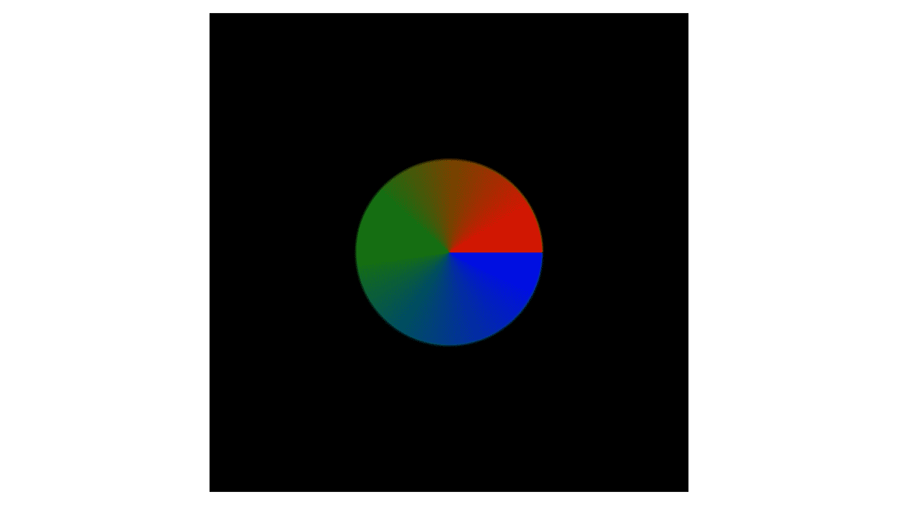

这个效果与 CSS 角向渐变得到的基本上一致，除了 CSS 角向渐变的起始角度是与 Y 轴的夹角，而 shader 是与 X 轴的夹角以外，没有其他的不同。这样，我们就可以在 WebGL 中利用极坐标系实现与 CSS 角向渐变一致的视觉效果了。

## 极坐标如何绘制 HSV 色轮？

想要实现丰富的视觉效果离不开颜色，通过前面的课程，我们已经知道各种颜色的表示方法，为了更方便地调试颜色，我们可以进一步来实现色轮。什么是色轮呢？色轮可以帮助我们，把某种颜色表示法所能表示的所有颜色方便、直观地显示出来。

那在 WebGL 中，我们该怎么绘制 HSV 色轮呢？我们可以用极坐标结合 HSV 颜色来绘制它。

接下来，就让我们一起在片元着色器中实现它吧。实现的过程其实并不复杂，我们只需要将像素坐标转换为极坐标，再除以 2π，就能得到 HSV 的 H 值。然后我们用鼠标位置的 x、y 坐标来决定 S 和 V 的值，完整的片元着色器代码如下：

```
#ifdef GL_ES  
precision highp float;  
#endif  
  
varying vec2 vUv;  
uniform vec2 uMouse;  
  
vec3 hsv2rgb(vec3 c){  
  vec3 rgb = clamp(abs(mod(c.x*6.0+vec3(0.0,4.0,2.0), 6.0)-3.0)-1.0, 0.0, 1.0);  
  rgb = rgb * rgb * (3.0 - 2.0 * rgb);  
  return c.z * mix(vec3(1.0), rgb, c.y);  
}  
  
vec2 polar(vec2 st) {  
  return vec2(length(st), atan(st.y, st.x));  
}  
  
void main() {  
  vec2 st = vUv - vec2(0.5);  
  st = polar(st);  
  float d = smoothstep(st.x, st.x + 0.01, 0.2);  
  if(st.y < 0.0) st.y += 6.28;  
  float p = st.y / 6.28;  
  gl_FragColor.rgb = d * hsv2rgb(vec3(p, uMouse.x, uMouse.y));  
  gl_FragColor.a = 1.0;  
}
```

最终的效果如下图所示：

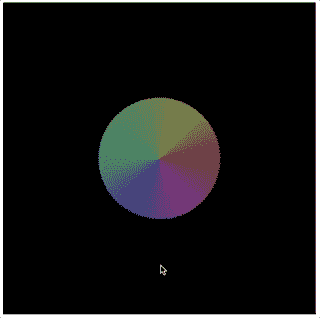

## 圆柱坐标与球坐标

最后，我还想和你说说极坐标和圆柱坐标系以及球坐标系之间的关系。我们知道极坐标系是二维坐标系，如果我们将极坐标系延 z 轴扩展，可以得到圆柱坐标系。圆柱坐标系是一种三维坐标系，可以用来绘制一些三维曲线，比如螺旋线、圆内螺旋线、费马曲线等等。

[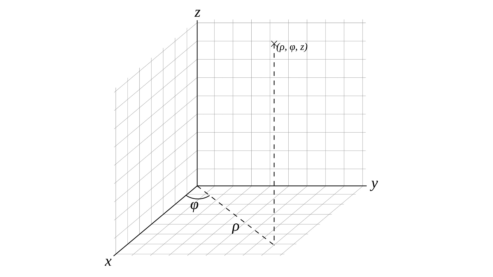](https://zh.wikipedia.org/)
圆柱坐标系

因为极坐标系可以和直角坐标系相互转换，所以直角坐标系和圆柱坐标系也可以相互转换，公式如下：

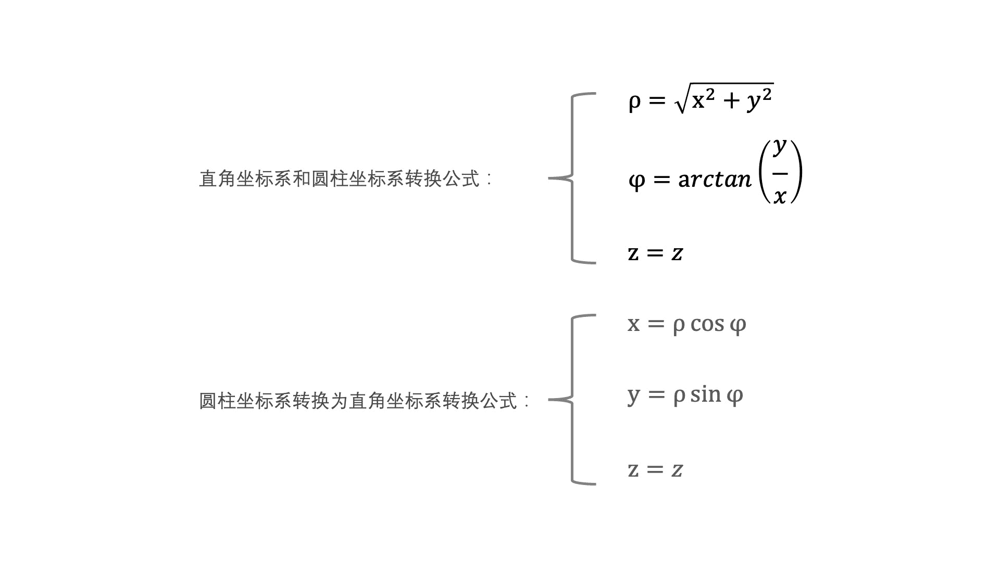

从上面的公式中你会发现，我们只转换了 x、y 的坐标，因为它们是极坐标，而 z 的坐标因为本身就是直角坐标不用转换。因此圆柱坐标系又被称为**半极坐标系。**

在此基础上，我们还可以进一步将圆柱坐标系转为球坐标系。

[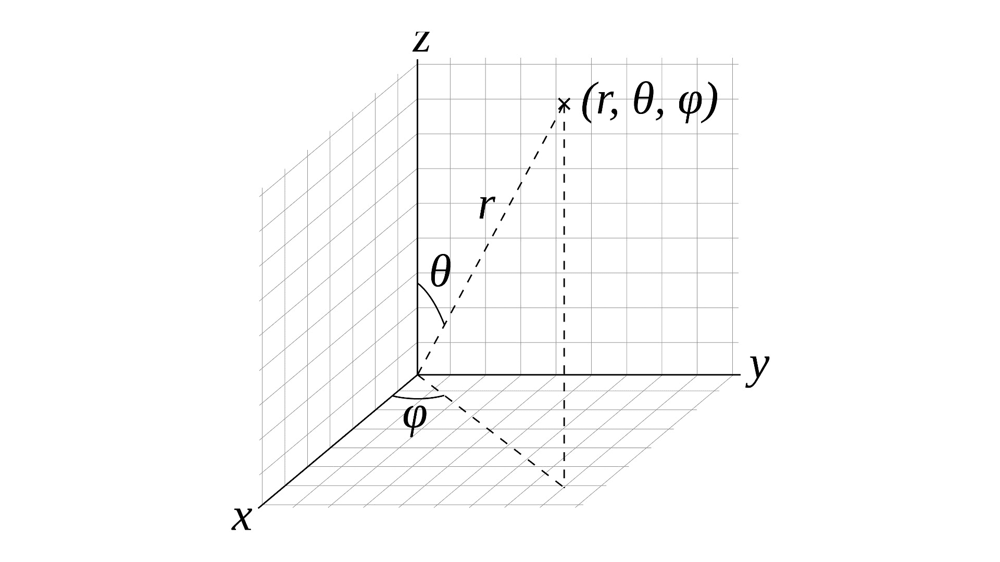](https://zh.wikipedia.org)
球坐标系

同样地，圆柱坐标系也可以和球坐标系相互转换，公式如下：

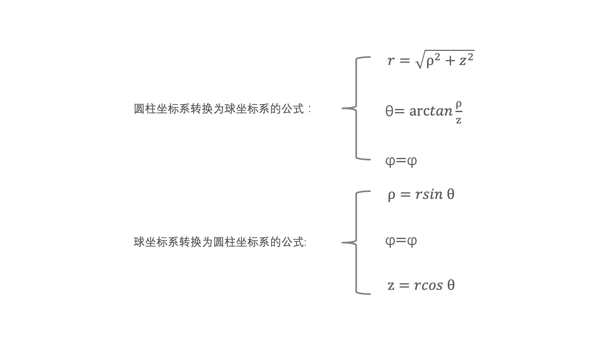

球坐标系在三维图形绘制、球面定位、碰撞检测等等可视化实现时都很有用，在后续的课程中，我们会有机会用到球坐标系，在这里你需要先记住它的转换公式。

## 要点总结

这一节课，我们学习了一个新的坐标系统也就是极坐标系，并且理解了直角坐标系与极坐标系的相互转换。

极坐标系是使用相对极点的距离，以及与 x 轴正向的夹角来表示点的坐标。极坐标系想要转换为直角坐标系需要用到 fromPolar 函数，反过来需要用到 toPolar 函数。

那在具体使用极坐标来绘制曲线的时候，有两种渲染方式。第一种是用 Cavans 渲染，这时候，我们可以用到之前学过的 parametric 高阶函数，将极坐标参数方程和坐标映射函数 fromPolar 传入，得到绘制曲线的函数，再用它来执行绘制。这样，极坐标系就能实现直角坐标系不太好描述的曲线了，比如，玫瑰线、心形线等等。

第二种是使用 shader 渲染，一般的方法是先将像素坐标转换为极坐标，然后使用极坐标构建距离场并着色。它能实现更多复杂的图案。

除了绘图，使用极坐标还可以实现角向渐变和 HSV 色轮。角向渐变通常可以用在构建饼图，而 HSV 色轮一般用在颜色可视化和择色交互等场合里。

此外，你还需要了解圆柱坐标、球坐标与直角坐标系的相互转换。在后续课程里，我们会使用圆柱坐标或球坐标来处理三维图形，到时候它们会非常有用。

## 小试牛刀

1. 用极坐标绘制小图案时，我们绘制了苹果和葫芦的图案，但它们是横置的。你可以试着修改它们，让它们的方向变为正向吗？具体怎么做呢？
2. 在角向渐变的例子中，CSS 角向渐变是与 Y 轴的夹角，而使用着色器绘制的版本是与 X 轴的夹角。那如果要让着色器绘制版本的效果与 CSS 角向渐变效果完全一致，我们该怎么做呢？
3. 我们已经学过了随机数、距离场以及极坐标，你是不是可以利用它们绘制出一个画布，并且呈现随机的剪纸图案，类似的效果如下所示。

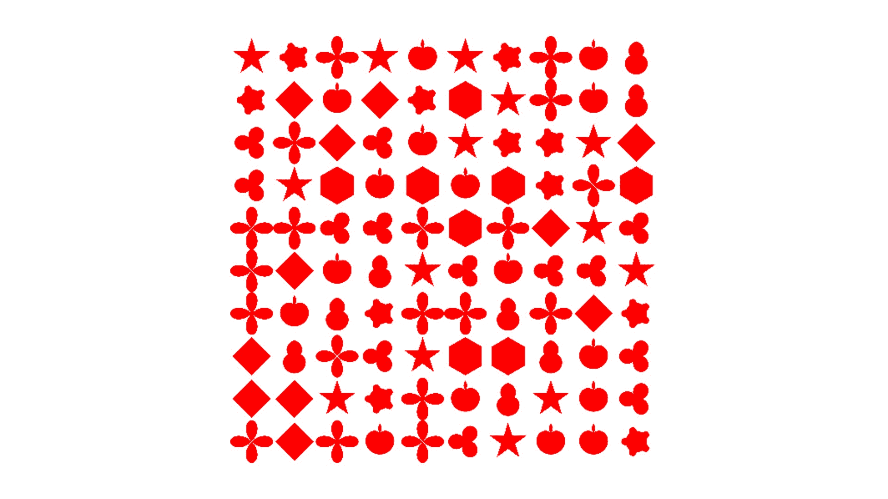

欢迎在留言区和我讨论，分享你的答案和思考，也欢迎你把这节课分享给你的朋友，我们下节课再见！

## 源码

parametric-shader

ploar-shader
