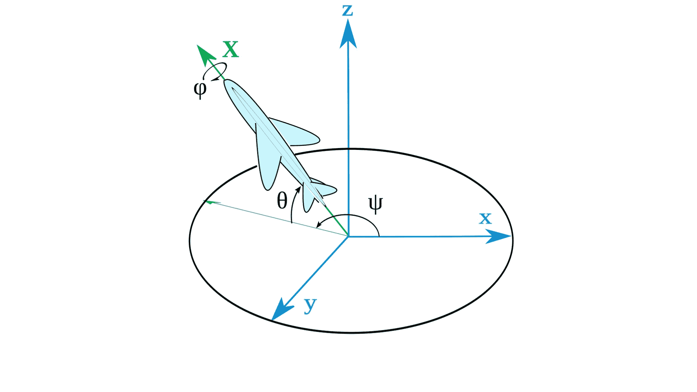
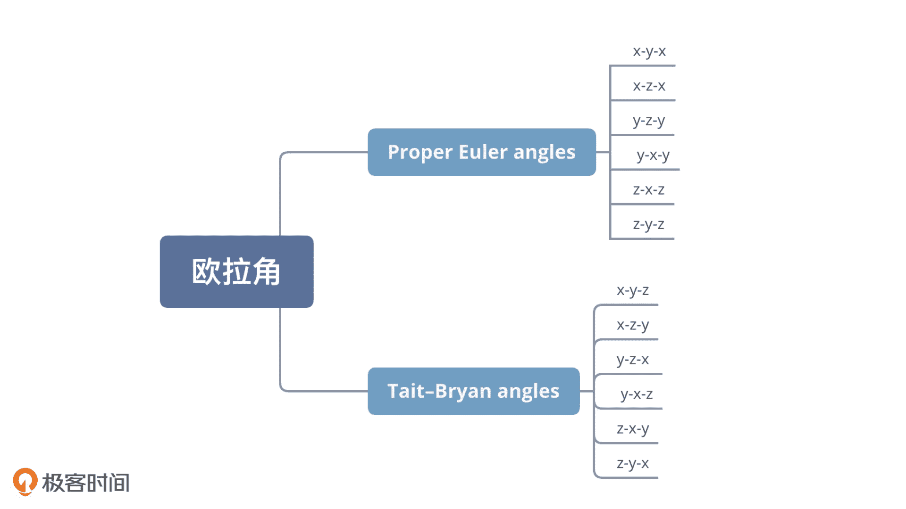
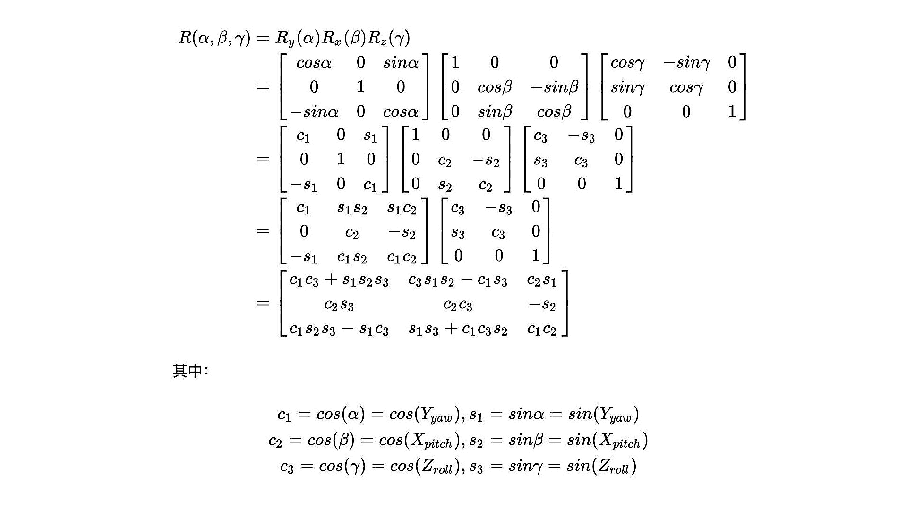
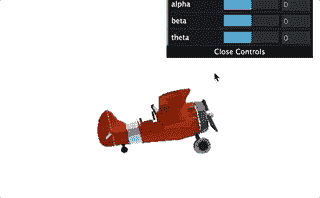
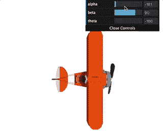
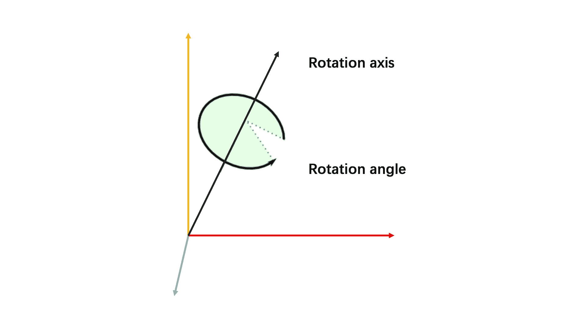
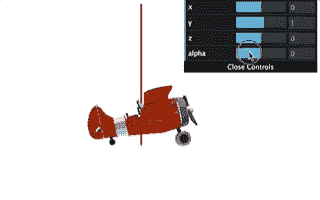
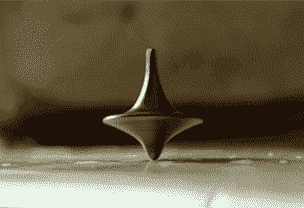

# 22 | 如何用仿射变换来移动和旋转3D物体？

 

你好，我是月影。

在前面的课程里，我们学习过使用仿射变换来移动和旋转二维图形。那在三维世界中，想要移动和旋转物体，我们也需要使用仿射变换。

但是，仿射变换该怎么从二维扩展到三维几何空间呢？今天，我们就来看一下三维仿射变换的基本方法，以及怎么对它进行优化。

三维仿射变换和二维仿射变换类似，也包括平移、旋转与缩放等等，而且具体的变换公式也相似。

比如，对于平移变换来说，如果向量 P(x0​,y0​,z0​) 沿着向量 Q(x1​,y1​,z1​) 平移，我们只需要让 P 加上 Q，就能得到变换后的坐标。
⎩⎨⎧​x=x0​+x1​y=y0​+y1​z=z0​+z1​​

再比如，对于缩放变换来说，我们直接让三维向量乘上标量，就相当于乘上要缩放的倍数就可以了。最后我们得到的三维缩放变换矩阵如下：
M=⎣⎡​sx​00​0sy​0​00sz​​⎦⎤​

而且，我们也可以使用齐次矩阵来表示三维仿射变换，通过引入一个新的维度，就可以把仿射变换转换为齐次矩阵的线性变换了。
M’=[M0​01​]

这个齐次矩阵，是一个 4X4 的矩阵，其实它就是我们在第 19 节课提到的模型矩阵（ModelMatrix）。

总之，对于三维的仿射变换来说，平移和缩放都只是增加一个 z 分量，这和二维放射变换没有什么不同。但对于物体的旋转变换，三维就要比二维稍微复杂一些了。因为二维旋转只有一个参考轴，就是 z 轴，所以二维图形旋转都是围绕着 z 轴的。但是，三维物体的旋转却可以围绕 x、y、z，这三个轴其中任意一个轴来旋转。

因此，这节课，我们就把重点放在处理三维物体的旋转变换上。

## 使用欧拉角来旋转几何体

我们先来看一下三维物体的旋转变换矩阵：
绕y轴旋转：Ry​=⎣⎡​cosα 0 −sinα​010​sinα0cosα​⎦⎤​绕x轴旋转：Rx​=⎣⎡​1 0 0​0cosβsinβ​0−sinβcosβ​⎦⎤​绕z轴旋转：Rz​=⎣⎡​cosγ sinγ 0​−sinγcosγ0​001​⎦⎤​

你会看到，我们使用了三个旋转矩阵 Ry、Rx、Rz 来描述三维的旋转变换。这三个旋转矩阵分别表示几何体绕 y 轴、x 轴、z 轴转过 α、β、γ 角。而这三个角，就叫做**欧拉角。**

### 什么是欧拉角？

那什么是欧拉角呢？欧拉角是描述三维物体在空间中取向的标准数学模型，也是航空航天普遍采用的标准。对于在三维空间里的一个参考系，任何坐标系的取向，都可以用三个欧拉角来表示。

举个例子，下图中这个飞机的飞行姿态，可以由绕 x 轴的旋转角度（翻滚机身）、绕 y 轴的旋转角度（俯仰），以及绕 z 轴的旋转角度（偏航）来表示。



也就是说，这个飞机的姿态可以由这三个欧拉角来确定。具体的表示公式就是 Rx、Ry、Rz，这三个旋转矩阵相乘。
M=Ry​×Rx​×Rz​

这里，我们是按照 Ry、Rx、Rz 的顺序相乘的。而 y−x−z 顺序有一个专属的名字叫做欧拉角的**顺规**，也就是说，我们现在采用的是 y−x−z 顺规。欧拉角有很多种不同的顺规表示方式，一共可以分两种：一种叫做 **Proper Euler angles**，包含六种顺规，分别是 z−x−z、x−y−x、y−z−y、z−y−z、x−z−x、y−x−y；另一种叫做 **Tait–Bryan angles**，也包含六种顺规，分别是 x−y−z、y−z−x、z−x−y、x−z−y、z−y−x、y−x−z。



显然，我们采用的 y−x−z 顺规，属于 **Tait–Bryan angles。**

不同的欧拉角顺规虽然表示方法不同，但它们本质上还是欧拉角，都可以表示三维几何空间中的任意取向。所以，我们在绘制三维图形的时候，使用任何一种表示法都可以。今天，我就以 y−x−z 顺规为例来接着讲。

采用 y−x−z 顺规的欧拉角之后，我们能得到如下的旋转矩阵结果：



### 如何使用欧拉角来旋转几何体？

接下来，我们通过一个例子来实际体会，使用欧拉角旋转几何体的具体过程。

这里，我们还是用 OGL 框架。OGL 的几何网格（Mesh）对象直接支持欧拉角，我们直接用对象的 rotation 属性就可以设置欧拉角，rotation 属性是一个三维向量，它的 x、y、z 坐标就对应围绕 x、y、z 旋转的欧拉角。而且 OGL 框架默认的欧拉角顺规是 y−x−z。

为了增加趣味性，我们不用立方体、圆柱体这些一般几何体，而是旋转一个飞机的几何模型。

在 OGL 中，我们可以加载 JSON 文件，来载入预先设计好的几何模型。

下面就是我先封装好的，一个加载几何模型的函数。这个函数会载入 JSON 文件的内容，然后根据其中的数据创建 Geometry 对象，并返回这个对象。

```
async function loadModel(src) {  
  const data = await (await fetch(src)).json();  
  
  const geometry = new Geometry(gl, {  
    position: {size: 3, data: new Float32Array(data.position)},  
    uv: {size: 2, data: new Float32Array(data.uv)},  
    normal: {size: 3, data: new Float32Array(data.normal)},  
  });  
  
  return geometry;  
}
```

这样，我们通过如下指令，就可以加载飞机几何体模型了。

```
const geometry = await loadModel('../assets/airplane.json');
```

这里的 assets/airplane.json 是一份几何模型文件，内容类似于下面这样：

```
{  
  "position": [0.752, 1.061, 0.0, 0.767...],  
  "normal": [0.975, 0.224, 0.0, 0.975...],  
  "uv": [0.745, 0.782, 0.705, 0.769...]  
}
```

其中 position、normal、uv 是顶点数据，我们比较熟悉，分别是顶点坐标、法向量和纹理坐标。这样的数据一般是由设计工具直接生成的，不需要我们来计算。

接下来，我们加载飞机的纹理图片，同样要先封装一个加载图片纹理的函数。在函数里，我们用 img 元素加载图片，然后将图片赋给对应的纹理对象。函数代码如下：

```
function loadTexture(src) {  
  const texture = new Texture(gl);  
  return new Promise((resolve) => {  
    const img = new Image();  
    img.onload = () => {  
      texture.image = img;  
      resolve(texture);  
    };  
    img.src = src;  
  });  
}
```

接着，我们就可以加载飞机的纹理图片了。具体操作如下：

```
const texture = await loadTexture('../assets/airplane.jpg');
```

然后，我们在片元着色器中，直接读取纹理图片中的颜色信息：

```
precision highp float;  
  
uniform sampler2D tMap;  
varying vec2 vUv;  
  
void main() {  
  gl_FragColor = texture2D(tMap, vUv);  
}
```

最后，我们就能将元素渲染出来了。渲染指令如下：

```
const program = new Program(gl, {  
  vertex,  
  fragment,  
  uniforms: {  
    tMap: {value: texture},  
  },  
});  
const mesh = new Mesh(gl, {geometry, program});  
mesh.setParent(scene);  
renderer.render({scene, camera});
```

最终，我们就能得到可以随意调整欧拉角的飞机模型了，效果如下图所示：



## 如何理解万向节锁？

使用欧拉角来操作几何体的方向，虽然很简单，但是有一个小缺陷，这个缺陷叫做万向节锁 (Gimbal Lock)。那万向节锁是什么呢，我们通过上面的例子来解释。

你会发现，当我们分别改变飞机的 alpha、beta、theta 值时，飞机会做出对应的姿态调整，包括偏航（改变 alpha）、翻滚（改变 beta）和俯仰（改变 theta）。

但是如果我们将 beta 固定在正负 90 度，改变 alpha 和 beta，我们会发现一个奇特的现象：



如上图所示，我们将 beta 设为 90 度，不管改变 alpha 还是改变 theta，飞机都绕着 y 轴旋转，始终处于一个平面上。也就是说，本来飞机姿态有 x、y、z 三个自由度，现在 y 轴被固定了，只剩下两个自由度了，这就是万向节锁。

万向节锁，并不是真的“锁”住。而是在特定的欧拉角情况下，姿态调整的自由度丢失了。而且，只要是欧拉角，不管我们使用哪一种顺规，万向节锁都会存在。这该怎么解决呢？

要避免万向节锁的产生，我们只能使用其他的数学模型，来代替欧拉角描述几何体的旋转。其中一个比较好的模型是**四元数**（Quaternion）。

## 使用四元数来旋转几何体

四元数是一种高阶复数，一个四元数可以表示为：q=w+xi+yj+zk。其中，i、j、k 是三个虚数单位，w 是标量，它们满足 i2=j2=k2=ijk=−1。如果我们把 xi+yj+zk 看成是一个向量，那么四元数 q 又可以表示为 q=(v,w)，其中 v 是一个三维向量。

我们可以用单位四元数来描述 3D 旋转。所谓单位四元数，就是其中的参数满足 x2+y2+z2+w2=1。单位四元数对应的旋转矩阵如下：
R(q)=⎣⎡​1−2y2−2z22xy+2zw2xz−2yw​2xy−2zw1−2x2−2z22yz+2xw​2xz+2yw2yz−2xw1−2x2−2y2​⎦⎤​

这个旋转矩阵的数学推导过程比较复杂，我们只要记住这个公式就行了。

与欧拉角相比，四元数没有万向节死锁的问题。而且与旋转矩阵相比，四元数只需要四个分量就可以定义，模型上更加简洁。但是，四元数相对来说没有旋转矩阵和欧拉角那么直观。

### 四元数与轴角

四元数有一个常见的用途是用来处理**轴角**。所谓轴角，就是在三维空间中，给定一个由单位向量表示的轴，以及一个旋转角度 ⍺，以此来表示几何体绕该轴旋转 ⍺ 角。

[](https://zinghd.gitee.io/Att-err3/)
轴角

绕单位向量 u 旋转 ⍺ 角，对应的四元数可以表示为：q=(usin(⍺/2),cos(⍺/2))。接着，我们来看一个四元数处理轴角的例子。

还是以前面飞机为例，不过，这次我们将欧拉角换成轴角，实现一个 updateAxis 和 updateQuaternion 函数，分别更新轴和四元数。

```
// 更新轴  
function updateAxis() {  
  const {x, y, z} = palette;  
  const v = new Vec3(x, y, z).normalize().scale(10);  
  points[1].copy(v);  
  axis.updateGeometry();  
  renderer.render({scene, camera});  
}  
  
// 更新四元数  
function updateQuaternion(val) {  
  const theta = 0.5 * val / 180 * Math.PI;  
  const c = Math.cos(theta);  
  const s = Math.sin(theta);  
  const p = new Vec3().copy(points[1]).normalize();  
  const q = new Quat(p.x * s, p.y * s, p.z * s, c);  
  mesh.quaternion = q;  
  renderer.render({scene, camera});  
}
```

然后，我们定义轴， 再把它显示出来。在 OGL 里面，我们可以通过 Polyline 对象来绘制轴。代码如下：

```
const points = [  
  new Vec3(0, 0, 0),  
  new Vec3(0, 10, 0),  
];  
  
const axis = new Polyline(gl, {  
  points,  
  uniforms: {  
    uColor: {value: new Color('#f00')},  
    uThickness: {value: 3},  
  },  
});  
axis.mesh.setParent(scene);
```

那么，随着我们修改轴或者修改旋转角，物体就会绕着轴旋转。效果如下图所示：



这样，我们就实现了用四元数让飞机沿着某个轴旋转的效果了。这其中最重要的一步，是要你理解怎么根据旋转轴和轴角来计算对应的四元数，也就是 updateQuaternion 函数里面做的事情。然后我们将这个更新后的四元数赋给飞机的 mesh 对象，就可以更新飞机的位置，实现飞机绕轴的旋转。我只在课程中给出了关键部分的代码，你可以去 GitHub 仓库里找到对应例子的完整代码。

## 要点总结

今天，我们学习了使用三维仿射变换，来移动和旋转 3D 物体。三维仿射变换在平移和缩放变换上的绘制方法，与二维仿射变换类似，只不过增加了一个 z 维度。但是对于旋转变换，三维放射变换就要复杂一些了，因为 3D 物体可以绕 x、y、z 轴中任意一个方向旋转。

那想要旋转三维几何体，我们可以使用欧拉角。欧拉角实际上就等于，绕 x、y、z 三个轴方向的旋转矩阵相乘，相乘的顺序就是欧拉角的顺规。

虽然顺规有很多种，但是选择不同的顺规，只是表达方式不一样，最终结果是等价的，都是欧拉角。那在这节课中，我们采用 y−x−z 顺规，它也是 OGL 库默认采用的。

但是欧拉角有一个万向节锁的问题，就是当 β 角旋转到正负 90 度的时候，我们无论怎么改变 α、γ 角，都只能让物体在一个水平面上运动。而且，只要我们使用欧拉角，就无法避免万向节锁的出现。

为了避免万向节锁，我们可以用四元数来旋转几何体。除此之外，四元数还有一个作用是可以用来构造轴角，让物体沿着某个具体的轴旋转。你可以回想一下我们刚刚实现的绕轴飞行的飞机。

## 小试牛刀

你可以试着利用放射变换，来实现一个旋转的 3D 陀螺效果。陀螺的形状可以用一个简单的圆锥体来表示。旋转的过程中，你可以让陀螺绕自身的中间轴旋转，也可以让它绕着三维空间某个固定的轴旋转。快来动手试一试吧。效果如下：



除了旋转的飞机和旋转的陀螺，你还能实现哪些旋转的物体呢？不如也把这篇文章分享给你的朋友们，一起来实现一下吧！

## 源码

课程中详细示例代码GitHub 仓库

## 推荐阅读

[1] 进一步理解欧拉角

[2] 欧拉角的不同表示方法参考文档

[3] 四元数与三维旋转

[4] 三维旋转：欧拉角、四元数、旋转矩阵、轴角之间的转换
