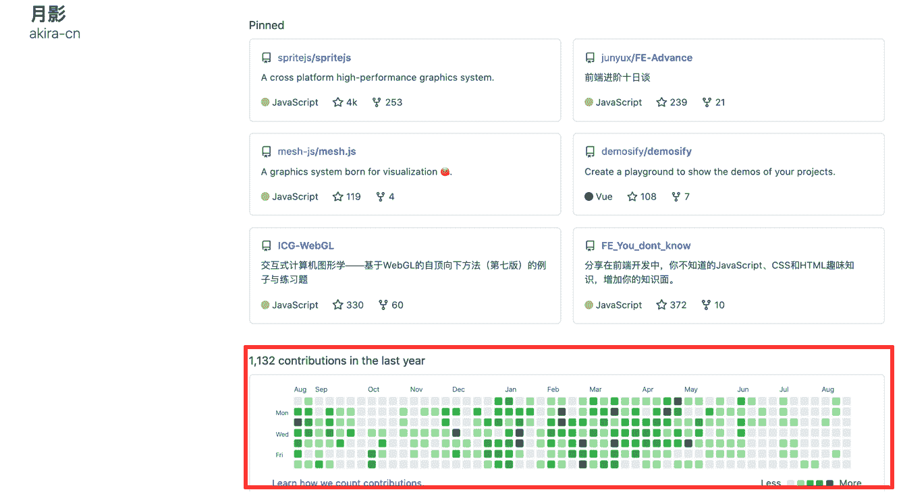
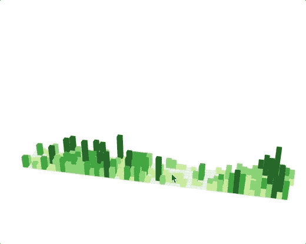
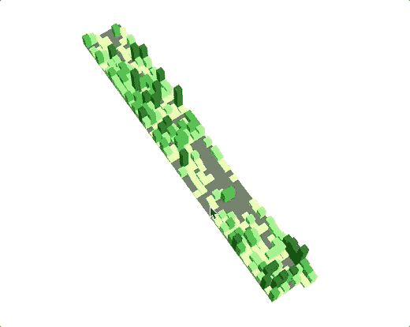
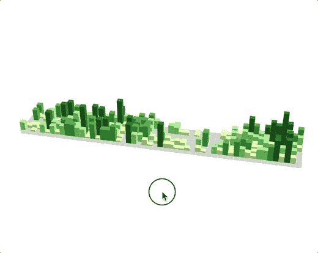
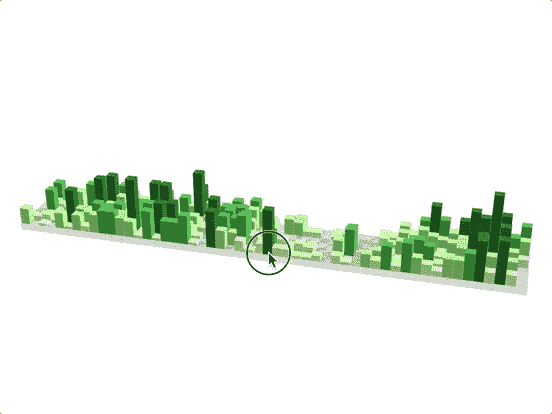
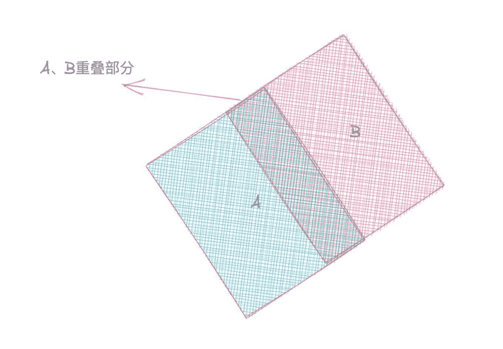
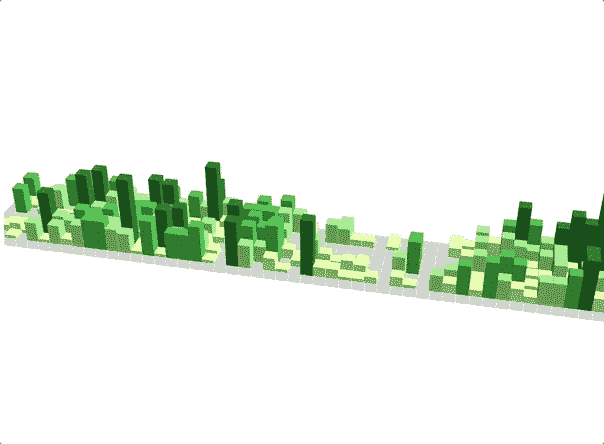
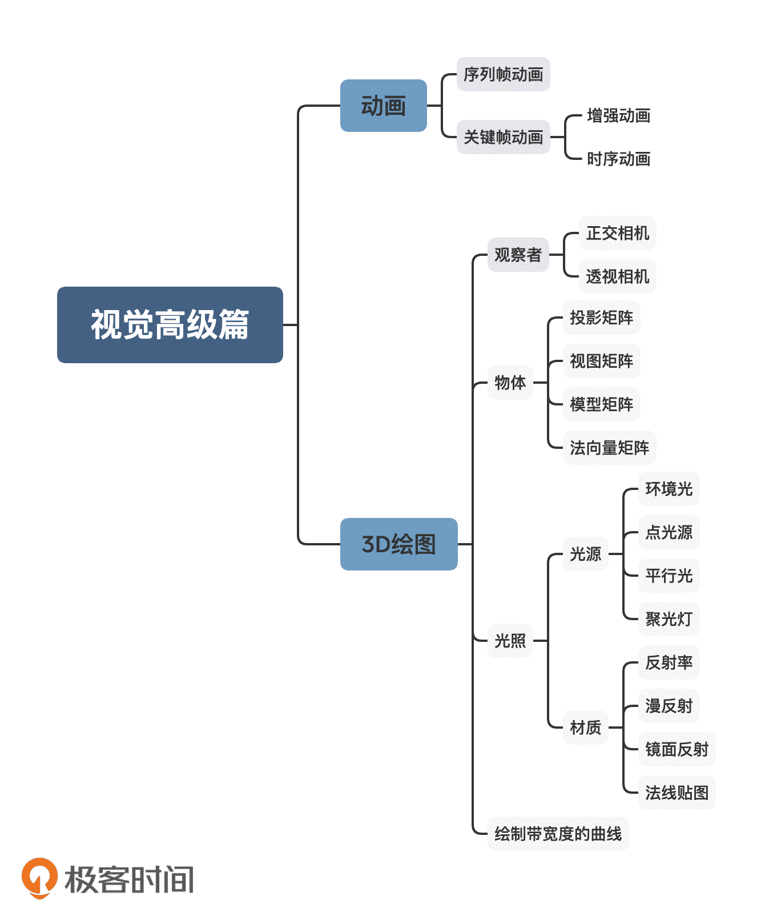

# 27 | 案例：如何实现简单的3D可视化图表？

 

你好，我是月影。

学了这么多图形学的基础知识和 WebGL 的视觉呈现技术，你一定已经迫不及待地想要开始实战了吧？今天，我带你完成一个小型的可视化项目，带你体会一下可视化开发的全过程。也正好借此机会，复习一下我们前面学过的全部知识。

这节课，我们要带你完成一个 **GitHub 贡献图表的可视化作品**。GitHub 贡献图表是一个统计表，它统计了我们在 GitHub 中提交开源项目代码的次数。我们可以在 GitHub 账号信息的个人详情页中找到它。

下图中的红框部分就是我的贡献图表。你会看到，GitHub 默认的贡献图表可视化展现是二维的，那我们要做的，就是把它改造为简单的动态 3D 柱状图表。



GitHub默认的贡献图表可视化展现示意图

## 第一步：准备要展现的数据

想要实现可视化图表，第一步就是准备数据。GitHub 上有第三方 API 可以获得指定用户的 GitHub 贡献数据，具体可以看这个项目。

通过 API，我们可以事先保存好一份 JSON 格式的数据，具体的格式和内容大致如下：

```
// github_contributions_akira-cn.json  
  
{  
  "contributions": [  
    {  
      "date": "2020-06-12",  
      "count": 1,  
      "color":"#c6e48b",  
    },  
    ...  
  ],  
}
```

从这份 JSON 文件中，我们可以取出每一天的提交次数 count，以及一个颜色数据 color。每天提交的次数越多，颜色就越深。有了这份数据内容，我们就可以着手实现具体的展现了。不过，因为数据很多，所以这次我们只想展现最近一年的数据。我们可以写一个函数，根据传入的时间对数据进行过滤。

这个函数的代码如下：

```
let cache = null;  
async function getData(toDate = new Date()) {  
  if(!cache) {  
    const data = await (await fetch('../assets/github_contributions_akira-cn.json')).json();  
    cache = data.contributions.map((o) => {  
      o.date = new Date(o.date.replace(/-/g, '/'));  
      return o;  
    });  
  }  
  // 要拿到 toData 日期之前大约一年的数据（52周）  
  let start = 0,  
    end = cache.length;  
  // 用二分法查找  
  while(start < end - 1) {  
    const mid = Math.floor(0.5 * (start + end));  
    const {date} = cache[mid];  
    if(date <= toDate) end = mid;  
    else start = mid;  
  }  
  // 获得对应的一年左右的数据  
  let day;  
  if(end >= cache.length) {  
    day = toDate.getDay();  
  } else {  
    const lastItem = cache[end];  
    day = lastItem.date.getDay();  
  }  
  // 根据当前星期几，再往前拿52周的数据  
  const len = 7 * 52 + day + 1;  
  const ret = cache.slice(end, end + len);  
  if(ret.length < len) {  
    // 日期超过了数据范围，补齐数据  
    const pad = new Array(len - ret.length).fill({count: 0, color: '#ebedf0'});  
    ret.push(...pad);  
  }  
  return ret;  
}
```

这个函数的逻辑是，先从 JSON 文件中读取数据并缓存起来，然后传入对应的日期对象，获取该日期之前大约一年的数据（准确来说是该日期的前 52 周数据，再加上该日期当前周直到该日期为止的数据，公式为 7*52 + day + 1）。

这样，我们就准备好了要用来展现的数据。

## 第二步：用 SpriteJS 渲染数据、完成绘图

有了数据之后，接下来我们就要把数据渲染出来，完成绘图。这里，我们要用到一个新的 JavaScript 库 SpriteJS 来绘制。

既然如此，我们先来熟悉一下 SpriteJS 库。

SpriteJS是基于 WebGL 的图形库，也是我设计和维护的开源可视化图形渲染引擎项目。它是一个支持树状元素结构的渲染库。也就是说，它和我们前端操作 DOM 类似，通过将元素一一添加到渲染树上，就可以完成最终的渲染。所以在后续的课程中，我们也会更多地用到它。

我们要用到的是 SpriteJS 的 3D 部分，它是基于我们熟悉的 OGL 库实现的。那我们为什么不直接用 OGL 库呢？这是因为 SpriteJS 在 OGL 的基础上，对几何体元素进行了类似 DOM 元素的封装。这样我们创建几何体元素就可以像操作 DOM 一样方便了，直接用 d3 库的 selection 子模块来操作就可以了。

### 1. 创建 Scene 对象

像 DOM 有 documentElement 作为根元素一样，SpriteJS 也有根元素。SpriteJS 的根元素是一个 Scene 对象，对应一个 DOM 元素作为容器。更形象点来说，我们可以把 Scene 理解为一个“场景”。那 SpriteJS 中渲染图形，都要在这个“场景”中进行。

接下来，我们就创建一个 Scene 对象，代码如下：

```
const container = document.getElementById('stage');  
  
const scene = new Scene({  
  container,  
  displayRatio: 2,  
});
```

创建 Scene 对象，我们需要两个参数。一个参数是 container，它是一个 HTML 元素，在这里是一个 id 为 stage 的元素，这个元素会作为 SpriteJS 的容器元素，之后 SpriteJS 会在这个元素上创建 Canvas 子元素。

第二个参数是 displayRatio，这个参数是用来设置显示分辨率的。你应该还记得，在讲 Canvas 绘图的时候，我们提到过，为了让绘制出来的图形能够适配不同的显示设备，我们要把 Canvas 的像素宽高和 CSS 样式宽高设置成不同的值。所以这里，我们把 displayRatio 设为 2，就可以让像素宽高是 CSS 样式宽高的 2 倍，对于一些像素密度为 2 的设备（如 iPhone 的屏幕），这么设置才不会让画布上绘制的图片、文字变得模糊。

### 2. 创建 Layer 对象

有了 scene 对象，我们再创建一个或多个 Layer 对象，也可以理解为是一个或者多个“图层”。在 SpriteJS 中，一个 Layer 对象就对应于一个 Canvas 画布。

```
const layer = scene.layer3d('fglayer', {  
  camera: {  
    fov: 35,  
  },  
});  
layer.camera.attributes.pos = [2, 6, 9];  
layer.camera.lookAt([0, 0, 0]);  

```

如上面代码所示，我们通过调用 scene.layer3d 方法，就可以在 scene 对象上创建了一个 3D（WebGL）上下文的 Canvas 画布。而且这里，我们把相机的视角设置为 35 度，坐标位置为（2, 6, 9），相机朝向坐标原点。

### 3. 将数据转换成柱状元素

接着，我们就要把数据转换成画布上的长方体元素。我们可以借助d3-selection，d3 是一个数据驱动文档的模型，d3-selection 能够通过数据操作文档树，添加元素节点。当然，在使用 d3-selection 添加元素前，我们要先创建用来 3D 展示的 WebGL 程序。

因为 SpriteJS 提供了一些预置的着色器，比如 shaders.GEOMETRY 着色器，就是默认支持 phong 反射模型的一组着色器，我们直接调用它就可以了。

```
const program = layer.createProgram({  
  vertex: shaders.GEOMETRY.vertex,  
  fragment: shaders.GEOMETRY.fragment,  
});
```

创建好 WebGL 程序之后，我们就可以获取数据，用数据来操作文档树了。

```
const dataset = await getData();  
const max = d3.max(dataset, (a) => {  
  return a.count;  
});  
  
/* globals d3 */  
const selection = d3.select(layer);  
const chart = selection.selectAll('cube')  
  .data(dataset)  
  .enter()  
  .append(() => {  
    return new Cube(program);  
  })  
  .attr('width', 0.14)  
  .attr('depth', 0.14)  
  .attr('height', 1)  
  .attr('scaleY', (d) => {  
    return d.count / max;  
  })  
  .attr('pos', (d, i) => {  
    const x0 = -3.8 + 0.0717 + 0.0015;  
    const z0 = -0.5 + 0.05 + 0.0015;  
    const x = x0 + 0.143 * Math.floor(i / 7);  
    const z = z0 + 0.143 * (i % 7);  
    return [x, 0.5 * d.count /max, z];  
  })  
  .attr('colors', (d, i) => {  
    return d.color;  
  });
```

如上面代码所示，我们先通过 d3.select(layer) 对象获得一个 selection 对象，再通过 getData() 获得数据，接着通过 selection.selectAll(‘cube’).data(dataset).enter().append(…) 遍历数据，创建元素节点。

这里，我们创建了 Cube 元素，就是长方体在 SpriteJS 中对应的对象，然后让 dataset 的每一条记录对应一个 Cube 元素，接着我们还要设置每个 Cube 元素的样式，让数据进入 cube 以后，能体现出不同的形状。

具体来说，我们要设置长方体 Cube 的长 (width)、宽 (depth)、高 (height) 属性，以及 y 轴的缩放 (scaleY)，还有 Cube 的位置 (pos) 坐标和长方体的颜色 (colors)。其中与数据有关的参数是 scaleY、pos 和 colors，我就来详细说说它们。

对于 scaleY，我们把它设置为 d.count 与 max 的比值。这里的 max 是指一年的提交记录中，提交代码最多那天的数值。这样，我们就可以保证 scaleY 的值在 0~1 之间，既不会太小、也不会太大。这种用相对数值来做可视化展现的做法，是可视化处理数据的一种常用基础技巧，在数据篇我们还会深入去讲。

而 pos 是根据数据的索引设置 x 和 z 来决定的。由于 Cube 的坐标基于中心点对齐的，现在我们想让它们变成底部对齐，所以需要把 y 设置为 d.count/max 的一半。

最后，我们再根据数据中的 color 值设置 Cube 的颜色。这样，我们通过数据将元素添加之后，画布上渲染出来的结果就是一个 3D 柱状图了，效果如下：



## 第三步：补充细节，实现更好的视觉效果

现在这个 3D 柱状图，还很粗糙。我们可以在此基础上，增加一些视觉上的细节效果。比如说，我们可以给这个柱状图添加光照。比如，我们可以修改环境光，把颜色设置成 (0.5, 0.5, 0.5, 1)，再添加一道白色的平行光，方向是 (-3, -3, -1)。这样的话，柱状图就会有光照效果了。具体的代码和效果图如下：

```
const layer = scene.layer3d('fglayer', {  
  ambientColor: [0.5, 0.5, 0.5, 1],  
  camera: {  
    fov: 35,  
  },  
});  
layer.camera.attributes.pos = [2, 6, 9];  
layer.camera.lookAt([0, 0, 0]);  
  
const light = new Light({  
  direction: [-3, -3, -1],  
  color: [1, 1, 1, 1],  
});  
  
layer.addLight(light);
```



除此之外，我们还可以给柱状图增加一个底座，代码和效果图如下：

```
const fragment = `  
  precision highp float;  
  precision highp int;  
  varying vec4 vColor;  
  varying vec2 vUv;  
  void main() {  
    float x = fract(vUv.x * 53.0);  
    float y = fract(vUv.y * 7.0);  
    x = smoothstep(0.0, 0.1, x) - smoothstep(0.9, 1.0, x);  
    y = smoothstep(0.0, 0.1, y) - smoothstep(0.9, 1.0, y);  
    gl_FragColor = vColor * (x + y);  
  }      
`;  
  
const axisProgram = layer.createProgram({  
  vertex: shaders.TEXTURE.vertex,  
  fragment,  
});  
  
const ground = new Cube(axisProgram, {  
  width: 7.6,  
  height: 0.1,  
  y: -0.049, // not 0.05 to avoid z-fighting  
  depth: 1,  
  colors: 'rgba(0, 0, 0, 0.1)',  
});  
  
layer.append(ground);
```



上面的代码不复杂，我想重点解释其中两处。首先是片元着色器代码，我们使用了根据纹理坐标来实现重复图案的技术。这个方法和我们第 11 节课说的思路完全一样，如果你对这个方法感到陌生了，可以回到前面复习一下。

其次，我们将底座的高度设置为 0.1，y 的值本来应该是 -0.1 的一半，也就是 -0.05，但是我们设置为了 -0.049。少了 0.001 是为了让上层的柱状图稍微“嵌入”到底座里，从而避免因为底座上部和柱状图底部的 z 坐标一样，导致渲染的时候由于次序问题出现闪烁，这个问题在图形学术语里面有一个名字叫做 z-fighting。



z-fighting 现象

z-fighting 是 3D 绘图中的一个常见问题，所以我再多解释一下。在 WebGL 中绘制 3D 物体，一般我们开启了深度检测之后，引擎会自动计算 3D 物体的深度，让离观察者很近的物体面，把离观察者比较远和背对着观察者的物体面遮挡住。那具体是怎么遮挡的呢？其实是根据物体在相机空间中的 z 坐标来判断的。

但有一种特殊情况，就是两个面的 z 坐标相同，又有重叠的部分。这时候，引擎就可能一会儿先渲染 A 面，过一会儿又先去渲染 B 面，这样渲染出来的内容就出现了“闪烁”现象，这就是 z-fighting。



如果A和B深度（z坐标）相同，那么A、B重叠部分渲染次序可能每次不同，从而产生z-fighting

z-fighting 有很多解决方法，比如可以人为指定一下几何体渲染的次序，或者，就是让它们的坐标不要完全相同，在上面的例子里，我们就采用了让坐标不完全相同的处理办法。

最后，为了让实现出来的图形更有趣，我们再增加一个过渡动画，让柱状图的高度从不显示，到慢慢显示出来。



要实现这个效果，我们需要稍微修改一下 d3.selection 的代码。

```
  const chart = selection.selectAll('cube')  
    .data(dataset)  
    .enter()  
    .append(() => {  
      return new Cube(program);  
    })  
    .attr('width', 0.14)  
    .attr('depth', 0.14)  
    .attr('height', 1)  
    .attr('scaleY', 0.001)  
    .attr('pos', (d, i) => {  
      const x0 = -3.8 + 0.0717 + 0.0015;  
      const z0 = -0.5 + 0.05 + 0.0015;  
      const x = x0 + 0.143 * Math.floor(i / 7);  
      const z = z0 + 0.143 * (i % 7);  
      return [x, 0, z];  
    })  
    .attr('colors', (d, i) => {  
      return d.color;  
    });
```

如上面代码所示，我们先把 scaleY 直接设为 0.001，然后我们用 d3.scaleLinear 来创建一个线性的缩放过程，最后，我们通过 chart.trainsition 来实现这个线性动画。

```
const linear = d3.scaleLinear()  
  .domain([0, max])  
  .range([0, 1.0]);  
  
chart.transition()  
  .duration(2000)  
  .attr('scaleY', (d, i) => {  
    return linear(d.count);  
  })  
  .attr('y', (d, i) => {  
    return 0.5 * linear(d.count);  
  });
```

到这里呢，我们就实现了我们想要实现的所有效果了。

## 要点总结

这节课，我们一起实现了 3D 动态的 GitHub 贡献图表，整个实现过程可以总结为两步。

第一步是处理数据，我们可以通过 API 获取 JSON 数据，然后得到我们想要的数据格式。第二步是渲染数据，今天我们是使用 SpriteJS 来渲染的，它的 API 类似于 DOM，对 d3 非常友好。所以我们可以直接使用 d3-selection，以数据驱动文档的方式就可以构建几何体元素。

并且，为了更好地展现数据之间的变换关系，我们根据数据创建了 Cube 元素，并将它们渲染了出来。而且，我们还给实现的柱状元素设置了光照、实现了过渡动画，算是实现了一个比较完整的可视化效果。

此外，我们还要注意，在实现过渡动画的过程中，很容易出现 z-fighting 问题，也就是我们实现的元素由于次序问题，在渲染的时候出现闪烁。这个问题在可视化中非常常见，不过，我们通过设置渲染次序或者避免坐标相同就可以避免。

到这里，我们视觉进阶篇的内容就全部讲完了。这一篇，我从实现简单的动画，讲到了 3D 物体的绘制、旋转、移动，以及给它们添加光照效果、法线贴图，让它们能更贴近真实的物体。

说实话，这一篇的内容单看真的不简单。但你认真看了会发现，所有的知识都是环环相扣的，只要有了前几篇的基础，我们再来学肯定可以学会。为了帮助你梳理这一篇的内容，我总结了一张知识脑图放在了下面，你可以看看。



## 小试牛刀

我们今天讲的这个例子，你学会了吗？你可以用自己的 GitHub 贡献数据，来实现同样的图表，也可以稍微修改一下它的样式，比如采用不同的颜色、不同的光照效果等等。

另外，课程中的例子是默认获取最近一年到当天的数据，你也可以扩展一下功能，让这个图表可以设置日期范围，根据日期范围来呈现数据。

如果你的 GitHub 贡献数据不是很多，也可以去找相似平台上的数据，来实现类似的图表。

今天的实战项目有没有让你体会到可视化的魅力呢？那就快把它分享出去吧！我们下节课再见！

## 源码

实现 3D 可视化图表详细代码

## 推荐阅读

[1] SpriteJS 官网

[2] d3-api
