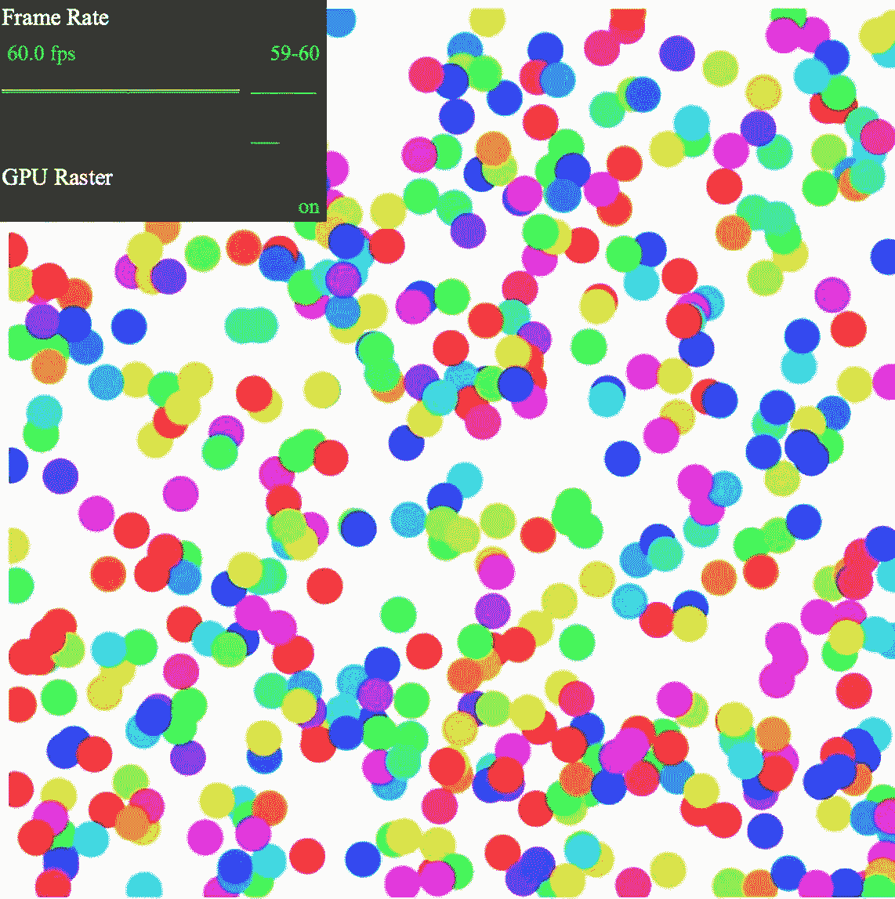
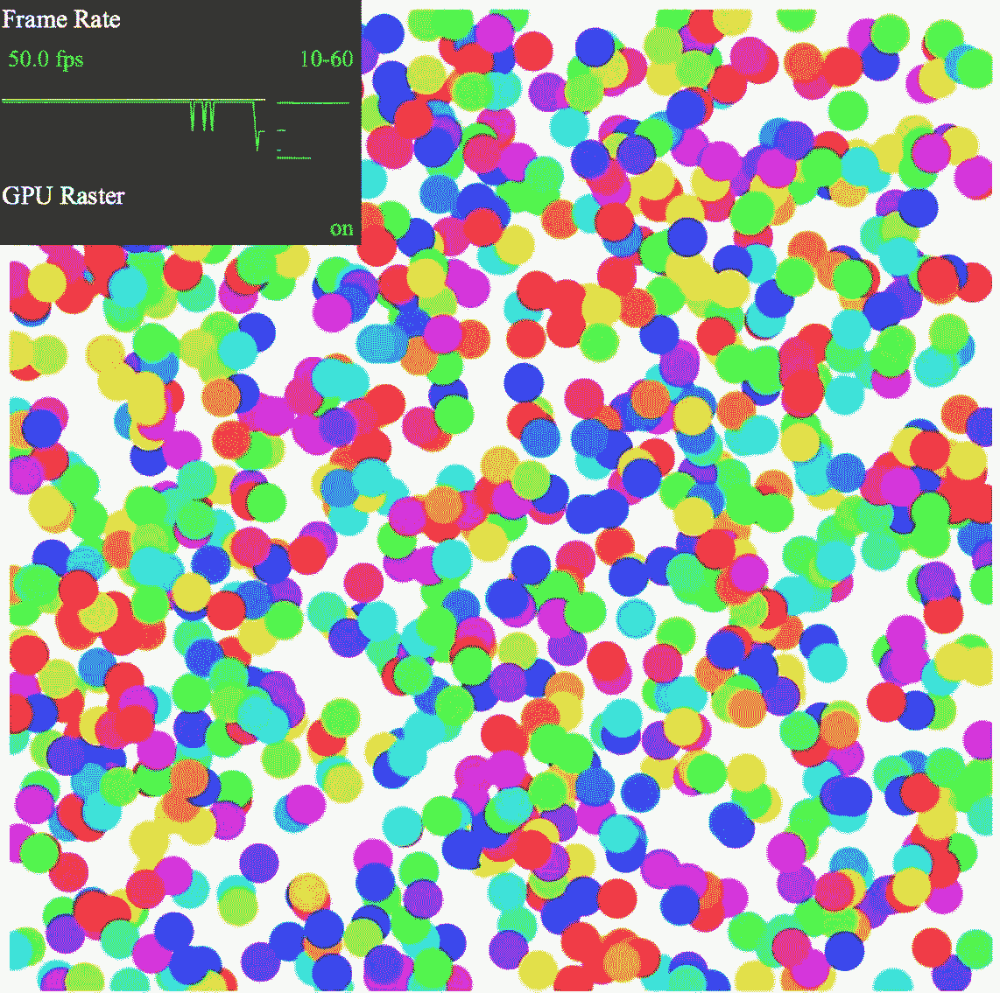
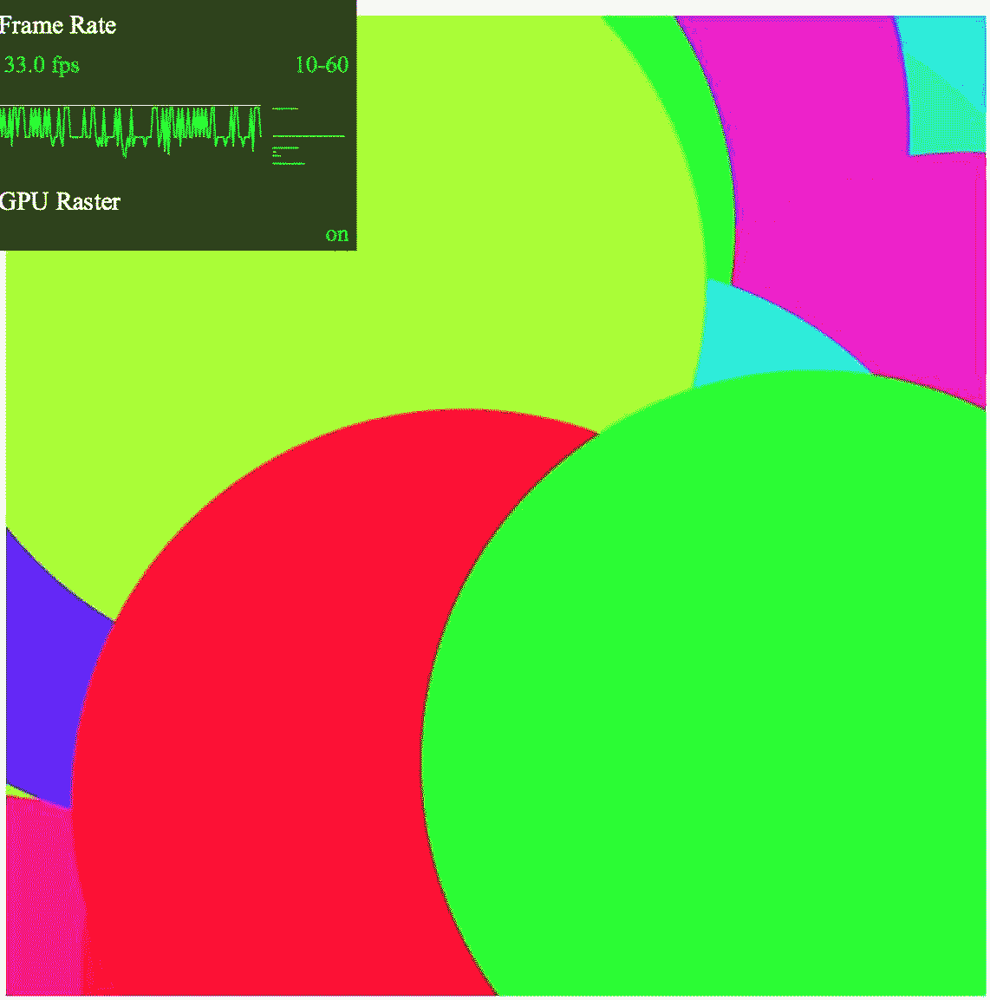
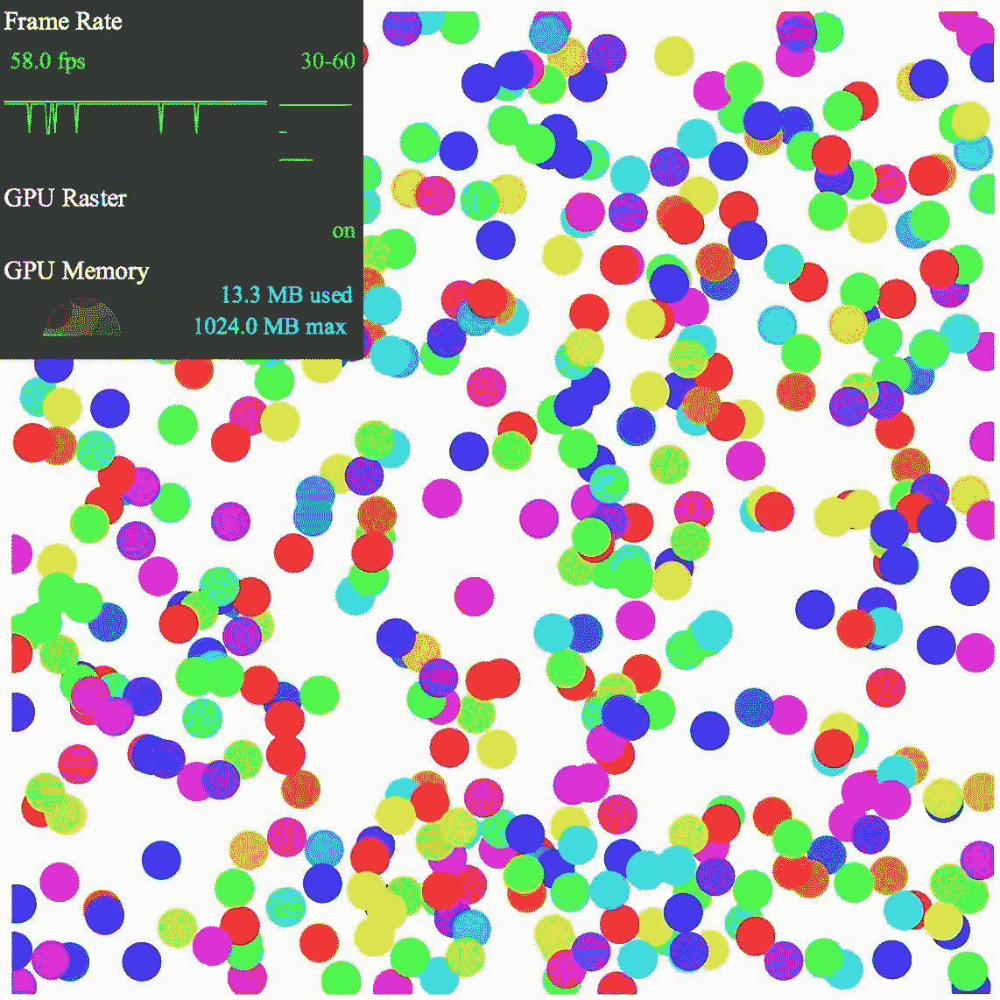
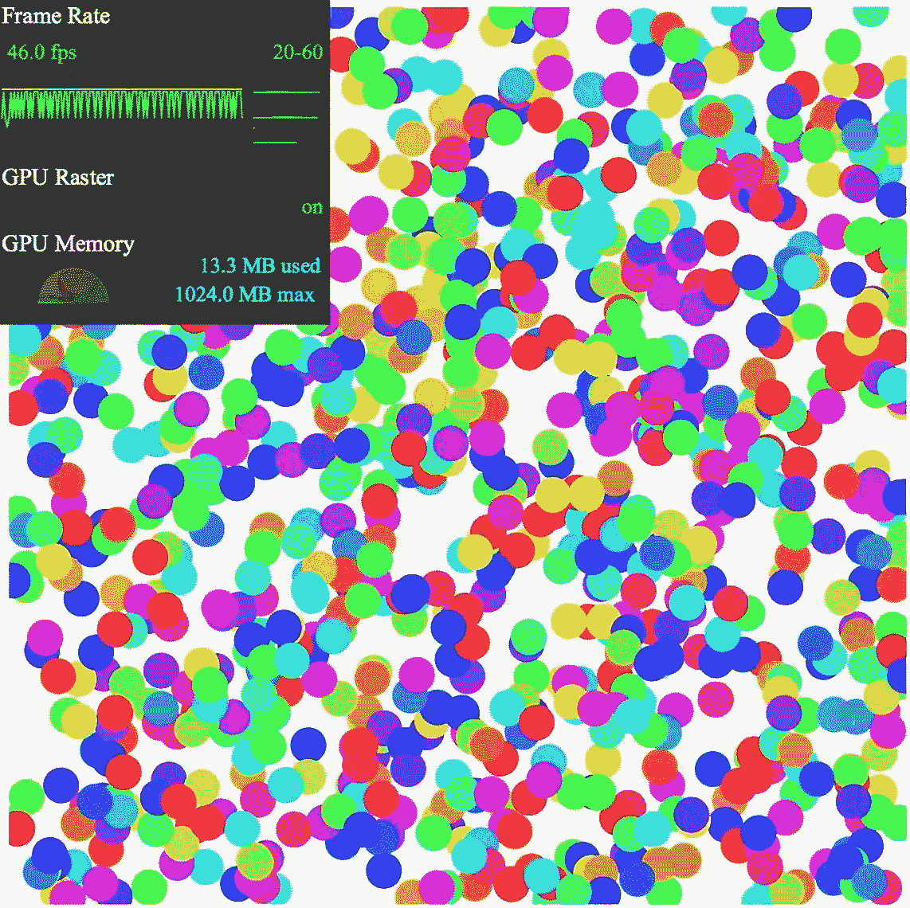
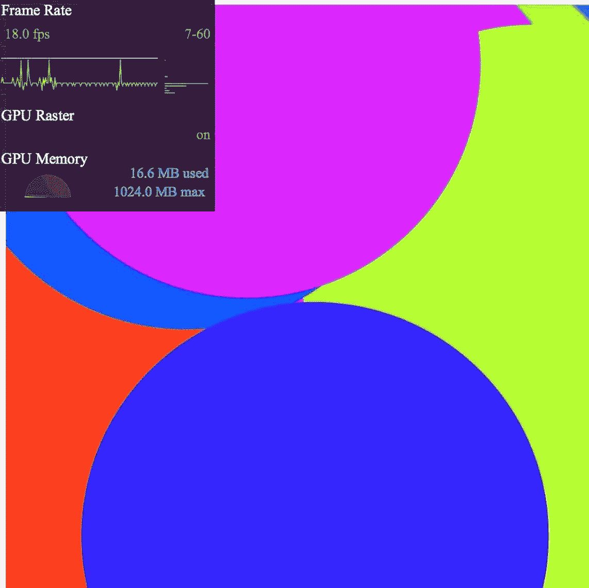
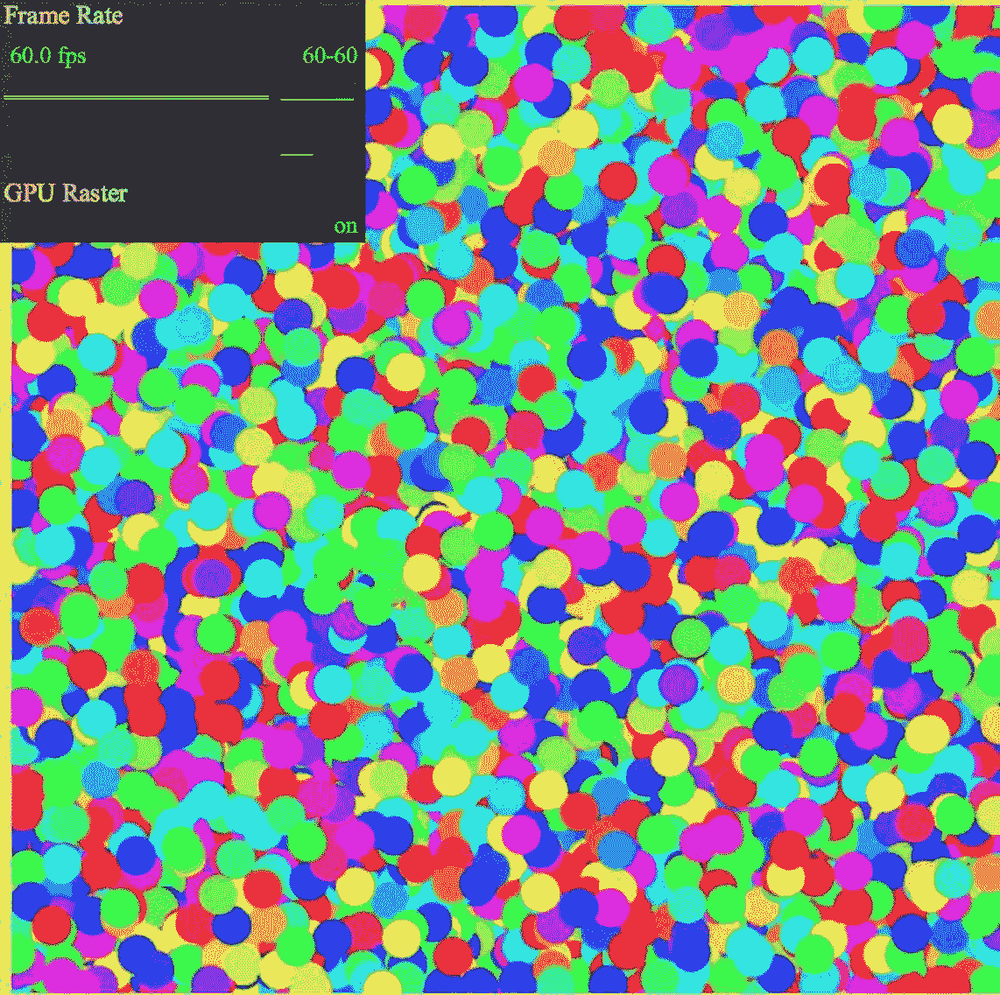

# 28 | Canvas、SVG与WebGL在性能上的优势与劣势

 

你好，我是月影。

性能优化，一直以来都是前端开发的难点。

我们知道，前端性能是一块比较复杂的内容，由许多因素决定，比如，网页内容和资源文件的大小、请求数、域名、服务器配置、CDN 等等。如果你能把性能优化好，就能极大地增强用户体验。

在可视化领域也一样，可视化因为要突出数据表达的内容，经常需要设计一些有视觉震撼力的图形效果，比如，复杂的粒子效果和大量元素的动态效果。想要实现这些效果，图形系统的渲染性能就必须非常好，能够在用户的浏览器上稳定流畅地渲染出想要的视觉效果。

那么针对可视化渲染，我们都要解决哪些性能问题呢？

## 可视化渲染的性能问题有哪些？

由于前端的可视化也是在 Web 上展现的，因此像网页大小这些因素也会影响它的性能。而且，无论是可视化还是普通 Web 前端，针对这些因素进行性能优化的原理和手段都一样。

所以我今天想和你聊的是，可视化方面特殊的性能问题。它们在我们熟悉的 Web 前端工作中并不常见，通常只在可视化中绘制复杂图形的时候，我们才需要重点考虑。这些问题大体上可以分为两类，一类是**渲染效率问题，****另一类是****计算问题**。

**我们先来看它们的定义，渲染效率问题指的是图形系统在绘图部分所花费的时间，而计算问题则是指绘图之外的其他处理所花费的时间，包括图形数据的计算、正常的程序逻辑处理等等**。

我们知道，在浏览器上渲染动画，每一秒钟最高达到 60 帧左右。也就是说，我们可以在 1 秒钟内完成 60 次图像的绘制，那么完成一次图像绘制的时间就是 1000/60（1 秒 =1000 毫秒），约等于 16 毫秒。

换句话说，如果我们能在 16 毫秒内完成图像的计算与渲染过程，那视觉呈现就可以达到完美的 60fps（即 60 帧每秒，fps 全称是 frame per second，是帧率单位）。但是，在复杂的图形渲染时，我们的帧率很可能达不到 60fps。

所以，我们只能退而求其次，最低可以选择 24fps，就相当于图形系统要在大约 42 毫秒内完成一帧图像的绘制。这是在我们的感知里，达到比较流畅的动画效果的最低帧率了。要保证这个帧率，我们就必须保证计算加上渲染的时间不能超过 42 毫秒。

因为计算问题与数据和算法有关，所以我们后面会专门讨论。这里，我们先关注渲染效率的问题，这个问题和图形系统息息相关。

我们知道，Canvas2D、SVG 和 WebGL 等图形系统各自的特点不同，所以它们在绘制不同图形时的性能影响也不同，会表现出不同的性能瓶颈。其实，通过基础篇的学习，我们也大体上知道了这些图形系统的区别和优劣。那今天，我们就在此基础上，深入讨论一下影响它们各自性能的关键因素，理解了这些要素，我们针对不同图形系统，就能快速找到需要进行性能优化的点了。

## 影响 Canvas 渲染性能的 2 大要素

我们知道，Canvas 是指令式绘图系统，它通过绘图指令来完成图形的绘制。那么我们很容易就会想到 2 个影响因素，首先绘制图形的数量越多，我们需要的绘图指令就越多，花费的渲染时间也会越多。其次，画布上绘制的图形越大，绘图指令执行的时间也会增多，那么花费的渲染时间也会越多。

这些其实都是我们现阶段得出的假设，而实践是检验真理的唯一标准，所以我们一起做个实验，来证明我们刚才的假设吧。

```
const canvas = document.querySelector('canvas');  
const ctx = canvas.getContext('2d');  
  
const WIDTH = canvas.width;  
const HEIGHT = canvas.height;  
  
function randomColor() {  
  return `hsl(${Math.random() * 360}, 100%, 50%)`;  
}  
  
function drawCircle(context, radius) {  
  const x = Math.random() * WIDTH;  
  const y = Math.random() * HEIGHT;  
  const fillColor = randomColor();  
  context.fillStyle = fillColor;  
  context.beginPath();  
  context.arc(x, y, radius, 0, Math.PI * 2);  
  context.fill();  
}  
  
function draw(context, count = 500, radius = 10) {  
  for(let i = 0; i < count; i++) {  
    drawCircle(context, radius);  
  }  
}  
  
requestAnimationFrame(function update() {  
  ctx.clearRect(0, 0, WIDTH, HEIGHT);  
  draw(ctx);  
  requestAnimationFrame(update);  
});
```

如上面代码所示，我们在 Canvas 上每一帧绘制 500 个半径为 10 的小圆，效果如下：



500个小球，半径10

注意，为了方便查看帧率的变化，我们在浏览器中开启了帧率检测。Chrome 开发者工具自带这个功能，我们在开发者工具的 Rendering 标签页中，勾选 FPS Meter 就可以开启这个功能查看帧率了。

我们现在看到，即使每帧渲染 500 个位置和颜色都随机的小圆形，Canvas 渲染的帧率依然能达到 60fps。

接着，我们增加小球的数量，把它增加到 1000 个。



1000个小球，半径10

这时你可以看到，因为小球数量增加一倍，所以帧率掉到了 50fps 左右，现在下降得还不算太多。而如果我们把小球的数量设置成 3000，你就能看到明显的差别了。

那如果我们把小球的数量保持在 500，把半径增大到很大，如 200，也会看到帧率有明显下降。



500个小球，半径200

但是，单从上图的实验来看，图形大小对帧率的影响也不是很大。因为我们把小球的半径增加了 20 倍，帧率也就下降到 33fps。当然这也是因为画圆比较简单，如果我们绘制的图形更复杂一些，那么大小的影响会相对显著一些。

通过这个实验，我们能得出，影响 Canvas 的渲染性能的主要因素有两点，一是**绘制图形的数量**，二是**绘制图形的大小。**这正好验证了我们开头的结论。

总的来说，Canvas2D 绘制图形的性能还是比较高的。在普通的个人电脑上，我们要绘制的图形不太大时，只要不超过 500 个都可以达到 60fps，1000 个左右其实也能达到 50fps，就算要绘制大约 3000 个图形，也能够保持在可以接受的 24fps 以上。

因此，在不做特殊优化的前提下，如果我们使用 Canvas2D 来绘图，那么 3000 个左右元素是一般的应用的极限，除非这个应用运行在比个人电脑的 GPU 和显卡更好的机器上，或者采用特殊的优化手段。那具体怎么优化，我会在下节课详细来说。

## 影响 SVG 性能的 2 大要素

讲完了 Canvas 接下来我们看一下 SVG。

我们用 SVG 实现同样的绘制随机圆形的例子，代码如下：

```
function randomColor() {  
  return `hsl(${Math.random() * 360}, 100%, 50%)`;  
}  
  
const root = document.querySelector('svg');  
const COUNT = 500;  
const WIDTH = 500;  
const HEIGHT = 500;  
  
function initCircles(count = COUNT) {  
  for(let i = 0; i < count; i++) {  
    const circle = document.createElementNS('http://www.w3.org/2000/svg', 'circle');  
    root.appendChild(circle);  
  }  
  return [...root.querySelectorAll('circle')];  
}  
const circles = initCircles();  
  
function drawCircle(circle, radius = 10) {  
  const x = Math.random() * WIDTH;  
  const y = Math.random() * HEIGHT;  
  const fillColor = randomColor();  
  circle.setAttribute('cx', x);  
  circle.setAttribute('cy', y);  
  circle.setAttribute('r', radius);  
  circle.setAttribute('fill', fillColor);  
}  
  
function draw() {  
  for(let i = 0; i < COUNT; i++) {  
    drawCircle(circles[i]);  
  }  
  requestAnimationFrame(draw);  
}  
  
draw();  

```

在我的电脑上（一台普通的 MacBook Pro，内存 8GB，独立显卡）绘制了 500 个半径为 10 的小球时，SVG 的帧率接近 60fps，会比 Canvas 稍慢，但是差别不是太大。



SVG绘制500个小球，半径10

当我们将小球数量增加到 1000 个时，SVG 的帧率就要略差一些，大概 45fps 左右。



SVG绘制1000个小球，半径10

乍一看，似乎 SVG 和 Canvas2D 的性能差别也不是很大。不过，随着小球数量的增加，两者的差别会越来越大。比如说，当我们将小球的个数增加到 3000 个左右的时候，Canvas2D 渲染的帧率依然保持在 30fps 以上，而 SVG 渲染帧率大约只有 15fps，差距会特别明显。

之所以在小球个数较多的时候，二者差距很大，因为 SVG 是浏览器 DOM 来渲染的，元素个数越多，消耗就越大。

如果我们保证小球个数在一个小数值，然后增大每个小球的半径，那么与 Canvas 一样，SVG 的渲染效率也会明显下降。



SVG绘制500个小球，半径200

如上图所示，当渲染 500 个小球时，我们把半径增加到 200，帧率下降到不到 20fps。

最终，我们能得到的结论与 Canvas 类似，影响 SVG 的性能因素也是相同的两点，一是**绘制图形的数量**，二是**绘制图形的大小**。但与 Canvas 不同的是，图形数量增多的时候，SVG 的帧率下降会更明显，因此，一般来说，在图形数量小于 1000 时，我们可以考虑使用 SVG，当图形数量大于 1000 但不超过 3000 时，我们考虑使用 Canvas2D。

那么当图形数量超过 3000 时，用 Canvas2D 也很难达到比较理想的帧率了，这时候，我们就要使用 WebGL 渲染。

## 影响 WebGL 性能的要素

用 WebGL 渲染上面的例子，我们不需要一个一个小球去渲染，利用 GPU 的并行处理能力，我们可以一次完成渲染。

因为我们要渲染的小球形状相同，所以它们的顶点数据是可以共享的。在这里我们采用一种 WebGL 支持的批量绘制技术，叫做 **InstancedDrawing（实例化渲染）**。在 OGL 库中，我们只需要给几何体数据传递带有 instanced 属性的顶点数据，就可以自动使用 instanced drawing 技术来批量绘制图形。具体的操作代码如下：

```
function circleGeometry(gl, radius = 0.04, count = 30000, segments = 20) {  
  const tau = Math.PI * 2;  
  const position = new Float32Array(segments * 2 + 2);  
  const index = new Uint16Array(segments * 3);  
  const id = new Uint16Array(count);  
  
  for(let i = 0; i < segments; i++) {  
    const alpha = i / segments * tau;  
    position.set([radius * Math.cos(alpha), radius * Math.sin(alpha)], i * 2 + 2);  
  }  
  for(let i = 0; i < segments; i++) {  
    if(i === segments - 1) {  
      index.set([0, i + 1, 1], i * 3);  
    } else {  
      index.set([0, i + 1, i + 2], i * 3);  
    }  
  }  
  for(let i = 0; i < count; i++) {  
    id.set([i], i);  
  }  
  return new Geometry(gl, {  
    position: {  
      data: position,  
      size: 2,  
    },  
    index: {  
      data: index,  
    },  
    id: {  
      instanced: 1,  
      size: 1,  
      data: id,  
    },  
  });  
}
```

我们实现一个 circleGeometry 函数，用来生成指定数量的小球的定点数据。这里我们使用批量绘制的技术，一下子绘制了 30000 个小球。与绘制单个小球一样，我们计算小球的 position 数据和 index 数据，然后我们设置一个 id 数据，这个数据等于每个小球的下标。

我们通过 instanced:1 的方式告诉 WebGL 这是一个批量绘制的数据，让每一个值作用于一个几何体。这样我们就能区分不同的几何体，而 WebGL 在绘制的时候会根据 id 数据的个数来绘制相应多个几何体。

接着，我们实现顶点着色器，并且在顶点着色器代码中实现随机位置和随机颜色。

```
precision highp float;  
attribute vec2 position;  
attribute float id;  
uniform float uTime;  
  
highp float random(vec2 co) {  
  highp float a = 12.9898;  
  highp float b = 78.233;  
  highp float c = 43758.5453;  
  highp float dt= dot(co.xy ,vec2(a,b));  
  highp float sn= mod(dt,3.14);  
  return fract(sin(sn) * c);  
}  
  
vec3 hsb2rgb(vec3 c){  
  vec3 rgb = clamp(abs(mod(c.x*6.0+vec3(0.0,4.0,2.0), 6.0)-3.0)-1.0, 0.0, 1.0);  
  rgb = rgb * rgb * (3.0 - 2.0 * rgb);  
  return c.z * mix(vec3(1.0), rgb, c.y);  
}  
  
varying vec3 vColor;  
  
void main() {  
  vec2 offset = vec2(  
    1.0 - 2.0 * random(vec2(id + uTime, 100000.0)),  
    1.0 - 2.0 * random(vec2(id + uTime, 200000.0))  
  );  
  vec3 color = vec3(  
    random(vec2(id + uTime, 300000.0)),  
    1.0,  
    1.0  
  );  
  vColor = hsb2rgb(color);  
  gl_Position = vec4(position + offset, 0, 1);  
}
```

上面的代码中的 random 函数和 hsb2rgb 函数，我们都学过了，整体逻辑也并不复杂，相信你应该能看明白。

最后，我们将 uTime 作为 uniform 传进去，结合 id 和 uTime，用随机数就可以渲染出与前面 Canvas 和 SVG 例子一样的效果。

这个 WebGL 渲染的例子的性能非常高，我们将小球的个数设置为 30000 个，依然可以轻松达到 60fps 的帧率。



WebGL，绘制30000个小球，半径10

WebGL 渲染之所以能达到这么高的性能，是因为 WebGL 利用 GPU 并行执行的特性，无论我们批量绘制多少个小球，都能够同时完成计算并渲染出来。

如果我们增大小球的半径，那么帧率也会明显下降，这一点和 Canvas2D 与 SVG 一样。当我们将小球半径增加到 0.8（相当于 Canvas2D 中的 200），那么可以流畅渲染的数量就无法达到这么多，大约渲染 3000 个左右可以保持在 30fps 以上，这个效率仍比 Canvas2D 有着 5 倍以上的提升。小球半径增加导致帧率下降，是因为图形增大，片元着色器要执行的次数就会增多，就会增加 GPU 运算的开销。

好了，那我们来总结一下 WebGL 性能的要素。WebGL 情况比较复杂，上面的例子其实不能涵盖所有的情况，不过不要紧，我这里先说一下结论，你先记下来，我们之后还会专门讨论 WebGL 的性能优化方法。

首先，WebGL 和 Canvas2D 与 SVG 不同，它的性能并不直接与渲染元素的数量相关，而是取决于 WebGL 的渲染次数。有的时候，图形元素虽然很多，但是 WebGL 可以批量渲染，就像前面的例子中，虽然有上万个小球，但是通过 WebGL 的 instanced drawing 技术，可以批量完成渲染，那样它的性能就会很高。当然，元素的数量多，WebGL 渲染效率也会逐渐降低，这是因为，元素越多，本身渲染耗费的内存也越多，占用内存太多，渲染效率也会下降。

其次，在渲染次数相同的情况下，WebGL 的效率取决于着色器中的计算复杂度和执行次数。图形顶点越多，顶点着色器的执行次数越多，图形越大，片元着色器的执行次数越多，虽然是并行执行，但执行次数多依然会有更大的性能开销。最后，如果每次执行着色器中的计算越复杂，WebGL 渲染的性能开销自然也会越大。

总的来说，WebGL 的性能主要有三点决定因素，**一是渲染次数，二是着色器执行的次数，三是着色器运算的复杂度。**当然，数据的大小也会决定内存的消耗，因此也会对性能有所影响，只不过影响没有前面三点那么明显。

## 要点总结

要针对可视化的渲染效率进行性能优化，我们就要先搞清影响图形系统渲染性能的主要因素。

对于 Canvas 和 SVG 来说，影响渲染性能的主要是绘制元素的数量和元素的大小。一般来说，Canvas 和 SVG 绘制的元素越多，性能消耗越大，绘制的图形越大，性能消耗也越大。相比较而言，Canvas 的整体性能要优于 SVG，尤其是图形越多，二者的性能差异越大。

WebGL 要复杂一些，它的渲染性能主要取决于三点。

第一点是渲染次数，渲染次数越多，性能损耗就越大。需注意，要绘制的元素个数多，不一定渲染次数就多，因为 WebGL 支持批量渲染。

第二点是着色器执行的次数，这里包括顶点着色器和片元着色器，前者的执行次数和几何图形的顶点数有关，后者的执行次数和图形的大小有关。

第三点是着色器运算的复杂度，复杂度和 glsl 代码的具体实现有关，越复杂的处理逻辑，性能的消耗就会越大。

最后，数据的大小会影响内存消耗，所以也会对 WebGL 的渲染性能有所影响，不过没有前面三点的影响大。

## 小试牛刀

1. 刚才我们用 SVG、Canvas 和 WebGL 分别实现了随机小球，由此比较了三种图形系统的性能。但是我们并没说 HTML/CSS，你能用 HTML/CSS 来实现这个例子吗？用 HTML/CSS 来实现，在性能方面与 SVG、Canvas 和 WebGL 有什么区别呢？从中，你能得出影响 HTML/CSS 渲染性能的要素吗？
2. 在 WebGL 的例子中，我们采用了批量绘制的技术。实际上我们也可以不采用这个技术，给每个小球生成一个 mesh 对象，然后让 Ogl 来渲染。你可以试着用 Ogl 不采用批量渲染来实现随机小球，然后对比它们之间的渲染方案，得出性能方面的差异吗?

## 源码

 课程中详细示例代码
