# 34 | 数据处理（二）：如何处理多元变量？

 

你好，我是月影。

数据处理是一门很深的学问，想要学好它，我们不仅需要掌握很复杂的理论，还需要不断地积累经验。不过，其中也有一些基础的数据处理技巧，掌握它们，我们就能更好地入门可视化了。

比如我们上节课重点讲解的数据分类，就是其中一种非常基础的数据处理技巧，也是数据处理的第一步。这一节课，我会以处理 2014 年北京市的天气历史数据为例，来和你进一步讨论数据处理的基础技巧，包括从数据到图表的展现以及处理多元变量的方法。

## 从数据到图表展现

一般来说，我们拿到的原始数据通常可以组织成表格的形式，表格中会有很多列，每一列都代表一个变量。比如，我们拿到的这份天气历史数据，它看起来可能是下面这样的：

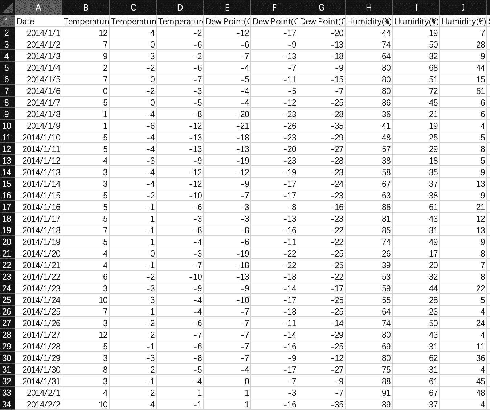

这里有许多变量，比如时间、最高气温、平均气温、最低气温、最高湿度、平均湿度、最低湿度、露点等等。一般的情况下，我们会将其中我们最关心的一个变量平均气温，用一个图表展现出来。具体怎么做呢？我们可以来动手操作一下。

这份数据是 csv 格式的，是一张表，我们先用 D3.js 将数据读取出来，然后结构化成 JSON 对象。

```
const rawData = await (await fetch('beijing_2014.csv')).text();  
const data = d3.csvParse(rawData);  
const dataset = data.filter(d => new Date(d.Date).getMonth() < 3)  
  .map(d => {return {temperature: Number(d['Temperature(Celsius)(avg)']), date: d.Date, category: '平均气温'}});  
console.log(dataset);
```

如上面代码所示，我们通过 fetch 读取 csv 的数据。CSV 文件格式是用逗号和回车分隔的文本，所以我们用.text() 读取内容。然后我们使用 d3 的 csvParse 方法，将数据解析成 JSON 数组。最后，我们再通过数组的 filter 和 map，将我们感兴趣的数据取出来。这里，我们截取了 1 月到 3 月的平均气温数据。

取到了想要的数据，接下来我们就可以将它展示出来了，这一步我们可以使用数据驱动框架。在预习篇我们讲过，数据驱动框架是一种特殊的库，它们更专注于处理数据的组织形式，将数据呈现交给更底层的图形系统（DOM、SVG、Canvas）或通用图形库（SpriteJS、ThreeJS）去完成。

但是，为了方便你理解，这里我就不使用数据驱动框架了，而是直接采用一个图表库QCharts，它是一个基于 SpriteJS 设计的图表库。与数据驱动框架相比，图表库虽然减少了灵活性，但是使用上更加方便，通过一些简单的配置，我们就可以完成图表的渲染。

用来展示平均气温最常见的图表就是折线图，展示折线图的过程可以简单分为 4 步：第一步是创建图表（Chart）并传入数据；第二步是创建图形（Visual)，这里我们创建的是折线图，所以使用 Line 对象；第三步是创建横、纵两个坐标轴（Axis）、提示（ToolTip）和一个图例（Legend）；最后一步是将图形、坐标轴、提示和图例都添加到图表上。具体的代码如下：

```
const { Chart, Line, Legend, Tooltip, Axis } = qcharts;  
const chart = new Chart({  
  container: '#app'  
});  
let clientRect={bottom:50};  
chart.source(dataset, {  
  row: 'category',  
  value: 'temperature',  
  text: 'date'  
});  
  
const line = new Line({clientRect});  
const axisBottom = new Axis({clientRect}).style('grid', false);  
axisBottom.attr('formatter', d => '');  
const toolTip = new Tooltip({  
  title: arr => {  
    return arr.category  
  }  
});  
const legend = new Legend();  
const axisLeft = new Axis({ orient: 'left',clientRect }).style('axis', false).style('scale', false);  
  
chart.append([line, axisBottom, axisLeft, toolTip, legend]);
```

这样，我们就将图表渲染到画布上了。

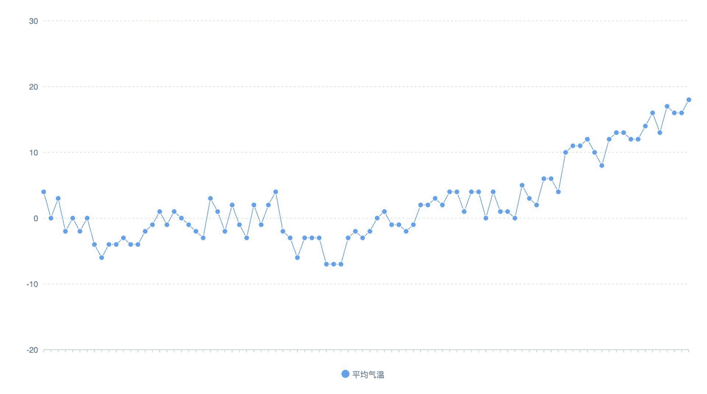

## 处理多元变量

刚才我们已经成功将平均气温这个变量用折线图展示出来了，但在很多数据可视化场景里，我们不只会关心一个变量，还会关注多个变量，比如，我们需要同时关注温度和湿度数据。那怎么才能把多个变量绘制在同一张图表上呢？换句话说，同一张图表怎么展示多元变量呢？

### 在一张图表上绘制多元变量

最简单的方式是直接在图表上同时绘制多个变量，每个变量对应一个图形，这样一张图表上就同时显示多个图形。

我们直接以刚才的代码为例，现在，我们修改例子中的代码，直接添加平均湿度数据，代码如下：

```
const rawData = await (await fetch('beijing_2014.csv')).text();  
const data = d3.csvParse(rawData).filter(d => new Date(d.Date).getMonth() < 3);  
const dataset1 = data  
  .map(d => {  
    return {  
      value: Number(d['Temperature(Celsius)(avg)']),  
      date: d.Date,  
      category: '平均气温'}  
    });  
const dataset2 = data  
  .map(d => {  
      return {  
        value: Number(d['Humidity(%)(avg)']),  
        date: d.Date,  
        category: '平均湿度'}  
      });
```

然后，我们修改图表的数据，将温度（dataset1）和湿度（dataset2）数据都传入图表，代码如下：

```
chart.source([...dataset1, ...dataset2], {  
  row: 'category',  
  value: 'value',  
  text: 'date'  
});
```

这样，我们就得到了同时显示温度和湿度数据的折线图。

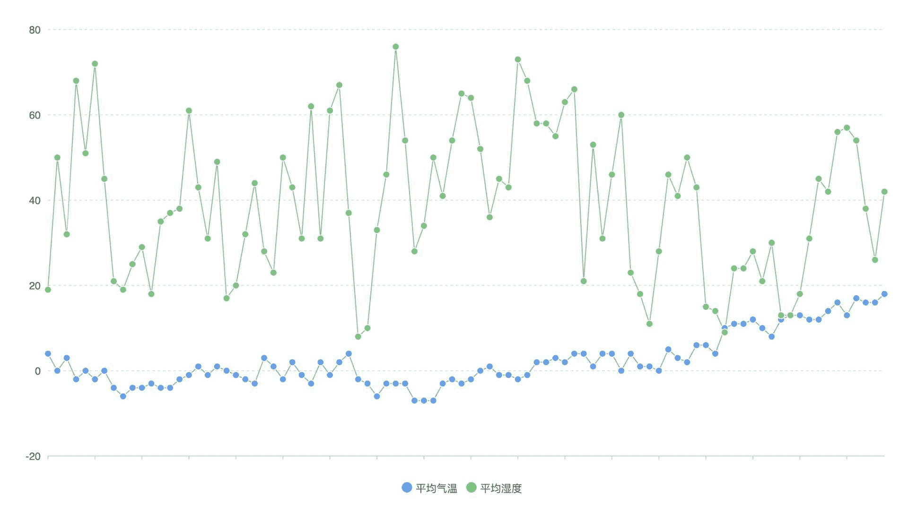

### 用散点图分析变量的相关性

不过，你应该也发现了，把温度和深度同时绘制到一张折线图之后，我们很难直观地看出温度与湿度的相关性。所以，如果我们希望了解 2014 年全年，北京市温度和湿度之间的关联性，我们还得用另外的方式。那都有哪些方式呢？

一般来说，要分析两个变量的相关性，我们可以使用散点图，散点图有两个坐标轴，其中一个坐标轴表示变量 A，另一个坐标轴表示变量 B。这里，我们将平均温度、相对湿度数据获取出来，然后用 QCharts 的散点图（Scatter）来渲染。具体的代码和示意图如下：

```
const rawData = await (await fetch('beijing_2014.csv')).text();  
const data = d3.csvParse(rawData);  
console.log(data);  
const dataset = data  
  .map(d => {  
    return {  
      temperature: Number(d['Temperature(Celsius)(avg)']),  
      humdity: Number(d['Humidity(%)(avg)']),  
      category: '平均气温与湿度'}  
    });  
  
const { Chart, Scatter, Legend, Tooltip, Axis } = qcharts;  
const chart = new Chart({  
  container: '#app'  
});  
let clientRect={bottom:50};  
chart.source(dataset, {  
  row: 'category',  
  value: 'temperature',  
  text: 'humdity'  
});  
  
const scatter = new Scatter({  
  clientRect,  
  showGuideLine: true,  
});  
const toolTip = new Tooltip({  
  title: (data) => '温度与湿度：',  
  formatter: (data) => {  
    return `温度：${data.temperature}C  湿度：${data.humdity}% `  
  }  
});  
const legend = new Legend();  
const axisLeft = new Axis({ orient: 'left',clientRect }).style('axis', false).style('scale', false);  
const axisBottom = new Axis();  
  
chart.append([scatter, axisBottom, axisLeft, toolTip, legend]);
```

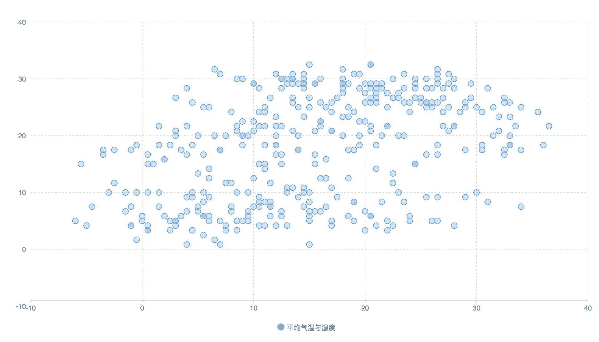

从这个图表我们可以看出，平均温度和相对湿度并没有相关性，所以点的空间分布比较随机。事实上也是如此，气温和绝对湿度有关，但相对湿度因为已经考虑过了温度因素，所以就和气温没有相关性了。

那你可能会有疑问，相关的图形长什么样呢？我们可以用另外两个变量，比如露点和平均温度，来试试看能不能画出相关的散点图。

我们先来说说什么是露点。在空气中水汽含量不变， 并且气压一定的情况下， 空气能够冷却达到饱和时的温度就叫做露点温度， 简称露点， 它的单位与气温相同。

从定义里我们知道，露点和温度与湿度都有相关性。接下来，我们来看一下露点和温度的相关性在散点图中是怎么体现的。很简单，我们只要修改一下上面代码里的数据，把平均湿度换成平均露点温度就行了。

```
const dataset = data  
  .map(d => {  
    return {  
      temperature: Number(d['Temperature(Celsius)(avg)']),  
      tdp: Number(d['Dew Point(Celsius)(avg)']),  
      category: '平均气温与露点'}  
    });
```

这样，我们最终呈现出来的散点图具有典型的数据正相关性，也就是说图形的点更集中在对角线附近的区域。

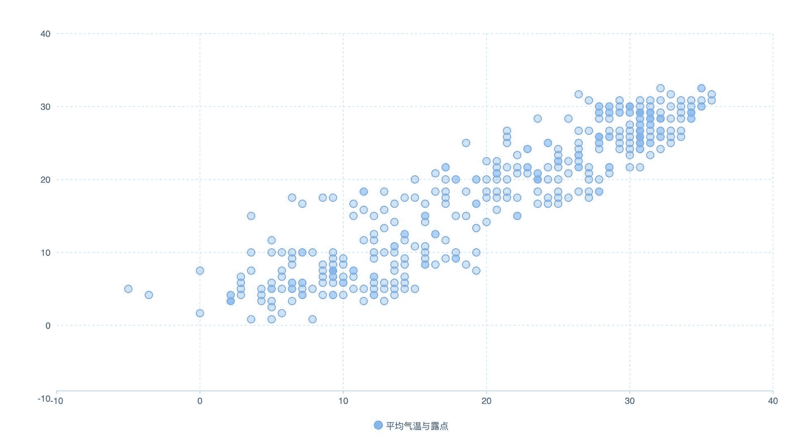

我们还可以把湿度数据也加上。

```
const dataset = data  
  .map(d => {  
    return {  
      value: Number(d['Temperature(Celsius)(avg)']),  
      tdp: Number(d['Dew Point(Celsius)(avg)']),  
      category: '平均气温与露点'}  
    });  
const dataset2 = data  
  .map(d => {  
    return {  
      value: Number(d['Humidity(%)(avg)']),  
      tdp: Number(d['Dew Point(Celsius)(avg)']),  
      category: '平均湿度与露点'}  
    });  
     
...  
chart.source([...dataset, ...dataset2], {  
  row: 'category',  
  value: 'value',  
  text: 'tdp'  
});
```

我们发现，平均湿度和露点也是成正相关的，不过露点与温度的相关性更强，因为散点更集中一些。

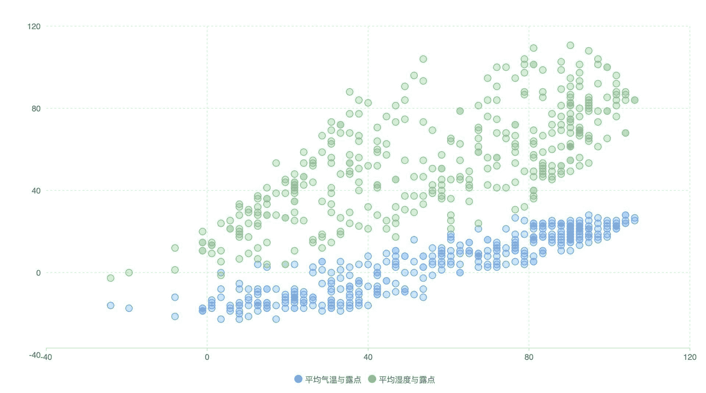

为了再强化理解，我们还可以看一组强相关的数据，比如平均温度和最低温度，你会发现，图上的散点基本上就在对角线上。

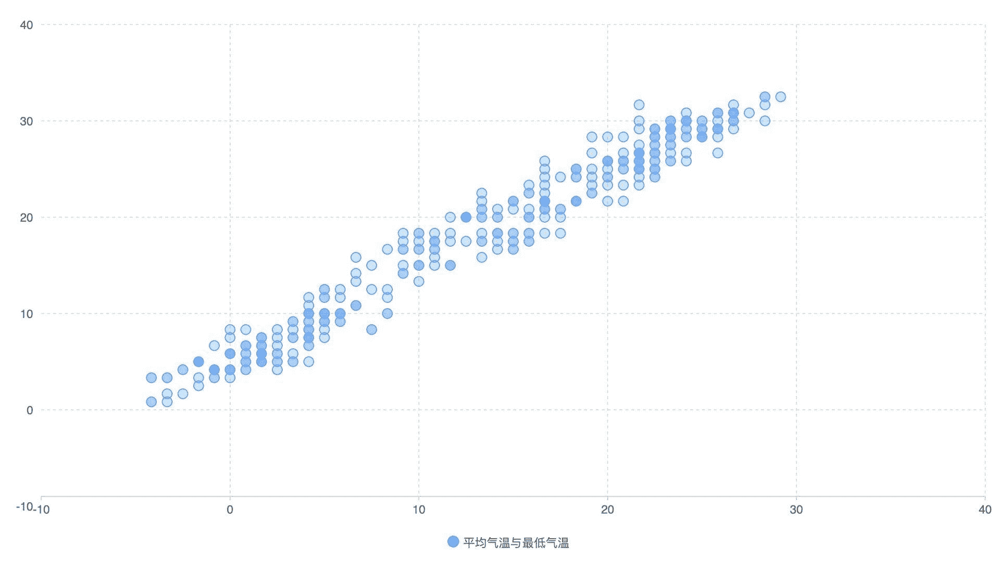

总的来说，两个数据的散点越集中在对角线，说明这两个数据的相关性越强，当然这么说还不够严谨只是方便我们记忆而已。这里，我找到了一张散点图和相关性之间关系的总结图，你可以多了解一下。

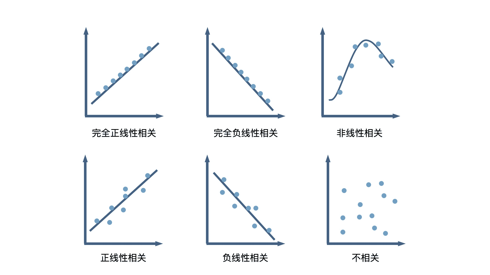

### 散点图的扩展

通过前面的例子，我们可以看到，用散点图可以分析出数据的二元变量之间的相关性，这对数据可视化场景的信息处理非常有用。不过，散点图也有明显的局限性，那就是它的维度只有二维，所以它一般只能处理二元变量，超过二维的多元变量的相关性，它处理起来就有些力不从心了。

不过，我们还不想放弃散点图在相关性上的优异表现。所以在处理高维度数据时，我们可以对散点图进行扩展，比如引入颜色、透明度、大小等信息来表示额外的数据维度，这样就可以处理多维数据了。

举个例子，我在下面给出了一张根据加州房产数据集制作的散点图。其中，点的大小代表街区人口数量、透明度代表人口密度，而颜色代表房价高低，并且加上经纬度代表点的位置。这个散点图一共表示了五维的变量（经度、纬度、人口总数、人口密度、房价高低），将它们都呈现在了一张图上，这在一定程度上表达了这些变量的相关信息。

[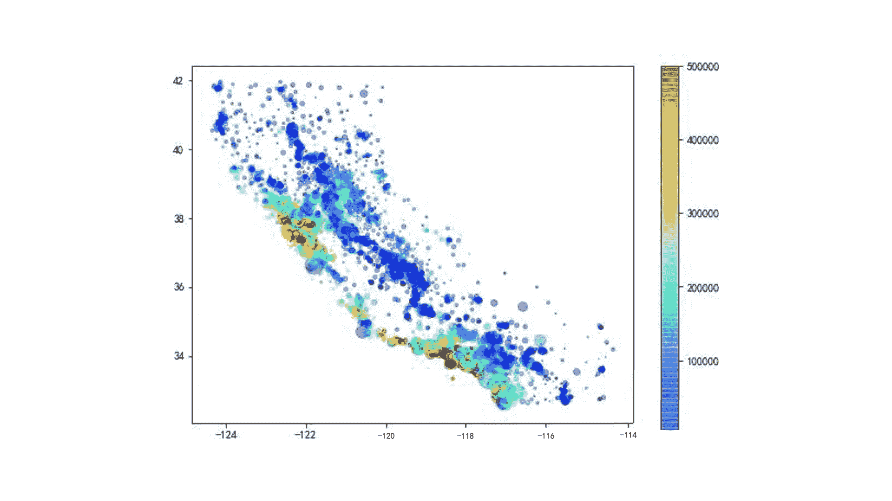](https://zhuanlan.zhihu.com/p/141118125)
图片来源：知乎

这里，我带你做个简单的分析。从这张图上，我们很容易就可以得出两个结论，第一个是，房价比较高的区域集中于两个中心，并且都靠近海湾。第二个是房价高的地方对应的人口密集度也高。

这就是用散点图处理多维数据的方法了。

### 其他图表形式

事实上，处理多维信息，我们还可以用其他的图表展现形式，比如用晴雨表来表示数据变化的趋势就比较合适。北大可视化实验室在疫情期间就制作了一张疫情数据晴雨表，你能明显看出每个省份每天的疫情变化。如下所示：

[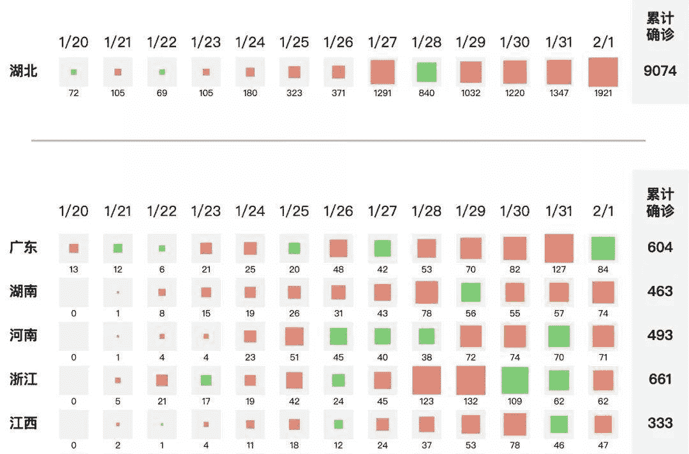](https://mp.weixin.qq.com/s/Nq0-p6z1GO869XaS0zliiw)
图片来源：mp.weixin.qq.com

再比如，还有平行坐标图。平行坐标图也有横纵两个坐标轴，并且把要进行对比的五个不同参数都放在了水平方向的坐标上。在下面的示意图中，绘制了所有 4 缸、6 缸或 8 缸汽车在五个不同参数（变量）上的对比。

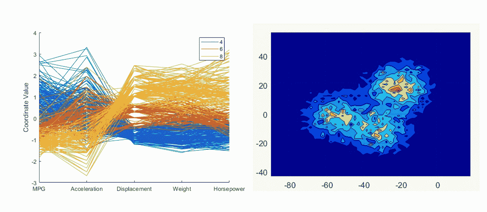

左为平行坐标图，右为热力图

此外，我们还可以用热力图、三维直方图、三维气泡图等等其他的可视化形式来展现多维度的信息。

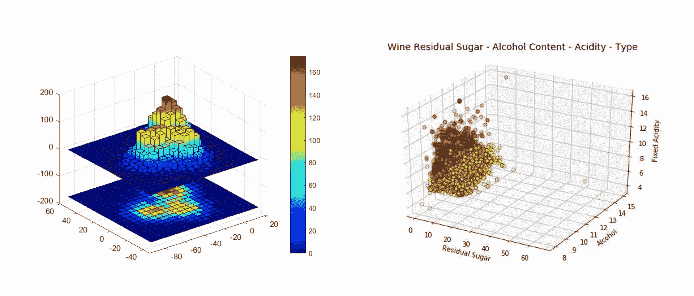

左为三维直方图，右为三维气泡图

总之，这些数据展现形式的基本实现原理，我们都在前面的视觉篇中讲过了。在掌握了视觉基础知识之后，我们就可以用自己想要的呈现形式，自由发挥，设计出各种直观的、形式有趣的图表了。

## 要点总结

这一节课，我们主要讨论数据到图表的展现以及如何处理多元变量。

在数据到图表的展现中，我们首先用 d3.js 把原始数据从 csv 中读取出来，然后选择我们需要的数据，用简单的图表库，比如，使用 QCharts 图表库进行渲染。渲染过程可以分为 4 步，分别是：创建图表对象 Chart 并传入数据，创建图形 Visual，创建坐标轴、提示和图例，把图形、坐标轴、提示和图例添加到图表对象中完成渲染。

在处理多元变量的时候，我们可以用散点图表示变量的相关性。对于超过二维的数据，我们可以扩展散点图，调整颜色、大小、透明度等等手段表达额外的信息。除了散点图之外，我们还可以用晴雨表、平行坐标图、热力图、三维直方图、气泡图等等图表，来表示多维数据的相关性。

到这里，我们用两节课的时间讲完了可视化的数据处理的基础部分。这部分内容如果再深入下去，就触达了数据分析的领域了，这也是一个和可视化密切相关的学科。那我也说过，可视化的重点，一是数据、二是视觉，视觉往深入研究，就进入渲染引擎、游戏等等领域，数据往深入研究，就进入数据分析的领域。所以，在可视化的入门或者说是基础阶段，掌握我现在讲的这些基础知识就够了。当然，如果你想深入研究也是好事，你可以参考我在课后给出的文章好好阅读一下。

## 小试牛刀

1. 我在 GitHub 代码仓库里放了两份数据，一份是我们今天讲课用到的，另一份是2013 到 2018 年的全国各地空气质量数据。你能把 2014 年北京每日 PM2.5 的数据用折线图表示出来吗？你还能结合这两份数据，用散点图分析平均气温和 PM2.5 指数的相关性吗？
2. 你可以模仿我北大可视化实验室的疫情晴雨表，实现一个 2018 年全国各城市空气质量晴雨表吗？

欢迎在留言区和我讨论，分享你的答案和思考，也欢迎你把这节课分享给你的朋友，我们下节课见！

## 源码

课程中完整示例代码见 GitHub 仓库

## 推荐阅读

[1] 从 1 维到 6 维 - 多维数据可视化策略

[2] QCharts
