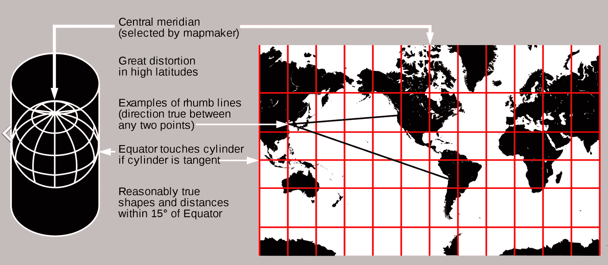
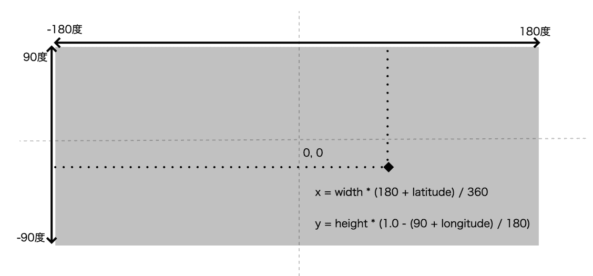
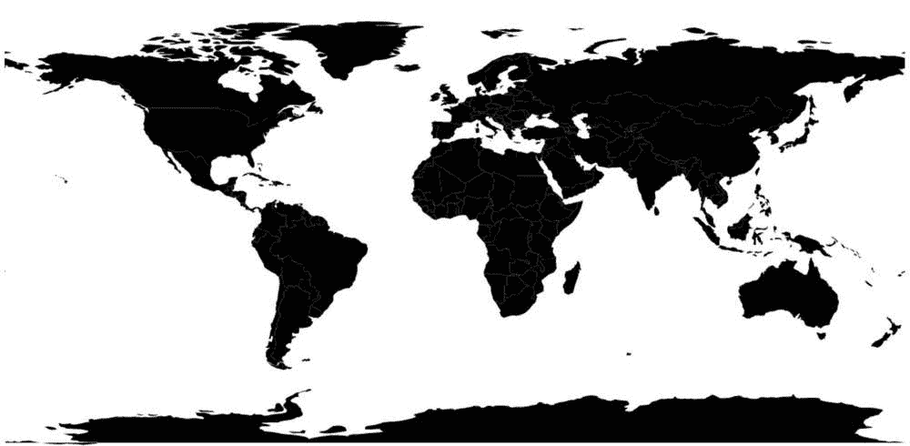
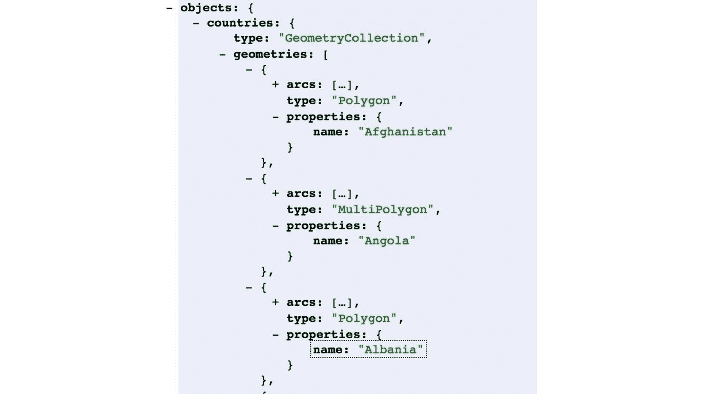
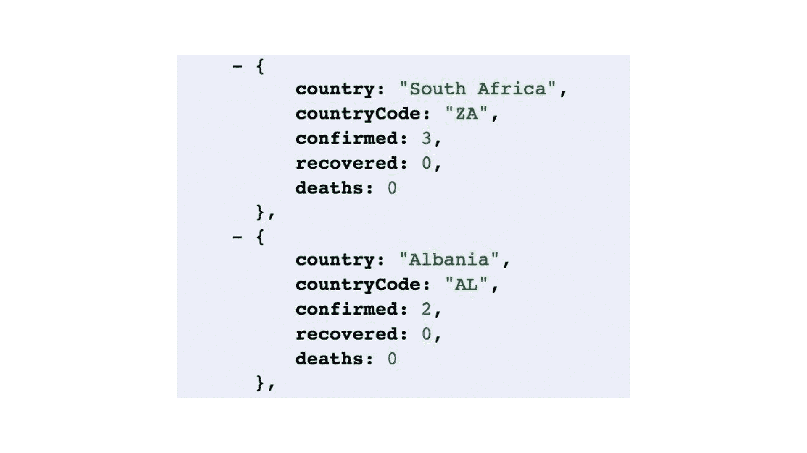
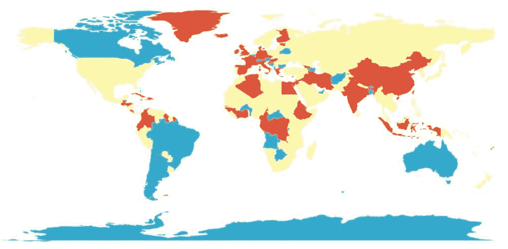
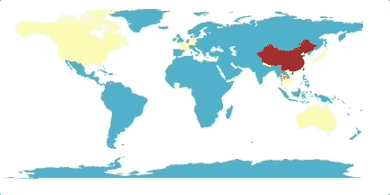

# 39 | 实战（三）：如何实现地理信息的可视化？

 

你好，我是月影。

前段时间，我们经常能看到新冠肺炎的疫情地图。这些疫情地图非常直观地呈现了世界上不同国家和地区，一段时间内的新冠肺炎疫情进展，能够帮助我们做好应对疫情的决策。实际上，这些疫情地图都属于地理位置信息可视化，而这类信息可视化的主要呈现方式就是地图。

在如今的互联网领域，地理信息可视化应用非常广泛。除了疫情地图，我们平时使用外卖订餐、春运交通、滴滴打车，这些 App 中都有地理信息可视化的实现。

那地理信息可视化该如何实现呢？今天，我们就通过一个疫情地图的实现，来讲一讲地理信息可视化该怎么实现。

假设，我们要使用世界地图的可视化，来呈现不同国家和地区，从 2020 年 1 月 22 日到 3 月 19 日这些天的新冠肺炎疫情进展。我们具体该怎么做呢？主要有四个步骤，分别是准备数据、绘制地图、整合数据和更新绘制方法。下面，我们一一来看。

## 步骤一：准备数据

新冠肺炎的官方数据在 WHO 网站上每天都会更新，我们可以直接找到 2020 年 1 月 22 日到 3 月 19 日的数据，将这些数据收集和整理成一份 JSON 文件。这份 JSON 文件的内容比较大，我把它放在 Github 上了，你可以去Github 仓库查看这份数据。

有了 JSON 数据之后，我们就可以将这个数据和世界地图上的国家一一对应。那接下来的任务就是准备世界地图，想要绘制一份世界地图，我们也需要有世界地图的地理数据，这也是一份 JSON 文件。

地理数据通常可以从开源社区中获取公开数据，或者从相应国家的测绘部门获取当地的公开数据。这次用到的世界地图的数据，我们是通过开源社区获得的。

一般来说，地图的 JSON 文件有两种数据格式，一种是 GeoJSON，另一种是 TopoJSON。其中 GeoJSON 是基础格式，它包含了描述地图地理信息的坐标数据。举个简单的例子：

```
{  
    "type":"FeatureCollection",   
    "features": [  
        {  
          "type":"Feature",  
          "geometry":{  
              "type":"Polygon",  
              "coordinates":  
              [  
                  [[117.42218831167838,31.68971206252246],  
                  [118.8025942451759,31.685801564127132],  
                  [118.79961418869482,30.633841626314336],  
                  [117.41920825519742,30.637752124709664],  
                  [117.42218831167838,31.68971206252246]]  
              ]  
          },  
          "properties":{"Id":0}  
        }  
    ]  
}
```

上面的代码就是一个合法的 GeoJSON 数据，它定义了一个地图上的多边形区域，坐标是由四个包含了经纬度的点组成的（代码中一共是五个点，但是首尾两个点是重合的）。

那什么是 TopoJSON 格式呢？TopoJSON 格式就是 GeoJSON 格式经过压缩之后得到的，它通过对坐标建立索引来减少冗余，数据压缩能够大大减少 JSON 文件的体积。

因为这节课的重点主要是地理信息的可视化绘制，而 GeoJSON 和 TopJSON 文件格式的具体规范又比较复杂，不是我们课程的重点，所以我就不详细来讲了。如果你有兴趣进一步学习，可以参考我在课后给出的资料。

这节课，我们直接使用我准备好的两份世界地图的 JSON 数据就可以了，一份是GeoJSON 数据，一份是TopoJSON 数据。接下来，我们会分别来讲怎么使用它们来绘制地图。

## 步骤二：绘制地图

将数据绘制成地图的方法有很多种，我们既可以用 Canvas2D、也可以用 SVG，还可以用 WebGL。除了用 WebGL 相对复杂，用 Canvas2D 和 SVG 都比较简单。为了方便你理解，我选择用比较简单的 Canvas2D 来绘制地图。

首先，我们将 GeoJSON 数据中，coordinates 属性里的经纬度信息转换成画布坐标，这个转换被称为地图投影。实际上，地图有很多种投影方式，但最简单的方式是**墨卡托投影**，也叫做等圆柱投影。它的实现思路就是把地球从南北两极往外扩，先变成一个圆柱体，再将世界地图看作是贴在圆柱侧面的曲面，经纬度作为 x、y 坐标。最后，我们再把圆柱侧面展开，经纬度自然就被投影到平面上了。

[](https://zh.wikipedia.org/wiki/%E9%BA%A5%E5%8D%A1%E6%89%98%E6%8A%95%E5%BD%B1%E6%B3%95)
墨卡托投影

墨卡托投影是最常用的投影方式，因为它的坐标转换非常简单，而且经过墨卡托投影之后的地图中，国家和地区的形状与真实的形状仍然保持一致。但它也有缺点，由于是从两极往外扩，因此高纬度国家的面积看起来比实际的面积要大，并且维度越高面积偏离的幅度越大。

在地图投影之前，我们先来明确一下经纬度的基本概念。经度的范围是 -180 度到 180 度，负数代表西经，正数代表东经。纬度的范围是 -90 度到 90 度，负数代表南纬，正数代表北纬。

接下来，我们就可以将经纬度按照墨卡托投影的方式转换为画布上的 x、y 坐标。对应的经纬度投影如下图所示。



注意，精度范围是 360 度，而维度范围是 180 度，而且因为 y 轴向下，所以计算 y 需要用 1.0 减一下。

所以对应的换算公式如下：

```
x = width * (180 + longitude) / 360;  
y = height * (1.0 - (90 + latitude) / 180); // Canvas坐标系y轴朝下
```

其中，longitude 是经度，latitude 是纬度，width 是 Canvas 的宽度，height 是 Canvas 的高度。

那有了换算公式，我们将它封装成投影函数，代码如下：

```
// 将geojson数据用墨卡托投影方式投影到1024*512宽高的canvas上  
const width = 1024;  
const height = 512;  
  
function projection([longitude, latitude]) {  
  const x = width * (180 + longitude) / 360;  
  const y = height * (1.0 - (90 + latitude) / 180); // Canvas坐标系y轴朝下  
  return [x, y];  
}
```

有了投影函数之后，我们就可以读取和遍历 GeoJSON 数据了。

我们用 fetch 来读取 JSON 文件，将它包含地理信息的字段取出来。根据 GeoJSON 规范，这个字段是 features 字段，类型是数组，然后我们通过 forEach 方法遍历这个数组。

```
(async function () {  
  const worldData = await (await fetch('./assets/data/world-geojson.json')).json();  
  const features = worldData.features;  
  features.forEach(({geometry}) => {  
    ...遍历数据  
    ...进行投影转换  
    ...进行绘制  
  });  
}();
```

在 forEach 迭代的时候，我们可以拿到 features 数组中每一个元素里的 geometry 字段，这个字段中包含有 coordinates 数组，coordinates 数组中的值就是经纬度值，我们可以对这些值进行投影转换，最后调用 drawPoints 将这个数据画出来。绘制过程十分简单，你直接看下面的代码就可以理解。

```
function drawPoints(ctx, points) {  
  ctx.beginPath();  
  ctx.moveTo(...points[0]);  
  for(let i = 1; i < points.length; i++) {  
    ctx.lineTo(...points[i]);  
  }  
  ctx.fill();  
}
```

完整的代码我放在了GitHub 仓库中，你可以下载到本地运行。这里，我直接把运行的结果展示给你看。



以上，就是利用 GeoJSON 数据绘制地图的全过程。这个过程非常简单，我们只需要将 coordinate 数据进行投影，然后根据投影的坐标把轮廓绘制出来就可以了。但是，GeoJSON 数据通常比较大，如果我们直接在 Web 应用中使用，有些浪费带宽，也可能会导致网络加载延迟，所以，使用 TopoJSON 数据是一个更好的选择。

举个例子，同样的世界地图数据，GeoJSON 格式数据有 251KB，而经过了压缩的 TopoJSON 数据只有 84KB，体积约为原来的 1/3。

尽管体积比 GeoJSON 数据小了不少，但是 TopoJSON 数据经过了复杂的压缩之后，我们在使用的时候还需要对它解压，把它变成 GeoJSON 数据。可是，如果我们自己写代码去解压，实现起来比较复杂。好在，我们可以采用现成的工具对它进行解压。这里，我们可以使用 GitHub 上的TopoJSON 官方仓库的 JavaScript 模块来处理 TopoJSON 数据。

这个转换简单到只用一行代码就可以完成，转换完成之后，我们就可以用同样的方法将世界地图绘制出来了。具体的转换过程我就不多说了，你可以自己试一试。转换代码如下：

```
const countries = topojson.feature(worldData, worldData.objects.countries);  

## 步骤三：整合数据

有了世界地图之后，下一步就是将疫情的 JSON 数据整合进地图数据里面。
```

在 GeoJSON 或者 TopoJSON 解压后的 countries 数据中，除了用 geometries 字段保存地图的地区信息外，还用 properties 字段来保存了其他的属性。在我们这一份地图数据中，properties 只有一个 name 属性，对应着不同国家的名字。

我们打开TopoJSON 文件就可以看到在 contries.geometries 下的 properties 属性中有一个 name 属性，对应国家的名字。



这个时候，我们再打开疫情的 JSON 数据，我们会发现疫情数据中的 contry 属性和 GeoJSON 数据里面的国家名称是一一对应的。



这样，我们就可以建立一个数据映射关系，将疫情数据中的每个国家的疫情数据直接写入到 GeoJSON 数据的 properties 字段里面。

接着，我们增加一个数据映射函数：

```
function mapDataToCountries(geoData, convidData) {  
  const convidDataMap = {};  
  convidData.dailyReports.forEach((d) => {  
    const date = d.updatedDate;  
    const countries = d.countries;  
    countries.forEach((country) => {  
      const name = country.country;  
      convidDataMap[name] = convidDataMap[name] || {};  
      convidDataMap[name][date] = country;  
    });  
  });  
  geoData.features.forEach((d) => {  
    const name = d.properties.name;  
    d.properties.convid = convidDataMap[name];  
  });  
}
```

在这个函数里，我们先将疫情数据的数组转换成以国家名为 key 的 Map，然后将它写入到 TopoJSON 读取出的 Geo 数据对象里。

最后，我们直接读取两个 JSON 数据，调用这个数据映射函数就完成了数据整合。

```
const worldData = await (await fetch('./assets/data/world-topojson.json')).json();  
const countries = topojson.feature(worldData, worldData.objects.countries);  
  
const convidData = await (await fetch('./assets/data/convid-data.json')).json();  
mapDataToCountries(countries, convidData);  

```

因为整合好的数据比较多，所以我只在这里列出一个国家的示例数据：

```
{  
  "objects": {  
  "countries": {  
    "type": "GeometryCollection",  
    "geometries": [{  
      "arcs": [  
        [0, 1, 2, 3, 4, 5]  
      ],  
      "type": "Polygon",  
      "properties": {  
        "name": "Afghanistan",  
        "convid": {  
          "2020-01-22": {  
            "confirmed": 1,  
            "recovered": 0,  
            "death": 0,  
          },  
          "2020-01-23": {  
            ...  
          },  
          ...  
        }  
      }  
    },  
  ...

## 步骤四：将数据与地图结合

将全部数据整合到地理数据之后，我们就可以将数据与地图结合了。在这里，我们设计用不同的颜色来表示疫情的严重程度，填充地图，确诊人数越多的区域颜色越红。要实现这个效果，我们先要创建一个确诊人数和颜色的映射函数。
```

我把无人感染到感染人数超过 10000 人划分了 7 个等级，每个等级用不同的颜色表示：

1. 若该地区无人感染，渲染成 #3ac 颜色
2. 若该地区感染人数小于 10，渲染成 rgb(250, 247, 171) 色
3. 若该地区感染人数 10~99 人，渲染成 rgb(255, 186, 66) 色
4. 若该地区感染人数 100~499 人，渲染成 rgb(234, 110, 41) 色
5. 若该地区感染人数 500~999 人，渲染成 rgb(224, 81, 57) 色
6. 若该地区感人人数 1000~9999 人，渲染成 rgb(192, 50, 39) 色
7. 若该地区感染人数超 10000 人，渲染成 rgb(151, 32, 19) 色

对应的代码如下：

```
function mapColor(confirmed) {  
  if(!confirmed) {  
    return '#3ac';  
  }  
  if(confirmed < 10) {  
    return 'rgb(250, 247, 171)';  
  }  
  if(confirmed < 100) {  
    return 'rgb(255, 186, 66)';  
  }  
  if(confirmed < 500) {  
    return 'rgb(234, 110, 41)';  
  }  
  if(confirmed < 1000) {  
    return 'rgb(224, 81, 57)';  
  }  
  if(confirmed < 10000) {  
    return 'rgb(192, 50, 39)';  
  }  
  return 'rgb(151, 32, 19)';  
}
```

然后，我们在绘制地图的代码里根据确诊人数设置 Canvas 的填充信息：

```
function drawMap(ctx, countries, date) {  
  date = formatDate(date); // 转换日期格式  
  
  
  countries.features.forEach(({geometry, properties}) => {  
    ... 读取当前日期下的确诊人数  
  
  
    ctx.fillStyle = mapColor(confirmed); // 映射成地图颜色并设置到Canvas上下文  
  
  
    ... 执行绘制  
  });  

```

我们先把 data 参数设为’2020-01-22’，这样一来，我们就绘制出了 2020 年 1 月 22 日的疫情地图。



2020年1月22日疫情地图

可是，疫情的数据每天都会更新，如果想让疫情地图随着日期自动更新，我们该怎么做呢？我们可以给地图绘制过程加上一个定时器，这样我们就能得到一个动态的疫情地图了，它会自动显示从 1 月 22 日到当前日期疫情变化。这样，我们就能看到疫情随时间的变化了。

```
const startDate = new Date('2020/01/22');  
let i = 0;  
const timer = setInterval(() => {  
  const date = new Date(startDate.getTime() + 86400000 * (++i));  
  drawMap(ctx, countries, date);  
  if(date.getTime() + 86400000 > Date.now()) {  
    clearInterval(timer);  
  }  
}, 100);  
drawMap(ctx, countries, startDate);  

```



## 要点总结

这节课，我们讲了实现地理信息可视化的通用步骤，一共可以分为四步，我们一起来回顾一下。

第一步是准备数据，包括地图数据和要可视化的数据。地图数据有 GeoJSON 和 TopoJSON 两个规范。相比较而言，TopoJSON 数据格式经过了压缩，体积会更小，比较适合 Web 应用。

第二步是绘制地图。要绘制地图，我们需要将地理信息中的坐标信息投影到地图上，最简单的投影方式是使用墨卡托投影。

第三步是整合数据，我们要把可视化数据和地图的地理数据集成到一起，这一步我们可以通过定义数据映射函数来实现。

最后一步，就是将数据与地图结合，根据整合后的数据结合地图完成最终的图形绘制。

总的来说，无论我们要实现多么复杂的地理信息可视化地图，核心的 4 个步骤是不会变的，只不过其中的每一步，我都可以替换具体的实现方式，比如，我们可以使用其他的投影方式来代替墨卡托投影，来绘制不同形状的地图。

## 课后练习

1. 我们今天选择使用 Canvas 来绘制地图，是因为它使用起来十分方便。其实，使用 SVG 绘制地图也很方便，你能试着改用 SVG 来实现今天的疫情地图吗？这和使用 Canvas 有什么共同点和不同点？
2. 我们今天使用的墨卡托投影是最简单的投影方法，它的缺点是让高纬度下的国家看起来比实际的要大很多。你能试着使用 D3.js 的d3-geo模块中提供的其他投影方式来实现地图吗？

3. 如果 我们要增加交互，让鼠标移动到某个国家区域的时候，这个区域高亮，并且显示国家名称、疫情确诊数、治愈数以及死亡数，这该怎么处理呢？你可以尝试增加这样的交互功能，来完善我们的地图应用吗？

好啦，今天的地理信息可视化实战就到这里了。欢迎你把实现的地图作品放在留言区，也欢迎把这节课转发出去，我们下节课见！

## 源码

[1] 新冠肺炎数据

[2] GeoJSON 数据

[3] TopoJSON 数据

[4] 完整的示例代码见GitHub 仓库

## 推荐阅读

[1] GeoJSON 标准格式学习

[2] [GeoJSON 和 TopoJSON]reference_end

[3] GeoJSON 规范

[4] TopoJSON 规范
