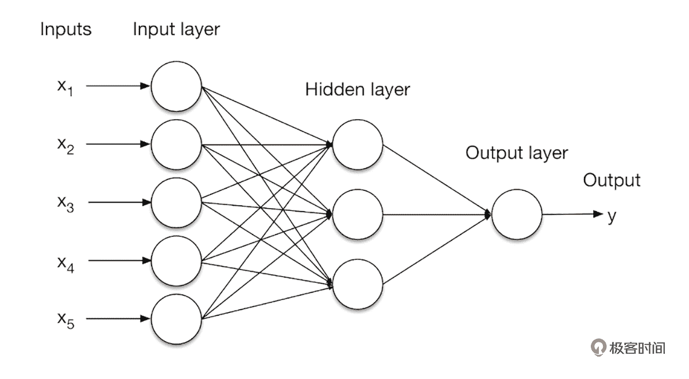
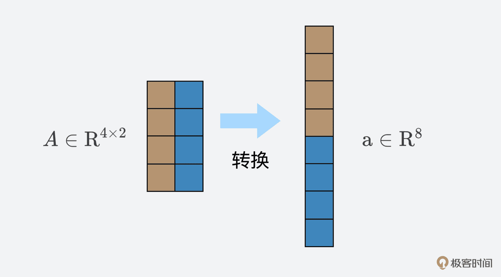
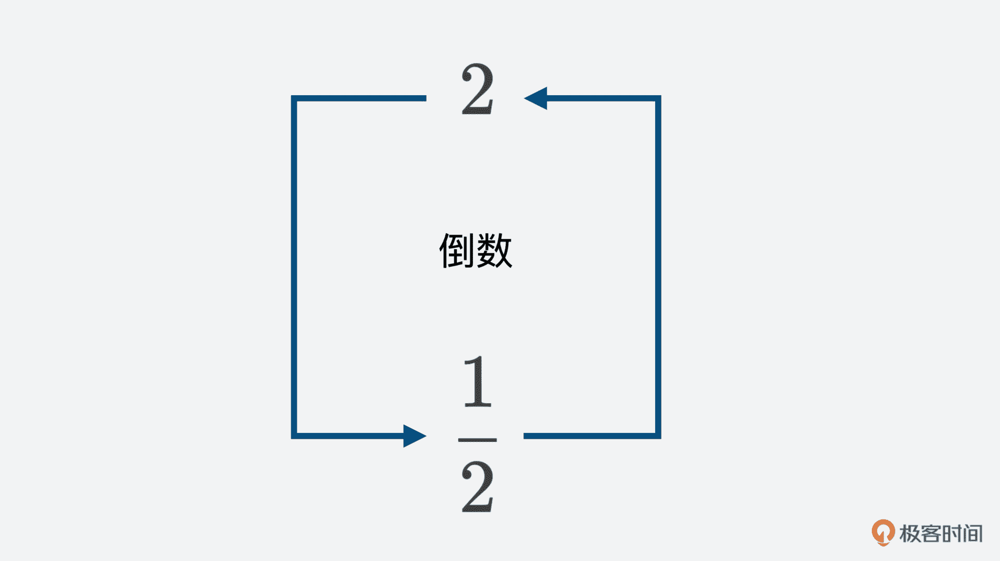
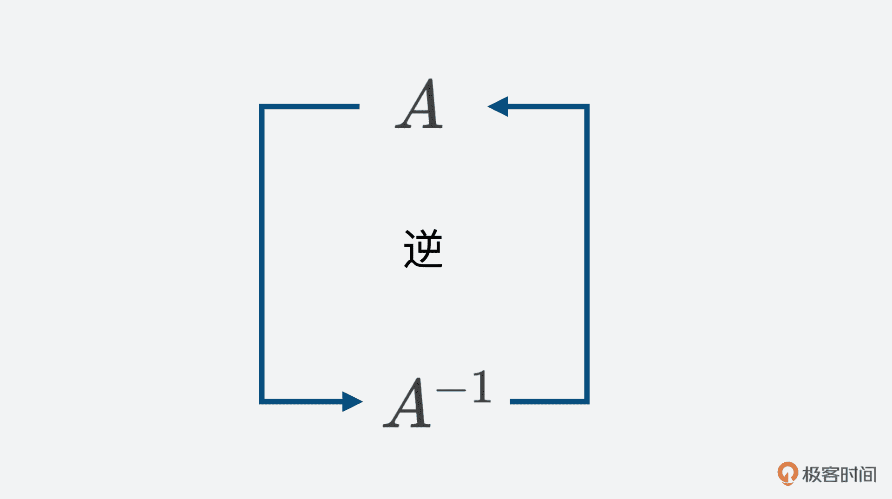
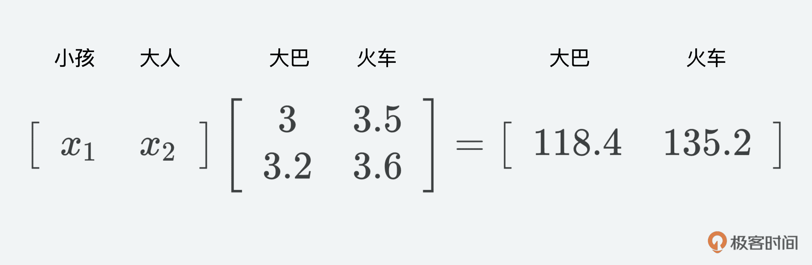
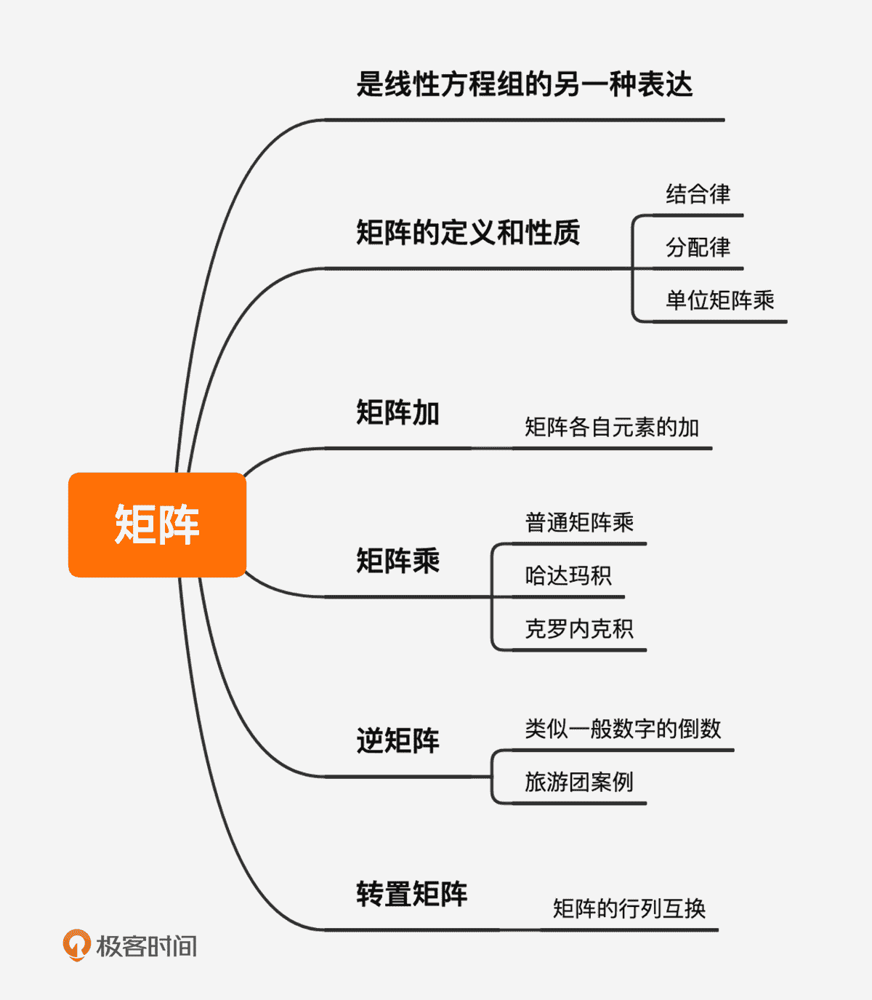

# 03 | 矩阵：为什么说矩阵是线性方程组的另一种表达？

 

你好，我是朱维刚。欢迎你继续跟我学习线性代数，今天我们要讲的内容是“矩阵”。

在开始学习之前，我想先问你个问题，你觉得，学习矩阵有什么用呢？你可以先自己想一想。之后我们讲任何一个知识的时候，你都可以从这个角度出发，自己先思考一下，这样有助于你对所学内容理解得更深刻。

对于刚才那个问题，我的答案很简单，就一句话，从我们程序员的角度去理解的话，**矩阵可以极大地提高计算机的运算效率**。怎么说呢？我给你举一个例子。在机器学习中（特别是深度学习，或者更具体一点，神经网络），并行计算是非常昂贵的。



上图是一个典型的神经网络架构，在这时候，矩阵就能发挥用武之地了，计算 H 隐藏层输出的公式是：H=f(W.x+b)，其中 W 是权重矩阵，f 是激活函数，b 是偏差，x 是输入层矩阵。而这个计算过程就叫做**向量化**（Vectorization），这也是 GPU 在深度学习中非常重要的原因，因为 GPU 非常擅长做类似矩阵乘之类的运算。
X=∣∣∣∣​x1​x2​​∣∣∣∣​W=∣∣∣∣∣∣​w1​w4​x3​​w2​w5​w6​​∣∣∣∣∣∣​H=f⎝⎛​∣∣∣∣∣∣​w1​w4​x3​​w2​w5​w6​​∣∣∣∣∣∣​∣∣∣∣​x1​x2​​∣∣∣∣​+b⎠⎞​

不过，矩阵也不仅仅局限于神经网络的应用，同时它也可以用在计算机图形图像的应用中，比如，三维物体从取景到屏幕的显示，就需要经历一系列的空间变换，才能生成二维图像显示在显示器上。在这个计算过程中，我们都需要用到矩阵。

矩阵是非常实用的，但它正式作为数学中的研究对象出现，其实是在行列式的研究发展起来之后。英国数学家 Arthur Cayley 被公认为矩阵论的创立人，他提出的矩阵概念可能来自于行列式。但我相信另一种说法，提出矩阵是为了更简单地表达线性方程组，也就是说，矩阵是线性方程组的另一种表达。

## 矩阵的基本概念

线性方程组的概念很简单，上节我们已经简单提过。你在小学或中学肯定也学过二元一次方程和二元一次方程组。
ax+by=c{a1​x+b1​y+C1​=0a2​x+b2​y+C2​=0​

在这样一个方程组中，a1、a2、b1、b2 不能同时为 0。当我们把二元一次方程组再扩展一下，变成多元一次方程组时，我们就能得到线性方程组的一般表达，即 AX=B。
⎩⎪⎪⎨⎪⎪⎧​a11​x1​+a12​x2​+⋯+a1n​xn​=b1​a21​x1​+a22​x2​+⋯+a2n​xn​=b2​⋯⋯⋯⋯⋯⋯⋯⋯⋯⋯am1​x1​+am2​x2​+⋯+amn​xn​=bm​​

于是，这个线性方程组的所有系数就构成了一个 m×n 的 m 行 n 列矩阵：
A=⎣⎢⎢⎡​a11​a21​…am1​​a12​a22​…am2​​…………​a1n​a2n​…amn​​⎦⎥⎥⎤​

我们把 A 称为该方程组的系数矩阵，而当我们把等式右边的常数 b 放入矩阵后，就是下面这样：
A=⎣⎢⎢⎡​a11​a21​…am1​​a12​a22​…am2​​…………​a1n​a2n​…amn​​b1​b2​…bm​​⎦⎥⎥⎤​

这样我们就得到了 A 矩阵的增广矩阵 A ，可以表示为 (A,B)，这里的 B 表示的是方程组常数项所构成的列向量，也就是 m×1 的 m 行 1 列矩阵：
B=∣∣∣∣∣∣∣∣​b1​b2​⋯bm​​∣∣∣∣∣∣∣∣​

如果设 X 为 n×1 的 n 行 1 列矩阵：
X=∣∣∣∣∣∣∣∣​x1​x2​⋯xn​​∣∣∣∣∣∣∣∣​

那么线性方程组 A，就可以表示为 AX=B 的矩阵形式。如果我们再换一种表示形式，设：a1​,a2​,…,an​,β 表示增广矩阵 A 的列向量，则线性方程组 A 又可表示为 a1​x1​+a2​x2​+⋯+an​xn​=β。

线性方程组的矩阵和向量形式都是线性方程组的其他表达形式。在工作中，你可以用它们来简化求解，甚至可以提升计算效率，就如之前提到的神经网络的隐藏层的输出计算、图形图像的三维空间变换。在数学中也是同样的，你可以经常运用它们来简化求解。具体线性方程组求解的内容比较多，我们下一节课再来详细讲解求解过程。

通过前面的讲解，我相信你对矩阵有了一定的了解，现在我们再回头来看看矩阵的定义吧。

矩阵的定义是：一个 (m,n) 矩阵 A，是由 m×n 个元素组成，m 和 n 是实数，其中元素 aij​,i=1,…,m,j=1,…,n 按 m 行 n 列的矩形排布方式后可以形成矩阵 A：
A=⎣⎢⎢⎡​a11​a21​…am1​​a12​a22​…am2​​…………​a1n​a2n​…amn​​⎦⎥⎥⎤​

其中 aij​ 属于实数 R，按通常的惯例，(1,n) 矩阵叫做行，(m,1) 矩阵叫做列，这些特殊的矩阵叫做行或列向量。

定义完矩阵后，我接着讲一个比较有趣的概念，矩阵转换（Matrix transformation）。矩阵转换经常被用在计算机图形图像的转换中，比如，一张彩色图片从 RGB 角度来说是三维的，如果要转换成灰度图片，也就是一维图片，那就要做矩阵转换。

我们来看一下矩阵转换的过程。设 Rm×n 是实数矩阵 (m,n) 的集合，A∈Rm×n 可以表示成另一种形式 a∈Rmn 。我们把矩阵的 n 列堆叠成一个长向量后完成转换。这个转换也叫做 reshape，其实就是重新调整原矩阵的行数、列数和维数，但是元素个数不变。



## 矩阵的运算

了解了矩阵的基本定义后，我们才能进入矩阵的运算环节，就是矩阵的加和乘。

加运算很简单，两个矩阵 A∈Rm×n，B∈Rm×n 的加运算其实就是矩阵各自元素的加。
A+B=⎣⎢⎢⎢⎢⎡​a11​+b11​⋅⋅⋅am1​+bm1​​……​a1n​+b1n​⋅⋅⋅amn​+bmn​​⎦⎥⎥⎥⎥⎤​∈Rm×n

我推荐你使用 NumPy 的 einsum 来高效地做这类运算，因为它在速度和内存效率方面通常可以超越我们常见的 array 函数。

```
C= np.einsum('il, lj', A, B)
```

接下来，我们一起来看看矩阵的乘。这里你需要注意，矩阵的乘和通常意义上“数之间的乘”不同，矩阵的乘有多种类型，这里我讲三种最普遍，也是在各领域里用得最多的矩阵乘。

### 1. 普通矩阵乘

普通矩阵乘是应用最广泛的矩阵乘，两个矩阵 A∈Rm×n，B∈Rn×k，普通矩阵则乘可以表示为 C=AB∈Rm×k，C 中元素的计算规则是矩阵 A、B 对应两两元素乘积之和。
cij​=k=1∑n​aik​bkj​,i=1,…,m,j=1,…,l

我们举例来说明。C 的第一个元素 c11​=a11​×b11​+a12​×b21​+a13​×b31​=1×1+2×2+3×3。
C=AB=[14​25​36​]⎣⎡​123​456​⎦⎤​=[1×1+2×2+3×34×1+5×2+6×3​1×4+2×5+3×64×4+5×5+6×6​]=[1432​3277​]

这里需要特别注意的是，只有相邻阶数匹配的矩阵才能相乘，例如，一个 n×k 矩阵 A 和一个 k×m 矩阵 B 相乘，最后得出 n×m 矩阵 C，而这里的 k 就是相邻阶数。
AB=C

但反过来 B 和 A 相乘就不行了，因为相邻阶数 m 不等于 n。

### 2. 哈达玛积

哈达玛积理解起来就很简单了，就是矩阵各对应元素的乘积，cij​=aij​×bij​ 。举个例子：
C=A∗B=[14​25​][12​45​]=[1∗14∗2​2∗45∗5​]=[18​825​]

哈达玛积其实在数学中不常看到，不过，在编程中哈达玛积非常有用，因为它可以用来同时计算多组数据的乘积，计算效率很高。

### 3. 克罗内克积

克罗内克积是以德国数学家利奥波德·克罗内克（Leopold Kronecker）的名字命名的。它可以应用在解线性矩阵方程和图像处理方面，当然从更时髦的角度说，它还能用在量子信息领域，我们也称之为直积或张量积。

和普通矩阵乘和哈达玛积不同的是，克罗内克积是两个任意大小矩阵间的运算，表示为 A×B，如果 A 是一个 m×n 的矩阵，而 B 是一个 p×q 的矩阵，克罗内克积则是一个 mp×nq 的矩阵。

接下来我们需要定义一个**在矩阵的乘法中起着特殊作用**的矩阵，它就是**单位矩阵**。高等代数中，在求解相应的矩阵时，若添加单位矩阵，通过初等变换进行求解，往往可以使问题变得简单。按照百度百科的解释，单位矩阵如同数的乘法中的 1，这种矩阵就被称为单位矩阵。它是个方阵，从左上角到右下角的对角线，也就是主对角线上的元素均为 1，除此以外全都为 0。

在线性代数中，大小为 n 的单位矩阵就是在主对角线上均为 1，而其他地方都是 0 的 n×n 的方阵，它用 In​ 表示，表达时为了方便可以忽略阶数，直接用 I 来表示：
I1​=[1],I2​=[10​01​],I3​=⎣⎡​100​010​001​⎦⎤​,…,In​=⎣⎢⎢⎢⎢⎡​10..0​01..0​……….…​00..1​⎦⎥⎥⎥⎥⎤​

## 矩阵的性质

在了解了矩阵加和乘，以及单位矩阵后，我们是时候来看一看矩阵的性质了。了解矩阵的性质是进行矩阵计算的前提，就像我们小时候学加减乘除四则运算法则时那样。所以，这块内容对你来说应该不难，你作为了解就好，重点是之后的运算。

### 1. 结合律

任意实数 m×n 矩阵 A，n×p 矩阵 B，p×q 矩阵 C 之间相乘，满足结合律 (AB)C=A(BC)。这个很好理解，我就不多说了。
∀A∈Rm×n,B∈Rn×p,C∈Rp×q:(AB)C=A(BC)

### 2. 分配律

任意实数 m×n 矩阵 A 和 B，n×p 矩阵 C 和 D 之间相乘满足分配律 (A+B)C=AC+BC，A(C+D)=AC+AD。
∀A,B∈Rm×n,C,D∈Rn×p:(A+B)C=AC+BC,A(C+D)=AC+AD

### 3. 单位矩阵乘

任意实数 m×n 矩阵 A 和单位矩阵之间的乘，等于它本身 A。
∀A∈Rm×n:Im​A=AIn​=A

注意，这里的行和列不同，m​=n 意味着，根据矩阵乘，左乘和右乘单位矩阵也不同，也就是 Im​​=In​。

## 逆矩阵与转置矩阵

了解矩阵基本概念、运算，以及性质后，我来讲一讲矩阵应用中的两个核心内容——逆矩阵和转置矩阵。逆矩阵和转置矩阵在实际应用中大有用处，比如：坐标系中的图形变换运算。我们先来看下什么是逆矩阵。

### 逆矩阵

下面这个图你应该非常熟悉了，图中表现的是数字的倒数，2 的倒数是 21​，21​ 的倒数是 2。



其实逆矩阵也有着类似的概念，只不过是写法不一样，我们会把逆矩阵写成 A−1。那为什么不是 A1​ 呢？那是因为数字 1 无法被矩阵除。



我们知道，2 乘以它的倒数 21​ 等于 1。同样的道理，A 乘以它的逆矩阵 A−1 就等于单位矩阵，即 A×A−1=I（I 即单位矩阵），反过来也一样，A−1×A=I。

为方便你理解，我用一个 2×2 矩阵 A 来解释一下逆矩阵的算法。首先，我们交换 a11​ 和 a22​ 的位置，然后在 a12​ 和 a21​ 前加上负号，最后除以行列式 a11​a22​−a12​a21​。
A−1=[a11​a21​​a12​a22​​]−1=a11​a22​−a12​a21​1​[a22​−a21​​−a12​a11​​]

那我们该如何验证这是不是正解呢？

方法其实很简单，记得刚才的公式就行，A×A−1=I。现在我们就代入公式来验证一下，A 和它的逆矩阵相乘，通过刚才的算法最终得出的结果是单位矩阵。
A×A−1=[a11​a21​​a12​a22​​][a11​a21​​a12​a22​​]−1=[a11​a21​​a12​a22​​][a11​a22​−a12​a21​a22​​a11​a22​−a12​a21​−a21​​​a11​a22​−a12​a21​−a12​​a11​a22​−a12​a21​a11​​​]=[a11​a22​−a12​a21​a11​×a22​​+a11​a22​−a12​a21​a12​×(−a21​)​a11​a22​−a12​a21​a21​×a22​​+a11​a22​−a12​a21​a22​×(−a21​)​​a11​a22​−a12​a21​a11​×(−a12​)​+a11​a22​−a12​a21​a12​×a11​​a11​a22​−a12​a21​a21​×(−a12​)​+a11​a22​−a12​a21​a22​×a11​​​]=[10​01​]

这里有一点需要特别说明，不是每一个矩阵都是可逆的。如果一个矩阵是可逆的，那这个矩阵我们叫做**非奇异矩阵**，如果一个矩阵是不可逆的，那这个矩阵我们就叫做**奇异矩阵**，而且如果一个矩阵可逆，那它的逆矩阵必然是唯一的。

还记得行列式 a11​a22​−a12​a21​ 吗？如果我们要证明矩阵是可逆的，只要证明行列式不等于零就行。更高阶的逆矩阵的算法也是一样的原理。

最后，我想通过一个现实生活中的案例来让你更多地了解逆矩阵。

一个旅游团由孩子和大人组成，去程他们一起做大巴，每个孩子的票价 3 元，大人票价 3.2 元，总共花费 118.4 元。回程一起做火车，每个孩子的票价 3.5 元，大人票价 3.6 元，总共花费 135.2 元。请问旅游团里有多少小孩和大人？

首先，我们设置一些矩阵，组成线性方程 XA=B。



要解 X，我们就要先计算 A 的逆矩阵 A−1：
A−1=[33.2​3.53.6​]−1=3×3.6−3.5×3.21​[3.6−3.2​−3.53​]=[−98​8.75−7.5​]

接下来再计算 X=BA−1：
[x1​​x2​​]=[118.4​135.2​][−98​8.75−7.5​]=[16​22​]

最终，我们得出这个旅游团有 16 个小孩和 22 个大人。

这也是解线性方程组的一种方法，类似这样的计算被广泛应用在各领域中，比如建筑工程、游戏和动画的 3D 效果上。虽然现在有很多程序包封装了这类数学计算的底层实现，但如果你能很好地理解这些概念，就可以为编程或算法调优打下坚实的基础。

Last but not least，方程次序很重要，也就是说，AX=B 和 XA=B 的结果是不同的，这个一定要牢记哦！

### 转置矩阵

一般伴随逆矩阵之后出现的就是转置矩阵。在计算机图形图像处理中，如果要对一个物体进行旋转、平移、缩放等操作，就要对描述这个物体的所有矩阵进行运算，矩阵转置就是这类运算之一，而矩阵的转置在三维空间中的解释就相当于“得到关于某个点对称的三维立体”。所以，转置矩阵的定义很简单。

将矩阵的行列互换，得到的新矩阵就叫做转置矩阵（transpose）。转置矩阵的行列式不变。我们把 m×n 矩阵 A 的行列互换，得到转置矩阵 AT。
A=⎣⎢⎢⎡​a11​a21​…am1​​a12​a22​…am2​​…………​a1n​a2n​…amn​​⎦⎥⎥⎤​AT=⎣⎢⎢⎡​a11​a12​…a1n​​a21​a22​…a2n​​…………​am1​am2​…amn​​⎦⎥⎥⎤​

最后，为了方便你理解，我们再总结一下逆矩阵和转置矩阵的性质。你不用死记硬背，重在理解。

1. 矩阵和自身逆矩阵相乘得道单位矩阵，AA−1=I=A−1A；
2. AB 两矩阵相乘的逆，等于逆矩阵 B 和逆矩阵 A 相乘，这里强调一下乘的顺序很重要，(AB)−1=B−1A−1；
3. AB 两矩阵相加后的逆矩阵，不等于各自逆矩阵的相加， (A+B)−1​=A−1+B−1；
4. 矩阵转置的转置还是它本身，(AT)T=A；
5. AB 两矩阵相加后的转置矩阵，等于各自转置矩阵的相加，(A+B)T=AT+BT；
6. AB 两矩阵相乘后的转置矩阵，等于转置矩阵 B 和转置矩阵 A 的相乘，这里再次强调乘的顺序很重要，(AB)T=BTAT。

## 本节小结

好了，到这里矩阵这一讲就结束了，最后我再带你总结一下前面讲解的内容。

今天的知识，你只需要知道矩阵是线性方程组的另一种表达，了解和掌握矩阵的定义和性质就足够了。当然，矩阵还有很多内容，但我认为掌握了我讲的这些内容后，就为以后的一些矩阵应用场景打下了坚实的数学基础，也是下一讲的解线性方程组的前置知识。



## 线性代数练习场

对于 10 维列向量 x=(x1​,…,x10​)T， v=(v1​,…,v10​)T，如果要计算 y=xxT(I+vvT)x，其中 I 是 10 阶单位矩阵。你会怎么做？

友情提醒，这里有多种方式解题。你能不能找到一个最简单的方法来解这道题？虽然结果很重要，但我想说的是过程更重要，而且往往解题过程不同，从计算机角度来说，运算的效率会有极大的不同。

欢迎你在留言区晒出你的运算过程和结果。如果有收获，也欢迎你把这篇文章分享给你的朋友。
