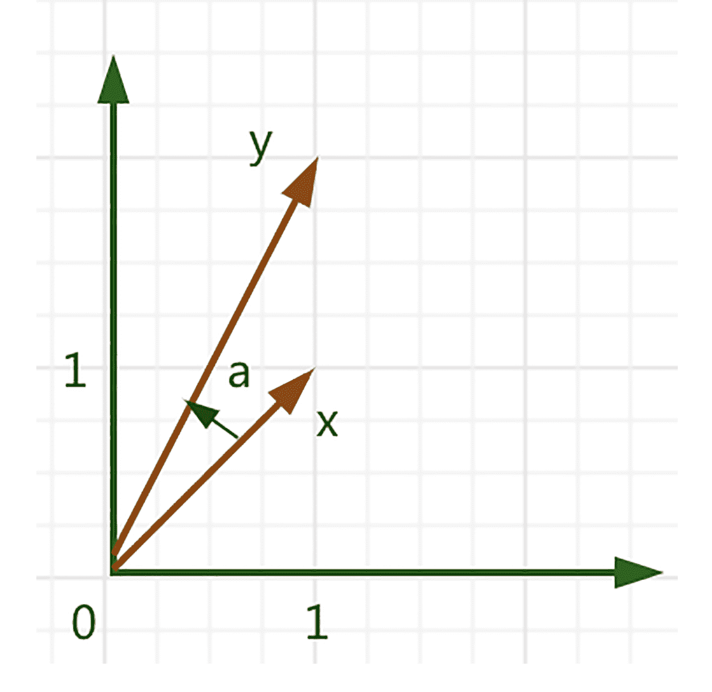
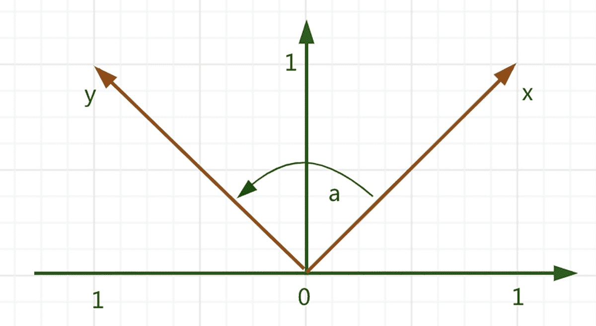
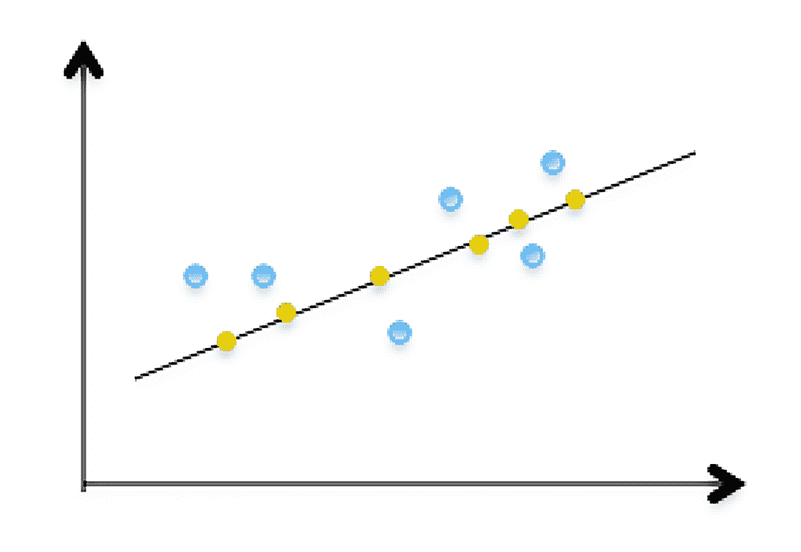
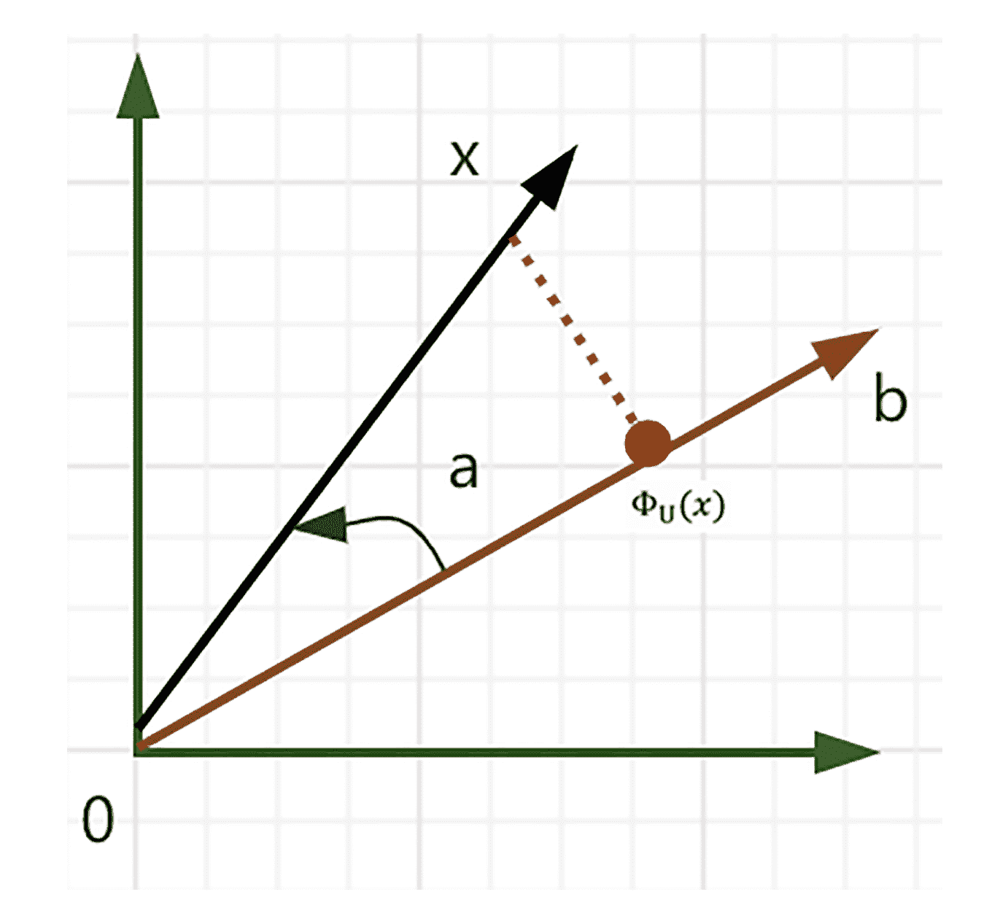

# 10 | 解析几何：为什么说它是向量从抽象到具象的表达？

 

你好，我是朱维刚。欢迎你继续跟我学习线性代数，今天我们要讲的内容是“解析几何”。

前面所有章节我们都是围绕向量、矩阵，以及向量空间来展开的。但这一节课有点不一样，我要讲的是解析几何，它使得向量从抽象走向了具象，让向量具有了几何的含义。比如，计算向量的长度、向量之间的距离和角度，这在机器学习的主成分分析 PCA 中是非常有用的。

## 范数

讲解析几何我们得从“范数”开始讲起。

因为很多人看到几何向量的第一反应就是，它是从原点开始的有向线段，并且向量的长度是这个有向线段的终端和起始端之间的距离。而范数，就是被用来度量某个向量空间或矩阵中的每个向量的长度或大小的。

现在，我们先来看一下范数的数学定义：一个向量空间 V 上的一个范数就是一个函数，它计算 V 中的每一个向量 x 的长度，用符号来表示的话就是：∥x∥∈R，它满足三种性质：

1. 正齐次性： 如果输入参数扩大正 λ 倍，其对应的函数也扩正大倍。设 λ∈R，x∈V，∥λx∥=∣λ∣∥x∥；
2. 次可加性：类似三角不等式，两边之和大于第三边。设 x,y∈V，∥x+y∥≤∥x∥+∥y∥；
3. 正定性：向量 x 的长度一定大于等于零。∥x∥≥0。

看到这里，你也许会问，范数似乎和以前老师教的**向量的模**一样啊。先别急，它们还真有那么一点关系，你听我慢慢道来。由于范数是度量某个向量空间或矩阵中的每个向量的长度或大小的，所以它和向量空间维度是有关系的，于是，我们可以把范数写成这样的模式来区分不同维度的大小计算：L1​,L2​,…,L∞​。

1. L1​ 范数：曼哈顿范数，也叫曼哈顿距离，设 x∈Rn，得到下面这个表达式。
∥x∥1​=i=1∑n​∣xi​∣

1. L2​ 范数：欧式范数，也叫欧式距离，设 x∈Rn，得到下面这个表达式。
∥x∥2​=i=1∑n​xi2​​

1. L∞​ 范数：切比雪夫范数，也叫切比雪夫距离，设 x∈Rn，得到下面这个表达式。
∥x∥∞​=max(∣x1​∣,∣x2​∣,…,∣xn​∣)

我们发现，向量的模和 L2​ 范数的计算方式都是一样的，都表示的是欧氏距离，所以，我们可以简单地认为向量的模等于 L2​ 范数。而其他的范数模式和向量的模则没有任何关系。

## 内积

学习解析几何时，我们必须掌握的第二个概念就是内积。

如果说范数是模式，是用来描述向量长度或大小的概念性表达，那么内积可以让我们很直观地了解一个向量的长度、两个向量之间的距离和角度，它的一个主要目的就是判断向量之间是否是正交的，正交这个概念我们会在后面讲解。

### 点积

我们从特殊到一般，先来看点积，它和第三篇矩阵中说的“普通矩阵乘”形式一样，点积是特殊的内积，为什么说它特殊呢？那是因为在表示两个向量之间的距离时，它就是大家熟悉的欧式距离，点积可以表示成这样的形式：
xTy=i=1∑n​xi​yi​

### 其他内积

除了点积外，我们再来看另一个不同的内积：设内积空间 V 是 R2，定义内积 ⟨x,y⟩=x1​y1​−(x1​y2​+x2​y1​)+2x2​y2​，一看便知这个和点积完全不同。

### 内积空间

最后，我们再来看一般内积和内积空间。因为解析几何关注的是向量的长度、两个向量之间的距离和角度，所以，我们要在原来向量空间上加一个额外的结构，这个额外结构就是内积，而加了内积的向量空间，我们就叫做内积空间。

为了表达方便，我们可以把内积写成 ⟨ ⋅,⋅⟩ 这样的形式，那么内积空间 V 可以被表示成这样：(V,⟨ ⋅,⋅⟩)。这时，如果一般内积由点积来表达，那这个向量空间就变成了更具体的欧式向量空间。

接下来看下内积空间有什么性质？我们定义一个内积空间 V 和它的元素 x、y、z，以及一个 c∈R：

1. 满足对称性：x 和 y 的内积等于 y 和 x 的内积，⟨x,y⟩=⟨y,x⟩；
2. 满足线性性：x 和 y+cz 的内积等于，x 和 y 的内积，与 x 和 z 的内积乘以 c 后的和，

⟨x,y+cz⟩=⟨x,y⟩+c⟨x,z⟩；

3. 满足正定性：x 和 y 的内积大于等于零，⟨x,y⟩≥0。

## 对称正定矩阵

内积还定义了一类矩阵，这类矩阵在机器学习中很重要，因为它可以被用来判定多元函数极值，而在深度学习中，它更是被用来获取最小化损失函数，我们把这类矩阵叫做对称正定矩阵。

对称正定矩阵的定义是：如果一个对称矩阵 A 属于方阵 Rn×n，对任意非零向量 x，都有 xTAx>0，那么 A 就是对称正定矩阵。

我们来看两个例子，判断它们是不是对称正定矩阵。

第一个例子，请你回答下面这个矩阵是对称正定矩阵吗？
A=[96​65​]

答案：是的，它是对称正定矩阵。因为 xTAx>0。
xTAx=[x1​​x2​​][96​65​][x1​x2​​]=(3x1​+2x2​)2+x22​>0

第二个例子，请你看下面这个矩阵是对称正定矩阵吗？
A=[96​63​]

答案：不是的，它只是对称矩阵。因为 xTAx 可能小于 0。
xTAx=[x1​​x2​​][96​63​][x1​x2​​]=(3x1​+2x2​)2−x22​

## 长度、距离和角度

前面我们通过范数讲了向量的长度，但从内积的角度来看，我们发现，内积和范数之间有着千丝万缕的关系。我们来看看下面这个等式。
∥x∥=⟨x,x⟩​

从这个等式我们发现，内积可以用来产生范数，确实是这样。不过，不是每一个范数都能被一个内积产生的，比如：曼哈顿范数。接下来，我们还是来关注能由内积产生的范数上，从不同的角度来看看几何上的长度、距离和角度的概念。

我们先用内积来计算一个**向量的长度**，比如：向量 x=[1​1​]T，我们可以使用点积来计算，计算后得出 x 的范数是 2​，具体计算过程是这样的：∥x∥=xTx​=12+12​=2​。

接着，我们再来看一下**向量之间的距离**，一个内积空间 V，(V,⟨ ⋅,⋅⟩)，x 和 y 是它的两个向量，那么 x 和 y 之间的距离就可以表示成：d(x,y)=∥x−y∥=⟨x−y,x−y⟩​。

如果用点积来计算 x 和 y 之间的距离，那这个距离就叫做欧式距离。

再接着，来看看两个**向量之间的角度**。我们使用柯西 - 施瓦茨不等式（Cauchy-Schwarz Inequality）来表示内积空间中两个向量 x 和 y 之间的角度：a。
−1≤∥x∥∥y∥⟨x,y⟩​≤1

取值是从 −1 到 1 之间，那么角度就是从 0 到 π 之间，我们用 cos 来表示就是：
cos(a)=∥x∥∥y∥⟨x,y⟩​

其中 a 就是角度，a 的角度取值是 0 到 π 之间。我们很容易就能发现，其实两个向量之间的角度，就是告诉了我们两个向量之间方向的相似性。例如：x 和 y=4x，使用点积来计算它们之间的角度是 0，也就是说它们的方向是一样的，y 只是对 x 扩大了 4 倍而已。

现在，我们通过一个例子，再来更清楚地看下两个向量之间角度的计算，设 x=[1​1​]T，y=[1​2​]T，使用点积来计算，我们得出：
cos(a)=⟨x,x⟩⟨y,y⟩​⟨x,y⟩​=xTxyTy​xTy​=10​3​

那么，这两个向量之间的角度如下。
arccos(10​3​)≈0.32

我们可以用图来更直观地表达一下。

于是，我们最后可以引出一个概念，也就是我们在一开始提到的**正交性**。如果两个向量 x 和 y 内积等于 0，⟨x,y⟩=0，那么 x 和 y 是正交的，这可以写成：x⊥y。再如果，x 和 y 的范数都等于 1，∥x∥=∥y∥=1，也就是说，如果它们都是单位向量，那么 x 和 y 就是标准正交的。

我们用图来更直观地表达一下。

## 正交投影

在理论讲解之后，我们要来了解一下解析几何在实践中经常运用的概念——正交投影，它是一种重要的线性变换，在图形图像、编码理论、统计和机器学习中扮演了重要角色。

在机器学习中，数据一般都是高维的。众所周知，高维数据是很难来分析和可视化的。而且，不是所有的高维数据都是有用的，可能只有一些数据包含了大部分的重要信息。

正交投影就是高维到低维的数据投影，在第 5 节课线性空间中，我简单介绍了高维数据投影到低维后，我们就能在低维空间更多地了解数据集、提炼相关模式。而在机器学习中，最普遍的降维算法——PCA 主成分分析，就是利用了降维的观点。

接下来，我开始讲解正交投影，在给出定义之前，先从一张图来了解会更直观。

图中的蓝点是原二维数据，黄点是它们的正交投影。所以，实际降维后，在一维空间中就形成了这条黑线表示，它近似地表达了原来二维数据表示的信息。

现在我们可以来看一下投影的定义：V 是一个向量空间，U 是 V 的一个向量子空间，一个从 V 到 U 的线性映射 Φ 是一个投影，如果它满足：Φ2=Φ∘Φ=Φ。因为线性映射能够被变换矩阵表示，所以，这个定义同样适用于一个特殊类型变换矩阵：投影矩阵 PΦ​，它也满足：PΦ2​=PΦ​。

### 投影到一维子空间上（线）

接下来，我们来看看如何投影到一维子空间，也就是把内积空间的向量正交投影到子空间，这里我们使用点积作为内积。

假设有一条通过原点的线，这条线是由基向量 b 产生的一维子空间 U，当我们把一个向量 x 投影到 U 时，需要寻找另一个最靠近 x 的向量 ΦU​(x)。还是老样子，我们通过图来看一下。

首先，投影 ΦU​(x) 靠近 x，也就是要找出 x 和 ΦU​(x) 之间的 ∥x−ΦU​(x)∥ 最小距离，从几何角度来说，就是线段 ΦU​(x)−x 和 b 正交，满足等式：⟨ΦU​(x)−x,b⟩=0。其次，投影 ΦU​(x) 必须是 U 的一个元素，也就是，基向量 b 的一个乘来产生 U，ΦU​(x)=λb。

于是，我们可以通过三个步骤来分别得到 λ、投影 ΦU​(x) 和投影矩阵 PΦ​，来把任意 x 映射到子空间 U 上。

第一步，计算 λ，通过正交条件产生这样的等式：

⟨x−ΦU​(x),b⟩=0。因为 ΦU​(x)=λb，所以它可以转变成：⟨x−λb,b⟩=0。

利用内积的双线性：⟨x,b⟩−λ⟨b,b⟩=0，我们得到：
λ=⟨b,b⟩⟨x,b⟩​=∥b∥2⟨b,x⟩​

然后，我们通过点积得到：
λ=∥b∥2bTx​

如果 ∥b∥=1，那 λ 就等于 bTx。

接着第二步，是计算投影点 ΦU​(x)。从 ΦU​(x)=λb，我们得到：
ΦU​(x)=λb=∥b∥2⟨x,b⟩​b=∥b∥2bTx​b

通过点积来计算，我们就得到了 ΦU​(x) 的长度：
∥ΦU​(x)∥=∥b∥2∣∣​bTx∣∣​​∥b∥=∣cos(a)∣∥x∥∥b∥∥b∥2∥b∥​=∣cos(a)∥x∥

这里的 a，是 x 和 b 之间的夹角。

最后第三步，是计算投影矩阵 PΦ​，投影矩阵是一个线性映射。所以，我们可以得到：ΦU​(x)=PΦ​x，通过 ΦU​(x)=λb，我们可以得到：
ΦU​(x)=λb=bλ=b∥b∥2bTx​=∥b∥2bbT​x

这里，我们立即可以得到投影矩阵 PΦ​ 的计算等式：
PΦ​=∥b∥2bbT​

## 本节小结

这一节课覆盖的知识点有点多，因为要把解析几何的知识点，浓缩到核心的几个点来讲解是一项艰巨的任务。不过不要怕，前面的几个知识点都是为这一节的重点“正交投影”来铺垫的。范数，被用来度量某个向量空间或矩阵中的每个向量的长度或大小，而内积让我们很直观地了解一个向量的长度、两个向量之间的距离和角度，以及判断向量之间是否是正交的。

所以，希望你能掌握范数和内积的理论知识，并把它和正交投影结合，运用在一些实践应用场景中，比如：3D 图形图像的坐标变换、数据压缩，以及机器学习的降维。

## 线性代数练习场

请用之前学到的正交投影的投影矩阵算法，来计算一条线上的投影矩阵 PΦ​。

这条线通过原点，由基 b=[1​2​2​]T 产生，PΦ​ 计算后，再通过一个 x 来验证一下它是否在 b 产生的子空间中，我们取 x=[1​1​1​]T。

欢迎在留言区晒出你的运算结果，我会及时回复。同时，也欢迎你把这篇文章分享给你的朋友，一起讨论、学习。
