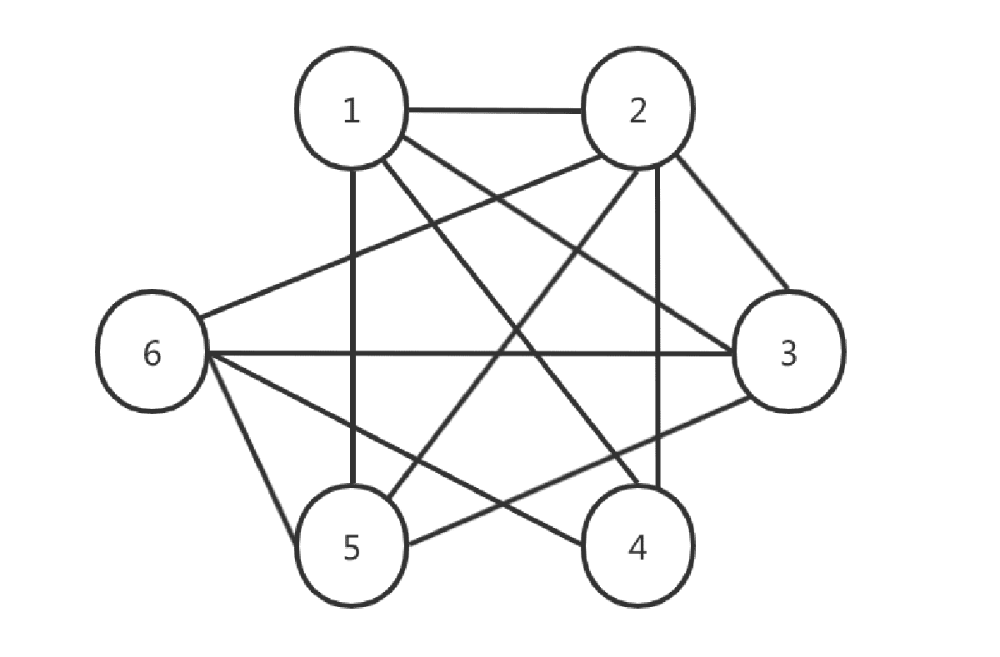
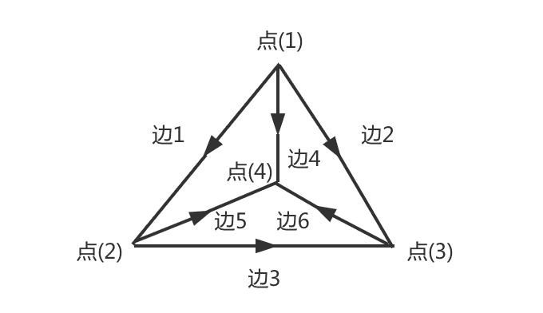
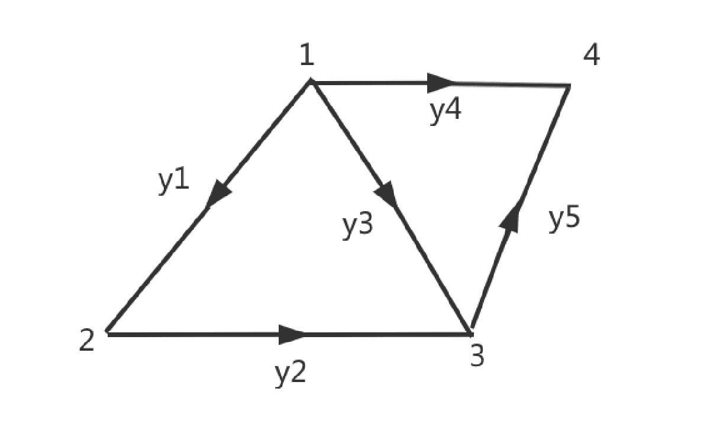

# 11 | 如何运用线性代数方法解决图论问题？

 

你好，我是朱维刚。欢迎你继续跟我学习线性代数，今天我要讲的内容是“如何运用线性代数方法解决图论问题”。

“图”这个字在计算机科学领域很常见，特别是在数据结构中。一说到图，是必定要联系到图论（Graph Theory）的，因为它是以图为研究对象的数学的一个分支。图论中的图，是由若干给定的**点**及连接两点的**线**所构成的图形，这种图形通常用来描述某些事物之间的某种特定关系，用点代表事物，用连接两点的线表示相应两个事物间具有这种关系。

说到这，你也许会问，这个和线性代数、矩阵有什么关系？

## 图的数学定义

既然是数学课，我们还是要先讲一下图的数学定义：一个图 G 是指一个有序三元组 (V,E,ϕ)，V 是非空的顶点集；E 是不与 V 相交的边集；ϕ 是关联函数，它使 G 的每条边对应于 G 的无序顶点对。如果 e 是一条边，u 和 v 是顶点，使得 ϕ(e)=uv，则 e 连接 u 和 v，也就是顶点 u 和 v 是 e 的端点。

好了，现在是时候通过两个应用场景来看下，如何把矩阵和图论关联起来，并运用在解决实际问题中了。

## 邻接矩阵应用

首先，是邻接矩阵（Adjacency Matrix），邻接矩阵是表示顶点之间相邻关系的矩阵。假设 G 是一个图，V(G) 是 G 的顶点集，E(G) 是 G 的边集，设 G 中有 n 个顶点，v1​,v2​,…,vn​，A=(aij​)n×n​ 是 G 的邻接矩阵。
ai​={1,vi​vj​∈E(G)0,vi​vj​∈/​E(G)′,i,j=1,2,…,n​

已知情况是这样的，那我们现在来看一下邻接矩阵在现实问题中的应用。这个例子来源于 1994 年全国大学生数学建模竞赛试题 B 题。

某厂生产一种弹子锁具，每个锁具的钥匙有 5 个槽，每个槽的高度从 ｛1,2,3,4,5,6｝ 中任取一数。由于工艺及其他原因，制造锁具时对 5 个槽的高度还有两个限制。

1. 至少有 3 个不同的数；
2. 相邻两槽的高度之差不能为 5。

满足以上条件制造出来的所有互不相同的锁具称为一批。销售部门在一批锁具中随意地取每 60 个装成一箱出售。问：每一批锁具有多少个，装多少箱？

我们先来看下弹子锁具的样子，否则自己想象会要一些时间。

这是一个 7 个槽的弹子锁具，只是比我们例子的 5 个槽多了两个槽。有了弹子锁具形象化输出后，我们开始解题。锁具装箱是一个排列组合的数学问题，但如果我们用图论的邻接矩阵方法来解这个问题，就能够起到化繁为简的作用。

首先，我们构造一个 6 节点的图：把 1、2、3、4、5、6 这 6 个数作为 6 个节点，如果两个数字可以相邻，那这两个节点之间就加一条边，每个节点有自己到自己的一条边。于是，我们得到了锁具各槽之间的关系图：

接着，构建邻接矩阵 A，根据前面说的，如果两点之间有一条边，那在矩阵中，相应位置的值就是 1，比如：节点 1 和 2 之间有一条边，那矩阵第一行第二列和第二行第一列的值就是 1，节点 1 和 6 之间没有边，那矩阵第一行第六列和第六行第一列的值就是 0，因为每个节点有自己到自己的一条边，所以第一行第一列的值就是 1，其它 5 个节点也是一样的。
A=⎣⎢⎢⎢⎢⎢⎢⎡​111110​111111​111111​111111​111111​011111​⎦⎥⎥⎥⎥⎥⎥⎤​

因为我们从没有 1、6 相邻的关系图得到了邻接矩阵 A，所以 A 中所有元素之和表示两个槽高**无 1、6 相邻**的锁具个数。而每个无 1、6 相邻的 5 位数与关系图中长度是 1 的一条链一一对应。于是，Ak 中各元素之和就是长度为 k 的链接个数。比如，A2 中第 i 行第 j 列的元素就是 i 开始经过两条边到达 j 的链接个数。我们这里因为是 5 个元素，也就是要经过 4 条边，所以需要计算 A4。
A4=⎣⎢⎢⎢⎢⎢⎢⎡​141165165165165140​165194194194194165​165194194194194165​165194194194194165​165194194194194165​140165165165165141​⎦⎥⎥⎥⎥⎥⎥⎤​

把 A4 中的元素求和，就能得到相邻高差为 5 的锁具数是 6306。

最后，因为题目的限制提到了槽的高度至少有 3 个不同的数，我们还要把 6306 这个数字减去仅有一个、两个槽高的锁具：6306−(6+(C62​−1)(25−2))=5880。

所以，我们得到一批锁具的个数是 5880，总共装 5880/60=98 箱。

这样，我们通过邻接矩阵的图论知识，解决了一批锁具的数量问题，比其它方法看起来更简单。

> 特别提示：文中用到的 Ak 在图论中的实际意义，是来自刘亚国的一篇文献《图论中邻接矩阵的应用》。

## 关联矩阵应用

接下来，我们在邻接矩阵上再升级一下，把边变成有向边。这样就形成了另一类矩阵：关联矩阵。关联矩阵经常被用在图论中，现在我们就来看一下关联矩阵和图之间的关系。如下图所示，我们定义了一个拥有 4 个节点和 6 条边的图。

接下来，定义一个 6×4 的矩阵来描述这个图，其中列表示点 (1) 到点 (4)，行表示边 1 到边 6：
A=⎣⎢⎢⎢⎢⎢⎢⎡​−1−10−100​10−10−10​01100−1​000111​⎦⎥⎥⎥⎥⎥⎥⎤​

矩阵 A 只包含了三类元素：-1、1、0。-1 表示点的箭头的出方向，1 表示点的箭头的入方向，0 则表示点和点之间没有关联。举例来说，矩阵 A 的第一行元素是 -1、1、0、0，那对于边 1 和点 (1)、点 (2) 说，我们从图中可以看到边 1 是从点 (1) 到点 (2)，A 中 -1 对于点 (1) 来说是箭头的出方向，1 对于点 (2) 来说是箭头的入方向，而边 1 和点 (3)、点 (4) 没有任何关系，所以第一行第三列和第四列都是 0。

这里，我们把关联矩阵用到现实场景中，比如：让它为电子电路服务，用它来分析整个电路的情况，也就是电路的拓扑结构，这里的电路指的是基尔霍夫定律，是分析和计算较为复杂电路的基础。假设 x1​,x2​,x3​,x4​ 是这几个点的电压值，我们来看一下 Ax 的结果：
Ax=⎣⎢⎢⎢⎢⎢⎢⎡​−1−10−100​10−10−10​01100−1​000111​⎦⎥⎥⎥⎥⎥⎥⎤​⎣⎢⎢⎡​x1​x2​x3​x4​​⎦⎥⎥⎤​=⎣⎢⎢⎢⎢⎢⎢⎡​x2​−x1​x3​−x1​x3​−x2​x4​−x1​x4​−x2​x4​−x3​​⎦⎥⎥⎥⎥⎥⎥⎤​

由此可见，结果是差值，也就是沿着边 1 到 6 的电势差，有了电势差，就说明有电流，但如果 Ax=0 会怎样呢？也就是方程满足这样的等式：
Ax=⎣⎢⎢⎢⎢⎢⎢⎡​−1−10−100​10−10−10​01100−1​000111​⎦⎥⎥⎥⎥⎥⎥⎤​⎣⎢⎢⎡​x1​x2​x3​x4​​⎦⎥⎥⎤​=⎣⎢⎢⎢⎢⎢⎢⎡​x2​−x1​x3​−x1​x3​−x2​x4​−x1​x4​−x2​x4​−x3​​⎦⎥⎥⎥⎥⎥⎥⎤​=⎣⎢⎢⎢⎢⎢⎢⎡​000000​⎦⎥⎥⎥⎥⎥⎥⎤​

很明显，这些差值，也就是电势差都等于 0，意味着没有电流。同理，如果把电压值换成温度呢？那应用场景就切换成热传导了。

刚才我们看到了 Ax=0 的情况，你还记得第八篇中说的零空间吗？它关注的就是 Ax=0，也就是向量空间 V 中所有经过 ϕ 映射为零的向量集合，用符号表示就是：ker(ϕ)，它的维数叫做零化度（nullity），表示成：dim(ker(ϕ))。

而在电路例子中，它表示的是所有六个电势差都是 0，也就意味着：所有四个电压值是相等的，在零空间中的每个 x 都是一个常向量：x=(c,c,c,c)。所以，A 的零空间是一条线。无论我们怎么同时升高或降低电压量 c，都不会改变电势差 0。

刚才我们说的是电压，现在我们来具体看看关联矩阵在基尔霍夫电流定律上的运用。我们来定义一个拥有 4 个节点和 5 条边的图：

基尔霍夫电流定律定义：ATy=0，其中 y 是向量 y1​,y2​,y3​,y4​,y5​，我们把这个图以关联矩阵的形式写出来就是：
⎣⎢⎢⎡​−1100​0−110​−1010​−1001​00−11​⎦⎥⎥⎤​⎣⎢⎢⎢⎢⎡​y1​y2​y3​y4​y5​​⎦⎥⎥⎥⎥⎤​=⎣⎢⎢⎡​0000​⎦⎥⎥⎤​

这里 -1，0，1 的含义上面有所描述，第一行和 y 向量相乘后得到：−y1​−y3​−y4​=0，说明从节点 1 出来的总电流等于 0，满足守恒定律；第二行和 y 向量相乘后得到：y1​−y2​=0，说明流入节点 2 的电流和从节点 2 流出的电流相等；同样，后面两行分别和 y 向量相乘后得到：y2​+y3​−y5​=0 和 y4​+y5​=0，和图表示的都一致，也都符合守恒定律。

好了，到这里简单电路的数学知识，也就是关联矩阵讲完了，如果碰到更复杂的电路，比如：在节点之间，也就是边上有电流源，那么，等式就要从 ATy=0 变成 ATy=f。

## 本节小结

本节是第一篇应用篇，所以我从更贴近生活的例子来讲解线性代数的应用，通过弹子锁具，让你能够了解，邻接矩阵与图论之间是怎么关联的；通过基尔霍夫定律，让你能够了解关联矩阵与图论之间是怎么关联的。

所以，邻接矩阵、关联矩阵的最大意义就是用数学的方式描述图，进而来描述某些事物之间的某种特定关系，是不是发现问题后通过数学工具来解决问题很美妙呢？

## 线性代数练习场

这次的练习题稍微有些难度，是一道传统练习题。

三名商人各带一个随从乘船渡河，现有一只小船只能容纳两个人，由他们自己划行，若在河的任一岸的随从人数多于商人，他们就可能抢劫财物。但如何乘船渡河由商人决定，试给出一个商人安全渡河的方案，使得渡河的次数最少。

> 注意：这里的问题包含两层含义——安全渡河和渡河次数最少。提示：使用本节的第一个例子的邻接矩阵和 Ak 来解这道题。

欢迎在留言区晒出你的运算过程和结果，我会及时回复。同时，也欢迎你把这篇文章分享给你的朋友，一起讨论、学习。
