# 04 | 如何构建性能分析决策树和查找瓶颈证据链？

 

你好，我是高楼。

上节课我给你讲了一个完整且固定的性能分析流程——RESAR 性能分析七步法，它可以应用在任何性能分析案例中。在这个分析流程中，有两个关键的技术和思路，分别是性能分析决策树和性能瓶颈证据链。这也是我们在02 讲中提到的，贯穿整个性能工程的两个重要概念。

今天这节课，我们一起来看看怎么一步步构建性能分析决策树和查找性能瓶颈证据链。

## 如何构建性能分析决策树？

实际上，性能分析决策树在性能监控设计和性能瓶颈分析时都会被使用，并且在性能瓶颈分析时，**我们必须要有决策树的思路**。所以，这是我一定要给你描述的步骤。在后面课程的分析中，我们也会大量地用到“性能分析决策树”这个词。

首先，什么是性能分析决策树呢？

> 性能分析决策树是包括了系统架构中所有技术组件、所有组件中的模块以及模块对应计数器的完整的结构化树状图。

在这句话中，有三个重要的层级，分别是组件、模块和计数器：

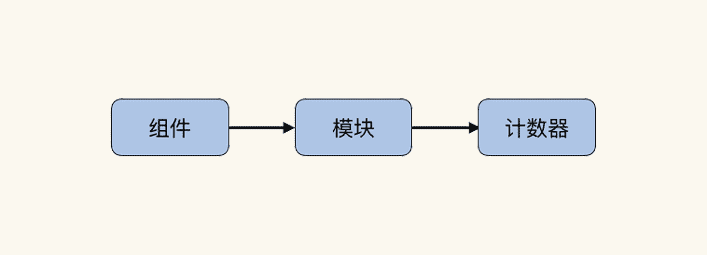

在后面的课程中，我也会频繁使用这三个关键词。

不过，这个关于“性能分析决策树”的定义虽然很合理，但还是会让人感觉抓不住重点，就像看了哲学语句一样。但是 IT 技术并不是哲学，所以，我们还要把它细化下去。

构建性能分析决策树是我们了解一个系统非常关键的环节，总体来看，它分为 4 个步骤。

**第一步：根据系统的架构，罗列出整个系统架构中的组件。**

在我们这个课程搭建的系统中，整体架构的组件是这样的：

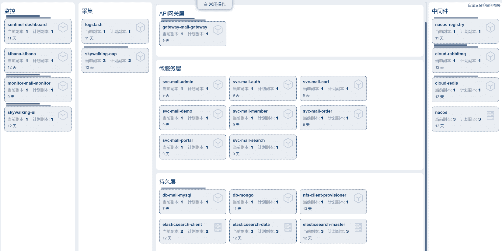

对应上面这张图，我们就能罗列出该系统的所有组件，如下：

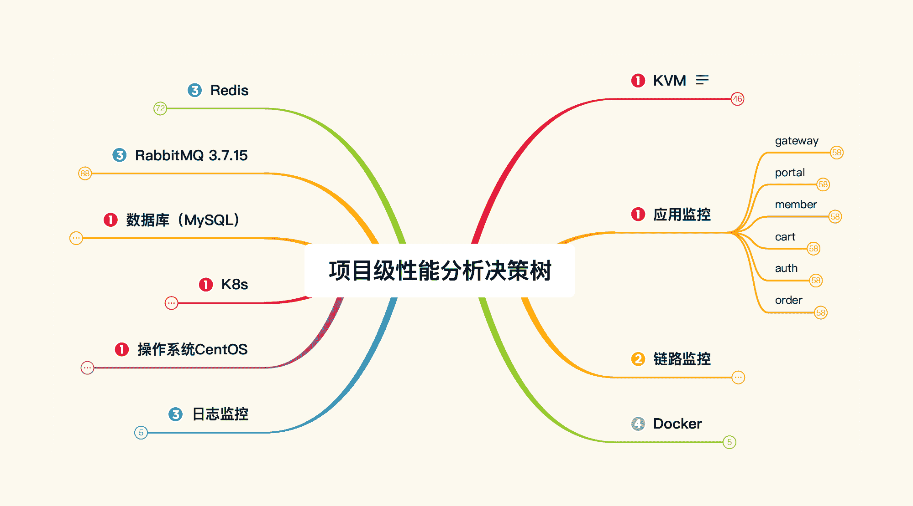

**第二步：深入细化组件中的每一个重要的模块。**

由于我们这个系统中的组件太多，我们先选择其中一个比较重要的组件——操作系统，来做示例。因为操作系统是性能分析中非常重要的一个环节，几乎所有的问题都会体现到操作系统的计数器上。至于其他的组件，你可以根据我说的流程自行确定一下。

根据操作系统的特性，我们先画出它的重要模块：

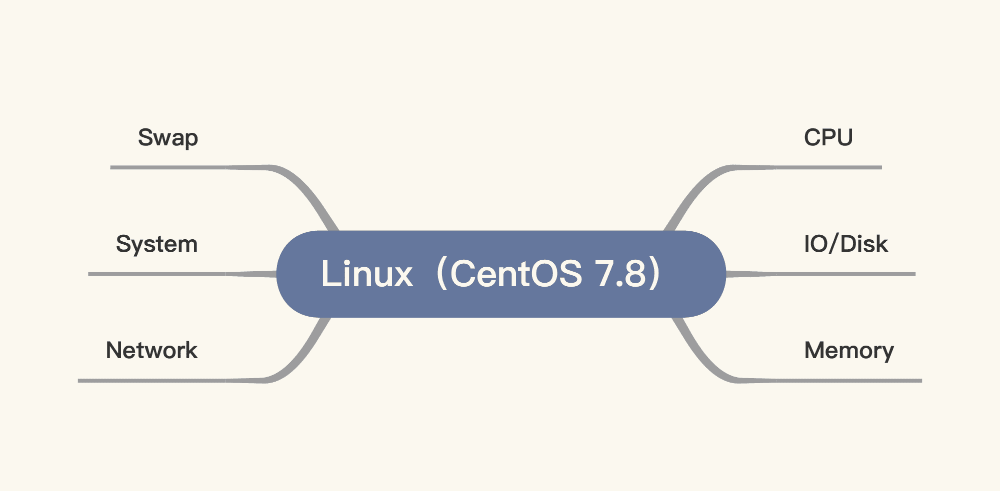

我在图中画了六个模块，其中一个是 Swap。Swap 的存在是为了让系统在没有内存可用的时候，可以用硬盘来做内存的交换分区。当 Swap 被用到时，其实就说明性能已经有了问题。所以，一般不建议在性能项目中使用 Swap，我们应该在使用 Swap 之前就把性能问题解决掉。不过，在生产环境中，如果我们被逼无奈，也只能把 Swap 打开了。

至于图中其他几个模块，基本上是我们在性能分析中必须要看的内容。

**第三步：列出模块对应的计数器。**

在罗列计数器的时候，我们要注意把**每个模块重要的计数器都囊括进来，千万不能漏掉重要的第一级计数器**，如果漏掉的话，有些数据可能就需要重新跑了。

现在，我们来看其中一个重要的模块——CPU。我们可以通过 top 命令查看到 CPU 的几个重要的计数器：

```
[root@k8s-worker-8 ~]# top  
top - 00:38:51 up 28 days,  4:27,  3 users,  load average: 78.07, 62.23, 39.14  
Tasks: 275 total,  17 running, 257 sleeping,   1 stopped,   0 zombie  
%Cpu0  :  4.2 us, 95.4 sy,  0.0 ni,  0.0 id,  0.0 wa,  0.0 hi,  0.0 si,  0.4 st  
%Cpu1  :  1.8 us, 98.2 sy,  0.0 ni,  0.0 id,  0.0 wa,  0.0 hi,  0.0 si,  0.0 st  
%Cpu2  :  2.1 us, 97.9 sy,  0.0 ni,  0.0 id,  0.0 wa,  0.0 hi,  0.0 si,  0.0 st  
%Cpu3  :  1.0 us, 99.0 sy,  0.0 ni,  0.0 id,  0.0 wa,  0.0 hi,  0.0 si,  0.0 st 
```

可以看到，top 命令中有九个计数器，分别是：us/sy/ni/id/wa/hi/si/st/load average。前 8 个是 CPU 的计数器，这是毋庸置疑的。那最后一个 load average 是什么呢？

在搜索引擎上，我们经常能看到一些关于 load average 的笼统描述。有人说 load average 高过 CPU 就说明系统负载高，也有人说 load average 和 CPU 并没有直接的关系，观点不一。

load average 作为 CPU 一个非常重要的性能计数器，我们在用它做判断时，如果不能给出非常明确的判断方向，那就有大问题了。所以，我要给你好好描述一下。

> load average 是 1m/5m/15m 内的可运行状态和不可中断状态的平均进程数。

这个说法非常对，但中规中矩，而且不是非常具体。

对于“可运行状态”，我们比较容易理解。从上面代码块中的数据可以看到，tasks 中有一个 Running 状态的任务数。不过，可运行状态不只是它，还有一些万事俱备只差 CPU 的情况。也就是说 tasks 中的 Running 状态的任务数，与 load average 的值之间并不是直接的等价关系。

同样在 vmstat 中，我们也能看到运行的任务数。在 vmstat 的 proc 列有两个参数：r 和 b。其中，r 是指正在运行状态和等待运行状态的进程，在 man 手册中是这样描述的：

```
r: The number of runnable processes (running or waiting for run time).
```

对于不可中断状态，我们经常见到的就是等 IO。当然，也不止是等 IO，内存交换也会在这个状态里，这种等 IO 的情况会体现在 vmstat 中 proc 下面的 b 列。下面这个计数器就是 vmstat 的 proc 的 b 列的说明。

```
b: The number of processes in uninterruptible sleep.
```

所以我们可以看到，**load average 实际上就是 vmstat 中 proc 列的 r 与 b 之和。**

其实，CPU 不止有 us/sy/ni/id/wa/hi/si/st/load average 这九个计数器，它还有两个计数器藏在 mpstat 中，分别是 %guest 和 %gnice。

```
[root@k8s-worker-8 ~]# mpstat -P ALL 2  
Linux 3.10.0-1127.el7.x86_64 (k8s-worker-8)   2021年02月15日   _x86_64_  (4 CPU)  
  
14时00分36秒  CPU    %usr   %nice    %sys %iowait    %irq   %soft  %steal  %guest  %gnice   %idle  
14时00分38秒  all    5.13    0.00    3.21    0.00    0.00    0.26    0.00    0.00    0.00   91.40  
14时00分38秒    0    4.62    0.00    2.56    0.00    0.00    0.00    0.00    0.00    0.00   92.82  
14时00分38秒    1    4.57    0.00    3.05    0.00    0.00    0.00    0.00    0.00    0.00   92.39  
14时00分38秒    2    5.70    0.00    3.63    0.00    0.00    0.00    0.00    0.00    0.00   90.67  
14时00分38秒    3    5.70    0.00    4.66    0.00    0.00    0.00    0.00    0.00    0.00   89.64
```

从下面这段描述中可以看到，如果在宿主机上看 %guest 和 %gnice 这两个参数，是比较有意义的，因为它可以说明 Guest 虚拟机消耗 CPU 的比例。如果你的宿主机上有多个虚拟机，你就可以通过这两个参数值来看虚拟机是不是消耗 CPU 太多，然后通过查进程的方式看看具体是哪一个虚拟机消耗得多。

```
%guest Show the percentage of time spent by the CPU or CPUs to run a virtual processor.  
%gnice Show the percentage of time spent by the CPU or CPUs to run a niced guest.
```

所以，在 Linux 操作系统中，如果是宿主机，我们就需要看 11 个计数器。如果是虚拟机的话，看 9 个计数器（图中前 9 个）就可以了：

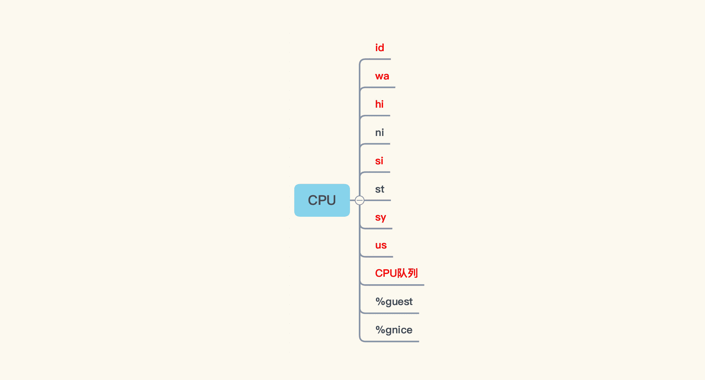

讲到这里，我们已经罗列出与 CPU 相关的所有计数器了。我们前面提到，要根据 Linux 操作系统中的各个模块，把相应的计数器全都罗列出来。所以，其他模块的计数器我们也需要像这样完整地找出来。

当我们把 Linux 操作系统所有的关键一级计数器找完之后，就会得到这样一张图：

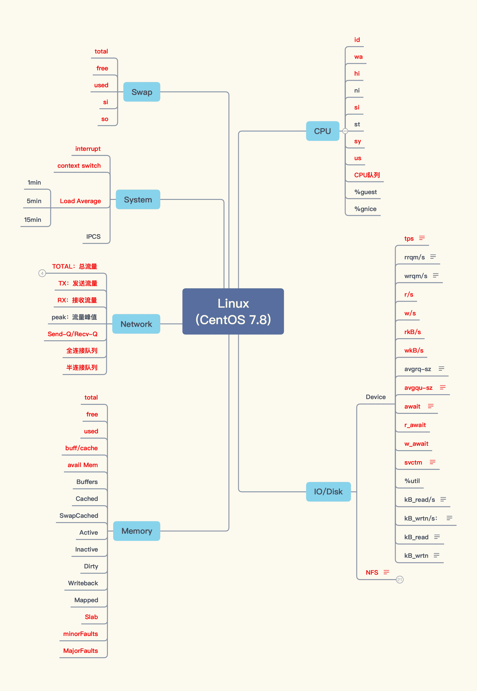

请你注意，这些计数器里，有一些会比较关键，我根据自己的经验，把重要的计数器都标红了。当然，如果你对操作系统有足够的理解，也可以从不同的角度，用不同的思路，列出自己的图。要知道，罗列计数器只是一个体力活，只要你愿意，就能列出来。

**第四步：画出计数器之间的相关性。**

从上面的图可以看到，尽管我们列出了很多计数器，但是这些计数器之间的关系是什么，我们还不清楚。

在分析的时候，由于我们要根据相应的计数器，来判断问题的方向（有时候一个计数器并不足以支撑我们作出判断，那我们就需要多个计数器共同判断）。所以，我们要画出这些计数器之间的关系，这一步非常重要。

我根据自己的理解，画出了 Linux 操作系统中计数器之间的关系，如下所示：

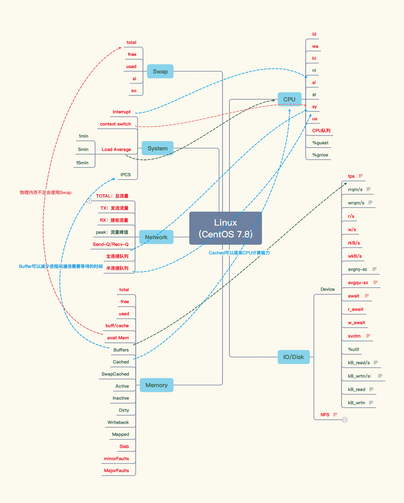

如果线画得太多，看起来会比较混乱，所以我只画出了几个最重要的关键相关性。

至此，我们就把 Linux 操作系统的性能分析决策树画完了，计数器也覆盖全了。不过，工作还没有结束，因为我们还需要找到合适的监控工具，来收集这些计数器的实时数据。

### 收集计数器的实时数据

请你注意，在收集计数器的实时数据时，可能不是一个监控工具就可以完全覆盖所有的计数器的。所以，在分析的时候，我们一定要清楚监控工具的局限在哪里。如果一个工具无法监控到全部的计数器，那就必须用多个工具相互补充，比如说对于 Linux 操作系统的监控，现在我们最常用的监控工具就是 prometheus+grafana+node_exporter，像这样：

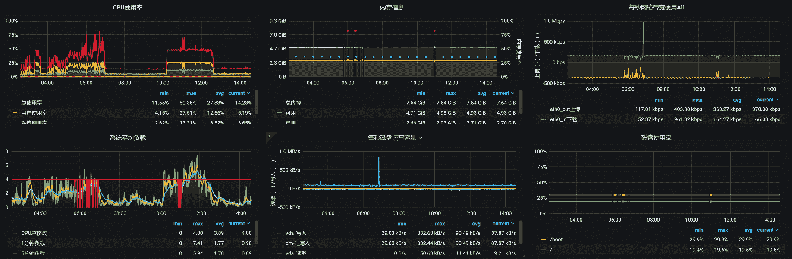

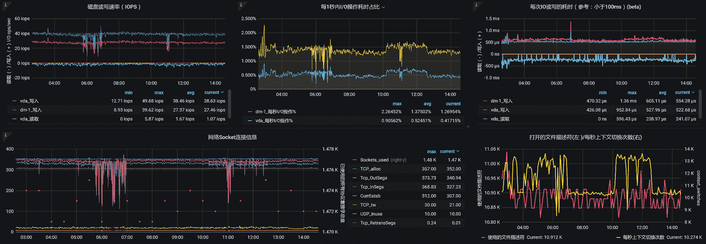

这是我们经常用的监控 Linux 操作系统的模板。那这个模板的数据全不全呢？其实一对比就能发现，这个模板虽然可以覆盖大部分 Linux 操作系统的性能计数器，但是并不全，比如说网络的队列、内存的软 / 硬错误等，这些就没有覆盖到。

因此，**我们在使用监控工具之前，一定要把性能分析决策树中的计数器，与监控工具中的计数器做对比，缺什么，我们就要在分析时用其他的监控工具或是命令来做补充。**

请你记住一点，**用什么监控工具并不重要，有没有监控到全部的计数器才重要**。即便我们没有任何的监控工具，要是只敲命令也能监控到全部计数器的话，也是可以的。所以，我希望你不要迷信工具。

到这里，整个性能分析决策树还没有结束。因为在这个系统的架构中还有其他的技术组件，而我们的任务就是把这些技术组件，都按照我们前面讲的那四个步骤，画出相应的性能分析决策树，最终形成一张完整的大图。

在我们这个系统中，如果画出全部的技术组件和模块的话，就会看到下面这张图：

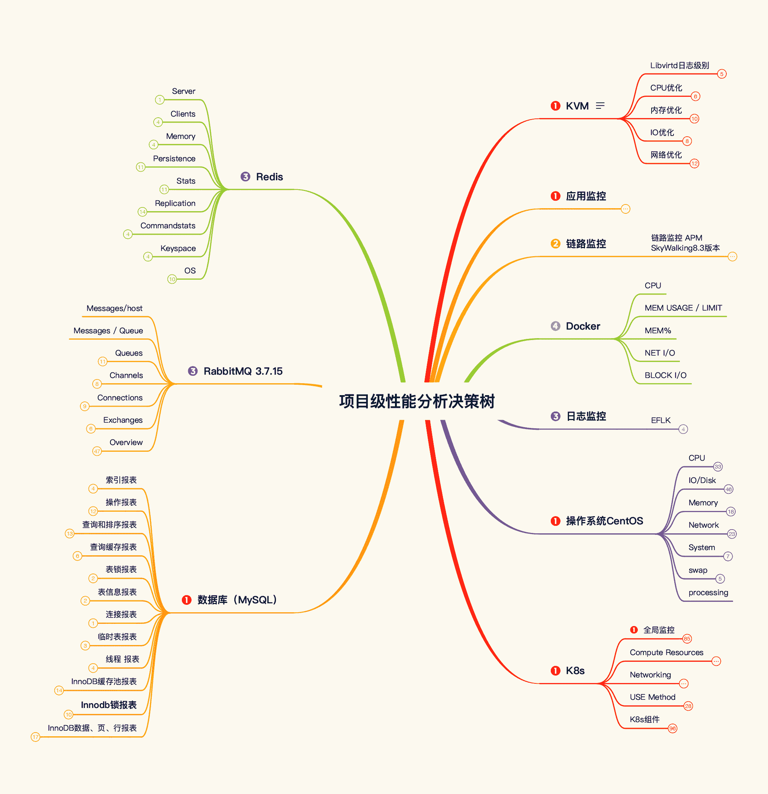

整个图我没有全部展开，要是展开的话就太大了，会完全看不到末端的计数器。不过你放心，在后面课程的分析案例中，我会让你看到如何应用这个性能分析决策树来做相应的问题分析。

讲到这里，我就把性能分析决策树完整地给你描述完了，步骤也列清楚了。古人有云：授人以鱼不如授人以渔。所以，我希望你看到这些步骤之后，可以画出你自己项目中完整的性能分析决策树。

我还要强调一点，这里我们只列出了第一级的性能计数器。如果第一级计数器有问题，而我们还不能判断出问题的原因，那就需要接着找第二级、第三级、第四级..... 关于怎么找更深层级的性能计数器，我会在接下来证据链的部分给你讲解。

不过，在我们一开始梳理性能分析决策树时，没必要把所有层级的性能计数器都列出来。因为可能我们整个项目做完了，都没有用到全部的计数器，全列出来容易浪费时间。只有我们看懂了第一级的计数器，并且判断出问题的方向，才有可能需要看更深层的计数器。

所以，**你要注意，理解每个计数器的含义才是至关重要的**。如果不理解计数器的含义，也不知道如何运用计数器，那我们就不可能知道怎么去做分析。

有了性能分析决策树之后，我们如何应用它呢？接下来，就不得不讲一讲性能瓶颈的证据链了。

## 怎么查找性能瓶颈证据链？

在每次做培训或者性能分析时，我都会强调，性能分析中有一个非常关键的词，那就是“证据链”。

如果性能分析没有证据链，那么分析思路就是跳跃的。通俗点讲，就是蒙，根据经验蒙，根据资料蒙。这种跳跃的分析思路是非常容易出错的。所以，我们在分析性能瓶颈时，一定要有理有据、顺藤摸瓜。

那具体怎么来判断呢？接下来我会通过一个例子给你讲解。

### 全局监控分析

在进入这个例子之前，我需要跟你强调一点，在性能分析中，监控分析可以分为两个部分：全局监控分析和定向监控分析。全局监控分析是指将整个架构中具有概括性的计数器都分析一遍。也**只有从全局监控计数器，我们才能看到性能问题的第一层现象**。

比如说，如果我们想找到哪一行代码有消耗 CPU 的问题，首先，我们是不知道具体是哪一行代码的，但是在 CPU 计数器上会体现出 CPU 使用率高的现象。而全局监控就是为了查看 CPU 消耗是不是比较高，当我们看到 CPU 消耗高的时候，再往下找是哪一行代码消耗 CPU 比较高，这就用到了定向监控分析的思路。

所以在性能分析的过程中，我通常会分为全局监控分析和定向监控分析两个阶段。而全局监控分析既可以用监控平台，也可以用命令。

在我之前做过的一个项目中，有一个主机有 24 颗 CPU，我在场景执行过程中看到了这样的数据：

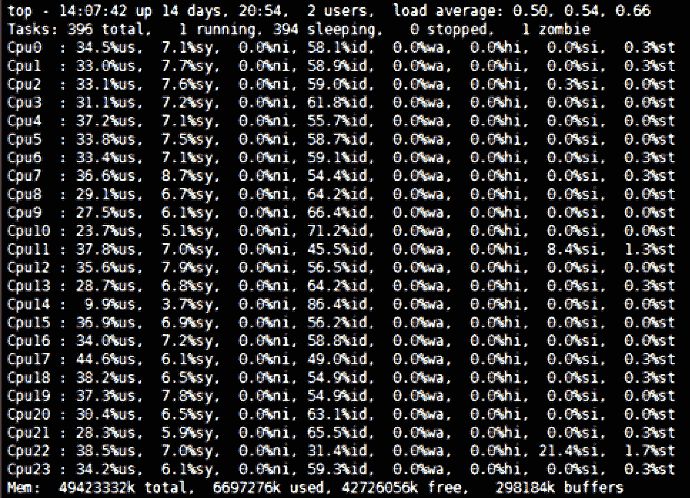

这就是我们前面提到的，性能分析决策树中 CPU 监控的具体命令。所以我们接下来的分析逻辑就是：**根据性能瓶颈的分析应用，选择相应的监控手段，覆盖性能分析决策树中****需要监控的****计数器，****然后****再进一步细化分析。**

在上面这张图中，我们看到所有 CPU 的 %us 使用率并没有很高，%id 也不小，还有一些剩余。但是 %si（软中断）这一项，唯独第 22 颗 CPU 的 %si 有 21.4% 之高。那这个软中断合理不合理呢？

有人可能会说，这也没有太高嘛，能有什么问题？如果我们只看 %si 平均值的话，可能确实发现不了问题的存在。但如果仔细看图中更详细的数据，就会有不一样的结论了，这也是为什么我们要把每颗 CPU 的使用率都先列出来的原因。

我们说，当一个应用跑着的时候，如果应用代码消耗了很多 CPU，那 %us 的使用率应该会变高，但是在上面我们看到的并不是 %us 高。并且在合理的情况下，每个 CPU 都应该被使用上，也就是说这些 CPU 的使用率应该是均衡的。

但是在这个图中，我们看到只有 CPU 22 的 %si 使用率比较高，为 21.4%。并且软中断（%si）只使用了 24 颗 CPU 中的一颗。这个软中断显然是不合理的。

### 定向监控分析

那既然软中断不合理，我们自然是要知道这个软中断到底中断到哪里去了，为什么只中断到一颗 CPU 上。所以，我们要去查一下软中断的数据。

在 Linux 操作系统中，有不少工具可以查看软中断，其中一个重要的工具就是 /proc/softirqs。这个文件记录了软中断的数据。在我们这个例子中，因为有 24 颗 CPU，数据看起来实在比较长。所以，我先把一些 CPU 数据过滤掉了，只留下图中这些数据来分析。

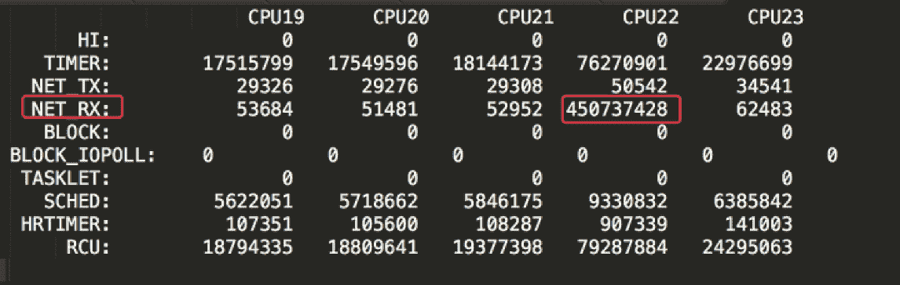

在这张图中，我标注出了 CPU 22 和它对应的模块名 NET_RX。你可能会奇怪，怎么一下子就找到了这个模块呢？这是因为 CPU 22 的使用率最高，在它上面产生的中断数自然要比其他 CPU 高得多。

由于 /proc/softirqs 文件中的各个计数器都是累加值，其他模块在各个 CPU 上的累加值比例都没有太大的差别，只有 NET_RX 模块在不同 CPU 上的计数值差别很大。所以，我们可以作出这样的判断：CPU 22 的使用率高是因为 NET_RX。

我们看“NET_RX”这个名字就能知道，这个模块的意思是网络接收数据。那在网络数据接收的过程中，什么东西会导致网络的中断只中断在一颗 CPU 上呢？

我们知道，网络的接收是靠队列来缓存数据的，所以我们接下来得去查一下网络接收的队列有多少个。我们可以通过 /sys/class/net/< 网卡名 >/queues/ 路径，查看到这个网络队列：

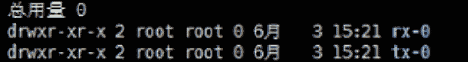

不难看出，RX 队列确实只有一个，这也就意味着，所有的网络接收数据都得走这一个队列。既然如此，那自然不可能用到更多的 CPU，只能用一颗了。

讲到这里，我要多说明一点：因为我们这节课重在讲解分析的逻辑，所以我在这里就不做更加细致的分析了。如果你要想更深入地理解网络中断逻辑，可以去翻一下 Linux 源码，看看 net_rx_action 函数。不过归根到底，中断在系统层的调用都是 do_softirqs 函数，所以当我们用 perf top -g 命令查看 CPU 热点的时候，你同样也可以看到上面我所描述的逻辑。

既然我们知道了网络接收队列只有一个，那上述问题的解决思路自然也就出来了：多增加几个队列，让更多的 CPU 来做中断的事情。因为网络中断是为了把数据从网卡向 TCP 层传输，所以队列一旦变多了，传输速度也会变得快一些。

所以，我们的解决方案就是增加队列：

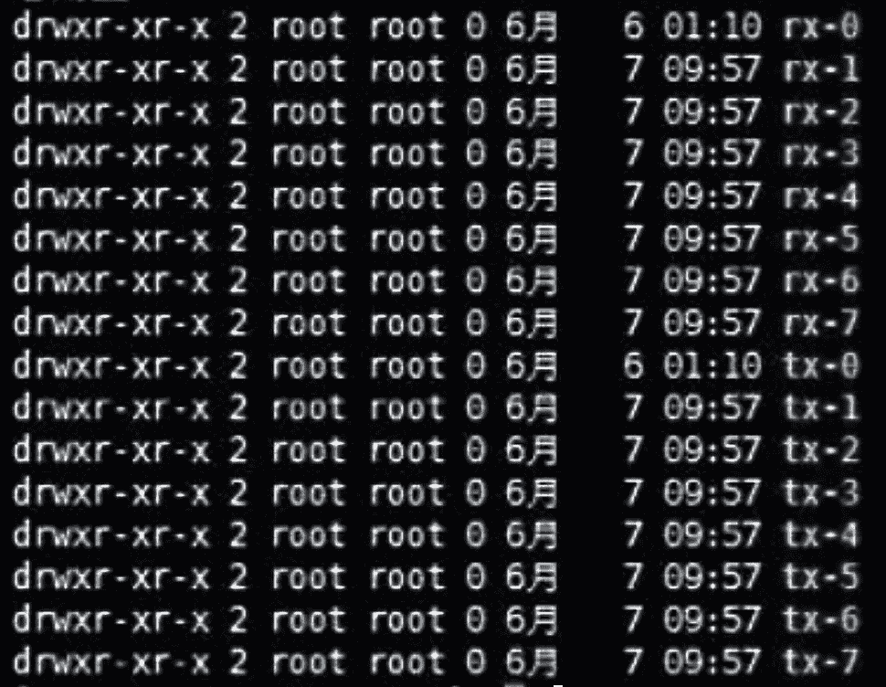

在我们这个例子中，我把队列增加到了 8 个，这样网络接收数据就会用到 8 颗 CPU。如果你想用更多的 CPU 也可以，这里我们有 24 颗 CPU，那就可以设置 24 个队列。如果你用的是虚拟机，对于这个改动，你可以在 KVM 的 XML 参数中增加一个队列参数来实现；如果你用的是物理机，那你就只能换网卡了。

现在我们把整个分析逻辑都理清楚了，下面就按照这个逻辑把对应的证据链画一下：

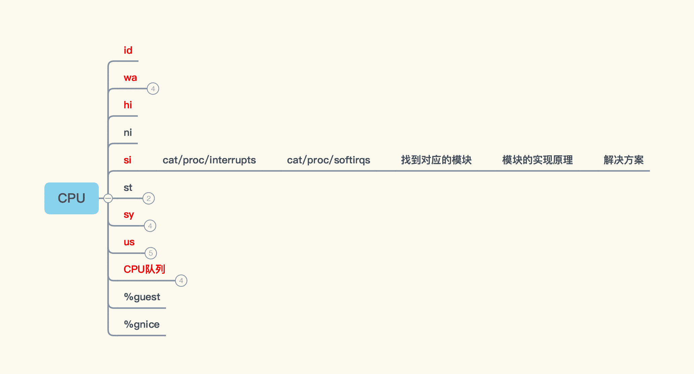

根据图中展示的逻辑，当我们看到 %si（软中断）高时，就去查看 cat/proc/interrupts 目录。其实对于这个软中断，有两个目录可以体现出来，一个是 cat/proc/interrupts，另一个是 cat/proc/softirqs。前者不仅包括软中断，还包括硬中断，如果我们看到软中断高，其实直接看 cat/proc/softirqs 就可以了。

紧接着，我们要找到对应的模块，然后再找到这个模块的实现原理，最后我们给出相应的解决方案。

这样一来，这个问题的完整证据链就找到了。

相信你通过这个例子可以看出，性能瓶颈的证据链其实就是，性能分析决策树在具体应用过程中完整的分析逻辑的记录。

请你注意，我们一开始并不会直接去看 cat/proc/softirqs 的内容，因为这个太定向、太具体了。我们一定要先看全局的数据，然后再一步一步往下去找，这样才是合理的。不难发现，我们从全局监控分析拿到的数据，和从定向监控分析拿到的数据是不一样的，因为它们是不同的角度，这一点你也要格外注意。

## 总结

这节课和上节课一起，我把整个分析逻辑总结为：**RESAR 性能分析七步法**，这是性能分析方法论中最重要的核心逻辑。不过，这些内容“孤篇盖全唐”的可能性很小，毕竟性能分析涉及到的所有细节无法在短短两节课里尽述。

所以，我把我认为最重要的部分都给你描述出来了，当你在实际应用时，可以按照这个思路，实现你的性能分析决策树和性能瓶颈证据链。前提是，你要理解你的系统，理解你的架构，并且要理解我给你讲的分析逻辑。

在这节课中，我为你讲解了两个重要的内容：性能分析决策树的构建，以及性能瓶颈证据链的查找。这是我们在每一个性能问题的分析过程中，都必须经历的。只有把决策树和证据链具体落地，我们才能在性能分析中无往不利。

## 课后作业

最后，请你思考一下：

1. 如何构建你自己的性能分析决策树？
2. 举一个你做过的性能分析中有完整证据链的案例。

欢迎你在留言区与我交流讨论。当然了，你也可以把这节课分享给你身边的朋友，他们的一些想法或许会让你有更大的收获。我们下节课见！

**关于课程读者群**

点击课程详情页的链接，扫描二维码，就可以加入我们这个课程的读者群哦，希望这里的交流与思维碰撞能帮助你取得更大的进步，期待你的到来～
