# 10 | 设计基准场景需要注意哪些关键点？

 

你好，我是高楼。

在前面的课程中我们提到过，在 RESAR 性能工程中，场景分为四类：基准、容量、稳定性、异常。每一类场景都对应着不同的目标。

其中，基准场景是为了找到系统中明显的配置及软件 Bug，同时也为容量场景提供可对比的基准数据。在 RESAR 性能工程的逻辑中，基准场景是非常重要、非常重要的部分，而不是随意试验一下场景能不能跑起来，是要有确定的结论的。

在这节课中，我要给你解释几个基本的问题，比如线程数应该如何确定，压力线程的连续递增的重要性，以及如何将之前所讲的分析思路应用在具体的分析案例中。

下面我们一起来看一看。

## 性能场景分类

在设计性能场景时，我们首先要清楚场景的目标是什么。在一些项目中，我们通常会拿到这样的需求：

1. 评估一下系统能支持的最大容量。这显然是为了知道当前的系统容量，目标很明确；
2. 测试并优化系统以支持线上的业务目标。这个需求显然有了优化的必要；
3. 测试并评估未来几年内，性能容量是否可以满足业务发展。这个需求显然是要求测试未来的业务场景。

这是我们经常拿到的几类性能需求，基于此，我把场景按照目标划分为三类：

1. 验证：评估当前系统容量；
2. 调优：评估并优化当前系统；
3. 推算：评估并推算未来系统容量。

这种分类和我们一直强调的按类型分类（也就是基准、容量、稳定性、异常）是什么关系呢？这里我画一张图说明一下：

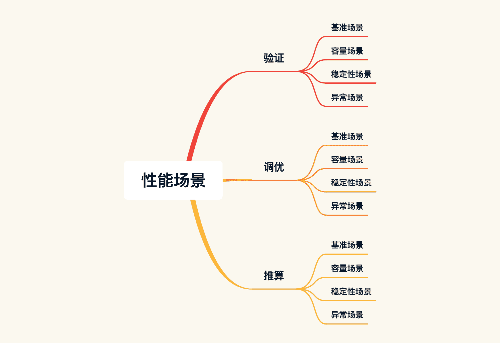

从图中可以明显看出这两种分类之间的关系：我们首先要确定性能场景的目标，然后再设计对应的具体场景。

你要注意，对于图中的三种目标，位于下方的目标是包含它上方的目标的，比如以调优为目标的场景，包括了以验证为目标的场景。

有了这些基本的了解后，下面我再给你详细解释一下。

#### 1. 按目标分类

对于按目标划分出的这三种性能场景，我们结合 RESAR 性能过程图具体来看看。

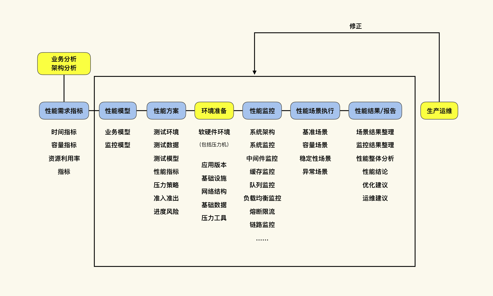

1. **性能验证**

性能验证（测试）是指针对当前的系统、当前的模型、当前的环境，验证一下版本是否有性能的变化。注意，在这个阶段中，我们不做复杂的性能监控，不做性能分析，也不调优。

在目前的性能市场中，大部分项目都处于性能验证的状态。如果对于一个已经在线上稳定运行了很久的系统来说，我们去做版本更新的验证倒是无可厚非的，只要比对一下数据就可以了。这种项目周期通常在一两周以内，不会更长了，而且也不用更长，除非有大的性能瓶颈。

对于性能验证的项目，其实很多人一直在做“性能场景执行”和“性能结果 / 报告”这两个步骤。其他的步骤也不是不做，只是会拿之前的文档做个修改，走个过场，想着反正也没人仔细看。所以，性能验证这个项目就变成了：来一个版本，用同样的脚本、同样的环境、同样的数据，执行一遍就好了。

当这样的执行多了以后，你就会产生一种误解：原来性能就是这样无聊地一轮一轮执行下去，还是熟悉的姿势、还是熟悉的味道……在我遇到的性能从业人员中，有很多人都是在这样的项目中认识了性能，从而认为自己的技术还挺好的，觉得性能也不怎么难。

1. **性能调优**

性能调优是指针对当前的系统、当前的模型、当前的环境，做性能监控、性能分析和性能优化，并且要给出具体的结论。这是我们大部分项目都应该做到，但实际上没有做到的。

如果一个项目需要给出“系统上线后以什么样的容量能力来运行”这样的结论，那么这个场景目标的细化是相当关键的。

现在，很多性能项目最缺少的就是给出一个明确的结论。什么叫“给出结论”呢？你说我写了 TPS 是多少、CPU 使用率是多少，这叫结论吗？对不起，我觉得这不叫结论。

**结论应该是有业务含义的**，比如说支持 1000 万用户在线、支持 1 万用户并发等等，这才叫结论。

不管你给出多少 TPS，只要老板或是其他人问：“那我上了 1000 万用户之后，系统会不会死呢？”你会有一种被敲了一闷棍的感觉，不知道该如何回答。而这个时候，给对方的感觉就是，这个性能做得没什么具体的价值。不管你有多累多辛苦，在这种情况下，性能的价值都会被低估。

前段时间，我跟一个十几年的朋友聊天，就聊到了这个话题：性能如何才能体现出价值。我说，如果是我做的项目，我会给出这样的承诺，那就是在我执行的性能场景范围之内，我要保证线上不会死。如果死了，我觉得这个性能项目就不应该收费了。

这就像你买了一个手机，回来一用，发现打不了电话，你觉得这时候怎么办？不是退货就是换货，还要生一肚子闷气。

既然如此，那我们做性能为什么就给不了这样的承诺呢？你想想，如果你做完了一个项目，却不能告诉对方这个系统能不能好好活着，那人家还要你干嘛，直接砍掉这个项目就好，还省了成本。

此外，从 RESAR 性能工程的过程图来看，对于性能调优的项目，我们需要完成从“性能需求指标”到“生产运维”的整个过程。注意，这整个过程不是走过场，而是每一步都要精雕细琢。

1. **性能推算**

性能估算针对的是未来的系统、未来的模型、未来的环境，我们要对此做出严谨的业务增长模型分析，并在场景执行过程中进行性能监控、分析和优化，同时给出具体的结论。很多项目都想做到性能估算，可往往都只走了过场。

其实，在性能估算的场景目标中，如果要估算的未来时间并不遥远，那我们根据业务的发展趋势的确可以推算得出来，并且这也是合理的场景。就怕遇到那种狮子大开口的需求，一说到估算，就是系统十年不宕机。

对于性能估算的项目，我们同样需要完成从“性能需求指标”到“生产运维”的整个过程。其中，有两个环节与性能调优项目中的不同，那就是“性能需求指标”和“性能模型”。

在性能估算项目中，性能需求指标和性能模型一定不是由性能测试人员来决定的，而是由整个团队来决定。上到老板，下到基层员工，都要有统一的认识。要不然等项目做完了之后，你就无法回答老板那个“能不能支持 1000 万在线“的问题。

上述就是我们按照目标划分出的三类性能场景，这里我用一张图帮你总结一下，我希望你能对它们有了一个清楚的了解。

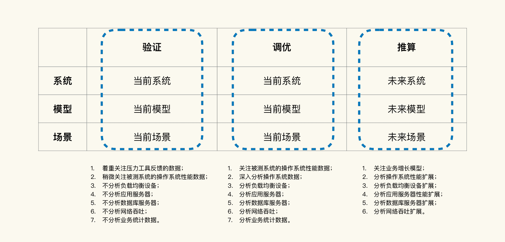

#### 2. 按过程分类

我们说，性能场景还可以按照过程分类，而这个“过程”，说的其实就是我们应该怎样执行性能场景、性能场景应该从哪里开始的问题。不知道你记不记得，我之前在第 5 讲中画过这样一张图：

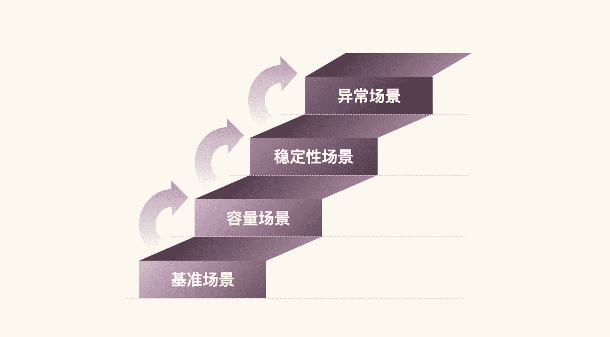

从图中可以看到，我一直强调的是这四种场景执行过程：

1. 基准场景
2. 容量场景
3. 稳定性场景
4. 异常场景

请你记住：**性能场景中需要且仅需要这四种场景****。**

你可能会问，就这么绝对吗？是的，我就是这么固执。

在正式的性能场景（需要给出结果报告的性能场景）中，我还要再强调两个关键词：“**递增**”和“**连续**”。为了说明这两个关键词有多么重要，我特意用红框红字给你写在下面，希望你能重视。


这两个关键词是我们在性能场景中一定要做到的。因为，在我们的生产环境里没有不连续的情况，并且在我们的生产环境中，用户量肯定是一个由少到多、有起伏变化的过程。而且，也只有这两个关键词能把场景的基调给定下来。所以，我一直在反复反复强调它们。

也许有人会说，我就是试一下看看场景能不能执行起来，也得这么干吗？嗯……那倒不用，请退出去把门带上。

下面我们来说一下在基准场景执行过程中，我们要重点关注什么。

## 基准场景

在我们对一个系统完全不了解的情况下，我们先要搞清楚系统大概的容量能力是多少，具体要从哪里开始呢？就是从基准场景开始。

比如说在我们这个电商系统中，我们要测试 11 个业务。那是不是可以一上来就把这 11 个业务脚本都做出来，上去压呢？那肯定是不行的，因为我们还不知道每一个业务能跑到多大的 TPS，有没有性能瓶颈。如果直接混合去压，会导致多个性能问题一起暴露出来并产生相互的影响，这样的话我们分析起来会比较困难。

所以，**我们要先做单接口的基准场景**。那具体怎么做呢？我们来看一个例子。首先，我们拿几个用户测试一下登录接口的基本性能（请你注意，这个尝试的过程本身并不是基准场景）。如下所示：

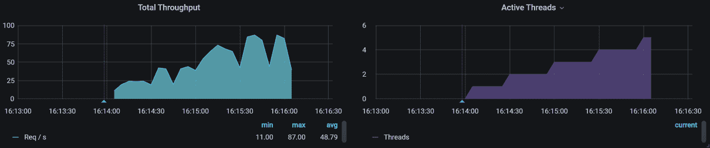

从图中，我们至少可以看出，1 个压力线程大概会产生 20TPS。

那单接口的容量达到多少才不影响混合的容量场景呢？很显然，如果这是一个单登录接口，就必须高过 50TPS，这是最起码的。而我们现在用的是 8C16G 的机器，根据 CRUD 的测试经验，即使不走缓存，这样的操作要达到 500TPS 应该没什么问题。

那在一个线程能产生 20 个 TPS 的前提下，我们先假设这个接口能达到的最大 500TPS 都是线性的，那就需要：
线程数=500TPS÷20TPS=25个线程

同时，因为 1 个压力线程大概会产生 20TPS，从 TPS 曲线上看还是上升的比较快的，所以我会考虑把 Duration（场景的持续时间）放长一点，目的是让压力不要增加得太快，而在这个缓慢增加的过程中观察各类曲线的变化，以判断后续的动作以及最大容量。我会这样来确定场景的加压过程。

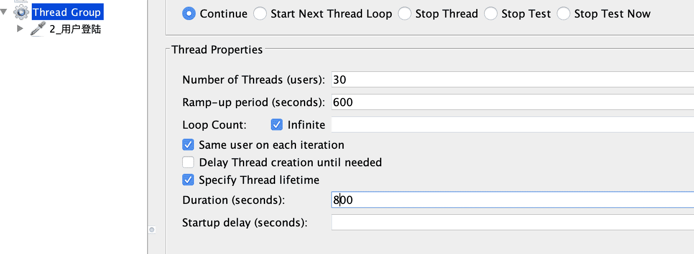

在图中，我上到了 30 个线程，这里也可以不要高出那么多，只要高出 25 个线程就可以了。我把 Ramp-up period 设置为 600 秒，也就是 20 秒上一个线程，这样就会产生一个明显的连续递增的过程。

现在，我们总结一下整个思路：

1. 先确定单线程运行时的 TPS 值；
2. 根据系统最大的预估容量设置场景中的线程数、递增参数等。强调一下，如果你不会预估容量，可以直接多加一些线程，然后在递增的过程中查看曲线的变化；
3. 确定正式基准场景的压力参数。

对于其他接口，我们也用这样的思路一个个执行下去。当然，对于这个过程，我们也需要在测试过程中不断地修正。

现在，我们根据上面讲述的过程，总结一下基准场景的目的：

1. **获得单接口最大 TPS**：如果单接口最大 TPS 没有超过容量场景中的要求，那就必须要调优。那如果超过了，是不是就不需要调优了呢？我们接着看第二个目的。
2. **解决单接口基准场景中遇到的性能问题**：也就是说，当我们在做单接口测试时，碰到了性能瓶颈一定要分析，这就涉及到了性能分析逻辑。所以，性能分析基本上可以分为两大阶段：

1. 第一阶段：硬件资源用完。即在基准场景中，我们要把 CPU、内存、网络、IO 等资源中的任一个耗尽，因为在这种情况下，我们很容易从全局监控的性能计数器中看到现象，可以接着去跟踪分析。
2. 第二阶段：优化到最高 TPS。即在基准场景中，我们要把单接口的 TPS 调到最高，以免成为容量场景中的瓶颈点。

如果第一阶段的目标达不到，那么不用多想，我们肯定要找瓶颈在哪里。要是硬件资源已经用完了，TPS 也满足了容量场景中的要求，那么，从成本的角度来考虑，这个项目就不需要再进行下去了。如果硬件资源用完了，但 TPS 没有满足容量场景中的要求，那就必须优化。

下面我们先来执行一个单接口场景，看一下上面的思路如何落地的。

## 登录接口

按照上面所讲的基准场景的设计步骤，我们先试运行一下这个接口的基准场景。注意，在基准测试中，试运行的过程只是为了看一下基本的接口响应时间，并不是为了完成基准场景。

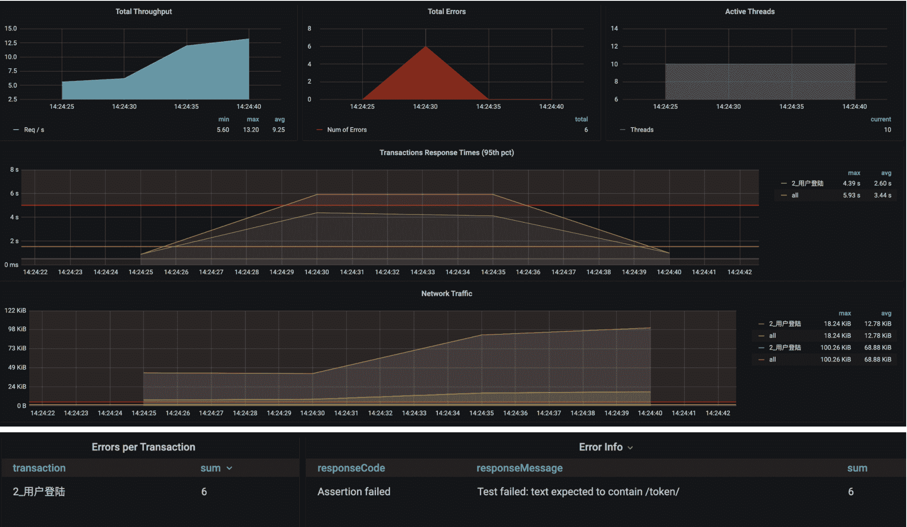

啊，满目疮痍呀！

从图中看，虽然场景执行时间并不长，但是 10 个线程上来就报了错，响应时间和 TPS 也都达到了让人伤心的程度，只有 12.5TPS。这可怎么办？

没办法，我们只有分析这个过程了。接下来的内容就是我对问题的分析过程。主要是看一下，我们前面提到的性能分析思路是如何落地的。

1. **问题现象**

如上图所示，这现象老明显了。

1. **分析过程**

从我一直提倡的 RESAR 性能分析逻辑上来说，针对响应时间长的问题，我们首先要做的就是拆分时间。由于这个系统已经部署了 SkyWalking，我们自然要果断地用它看看时间浪费在了哪里。

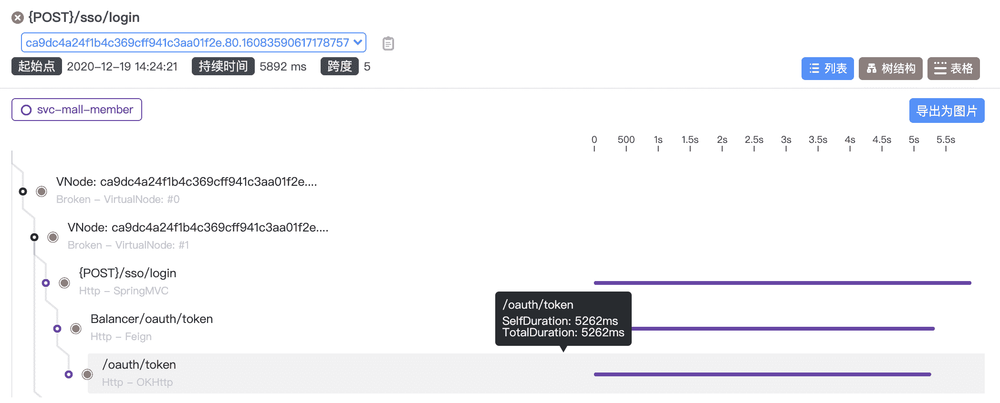

你看图中，一个 Token 的 SelfDuration 居然要 5 秒多！唉，开源项目的坑还是多呀。看起来功能似乎都实现了，连 Star 都好几万了，但是完全没性能意识。

不过这样也好，这下我们可有的玩了。我们做性能分析的人，就是要收拾这样的烂系统，才能快速成长嘛。

话说回来，既然 Token 接口响应时间长，我们在 SkyWaking 中又看不到完整的调用栈，那么接下来就有两个动作可以做：

1. 打印一个完整的栈，看看调用链路。
2. 不打印栈，直接连到 Java 进程中看方法的时间消耗。

我们用第一个方法看到调用链路，也还是要跟踪具体方法的耗时，只有这样才能把证据链走下去。在这里，我就直接用第二个方法了。

在第二个方法中，我们要看方法的时间消耗，可以使用的工具其实有很多，像 JDB/JvisualVM/Arthas 这些都可以。这里我们用 Arthas 来跟踪一下。

首先，我们跟踪一下那个 Token 的方法。

```
trace com.dunshan.mall.auth.controller.AuthController postAccessToken '#cost > 1000' -n 3  
trace org.springframework.security.oauth2.provider.endpoint.TokenEndpoint postAccessToken '#cost > 1000' -n 3  
trace org.springframework.security.oauth2.provider.token.AbstractTokenGranter getOAuth2Authentication '#cost > 1000' -n 3  
trace org.springframework.security.authentication.AuthenticationManager getOAuth2Authentication '#cost > 500' -n 3  
trace org.springframework.security.authentication.ProviderManager authenticate '#cost > 500' -n 3  
trace org.springframework.security.authentication.dao.AbstractUserDetailsAuthenticationProvider authenticate '#cost > 500' -n 3
```

我们用上面的语句一层层跟踪下去，最终来到了这里：

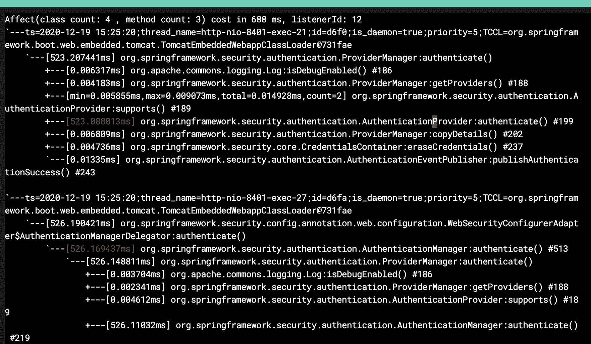

请你注意，我们即使不用 Arthas，采用其他的工具也可以达到同样的效果。所以，请你不要迷恋工具，要迷恋就迷恋哥。

既然这个 authenticate 方法耗时比较长，那我们就打开源代码看看这一段是什么东西。

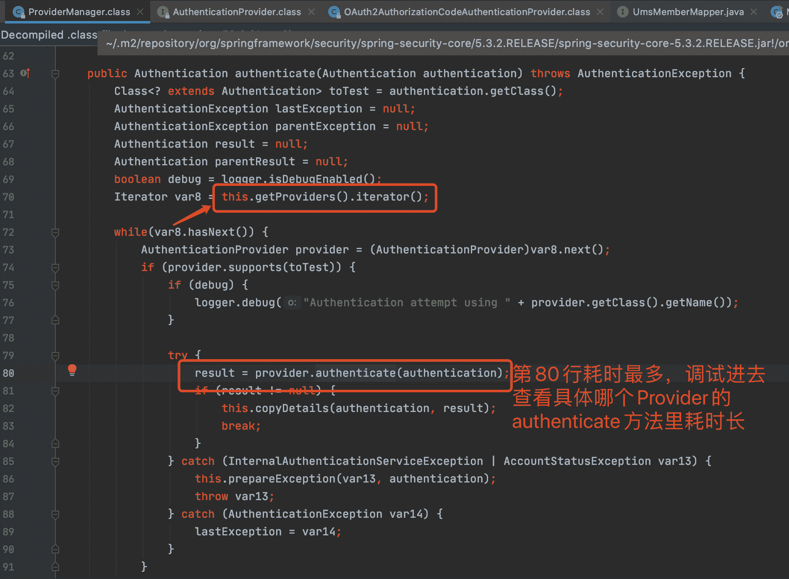

接着，我们调试跟踪进去，看到如下部分：

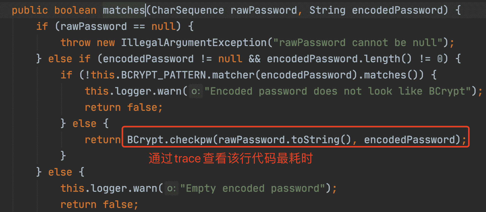

原来，这里是一个加密算法 BCrypt。

1. **优化方案**

我解释一下，Bcrypt 在加密时，每一次 HASH 出来的值是不同的，并且特别慢！

我们跟踪到这里，解决方案其实比较明确了，那就是用更快的加密方式，或者去掉这个加密算法。我们把更换加密方式这个问题留给开发去解决。作为性能分析人员，我决定把这个加密算法直接去掉，咱们先往下走。

1. **优化效果**

优化效果如下：

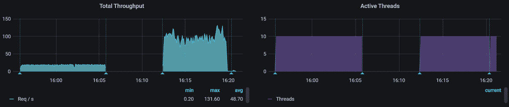

从图中可以看到，对于同样的线程数，现在 TPS 从 20 涨到了 80 了。

从这个简单的分析逻辑中，你可以看到，我们通过响应时间的拆分跟踪，知道了哪个方法慢，再进一步去分析这个方法，确定解决方案。这就是一个最简单的 RESAR 性能分析七步法的应用，看起来我们似乎在这个分析过程中跳过了七步法中的分析架构图这样的步骤，但实际上在我们分析的过程中，是跳不开的，因为不管是看架构图，还是看调用链，都是要在脑子中有架构逻辑的。

在基准场景中，我们还会遇到各种问题，后面我都会一一记录下来，希望能给你一些借鉴。

## 总结

根据 RESAR 性能工程理论，在性能场景中，我们按执行过程，可以将场景分为四类：基准场景、容量场景、稳定性场景和异常场景。这些场景各有目的，在这节课中，我们主要描述了基准场景的逻辑，并给出了实例。

基准场景有两个重要的目的：

1. 获得单接口最大 TPS；
2. 解决单接口基准场景中遇到的性能问题。

这两个目的对我们很重要，都是为了容量场景打基础的。

在这节课中，我主要想让你感受一下性能分析的过程。当然了，我们最后的这个优化效果其实还没有达到我对性能的要求。不过，你放心，在后面的课程中你将看到更多的分析逻辑。

来，跟哥往下走。

## 课后作业

最后，请你思考一下：

1. 为什么 RESAR 性能工程按过程只分为四类场景？
2. 在分析代码时间时，我们如何跟踪 Java 的执行耗时，有多少种手段？

记得在留言区和我讨论、交流你的想法，每一次思考都会让你更进一步。

如果这节课让你有所收获，也欢迎你分享给你的朋友，共同学习进步。我们下一讲再见！
