# 12 | 打开首页之二：如何平衡利用硬件资源？

 

你好，我是高楼。

针对打开首页接口的性能问题，我们在上节课中确定了是 Gateway 在消耗响应时间，达到了近 100 毫秒。于是，我们开始定位 Gateway 上的响应时间消耗。

在第一阶段的时候，我们关注了应用所在的主机，同时还了解到，宿主机总共有四台机器；在第二阶段，我们查看了物理机的 CPU 模式。并尝试通过修改 CPU 运行模式来优化性能。可是，问题仍然没有解决，TPS 没见提升，响应时间依旧很长。

今天这节课，我们进入第三阶段，继续分析其他的瓶颈点，比如 wa cpu、资源均衡使用、网络带宽等问题。其中，**在性能的分析逻辑里，资源均衡使用是一个非常容易被忽略，但又极为重要的方面。**我们通常都盯着计数器给出的数值有什么异常，而不是考虑资源怎么做相应的调配。

在我们这个案例中，系统是用 k8s 来管理资源的，所以我们必须要关注资源的均衡使用，避免出现有些服务性能很差，却和性能好的服务分配同样资源的情况。另外，网络资源在 k8s 中会跨越好几层，我们也要着重关注一下。

在学习这节课时，我建议你多思考下资源的均衡使用问题。现在，我们就开始今天的课程。

## 定位 gateway 上的响应时间消耗

### 第三阶段：NFS 服务器的 wa cpu 偏高

根据分析的逻辑，我们仍然是先看全局监控数据，思路依旧是“全局 - 定向”，这是我一贯的顺序了。

因此，我们现在再来查一下全局监控计数器，得到下面这样的视图：

```
[root@lenvo-nfs-server ~]# top  
top - 00:12:28 up 32 days,  4:22,  3 users,  load average: 9.89, 7.87, 4.71  
Tasks: 217 total,   1 running, 216 sleeping,   0 stopped,   0 zombie  
%Cpu0  :  0.0 us,  4.0 sy,  0.0 ni, 34.8 id, 61.2 wa,  0.0 hi,  0.0 si,  0.0 st  
%Cpu1  :  0.0 us,  4.7 sy,  0.0 ni, 27.8 id, 67.6 wa,  0.0 hi,  0.0 si,  0.0 st  
%Cpu2  :  0.0 us,  6.1 sy,  0.0 ni,  0.0 id, 93.9 wa,  0.0 hi,  0.0 si,  0.0 st  
%Cpu3  :  0.0 us,  7.6 sy,  0.0 ni,  3.4 id, 82.8 wa,  0.0 hi,  6.2 si,  0.0 st  
KiB Mem :  3589572 total,    82288 free,   775472 used,  2731812 buff/cache  
KiB Swap:  8388604 total,  8036400 free,   352204 used.  2282192 avail Mem 
```

可以看到，计数器 wa 的 CPU 使用率偏高，其中 Cpu2 的 wa 已经达到 90% 以上。我们知道，wa cpu 是指 CPU 在读写的时候，所产生的 IO 等待时间占 CPU 时间的百分比。那么，它现在竟然这么高，是因为写操作有很多吗？

这时候我们就要关注下 IO 的状态了，因为 IO 慢绝对是一个性能问题。通过 iostat 命令，我们看到 IO 状态如下：

```
[root@lenvo-nfs-server ~]# iostat -x -d 1  
Linux 3.10.0-693.el7.x86_64 (lenvo-nfs-server)   2020年12月26日   _x86_64_  (4 CPU)  
..................  
Device:         rrqm/s   wrqm/s     r/s     w/s    rkB/s    wkB/s avgrq-sz avgqu-sz   await r_await w_await  svctm  %util  
sda               0.00     0.00   94.00   39.00 13444.00 19968.00   502.44   108.43  410.80   52.00 1275.59   7.52 100.00  
  
  
Device:         rrqm/s   wrqm/s     r/s     w/s    rkB/s    wkB/s avgrq-sz avgqu-sz   await r_await w_await  svctm  %util  
sda               0.00    18.00  137.00  173.00 17712.00 43056.00   392.05   129.46  601.10   38.80 1046.38   3.74 115.90  
..................
```

你可以看到，IO 使用率达到了 100%，说明 IO 的过程实在是太慢了。

接下来，我们再查查 Block Size 是多少，算一下当前 IO 到底是随机读写还是顺序读写。虽然大部分操作系统都默认 Block Size 是 4096，但是，本着不出小错的原则，我们还是查一下比较放心。

我们先确定磁盘的格式是什么：

```
[root@lenvo-nfs-server ~]# cat /proc/mounts  
...................  
/dev/sda5 / xfs rw,relatime,attr2,inode64,noquota 0 0  
...................  
[root@lenvo-nfs-server ~]# 
```

通过上述命令可以知道，这个磁盘是 XFS 格式。那我们就用下面这个命令来查看 Block Size：

```
[root@lenvo-nfs-server ~]# xfs_info /dev/sda5  
meta-data=/dev/sda5              isize=512    agcount=4, agsize=18991936 blks  
         =                       sectsz=512   attr=2, projid32bit=1  
         =                       crc=1        finobt=0 spinodes=0  
data     =                       bsize=4096   blocks=75967744, imaxpct=25  
         =                       sunit=0      swidth=0 blks  
naming   =version 2              bsize=4096   ascii-ci=0 ftype=1  
log      =internal               bsize=4096   blocks=37093, version=2  
         =                       sectsz=512   sunit=0 blks, lazy-count=1  
realtime =none                   extsz=4096   blocks=0, rtextents=0  
[root@lenvo-nfs-server ~]# 
```

结果显示，Block Size 是 4096。同时，我们也可以看到读写基本上都是顺序的，不是随机。

那我们就来计算一条数据，确认一下顺序写的能力。如果全部是随机写，那么：

次数=（43056×1024）÷4096=10,764次

但是，实际上写只有 173 次，所以确实是顺序写了。

问题又来了，一次写多少个 Block 呢？

（43056×1024）÷173÷4096≈62个

我们得出，一次写 62 个 Block。从这样的数据来看，说明顺序写的能力还是不错的。因为对普通磁盘来说，应用在读写的时候，如果是随机写多，那写的速度就会明显比较慢；如果顺序写多，那么写的速度就可以快起来。

你发现了吗？虽然当前磁盘的顺序写能力不错，但是等待的时间也明显比较多。所以，接下来，我们得查一下是什么程序写的。这里我们用 iotop 命令查看：

```
Total DISK READ :      20.30 M/s | Total DISK WRITE :     24.95 M/s  
Actual DISK READ:      20.30 M/s | Actual DISK WRITE:       8.27 M/s  
  TID  PRIO  USER     DISK READ  DISK WRITE  SWAPIN     IO>    COMMAND                    
12180 be/4 root        2.39 M/s   16.01 M/s  0.00 % 35.94 % [nfsd]  
12176 be/4 root        3.20 M/s    0.00 B/s  0.00 % 32.25 % [nfsd]  
12179 be/4 root        3.03 M/s    6.43 M/s  0.00 % 32.23 % [nfsd]  
12177 be/4 root        2.44 M/s  625.49 K/s  0.00 % 31.64 % [nfsd]  
12178 be/4 root        2.34 M/s 1473.47 K/s  0.00 % 30.43 % [nfsd]  
12174 be/4 root        2.14 M/s   72.84 K/s  0.00 % 29.90 % [nfsd]  
12173 be/4 root        2.91 M/s  121.93 K/s  0.00 % 24.95 % [nfsd]  
12175 be/4 root     1894.69 K/s   27.71 K/s  0.00 % 24.94 % [nfsd]  
...............
```

可以看到，IO 都是 NFS 写过来的。那 NFS 的流量又是从哪里来的呢？从下面的数据来看，这些流量是从各个挂载了 NFS 盘的机器写过来的，这是我们一开始部署应用的时候，考虑统一使用 NFS 来做 IO 的思路。因为这个机器挂载了一个大容量的磁盘，为了保证磁盘够用，就把多个主机挂载了 NFS 盘。

```
                    191Mb               381Mb               572Mb               763Mb          954Mb  
mqqqqqqqqqqqqqqqqqqqvqqqqqqqqqqqqqqqqqqqvqqqqqqqqqqqqqqqqqqqvqqqqqqqqqqqqqqqqqqqvqqqqqqqqqqqqqqqqqqq  
172.16.106.119:nfs                   => 172.16.106.130:multiling-http        1.64Mb  2.04Mb  3.06Mb  
                                     <=                                      26.2Mb  14.5Mb  19.8Mb  
172.16.106.119:nfs                   => 172.16.106.100:apex-mesh             1.43Mb  2.18Mb  3.79Mb  
                                     <=                                      25.5Mb  14.2Mb  14.4Mb  
172.16.106.119:nfs                   => 172.16.106.195:vatp                   356Kb  1.27Mb  1.35Mb  
                                     <=                                      9.71Mb  7.04Mb  7.41Mb  
172.16.106.119:nfs                   => 172.16.106.56:815                    7.83Kb  4.97Kb  4.81Kb  
                                     <=                                       302Kb   314Kb   186Kb  
172.16.106.119:nfs                   => 172.16.106.79:device                 11.0Kb  7.45Kb  7.57Kb  
                                     <=                                      12.4Kb  22.0Kb  28.5Kb  
172.16.106.119:ssh                   => 172.16.100.201:cnrprotocol           2.86Kb  2.87Kb  5.81Kb  
                                     <=                                       184b    184b    525b  
169.254.3.2:60010                    => 225.4.0.2:59004                      2.25Kb  2.40Kb  2.34Kb  
                                     <=                                         0b      0b      0b  
169.254.6.2:60172                    => 225.4.0.2:59004                      2.25Kb  2.40Kb  2.34Kb  
                                     <=                                         0b  0b  0b  
172.16.106.119:nfs                   => 172.16.106.149:986                      0b   1.03Kb   976b  
                                     <=                                         0b   1.26Kb  1.11Kb  
  
  
qqqqqqqqqqqqqqqqqqqqqqqqqqqqqqqqqqqqqqqqqqqqqqqqqqqqqqqqqqqqqqqqqqqqqqqqqqqqqqqqqqqqqqqqqqqqqqqqqqqq  
TX:             cum:   37.0MB   peak:   31.9Mb                      rates:   3.44Mb  5.50Mb  8.22Mb  
RX:                     188MB            106Mb                               61.8Mb  36.2Mb  41.8Mb  
TOTAL:                  225MB            111Mb                               65.2Mb  41.7Mb  50.1Mb
```

我们在 Total DISK WRITE 中可以看到，读能力才达到 20M。没办法，既然 wa 这个机器的能力不怎么好，那就只有放弃统一写的思路。不过，为了不让机器的 IO 能力差成为应用的瓶颈点，我们还是再尝试一下这两个动作：

1. 第一，把 MySQL 的数据文件移走；
2. 第二，把 Log 移走。

接着我们执行场景，希望结果能好。

可是，在我查看了 TPS 和 RT 曲线后，很遗憾地发现，结果并没有改善。TPS 依然很低并且动荡非常大：

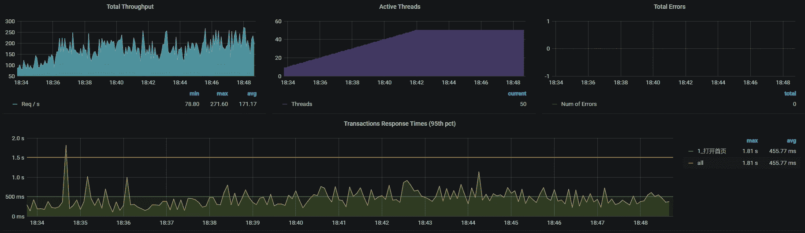

看来我们的努力并没有什么效果，悲剧！就这样，命运让我们不得不来到第四个阶段。

### 第四阶段：硬件资源耗尽，但 TPS 仍然很低

这个阶段我们查什么呢？仍然是全局监控的数据。我们来看一下所有主机的 Overview 资源：

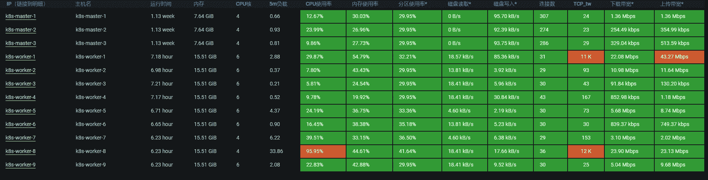

从上图中可以看到，虚拟机 k8s-worker-8 的 CPU 使用率已经很高了，达到了 95.95%。那我们就登录到这台虚拟机上，看看更详细的全局监控数据：

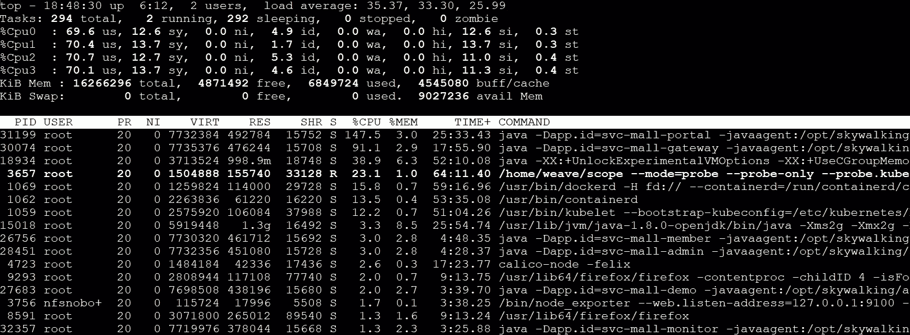

因为 CPU 不超分了，所以我们可以很明显地看到，k8s-worker-8 中的 CPU 被耗尽。从进程上来看，CPU 是被我们当前正在测试的接口服务消耗的。并且在这台虚拟机上，不止有 Portal 这一个进程，还有很多其他的服务。

那我们就把 Portal 服务调度到一个不忙的 worker 上去，比如移到 worker-3（6C16G）上:

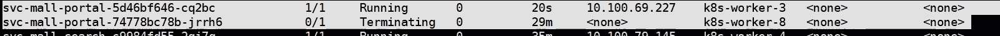

得到如下结果：

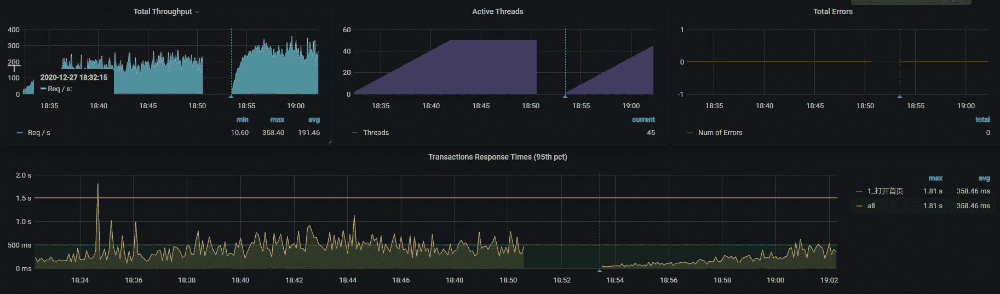

我们看到，TPS 已经有所上升了，达到了近 300，性能确实变好了一些。但是，这个数据还不如我们一开始不优化的结果，毕竟一开始还能达到 300TPS 呢。那我们就接着分析当前的瓶颈在哪里。

我们先来看一下主机的性能数据：

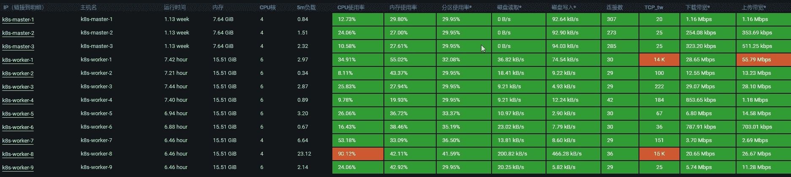

其中，worker-8 的 CPU 使用率达到了 90.12%。为什么这个 CPU 还是如此之高呢？我们继续来 top 一下，看看 worker-8 的性能数据：

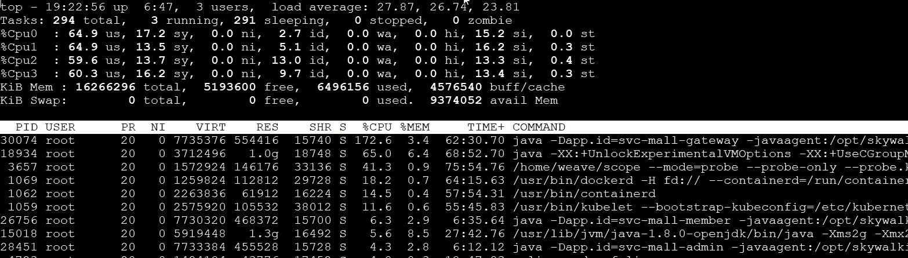

你看，在 process table 中，排在最上面的是 Gateway 服务，说明是 Gateway 进程消耗的 CPU 最多。既然如此，我们自然要看看这个进程中的线程是不是都在干活。

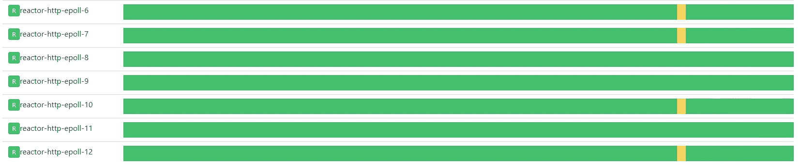

我们看到上图中全是绿色的，也就是说 Gateway 中的线程一直处于 Runnable 状态，看来工作线程确实挺忙的了。而在前面的 worker-8 性能数据中，si cpu 已经达到了 16% 左右。所以结合这一点，我们来看一下实时的软中断数据：

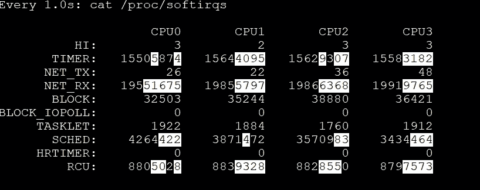

可以看到网络软中断一直在往上跳，这说明确实是网络软中断导致 si cpu 变高的。网络软中断的变化是我们根据证据链找下来的。证据链如下：

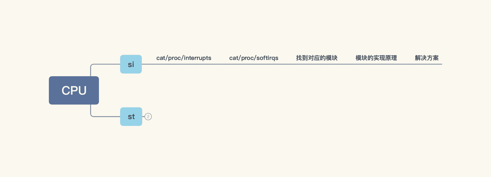

我们再看一下网络带宽有多大：

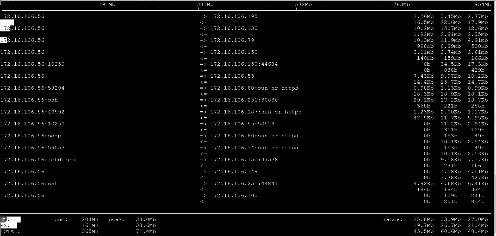

可以看到，网络带宽倒是不大。

从上述 Gateway 的工作线程、软中断数据和网络带宽情况来看，Gateway 只负责转发，并没有什么业务逻辑，也没有什么限制。所以，针对 TPS 上不去的原因，似乎除了网络转发能力比较差之外，我们再找不到其他解释了。

这个思路其实是需要一些背景知识的，因为我们通常用网络带宽来判断网络是不是够用，但是这是不够的。你要知道，在网络中当小包过多的时候，网络带宽是难以达到线性流量的。所以，我们这里的网络带宽即便不会很高，也会导致网络软中断的增加和队列的出现。

既然如此，那我们就把这个 Gateway 也从 worker-8 移到 worker-2（6C16G）上去，做这一步是为了减少网络软中断的争用。我们再看一下集群的整体性能：

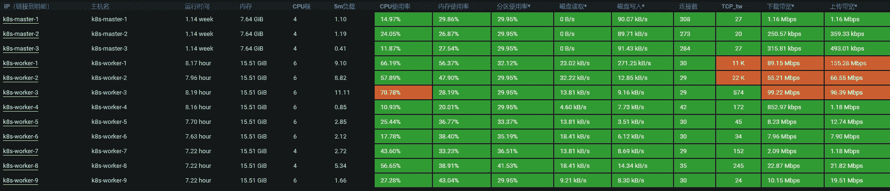

看起来不错哦，worker-3 的 CPU 使用率降到了 70.78%。不过网络带宽有几个地方变红了，这个我们后面再分析。至少我们从这里看到，压力是起来了。

我们回来看一下压力的情况：

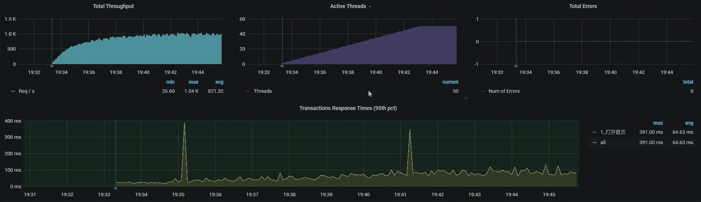

TPS 已经达到 1000 左右了！棒棒的，有没有！我们画一个 TPS 对比图庆祝一下：


其实到这里，打开首页这个接口的基准场景就可以结束了，因为我们已经优化到了比需求还要高的程度。只是从技术角度来说，一个系统优化到最后是会有上限的，所以，我们仍然需要知道这个上限在哪里。

### 第五阶段：硬件资源还是要用完

现在压力把 worker-3 的 CPU 资源用得最高，用到了 70.78%。那么，下面我们就要把这个机器的硬件资源给用完，因为只有将资源都用尽，我们才能判断系统容量的最上限。这也就是我一直强调的，要将**性能优化分为两个阶段：一是把资源用起来；二是把容量调上去。**就算不是 CPU 资源，把其他的资源用完也可以。

既然这时候压力已经把 worker-3 的 CPU 资源用到了 70.78%，那我们就到这个应用中看一下线程把 CPU 用得怎么样。

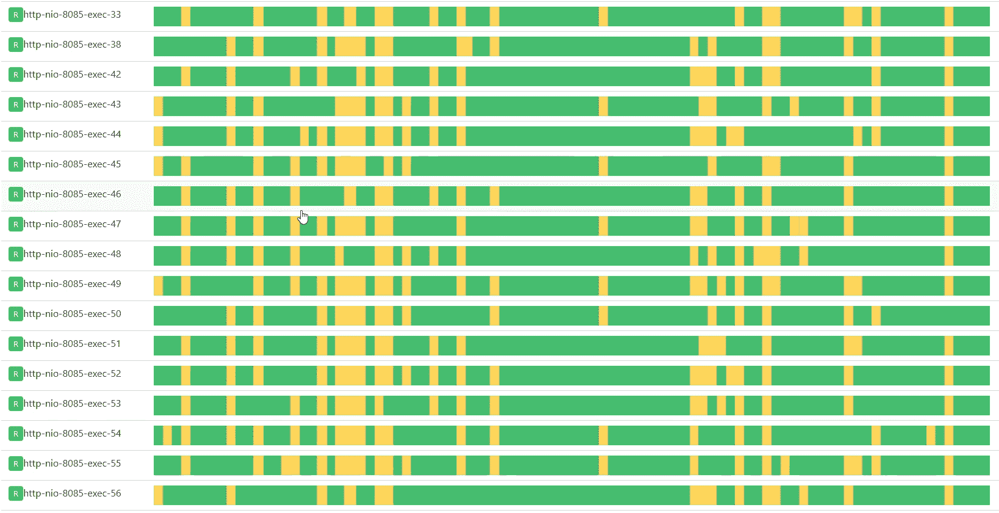

你看，这里面的线程确实都忙起来了。

既然如此，那我们把 Tomcat 和 JDBC 连接的最大值都改到 80，再来看一下 TPS 的表现（请你注意，这里只是一个尝试，所以改大即可，并没有什么道理。在后续的测试过程中，我们还要根据实际情况来做调整，就是不能让线程太大，也不能不够用）。

为了让压力能直接压到一个节点上，我们跳过 Ingress，用分段的测法直接把压力发到服务上。然后，我们去 Pod 里设置一个 node port 把服务代理出来，再修改一下压力脚本。得到结果如下：

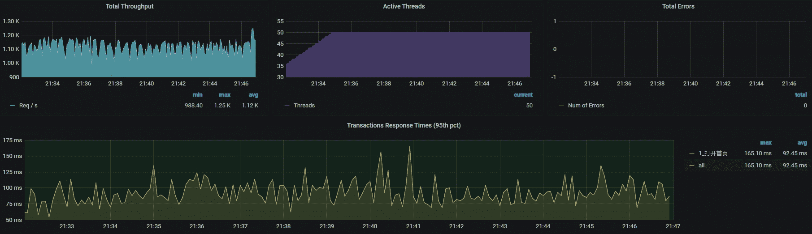

TPS 还是抖动大。那我们接着看全局监控：

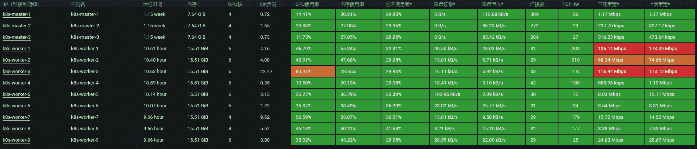

看上图就可以知道，有几个主机的带宽都飘红了，而其他的资源使用率并没有特别高。前面我们有说过，分析网络问题，不应该只看网络带宽，还要分析其他的内容，下面我们就得分析一下网络带宽。

我们到监控工具中看一下网络的流量，你可以看到确实有一些非被测应用在占用带宽，并且占得还不小：

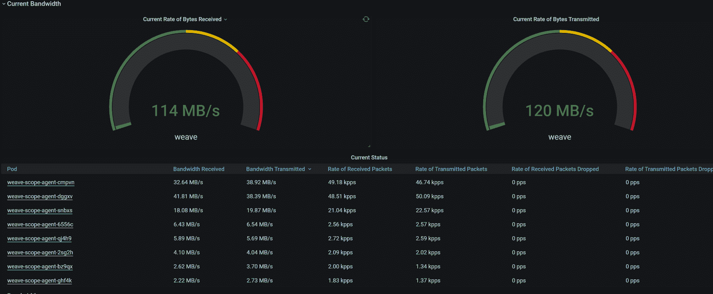

我们再看总体带宽，发现已经用了 4G 多：

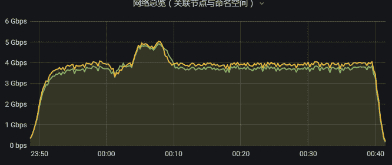

为了弄清楚那些与被测系统无关的应用，会对带宽消耗产生影响进而影响 TPS，我们现在先把影响带宽的应用都删除了，比如 Weave Scope、Monitoring 的监控工具等，从列表中来看这些应用占了不小的带宽。

然后我们再次测试，发现 TPS 有所上升，关键是稳定了很多：

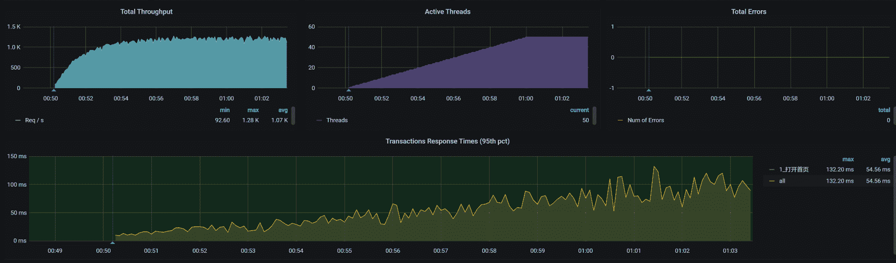

我们可以看到，TPS 已经上升到了 1200 左右，可见带宽对 TPS 还是造成了不小的影响。

接着，我们查一下网络的队列，发现应用上面已经出现了不小的 Recv_Q。

```
Proto Recv-Q Send-Q Local Address           Foreign Address         State       PID/Program name     Timer  
tcp      759      0 10.100.69.229:8085      10.100.140.32:35444     ESTABLISHED 1/java               off (0.00/0/0)  
tcp      832      0 10.100.69.229:34982     10.96.224.111:3306      ESTABLISHED 1/java               keepalive (4871.85/0/0)  
tcp     1056      0 10.100.69.229:34766     10.96.224.111:3306      ESTABLISHED 1/java               keepalive (4789.93/0/0)  
tcp      832      0 10.100.69.229:35014     10.96.224.111:3306      ESTABLISHED 1/java               keepalive (4888.23/0/0)  
tcp     3408      0 10.100.69.229:34912     10.96.224.111:3306      ESTABLISHED 1/java               keepalive (4855.46/0/0)  
tcp     3408      0 10.100.69.229:35386     10.96.224.111:3306      ESTABLISHED 1/java               keepalive (5019.30/0/0)  
tcp     3392      0 10.100.69.229:33878     10.96.224.111:3306      ESTABLISHED 1/java               keepalive (4495.01/0/0)  
tcp      560      0 10.100.69.229:35048     10.96.224.111:3306      ESTABLISHED 1/java               keepalive (4888.23/0/0)  
tcp     1664      0 10.100.69.229:34938     10.96.224.111:3306      ESTABLISHED 1/java               keepalive (4855.46/0/0)  
tcp      759      0 10.100.69.229:8085      10.100.140.32:35500     ESTABLISHED 1/java               off (0.00/0/0)  
tcp      832      0 10.100.69.229:35114     10.96.224.111:3306      ESTABLISHED 1/java               keepalive (4921.00/0/0)  
tcp     1056      0 10.100.69.229:34840     10.96.224.111:3306      ESTABLISHED 1/java               keepalive (4822.69/0/0)  
tcp     1056      0 10.100.69.229:35670     10.96.224.111:3306      ESTABLISHED 1/java               keepalive (5117.60/0/0)  
tcp     1664      0 10.100.69.229:34630     10.96.224.111:3306      ESTABLISHED 1/java               keepalive (4757.16/0/0)
```

从这里来看，网络已经成为了下一个瓶颈（关于这一点，我们在后续的课程里会讲）。

如果你想接着调优，还可以从应用代码下手，让应用处理得更快。不过，对于基准测试来说，一个没有走任何缓存的接口，在一个 6C16G 的单节点虚拟机上能达到这么高的 TPS，我觉得差不多了。

接下来，我们还要去折腾其他的接口，所以，我们对这个接口的优化到这里就结束了。


## 总结

在打开首页这个接口的基准场景中，涉及到了很多方面的内容。从一开始的信息整理，比如访问路径、查看代码逻辑、场景试运行等，都是在为后面的分析做准备。

而当我们看到响应时间高，然后做拆分时间这一步，就是我一直在 RESAR 性能工程中强调的“**分析的起点**”。因为在此之前，我们用的都是压力工具上的数据，只是把它们罗列出来就好了，没有任何分析的部分。

对于拆分时间，我们能用的手段有多种，你可以用你喜欢的方式，像日志、APM 工具，甚至抓包都是可以的。拆分了时间之后，我们就要分析在某个节点上响应时间高的时候，要怎么做。这时就用到了我一直强调的“全局 - 定向”监控分析思路。

在每一个阶段，你一定要清楚地定义优化的方向和目标，否则容易迷失方向。特别是对于一些喜欢把鼠标操作得特别快的同学，容易失去焦点，我劝你慢点操作，想清楚下一步再动。

而我们上述整个过程，都依赖于我说的性能分析决策树。从树顶往下，一层层找下去，不慌不乱，不急不燥。

只要你想，就能做到。

## 课后作业

最后，我给你留三个思考题。

1. 当 st cpu 高的时候，你要去看什么？
2. 当 wa cpu 高的时候，你要去看什么？
3. 为什么我们要把硬件资源用完？

记得在留言区和我讨论、交流你的想法，每一次思考都会让你更进一步。

如果你读完这篇文章有所收获，也欢迎你分享给你的朋友，共同学习进步。我们下一讲再见！
