# 13 | 用户登录：怎么判断线程中的Block原因？

 

你好，我是高楼。

这节课我们接着来“玩”一下用户登录。在第 10 讲的课程中，我们以登录功能为例做了一些分析，来说明基准场景中的一些要点。但是，我们还没有把它优化完，所以这节课还要接着来折腾它。

用户登录说起来只是一个很普通的功能，不过它的逻辑一点也不简单。因为登录过程要对个人的信息进行对比验证，验证过程中又要调用相应的加密算法，而加密算法是对性能要求很高的一种功能。复杂的加密算法安全性高，但性能就差；不复杂的加密算法性能好，但安全性低，这是一个取舍的问题。

另外，还有 Session 存储和同步。对于个大型的系统来说，不管你在哪个系统访问，在调用其他系统时如果需要验证身份就要同步 Session 信息，并且在做业务时，我们也要把相应的 Session 信息带上，不然就识别不了。

你看，登录功能实际上会涉及到很多的业务，它其实一点也不简单。所以，这节课我会带着你好好分析用户登录功能，并带你了解在压力过程中业务逻辑链路和整体 TPS 之间的关系。同时，也希望你能学会判断线程中的 BLOCKED 原因。

## 修改加密算法

还记得在第 10 讲中，我们在基准场景中对登录业务的测试结果吗？在 10 个压力线程下，TPS 达到了 100 左右。

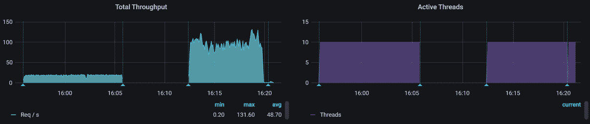

同时，在第 10讲中，我们发现了加密算法 BCrypt 效率低之后，讨论了两种优化方式：一种是用更快的加密方式，另一种是去掉这个加密算法。当时，我选择把加密算法 BCrypt 直接去掉。在这节课中，我们来试试第一种方式，把它改为 MD5，具体有两个动作：

1. 更改加密算法。之前的 BCrypt 加密算法虽然安全性高，但性能差，所以建议改成 MD5。
2. 加载所有用户到 Redis 中。

我们再跑一遍压力场景。注意，在跑这一遍之前，我们只是更改了加密算法，并没有执行加载缓存的动作。我希望一次只做一个动作来判断结果（但是上面两个动作我们都要做哦，请你接着看下去），结果如下：

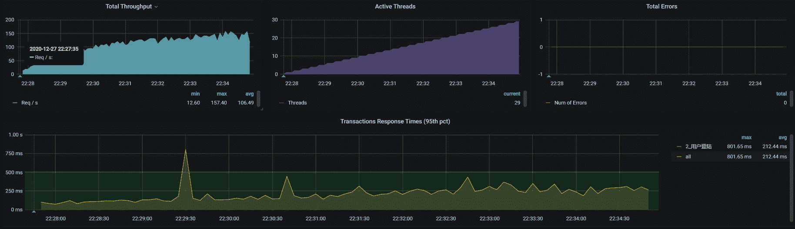

从上面的结果来看，性能有些上升了，但是还没达到我想要的样子。我希望性能有突飞猛进的增加，而不是现在这样不温不火的样子，看着就来气。所以，我们还是要继续“收拾收拾”这个接口，使用缓存，看下效果如何。

## 检验缓存的效果

为了确定缓存对后续的性能优化产生了效果，我们可以用两个手段来检验效果：

1. 把参数化数据量降下来，只用少量的数据测试一下（请注意，我们只是尝试一下，并不是说用少量的数据来运行场景是对的）；
2. 直接加载全部缓存。

我们得到这样的结果：

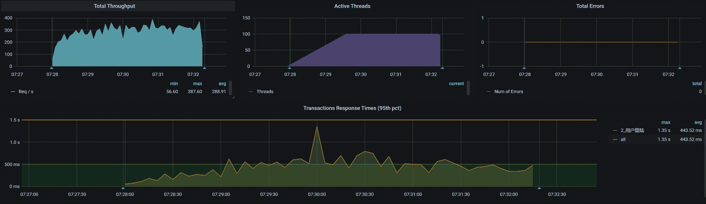

从曲线上看，登录接口能达到 300TPS 左右了。但是，我还是觉得不够好，因为从硬件资源上来看，再根据我以往的经验，它应该还能达到更高才对。

而在分析的过程中，再也没有第 11讲和第12 讲中提到的硬件资源的问题，但是在这里我们通过查看全局监控数据，看到的是 us cpu 高，说明确实都是业务逻辑在消耗 CPU 资源了。所以，我们就只有从登陆逻辑入手，来优化这个问题了。

## 修改登录的逻辑

通过阅读源代码，我整理了这个系统的原登录逻辑：

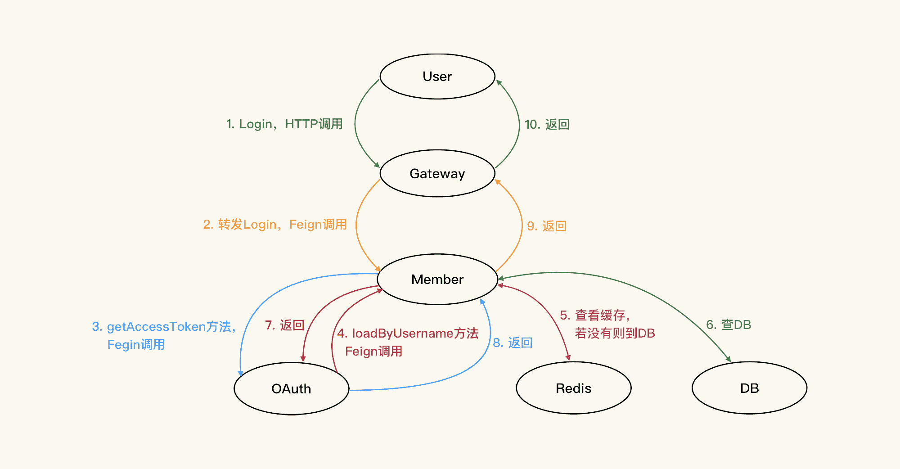

这个逻辑看着比较啰嗦，其中 Member 服务调 auth 服务，倒还能理解。可是，Auth 服务为什么还要到 Member 里取用户名呢？自己直接查缓存或 DB 不香吗？从架构设计的角度来看，为了避免共享数据库，这样的设计似乎也没啥。只是在我们的优化过程中，需要根据实际环境来做判断。

在我们这个环境中，需要把 DB 共用，这样 Auth 服务就可以直接使用数据库，而不用再从 Member 绕一圈。所以，我们先改成下面这种新的登录逻辑，这样就可以减少一次调用。

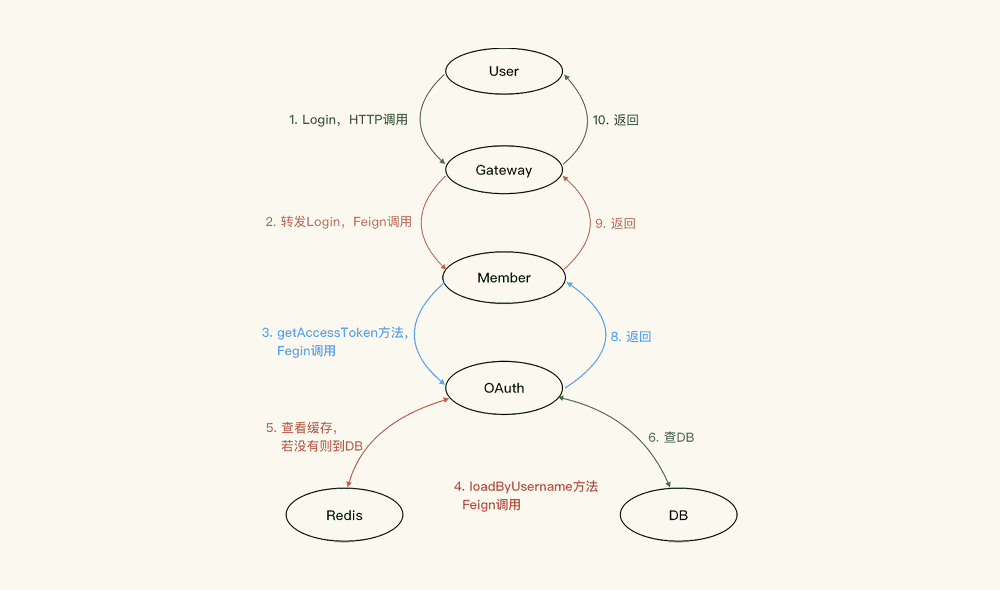

修改之后，登录 TPS 如下：


从结果上来看，TPS 确实有增加，已经到 700 以上了。很好。

这时候是不是就可以结束分析了呢？不是，我们还需要知道当前的瓶颈点在哪，因为根据我的性能理念，每个业务都会有瓶颈点，不管优化到什么程度，除非一直把硬件资源耗光。所以，我们继续接着分析。

## 看架构图

还是一样，在分析性能瓶颈之前，我们先来看架构图，了解用户登录接口会涉及到哪些服务和技术组件。

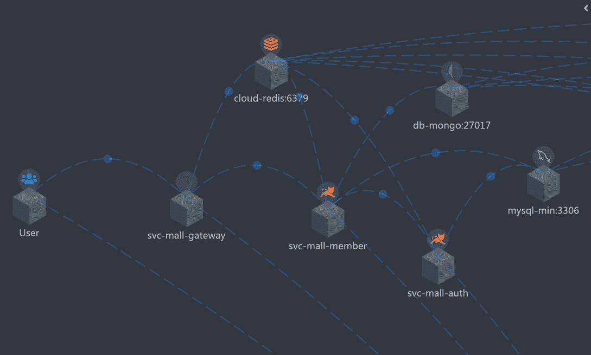

从这个架构图中可以看到，登录操作跨了 Gateway/Member/Auth 三个服务，连接了 Redis/MySQL 两个组件。图中的 MongoDB 虽然看上去有线，但实际上登录并没有用上。

了解这些信息之后，我们按照分析逻辑，一步步来分析问题。

## 拆分时间

我们前面提到，修改登录逻辑后的 TPS 如下：

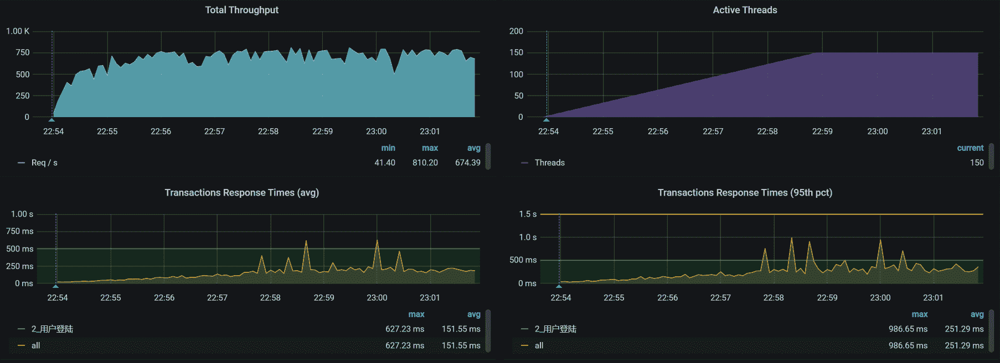

可以看到，响应时间已经上升到了 100ms 左右，所以，我们现在要找出这个时间消耗在了哪里。你可能已经注意到，图中的用户增加到了 150。这是为了把响应时间拉大，便于我们分析。下面我们把这个响应时间拆分一下，看看问题出在哪里。

1. **Gateway 服务上的时间**

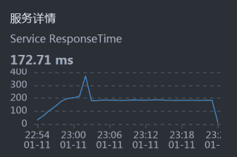

1. **Member 服务上的时间**

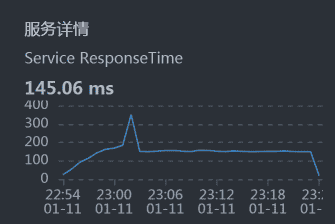

1. **Auth 服务上的时间**

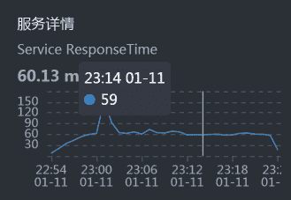

我们看到，Member 服务上的时间消耗是 150ms 左右，Auth 服务上的时间消耗有 60ms 左右。Member 服务是我们要着重分析的，因为它的响应时间更长。而 Auth 上虽然时间不太长，但是也达到了 60ms 左右，从经验上来说，我觉得还是有点稍长了，最好平均能到 50ms 以下，所以我们也要稍微关心一下。

## 全局监控

我们的分析逻辑雷打不动，依旧是**先看全局监控，后看定向监控**。从下面这张全局监控图的数据来看，worker-7 和 worker-8 的 CPU 使用率比其他的要高。

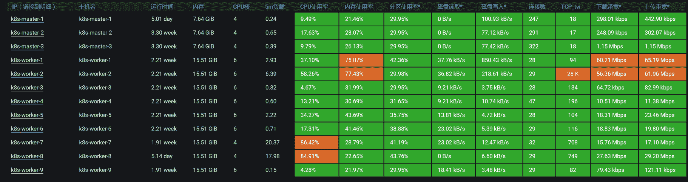

既然 worker-7/8 的 CPU 使用率要高一点，那我们就要查一下这两个节点上跑着什么样的服务。所以我们来看一下 POD 的分布，大概看一下每个 POD 在哪个 worker 节点上，以便后面分析 POD 相互之间的影响：

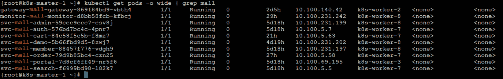

原来，在 worker-7 和 worker-8 上，分别运行着响应时间稍高的 Auth 服务和 Member 服务。对于这两个服务，我们都要分析，只是得一个一个来，那我们就从 auth 服务开始。

你可能会问：为什么要先从 Auth 服务下手呢？没啥原因，就是看它的 CPU 更红一点。你还可能奇怪：图中其他地方也红了，为什么不关注呢？我来逐一给你分析一下。

1. 图中的 worker-1 和 worker-2，内存使用率相对较大，达到了 70% 以上。从经验上来说，我几乎没有怎么关心过 Linux 的内存使用率，除非出现大量的 page faults。因为 Linux 内存在分配给应用程序使用之后，是会体现在 Cache 当中的。被应用程序 Cache 住的内存在操作系统上来看都是被使用的，但实际上可能并未真的被使用，这时操作系统会把这部分 Cache 内存计算到 available 内存当中，所以说，我们直接看操作系统级别的空闲内存是分析不出问题来的。
2. 在 worker-2 上，我们看到 TCP 的 Time Wait 达到近 3 万，不过这也不是我关心的点，因为 Time Wait 是正常的 TCP 状态，只有端口不够用、内存严重不足，我才会稍微看一眼。
3. 至于 worker-1 和 worker-2 的上下行带宽，看起来真是不大。在内网结构中，我们在测试的时候，内网带宽达到过好几 Gbps，这点带宽还不足以引起我们的重视。

所以，我们要“收拾”的还是 worker-7 和 worker-8。

既然 Auth 服务在 worker-7 上，member 服务在 worker-8 上，就像前面说的，我们不如就从 Auth 服务开始。

## Auth 服务定向分析

对于 Auth 服务，我们从哪里开始分析呢？其实，我们可以按部就班。既然是 Auth 服务导致 worker-7 的 CPU 使用率偏高，那我们就可以走下面这个证据链：

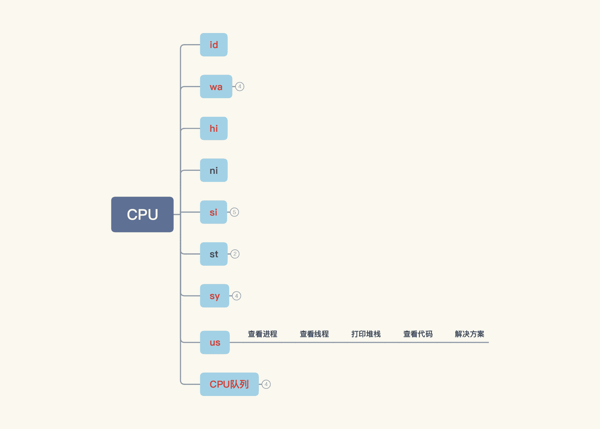

按照这个证据链，我们应该先看进程。不过，仗着傻小子火气壮（俗称：艺高人胆大），我直接就去看线程状态了，想看看能不能凭经验蒙对一把。于是，我打开了 Spring Boot Admin 的线程页面：

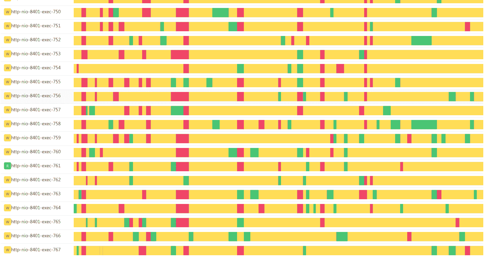

有没有满目疮痍的感觉？人生就是这样，到处都有惊吓。

在我颤抖着手点开一些红色的地方之后，看到了类似这样的信息：

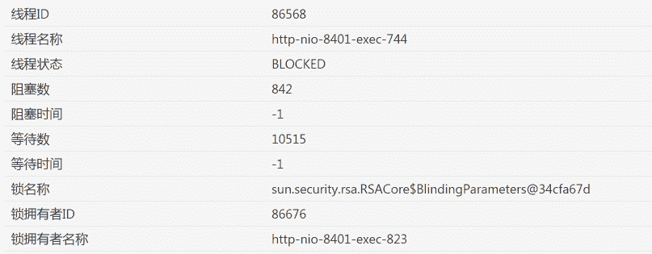

可以看到，阻塞数非常大，达到了 842。此外，锁拥有者 ID 是 86676，锁拥有者名称是线程 823。

我们抓两段栈出来看一下，找一下锁之间的关系：

```
-- 第一处：  
"http-nio-8401-exec-884" #86813 daemon prio=5 os_prio=0 tid=0x00007f2868073000 nid=0x559e waiting for monitor entry [0x00007f2800c6d000]  
   ​java.lang.Thread.State: BLOCKED (on object monitor  
  at java.security.Provider.getService(Provider.java:1035)  
  - waiting to lock <0x000000071ab1a5d8> (a sun.security.provider.Sun)  
  at sun.security.jca.ProviderList.getService(ProviderList.java:332)  
.....................  
  at com.dunshan.mall.auth.util.MD5Util.toMD5(MD5Util.java:11)  
  at com.dunshan.mall.auth.config.MyPasswordEncoder.matches(MyPasswordEncoder.java:23)  
.....................  
  ​at com.dunshan.mall.auth.controller.AuthController.postAccessToken$original$sWMe48t2(AuthController.java:46  
  at com.dunshan.mall.auth.controller.AuthController.postAccessToken$original$sWMe48t2$accessor$jl0WbQJB(AuthController.java)  
  at com.dunshan.mall.auth.controller.AuthController$auxiliary$z8kF9l34.call(Unknown Source)  
.....................  
  at com.dunshan.mall.auth.controller.AuthController.postAccessToken(AuthController.java)  
.....................  
  
  
-- 第二处：  
"http-nio-8401-exec-862" #86728 daemon prio=5 os_prio=0 tid=0x00007f28680d6000 nid=0x553a waiting for monitor entry [0x00007f2802b8c000]  
   ​java.lang.Thread.State: BLOCKED (on object monitor  
  at sun.security.rsa.RSACore$BlindingParameters.getBlindingRandomPair(RSACore.java:404)  
  - waiting to lock <0x000000071ddad410> (a sun.security.rsa.RSACore$BlindingParameters)  
  at sun.security.rsa.RSACore.getBlindingRandomPair(RSACore.java:443)  
  .....................  
  at com.dunshan.mall.auth.controller.AuthController.postAccessToken$original$sWMe48t2(AuthController.java:46)  
  at com.dunshan.mall.auth.controller.AuthController.postAccessToken$original$sWMe48t2$accessor$jl0WbQJB(AuthController.java)  
  at com.dunshan.mall.auth.controller.AuthController$auxiliary$z8kF9l34.call(Unknown Source)  
.....................  
  at com.dunshan.mall.auth.controller.AuthController.postAccessToken(AuthController.java)  
.....................
```

这两个栈的内容并不是同一时刻出现的，说明这个 BLOCKED 一直存在。但是不管怎么样，这个栈在做 RSA 加密，它和 Token 部分有关。

其中，线程 http-nio-8401-exec-884 是 BLOCKED 状态，那就说明有其他线程持有这个锁，所以我们自然要看一下线程栈中的 waiting to lock <0x000000071ab1a5d8>。其实，如果你有经验的话，一下子就能知道这里面是什么问题。不过，我们做性能分析的人要讲逻辑。

我在这里啰嗦几句，**当你碰到这种锁问题，又不知道具体原因的时候，要下意识地去打印一个完整的栈来看，而不是再到 Spring Boot Admin 里胡乱点**。为什么不建议你这么做？原因有这么几个：

1. 由于线程太多，点着看逻辑关系比较累；
2. 不断在刷，眼晕；
3. 我不喜欢。

所以，对于前面遇到的锁问题，我们首先要做的就是到容器中的 jstack 里打印一下栈，把它下载下来，然后祭出工具打开看一眼。

你可能会问，为什么不用 Arthas 之类的工具直接在容器里看？主要是因为 Arthas 的 Dashboard 在 Thread 比较多的时候，看起来真心累。

下面这张图就是 jstack 打印出来的栈，在下载之后用工具打开的效果。

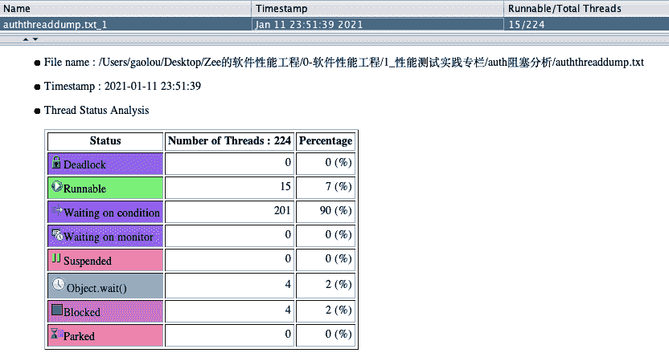

是不是有种买彩票的感觉？看起来有那么多的 BLOCKED 状态的线程（多达 842 个），居然一个都没蒙到！我本来想抓 BLOCKED 状态的线程，并且线程描述是“Waiting on monitor”，但是，从上面的线程描述统计来看，一个也没见。哼，真生气。

这时候，身为一个做性能分析的人，我们一定要记得倒杯茶，静静心，默默地把 jstack 连续再执行几遍。我在这里就连续执行了 10 遍，然后再找每个栈的状态。

终于，Waiting on monitor 来了：

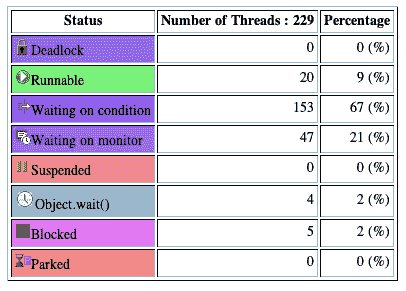

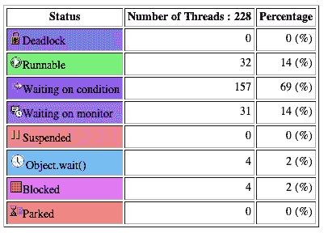

看起来有得玩了！接下来让我们看看究竟是谁阻塞住了上面的线程。

我们先在相应的栈里，找到对应的持有锁的栈。下面是栈中的阻塞关系。

1. **第一个栈**

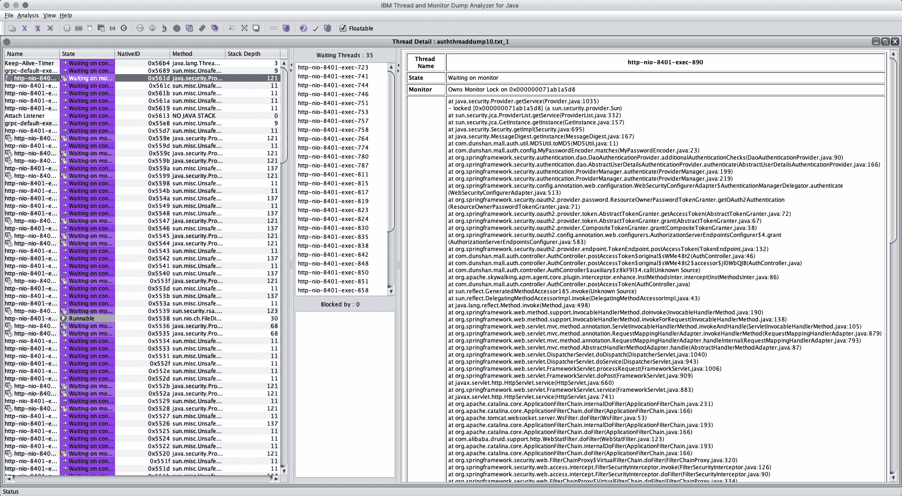

1. **第二个栈**

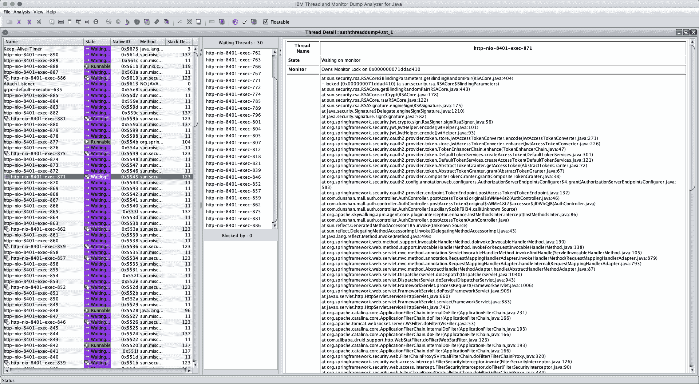

你要注意，这是两个栈文件。所以，我们要分别从这两个栈文件里找到各自的对应等待关系。下面这段代码就对应了上面的 Waiting 线程。

```
-- 第一处  
"http-nio-8401-exec-890" #86930 daemon prio=5 os_prio=0 tid=0x00007f28680a5800 nid=0x561d waiting for monitor entry [0x00007f2800263000]  
   ​java.lang.Thread.State: BLOCKED (on object monitor  
  at java.security.Provider.getService(Provider.java:1035)  
  - locked <0x000000071ab1a5d8> (a sun.security.provider.Sun)  
  at sun.security.jca.ProviderList.getService(ProviderList.java:332)  
  .....................  
  at com.dunshan.mall.auth.util.MD5Util.toMD5(MD5Util.java:11)  
  at com.dunshan.mall.auth.config.MyPasswordEncoder.matches(MyPasswordEncoder.java:23)  
.....................  
  at com.dunshan.mall.auth.controller.AuthController.postAccessToken$original$sWMe48t2(AuthController.java:46)  
  at com.dunshan.mall.auth.controller.AuthController.postAccessToken$original$sWMe48t2$accessor$jl0WbQJB(AuthController.java)  
  at com.dunshan.mall.auth.controller.AuthController$auxiliary$z8kF9l34.call(Unknown Source)  
  at org.apache.skywalking.apm.agent.core.plugin.interceptor.enhance.InstMethodsInter.intercept(InstMethodsInter.java:86)  
  at com.dunshan.mall.auth.controller.AuthController.postAccessToken(AuthController.java)  
  
  
-- 第二处  
"http-nio-8401-exec-871" #86739 daemon prio=5 os_prio=0 tid=0x00007f28681d6800 nid=0x5545 waiting for monitor entry [0x00007f2801a7b000]  
   ​java.lang.Thread.State: BLOCKED (on object monitor  
  at sun.security.rsa.RSACore$BlindingParameters.getBlindingRandomPair(RSACore.java:404)  
  - locked <0x000000071ddad410> (a sun.security.rsa.RSACore$BlindingParameters)  
  at sun.security.rsa.RSACore.getBlindingRandomPair(RSACore.java:443)  
.....................    
  at com.dunshan.mall.auth.controller.AuthController.postAccessToken$original$sWMe48t2(AuthController.java:46)  
  at com.dunshan.mall.auth.controller.AuthController.postAccessToken$original$sWMe48t2$accessor$jl0WbQJB(AuthController.java)  
  at com.dunshan.mall.auth.controller.AuthController$auxiliary$z8kF9l34.call(Unknown Source)  
  at org.apache.skywalking.apm.agent.core.plugin.interceptor.enhance.InstMethodsInter.intercept(InstMethodsInter.java:86)  
  at com.dunshan.mall.auth.controller.AuthController.postAccessToken(AuthController.java)
```

你看上面 locked 这一行的锁 ID，既然找到了这两处持有锁的栈，那我们就通过上面的栈，到源码中找到这两处栈的代码：

```
-- 第一处同步代码块  
    public synchronized Service getService(String type, String algorithm) {  
        ​checkInitialized()  
        // avoid allocating a new key object if possible  
        ​ServiceKey key = previousKey  
        if (key.matches(type, algorithm) == false) {  
            key = new ServiceKey(type, algorithm, false);  
            ​previousKey = key  
        ​  
        if (serviceMap != null) {  
            ​Service service = serviceMap.get(key)  
            if (service != null) {  
                return service;  
            ​  
        ​  
        ​ensureLegacyParsed()  
        return (legacyMap != null) ? legacyMap.get(key) : null;  
    ​  
  
  
-- 第二处同步代码块  
        // return null if need to reset the parameters  
        BlindingRandomPair getBlindingRandomPair(  
                BigInteger e, BigInteger d, BigInteger n) {  
  
  
            if ((this.e != null && this.e.equals(e)) ||  
                (this.d != null && this.d.equals(d))) {  
  
  
                BlindingRandomPair brp = null;  
                synchronized (this) {  
                    if (!u.equals(BigInteger.ZERO) &&  
                        ​!v.equals(BigInteger.ZERO))   
  
  
                        brp = new BlindingRandomPair(u, v);  
                        if (u.compareTo(BigInteger.ONE) <= 0 ||  
                            v.compareTo(BigInteger.ONE) <= 0) {  
  
  
                            // need to reset the random pair next time  
                            ​u = BigInteger.ZERO  
                            ​v = BigInteger.ZERO  
                        } else {  
                            ​u = u.modPow(BIG_TWO, n)  
                            ​v = v.modPow(BIG_TWO, n)  
                        ​  
                    } // Otherwise, need to reset the random pair.  
                ​  
                return brp;  
            ​  
  
  
            return null;
```

你可以看到，第一处是 JDK 中提供的 getService 类采用了全局同步锁定，导致的分配 key 时产生争用，这个其实在 JDK 的 Bug List 中有过描述，详见JDK-7092821。准确来说，它不算是 Bug，如果你想改的话，可以换一个库。

第二处是 JDK 中提供的 RSA 方法，是为了防范时序攻击特意设计成这样的。RSA 中有大素数的计算，为了线程安全，RSA 又加了锁。关于 RSA 的逻辑，你可以去看下源代码的 /sun/security/rsa/RSACore.java 中的逻辑。

不过，RSA 是一种低效的加密方法，当压力发起来的时候，这样的 synchronized 类必然会导致 BLOCKED 出现。对此，在源码中有下面这样一段注释，其中建议先计算 u/v，可以提高加密效率。

```
 ​* Computing inverses mod n and random number generation is slow, s  
 * it is often not practical to generate a new random (u, v) pair for  
 * each new exponentiation.  The calculation of parameters might even be  
 * subject to timing attacks.  However, (u, v) pairs should not be  
 * reused since they themselves might be compromised by timing attacks,  
 * leaving the private exponent vulnerable.  An efficient solution to  
 * this problem is update u and v before each modular exponentiation  
 * step by computing:  
 *  
 *     u = u ^ 2  
 *     v = v ^ 2  
 ​  
 ​* The total performance cost is small
```

既然我们已经知道了这两个 BLOCKED 产生的原因，那下一步的操作就比较简单了。

1. 针对第一处锁：实现自己的方法，比如说实现一个自己的分布式锁。
2. 针对第二处锁：换一个高效的实现。

至此，我们就找到了应用中 BLOCKED 的逻辑。因为我们这是一个性能专栏，所以我就不再接着整下去了。如果你是在一个项目中，分析到这里就可以把问题扔给开发，然后去喝茶了，让他们伤脑筋去，哈哈。

不过，这只是一句玩笑而已，你可别当真。作为性能分析人员，我们要给出合情合理并且有证据链的分析过程，这样我们和其他团队成员沟通的时候，才会更加简单、高效。

## Member 服务定向分析

分析完 Auth 服务后，我们再来看看 Member 服务的性能怎么样。因为全局监控数据前面我们已经展示了，所以这里不再重复说明，我们直接来拆分一下对 Member 服务调用时的响应时间。

1. **Gateway 上的响应时间**

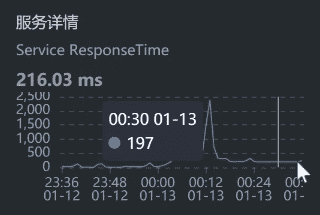

1. **Member 上的响应时间**

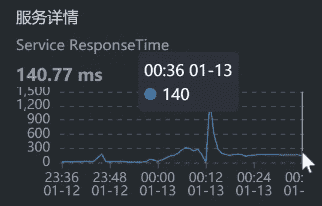

1. **Auth 上的响应时间**

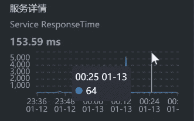

从上面的信息来看，这几段都有不同的时间消耗：Member 服务上有 80 毫秒左右，Auth 服务上已经有 60 毫秒左右，明显是有点高了。

我们登录到 Member 这个服务中，先看整体的资源使用情况。这里我用了最经典传统的 top 命令：

```
%Cpu0  : 63.8 us, 12.4 sy,  0.0 ni,  9.2 id,  0.0 wa,  0.0 hi, 14.2 si,  0.4 st  
%Cpu1  : 60.3 us, 11.7 sy,  0.0 ni, 11.0 id,  0.0 wa,  0.0 hi, 16.6 si,  0.3 st  
%Cpu2  : 59.4 us, 12.0 sy,  0.0 ni, 14.1 id,  0.0 wa,  0.0 hi, 13.8 si,  0.7 st  
%Cpu3  : 59.8 us, 12.1 sy,  0.0 ni, 11.7 id,  0.0 wa,  0.0 hi, 15.7 si,  0.7 st
```

从 CPU 使用分布上来看，其他计数器都还正常，只是 si 有点高。这是一个网络中断的问题，虽然有优化的空间，但是受基础架构所限，性能提升得不太多，这也是为什么现在很多企业都放弃了虚拟化，直接选择容器化的一个原因。

针对这个网络中断的问题，我将在后面的课程中仔细给你扒一扒，这节课我们暂且不做过多的讲解。

## 总结

这节课我用登录功能给你串了一个完整的性能分析场景。

在前面代码修改的部分，性能分析过程是比较快的，我们就是看看哪里的代码逻辑会消耗更多的时间。这个思路就是前面提到的 us cpu 的证据链。

而接下来我们在分析 Auth 服务的时候，是先从拆分时间开始一步步走到代码里的，其中最核心的部分是从 CPU 到栈，再到 BLOCKED 的判断。当我们看到栈上有 BLOCKED 的时候，要记得打印栈信息。但是因为有些锁会非常快速地获取和释放，所以就可能会出现打印栈时，看到等某个锁的栈信息，但是整个栈文件中却没有这把锁的情况。这个时候，你就要注意了，**我们一定要去连续地多打几次栈，直到抓到对应的锁。**

这是分析栈中锁的一个关键，因为我们经常会看到等锁的栈信息，看不到持有锁的栈信息。而连续多打几次栈，就是为了把持有锁和等待锁的栈同时打印出来，否则我们就找不出分析的逻辑了。

接着，当我们看到了持有锁的栈之后，就根据自己业务代码的调用逻辑，一层层地去找是哪里加的锁。至于这个锁加的合理不合理，就和业务逻辑有关了。作为性能分析人员，这个时候我们就可以把开发、业务、架构等人拉到一起讨论。这个锁要不要改，不是做性能的人说了算，而是大家一起说了算。

通过上述的分析，相信你可以看到，在我的性能分析逻辑中，从现象到原理，都需要搞清楚。

## 课后作业

最后，我给你留几个思考题来巩固今日所学。

1. 为什么看到 BLOCKED 的栈时要连续多打几次栈信息？
2. 为什么从性能分析中要从现象到原理？
3. 低效的代码有什么优化思路？

记得在留言区和我讨论、交流你的想法，每一次思考都会让你更进一步。

如果你读完这篇文章有所收获，也欢迎你分享给你的朋友，共同学习进步。我们下一讲再见！
