# 15 | 查询商品：资源不足有哪些性能表现？

 

你好，我是高楼。

这节课，我们来收拾“查询商品”这个接口。虽然这次的现象同样是 TPS 低、响应时间长，但是，这个接口走的路径和之前的不一样，所以在分析过程中会有些新鲜的东西，你将看到在资源真的不足的情况下，我们只有增加相应节点的资源才能提升性能。

在我的项目中，我一直都在讲，**不要轻易给出资源不足的结论。因为但凡有优化的空间，我们都要尝试做优化，而不是直接告诉客户加资源。而给出“增加资源”这个结论，也必须建立在有足够证据的基础上**。在这节课中，你也将看到这一点。

话不多说，我们直接开始今天的内容。

## 压力场景数据

对于查询商品接口，我们第一次试执行性能场景的结果如下：

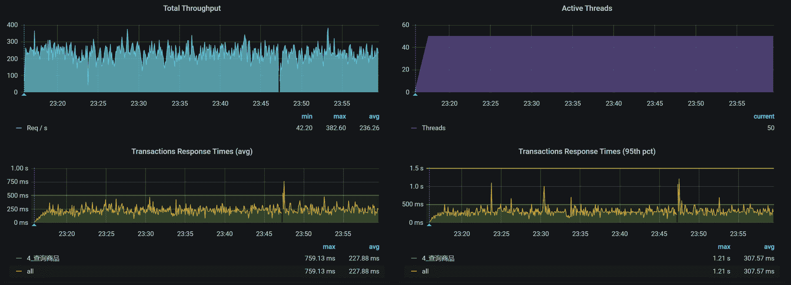

你看，TPS 只有 250 左右，并且响应时间也明显随着压力的增加而增加了，看起来瓶颈已经出现了，对吧？根据哥的逻辑，下一步就是看架构图啦。

## 先看架构图

我们用 APM 工具来看看这个接口的架构。


你看，从压力机到 Gateway 服务、到 Search 服务、再到 ES-Client，这个 APM 工具也只能帮我们到这里了。因为我们用的是 ElasticSearch 7 来做的搜索服务的支撑，而这个 skywalking 工具也没有对应的 Agent，所以后面并没有配置 skywalking。

在这里，我要多啰嗦几句。现在的 APM 工具大多是基于应用层来做的，有些运维 APM 采集的数据会更多一些，但也是响应时间、吞吐量等这样的信息。对于性能分析而言，现在的 APM 工具有减少排查时间的能力，但是在组件级的细化定位上还有待提高。虽然 AI OPS 也被提到了台面，但是也没见过哪个公司上了 AIOPS 产品后，就敢不让人看着。

总之，从细化分析的角度，我们在定位问题的根本原因时，手头有什么工具就可以用什么工具，即使什么工具都没有，撸日志也是照样能做到的，所以我建议你不要迷信工具，要“迷信”思路。

下面我们来拆分下这个接口的响应时间，看看这个案例的问题点在哪里。

## 拆分响应时间

**“在 RESAR 性能分析逻辑中，拆分响应时间只是一个分析的起点**。”这是我一直在强调的一句话。如果性能工程师连这个都不会做，就只能好好学习天天向上了。

根据架构图，我们拆分响应时间如下。

1. Gateway 服务上的响应时间：

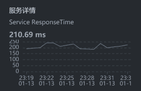

1. Search 服务上的响应时间：

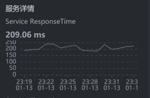

1. ES Client 的响应时间：

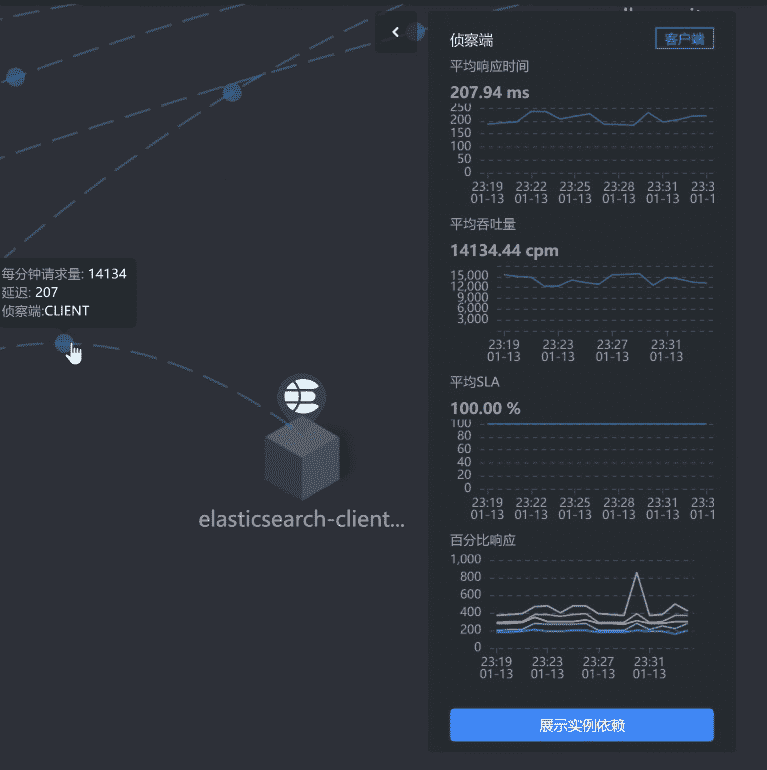

一层层看过之后，我们发现查询商品这个接口的响应时间消耗在了 ES client 上面。而在我们这个查询的路径上，在 gateway/search 服务上，我们并没有做什么复杂的动作。

既然知道了响应时间消耗在哪里，下面我们就来定位它，看能不能把 TPS 优化起来。

## 全局监控

根据高老师的经验，我们还是从全局监控开始，看全局监控可以让我们更加有的放矢。在分析的过程中，经常有人往下走了几步之后，就开始思维混乱、步伐飘逸。因为数据有很多，所以分析时很容易从一个数据走到不重要的分支上去了。而这时候，如果你心里有全局监控数据，思路就会更清晰，不会在无关的分支上消耗时间。

回到我们这个例子中，从下面的 k8s worker（也就是 k8s 中的 node，在我们的环境中我习惯叫成 worker，就是为了体现：在我的地盘，我爱叫啥就叫啥）的数据上来看，似乎没有一个 worker 的资源使用率是特别高的。

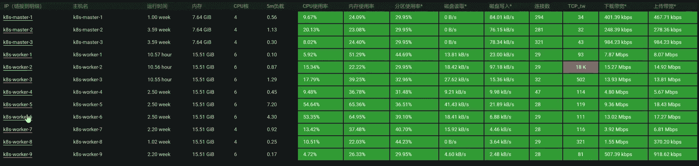

请你注意，在 k8s 中看资源消耗，一定不要只看 worker 这个层面，因为这个层面还不够，一个 worker 上可能会运行多个 pod。从上图来看，由于 worker 层面没有资源消耗，但是时间又明显是消耗在 ES client 上的，所以，接下来我们要看一下每一个 pod 的资源使用情况。

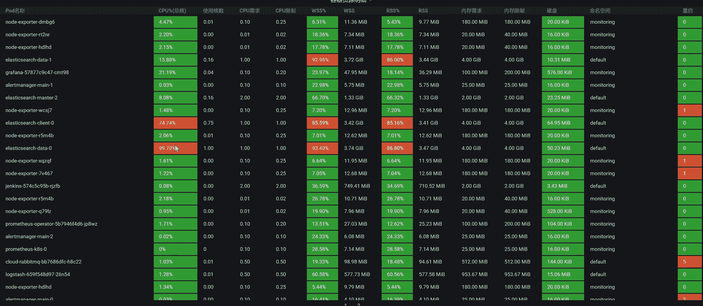

咦，有红色。你看，有两个与 ES 相关的 POD，它们的 CPU 都飘红了，这下可有得玩了。既然是与 ES 相关的 POD，那我们就把 ES 所有的 POD 排个序看看。

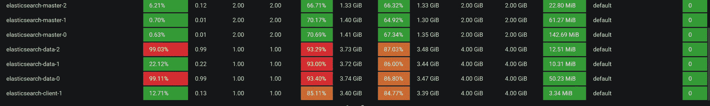

从上图的数据来看，有一个 ES Client 消耗了 67% 的 CPU，有两个 ES Data 消耗了 99% 的 CPU，ES 本来就是吃 CPU 的大户，所以我们接下来要着重分析它。

这里我再说明一点，我们从前面的 worker 资源使用率一步一步走到这里，在分析方向上是合情合理的，因为这些都是属于我提到的全局监控的内容。

## 定向分析

现在我们就来扒一扒 ES，看看它在哪个 worker 节点上。罗列 Pod 信息如下：

```
[root@k8s-master-1 ~]# kubectl get pods -o wide | grep elasticsearch  
elasticsearch-client-0                      1/1     Running   0          6h43m   10.100.230.2     k8s-worker-1   <none>           <none>  
elasticsearch-client-1                      1/1     Running   0          6h45m   10.100.140.8     k8s-worker-2   <none>           <none>  
elasticsearch-data-0                        1/1     Running   0          7h8m    10.100.18.197    k8s-worker-5   <none>           <none>  
elasticsearch-data-1                        1/1     Running   0          7h8m    10.100.5.5       k8s-worker-7   <none>           <none>  
elasticsearch-data-2                        1/1     Running   0          7h8m    10.100.251.67    k8s-worker-9   <none>           <none>  
elasticsearch-master-0                      1/1     Running   0          7h8m    10.100.230.0     k8s-worker-1   <none>           <none>  
elasticsearch-master-1                      1/1     Running   0          7h8m    10.100.227.131   k8s-worker-6   <none>           <none>  
elasticsearch-master-2                      1/1     Running   0          7h8m    10.100.69.206    k8s-worker-3   <none>           <none>  
[root@k8s-master-1 ~]# 
```

现在就比较清晰了，可以看到，在整个 namespace 中有两个 ES client，三个 ES data，三个 ES master。

我们来画一个细一点的架构图，以便在脑子里记下这个逻辑：

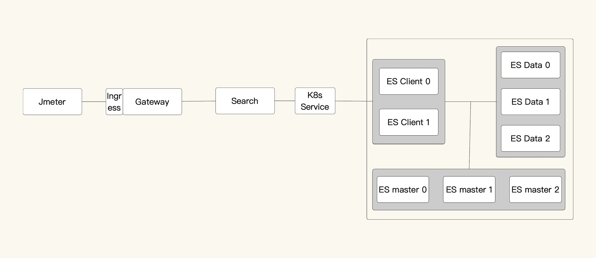

再结合我们在全局分析中看到的资源使用率图，现在判断至少有两个问题：

1. ES client 请求不均衡；
2. ES data CPU 高。

下面我们一个一个来分析。

### ES client 请求不均衡

从上面的架构图中可以看到，search 服务连两个 ES client，但是只有一个 ES client 的 CPU 使用率高。所以，我们需要查一下链路，看看 ES 的 service：

```
[root@k8s-master-1 ~]# kubectl get svc -o wide | grep search  
elasticsearch-client            NodePort    10.96.140.52    <none>        9200:30200/TCP,9300:31614/TCP         34d     app=elasticsearch-client,chart=elasticsearch,heritage=Helm,release=elasticsearch-client  
elasticsearch-client-headless   ClusterIP   None            <none>        9200/TCP,9300/TCP                     34d     app=elasticsearch-client  
elasticsearch-data              ClusterIP   10.96.16.151    <none>        9200/TCP,9300/TCP                     7h41m   app=elasticsearch-data,chart=elasticsearch,heritage=Helm,release=elasticsearch-data  
elasticsearch-data-headless     ClusterIP   None            <none>        9200/TCP,9300/TCP                     7h41m   app=elasticsearch-data  
elasticsearch-master            ClusterIP   10.96.207.238   <none>        9200/TCP,9300/TCP                     7h41m   app=elasticsearch-master,chart=elasticsearch,heritage=Helm,release=elasticsearch-master  
elasticsearch-master-headless   ClusterIP   None            <none>        9200/TCP,9300/TCP                     7h41m   app=elasticsearch-master  
svc-mall-search                 ClusterIP   10.96.27.150    <none>        8081/TCP                              44d     app=svc-mall-search  
[root@k8s-master-1 ~]# 
```

你看，整个 namespace 中有一个 client service（解析出来的是 VIP，访问此服务时不会绕过 K8s 的转发机制），还有一个 client-headless service（解析出来的是 POD IP，访问这个服务时会绕过 K8s 的转发机制）。

接下来，我们查一下为什么会出现访问不均衡的情况。

通过查看 search 服务的 ES 配置，我们看到如下信息：

```
  elasticsearch:  
    rest:  
      uris: elasticsearch-client:9200  
      username: elastic  
      password: admin@123
```

看到我们这里是用的 elasticsearch-client:9200，我们再来看一下 client service 的配置：

```
---  
apiVersion: v1  
kind: Service  
metadata:  
  annotations:  
    meta.helm.sh/release-name: elasticsearch-client  
    meta.helm.sh/release-namespace: default  
  creationTimestamp: '2020-12-10T17:34:19Z'  
  labels:  
    app: elasticsearch-client  
    app.kubernetes.io/managed-by: Helm  
    chart: elasticsearch  
    heritage: Helm  
    release: elasticsearch-client  
  managedFields:  
    - apiVersion: v1  
      fieldsType: FieldsV1  
      fieldsV1:  
        'f:metadata': {}  
        'f:spec':  
          'f:ports': {}  
      manager: Go-http-client  
      operation: Update  
      time: '2020-12-10T17:34:19Z'  
  name: elasticsearch-client  
  namespace: default  
  resourceVersion: '4803428'  
  selfLink: /api/v1/namespaces/default/services/elasticsearch-client  
  uid: 457e962e-bee0-49b7-9ec4-ebfbef0fecdd  
spec:  
  clusterIP: 10.96.140.52  
  externalTrafficPolicy: Cluster  
  ports:  
    - name: http  
      nodePort: 30200  
      port: 9200  
      protocol: TCP  
      targetPort: 9200  
    - name: transport  
      nodePort: 31614  
      port: 9300  
      protocol: TCP  
      targetPort: 9300  
  selector:  
    app: elasticsearch-client  
    chart: elasticsearch  
    heritage: Helm  
    release: elasticsearch-client  
  sessionAffinity: None  
  type: NodePort
```

从上面的配置来看，sessionAffinity 也配置为 None 了，也就是说这个 service 不以客户端的 IP 来保持 session。因为在这个环境配置中，Type 为 NodePort，而我们在 k8s 中配置的转发规则是 iptables。所以说，service 是依赖 iptables 的规则来做后端转发的。

接下来，我们检查一下 iptables 的转发规则。

我们先来看 iptables 中关于 ES client 的规则：

```
[root@k8s-master-1 ~]# iptables -S KUBE-SERVICES -t nat|grep elasticsearch-client|grep 9200  
-A KUBE-SERVICES ! -s 10.100.0.0/16 -d 10.96.140.52/32 -p tcp -m comment --comment "default/elasticsearch-client:http cluster IP" -m tcp --dport 9200 -j KUBE-MARK-MASQ  
-A KUBE-SERVICES -d 10.96.140.52/32 -p tcp -m comment --comment "default/elasticsearch-client:http cluster IP" -m tcp --dport 9200 -j KUBE-SVC-XCX4XZ2WPAE7BUZ4  
[root@k8s-master-1 ~]# 
```

可以看到，service 的规则名是 KUBE-SVC-XCX4XZ2WPAE7BUZ4，那我们再去查它对应的 iptables 规则：

```
[root@k8s-master-1 ~]# iptables -S KUBE-SVC-XCX4XZ2WPAE7BUZ4 -t nat  
-N KUBE-SVC-XCX4XZ2WPAE7BUZ4  
-A KUBE-SVC-XCX4XZ2WPAE7BUZ4 -m comment --comment "default/elasticsearch-client:http" -j KUBE-SEP-LO263M5QW4XA6E3Q  
[root@k8s-master-1 ~]#  
[root@k8s-master-1 ~]# iptables -S KUBE-SEP-LO263M5QW4XA6E3Q -t nat  
-N KUBE-SEP-LO263M5QW4XA6E3Q  
-A KUBE-SEP-LO263M5QW4XA6E3Q -s 10.100.227.130/32 -m comment --comment "default/elasticsearch-client:http" -j KUBE-MARK-MASQ  
-A KUBE-SEP-LO263M5QW4XA6E3Q -p tcp -m comment --comment "default/elasticsearch-client:http" -m tcp -j DNAT --to-destination 10.100.227.130:9200
```

问题来了，这里好像没有负载均衡的配置（没有 probability 参数），并且根据 iptables 规则也只是转发到了一个 ES client 上。到这里，其实我们也就能理解，为什么在全局监控的时候，我们只看到一个 ES client 有那么高的 CPU 使用率，而另一个 ES client 却一点动静都没有。

但是，这里的 iptables 规则并不是自己来配置的，而是在部署 k8s 的时候自动刷进去的规则。现在只有一条规则了，所以只能转发到一个 POD 上去。

那我们就再刷一遍 ES 的 POD，重装一下 ES 的 POD，看 k8s 自己能不能刷出来负载均衡的 iptables 规则。重来一遍之后，我们再来看 iptables 规则：

```
[root@k8s-master-1 ~]# iptables -S KUBE-SVC-XCX4XZ2WPAE7BUZ4 -t nat  
-N KUBE-SVC-XCX4XZ2WPAE7BUZ4  
-A KUBE-SVC-XCX4XZ2WPAE7BUZ4 -m comment --comment "default/elasticsearch-client:http" -m statistic --mode random --probability 0.50000000000 -j KUBE-SEP-IFM4L7YNSTSJP4YT  
-A KUBE-SVC-XCX4XZ2WPAE7BUZ4 -m comment --comment "default/elasticsearch-client:http" -j KUBE-SEP-5RAP6F6FATXC4DFL  
[root@k8s-master-1 ~]#
```

哟，现在刷出来两条 iptables 规则了，看来之前在我们不断折腾的部署过程中，ES client 一直是有问题的。

在上面的 iptables 规则里，那两条 iptables 的上一条中有一个关键词“——probability 0.50000000000”。我们知道，iptables 的匹配规则是从上到下的，既然上一条的匹配是随机 0.5，也就是说只有 50% 的请求会走第一条规则，那下一条自然也是随机 0.5 了，因为总共只有两条规则嘛。这样一来就均衡了。

我们再接着做这个接口的压力场景，看到如下信息：

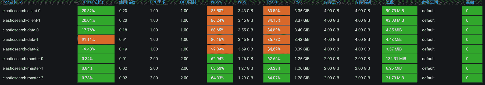

看起来 ES client 均衡了，对不对？

它对应的 TPS，如下：

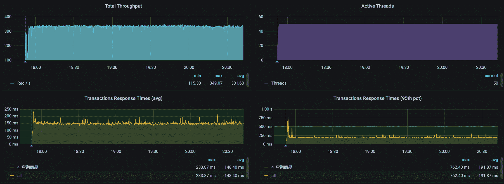

明显 TPS 提升了 60 左右。

ES client 请求不均衡的问题解决了，现在，我们还要来看一下 ES data 单节点 CPU 高的问题。

### ES Data CPU 使用率高

1. **第一阶段：加一个 CPU**

在 TPS 提升之后，我们再来看一下全局监控数据。

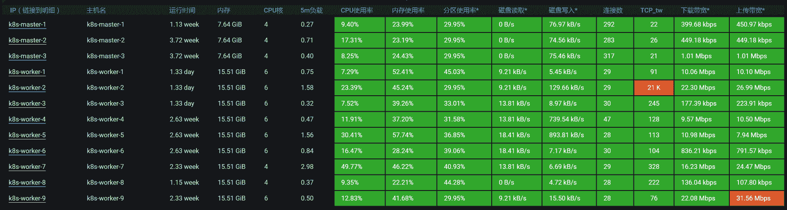

看起来比一开始好多了。基于前面分析 ES client 的经验，我们就先来查一下 ES data 的 iptables 规则：

```
-- 查看下有哪些ES data的POD  
[root@k8s-master-1 ~]# kubectl get pods -o wide | grep data  
elasticsearch-data-0                        1/1     Running   0          10h     10.100.18.197    k8s-worker-5   <none>           <none>  
elasticsearch-data-1                        1/1     Running   0          10h     10.100.5.5       k8s-worker-7   <none>           <none>  
elasticsearch-data-2                        1/1     Running   0          10h     10.100.251.67    k8s-worker-9   <none>           <none>  
  
  
-- 查看ES data对应的iptables规则  
[root@k8s-master-1 ~]# iptables -S KUBE-SERVICES -t nat|grep elasticsearch-data  
-A KUBE-SERVICES ! -s 10.100.0.0/16 -d 10.96.16.151/32 -p tcp -m comment --comment "default/elasticsearch-data:http cluster IP" -m tcp --dport 9200 -j KUBE-MARK-MASQ  
-A KUBE-SERVICES -d 10.96.16.151/32 -p tcp -m comment --comment "default/elasticsearch-data:http cluster IP" -m tcp --dport 9200 -j KUBE-SVC-4LU6GV7CN63XJXEQ  
-A KUBE-SERVICES ! -s 10.100.0.0/16 -d 10.96.16.151/32 -p tcp -m comment --comment "default/elasticsearch-data:transport cluster IP" -m tcp --dport 9300 -j KUBE-MARK-MASQ  
-A KUBE-SERVICES -d 10.96.16.151/32 -p tcp -m comment --comment "default/elasticsearch-data:transport cluster IP" -m tcp --dport 9300 -j KUBE-SVC-W4QKPGOO4JGYQZDQ  
  
  
-- 查看9200（外部通信）对应的规则  
[root@k8s-master-1 ~]# iptables -S KUBE-SVC-4LU6GV7CN63XJXEQ -t nat  
-N KUBE-SVC-4LU6GV7CN63XJXEQ  
-A KUBE-SVC-4LU6GV7CN63XJXEQ -m comment --comment "default/elasticsearch-data:http" -m statistic --mode random --probability 0.33333333349 -j KUBE-SEP-ZHLKOYKJY5GV3ZVN  
-A KUBE-SVC-4LU6GV7CN63XJXEQ -m comment --comment "default/elasticsearch-data:http" -m statistic --mode random --probability 1 -j KUBE-SEP-6ILKZEZS3TMCB4VJ  
-A KUBE-SVC-4LU6GV7CN63XJXEQ -m comment --comment "default/elasticsearch-data:http" -j KUBE-SEP-JOYLBDPA3LNXKWUK  
  
  
-- 查看以上三条规则的转发目标  
[root@k8s-master-1 ~]# iptables -S KUBE-SEP-ZHLKOYKJY5GV3ZVN -t nat  
-N KUBE-SEP-ZHLKOYKJY5GV3ZVN  
-A KUBE-SEP-ZHLKOYKJY5GV3ZVN -s 10.100.18.197/32 -m comment --comment "default/elasticsearch-data:http" -j KUBE-MARK-MASQ  
-A KUBE-SEP-ZHLKOYKJY5GV3ZVN -p tcp -m comment --comment "default/elasticsearch-data:http" -m tcp -j DNAT --to-destination 10.100.18.197:9200  
[root@k8s-master-1 ~]# iptables -S KUBE-SEP-6ILKZEZS3TMCB4VJ -t nat  
-N KUBE-SEP-6ILKZEZS3TMCB4VJ  
-A KUBE-SEP-6ILKZEZS3TMCB4VJ -s 10.100.251.67/32 -m comment --comment "default/elasticsearch-data:http" -j KUBE-MARK-MASQ  
-A KUBE-SEP-6ILKZEZS3TMCB4VJ -p tcp -m comment --comment "default/elasticsearch-data:http" -m tcp -j DNAT --to-destination 10.100.251.67:9200  
[root@k8s-master-1 ~]# iptables -S KUBE-SEP-JOYLBDPA3LNXKWUK -t nat  
-N KUBE-SEP-JOYLBDPA3LNXKWUK  
-A KUBE-SEP-JOYLBDPA3LNXKWUK -s 10.100.5.5/32 -m comment --comment "default/elasticsearch-data:http" -j KUBE-MARK-MASQ  
-A KUBE-SEP-JOYLBDPA3LNXKWUK -p tcp -m comment --comment "default/elasticsearch-data:http" -m tcp -j DNAT --to-destination 10.100.5.5:9200  
[root@k8s-master-1 ~]
```

Everythins is perfect!！规则很合理。ES Data 总共有三个 pod，从逻辑上来看，它们各占了三分之一。

在前面的 ES client 分析中，我们讲到，第一个 POD 是 0.5，下一条自然也只剩下 0.5，这很容易理解。现在，ES data 的部分有三条 iptables 规则，我们来简单说明一下。

> 通常我们理解的 iptables 就是一个防火墙。不过，要是从根本上来讲，它不算是一个防火墙，只是一堆规则列表，而通过 iptables 设计的规则列表，请求会对应到 netfilter 框架中去，而这个 netfilter 框架，才是真正的防火墙。其中，netfilter 是处于内核中的，iptables 就只是一个用户空间上的配置工具而已。

> 我们知道 iptables 有四表五链。四表是：fileter 表（负责过滤）、nat 表（负责地址转换）、mangle 表（负责解析）、raw 表（关闭 nat 表上启用的连接追踪）；五链是：prerouting 链（路由前）、input 链（输入规则）、forward 链（转发规则）、output 链（输出规则）、postrouting 链（路由后）。

> 而在这一部分，我们主要是看 nat 表以及其上的链。对于其他的部分，如果你想学习，可自行查阅 iptables 相关知识。毕竟，我还时刻记得自己写的是一个性能专栏，而不是计算机基础知识专栏，哈哈。

从上面的信息可以看到，我们的这个集群中有三个 ES data 服务，对应着三条转发规则，其中，第一条规则的匹配比例是：0.33333333349；第二条比例：0.50000000000；第三条是 1。而这三条转发规则对应的 POD IP 和端口分别是：10.100.18.197:9200、10.100.251.67:9200、10.100.5.5:9200，这也就意味着，通过这三条 iptables 规则可以实现负载均衡，画图理解如下：

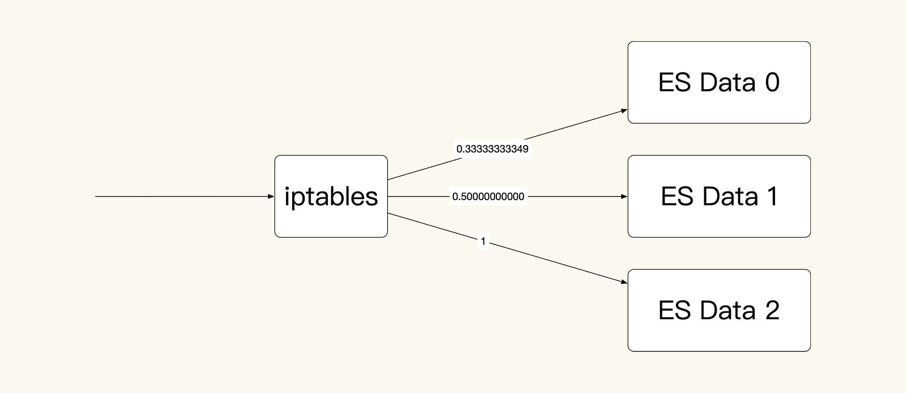

我们假设有 30 个请求进来，那 ES Data 0 上就会有 30x0.33333333349=10 个请求；对于剩下的 20 个请求，在 ES Data 1 上就会有 20x0.50000000000=10 个请求；而最后剩下的 10 个请求，自然就到了 ES Data 2 上。这是一个非常均衡的逻辑，只是在 iptables 规则中，我看着这几个数据比例，实在是觉得别扭。

既然明白了这个逻辑，下面我们还是把查询商品接口的场景压起来看一下：

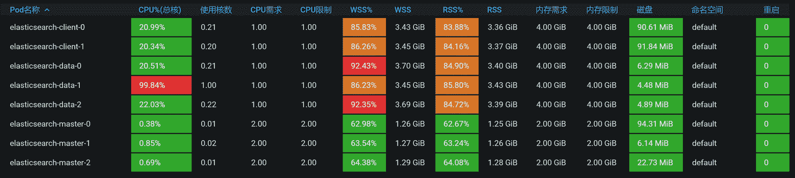

从数据上来看，经常会出现 ES data 某个节点消耗 CPU 高的情况。可是，对应到我们前面看到的全局 worker 监控界面中，并没有哪个 worker 的 CPU 很高。所以，在这里，我们要查一下 ES Data 中的 cgroup 配置，看它的限制是多少。


也就是说，ES data 的每个 POD 都是配置了一颗 CPU，难怪 CPU 使用率动不动就红了。

还有一点你要记住，前面我们在查看 data 列表的时候发现，ES data 0 在 worker-5 上，ES data 1 在 worker-7 上，ES data 2 在 worker-9 上。而我们现在看到的却是，它们都各自分到了一个 CPU。既然如此，那我们就再添加一个 CPU，然后再回去看一下 worker-5/7/9 的反应。为什么只加一个 CPU 呢？因为从 worker-7 上来看，现在的 CPU 使用率已经在 50% 左右了，要是加多了，我怕它吃不消。


看一下压力场景执行的效果：

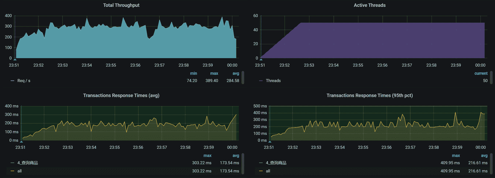

似乎……不怎么样？TPS 并没有增加。

1. **第二阶段：加副本**

我们再看加了 CPU 之后的全局 POD 监控：

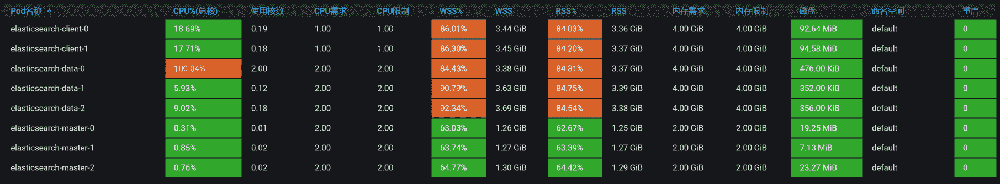

还是只有一个 ES data 的 CPU 使用率高，所以我想查一下 ES 中的数据分布。因为负载均衡的问题解决了，并且知道有三个 ES data 节点。现在我们就要知道是不是每个节点都被访问到了。

```
pms                               0 p 10.100.18.199 _w   32   17690 18363   6.7mb  7820 true  true  8.5.1 false  
pms                               0 p 10.100.18.199 _15  41    2110     0 465.7kb  5500 true  true  8.5.1 true  
pms                               0 p 10.100.18.199 _16  42   21083 30255   9.5mb  5900 true  true  8.5.1 false  
pms                               0 p 10.100.18.199 _17  43    2572     0   568kb  5500 true  true  8.5.1 true  
pms                               0 p 10.100.18.199 _18  44    1403     0 322.9kb  5500 true  true  8.5.1 true  
pms                               0 p 10.100.18.199 _19  45    1856     0 414.1kb  5500 true  true  8.5.1 true  
pms                               0 p 10.100.18.199 _1a  46    1904     0   423kb  5500 true  true  8.5.1 true
```

为啥数据都在一个节点上（都是 10.100.18.199）？看起来只有一个数据副本的原因了。

```
green open pms                                            A--6O32bQaSBrJPJltOLHQ 1 0   48618 48618  55.1mb  18.3mb
```

所以，我们先把副本数加上去，因为我们有三个 data 节点，所以这里加三个副本：

```
PUT /pms/_settings  
{  
    "number_of_replicas": 3  
}  
  
我们再次查看ES中的数据分布，如下所示：  
  
pms                               0 r 10.100.18.200 _w   32   17690 18363   6.7mb  7820 true  true  8.5.1 false  
pms                               0 r 10.100.18.200 _15  41    2110     0 465.7kb  5500 true  true  8.5.1 true  
pms                               0 r 10.100.18.200 _16  42   21083 30255   9.5mb  5900 true  true  8.5.1 false  
pms                               0 r 10.100.18.200 _17  43    2572     0   568kb  5500 true  true  8.5.1 true  
pms                               0 r 10.100.18.200 _18  44    1403     0 322.9kb  5500 true  true  8.5.1 true  
pms                               0 r 10.100.18.200 _19  45    1856     0 414.1kb  5500 true  true  8.5.1 true  
pms                               0 r 10.100.18.200 _1a  46    1904     0   423kb  5500 true  true  8.5.1 true  
pms                               0 p 10.100.251.69 _w   32   17690 18363   6.7mb  7820 true  true  8.5.1 false  
pms                               0 p 10.100.251.69 _15  41    2110     0 465.7kb  5500 true  true  8.5.1 true  
pms                               0 p 10.100.251.69 _16  42   21083 30255   9.5mb  5900 true  true  8.5.1 false  
pms                               0 p 10.100.251.69 _17  43    2572     0   568kb  5500 true  true  8.5.1 true  
pms                               0 p 10.100.251.69 _18  44    1403     0 322.9kb  5500 true  true  8.5.1 true  
pms                               0 p 10.100.251.69 _19  45    1856     0 414.1kb  5500 true  true  8.5.1 true  
pms                               0 p 10.100.251.69 _1a  46    1904     0   423kb  5500 true  true  8.5.1 true  
pms                               0 r 10.100.140.10 _w   32   17690 18363   6.7mb  7820 true  true  8.5.1 false  
pms                               0 r 10.100.140.10 _15  41    2110     0 465.7kb  5500 true  true  8.5.1 true  
pms                               0 r 10.100.140.10 _16  42   21083 30255   9.5mb  5900 true  true  8.5.1 false  
pms                               0 r 10.100.140.10 _17  43    2572     0   568kb  5500 true  true  8.5.1 true  
pms                               0 r 10.100.140.10 _18  44    1403     0 322.9kb  5500 true  true  8.5.1 true  
pms                               0 r 10.100.140.10 _19  45    1856     0 414.1kb  5500 true  true  8.5.1 true  
pms                               0 r 10.100.140.10 _1a  46    1904     0   423kb  5500 true  true  8.5.1 true
```

我们接着压起来，看看 POD 的资源：

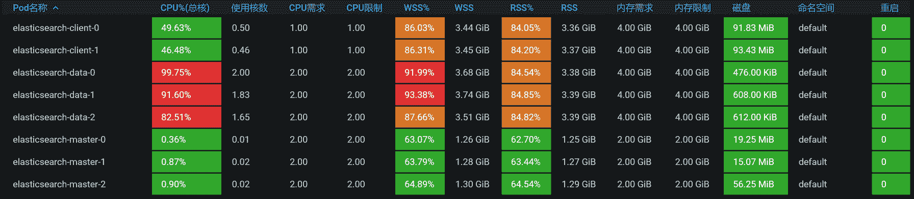

现在看着是不是开心多了？data 节点的 CPU 都用起来了。

我们再看一下 worker 的资源：

```
[root@k8s-master-1 ~]# kubectl get pods -o wide | grep data  
elasticsearch-data-0                        1/1     Running   0          16m     10.100.18.199    k8s-worker-5   <none>           <none>  
elasticsearch-data-1                        1/1     Running   0          17m     10.100.251.68    k8s-worker-9   <none>           <none>  
elasticsearch-data-2                        1/1     Running   0          18m     10.100.140.9     k8s-worker-2   <none>           <none>
```

现在 ES Data 的 POD 分布到 2、5、9 三这个 worker 上去了，我们查看下全局监控：

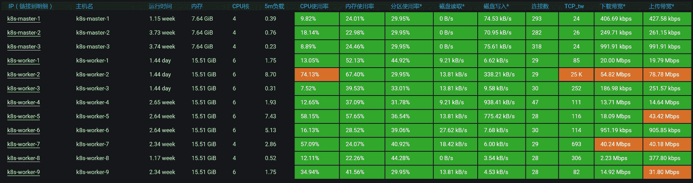

嗯，不错，ES data 的 POD 把资源用起来了。其实这里要想继续调，还可以把 CPU 加大，ES 本来就是吃 CPU、内存的大户。不过，我们前面在配置的时候，给 ES data 的 CPU 也确实太小了。这个问题，并不是我故意设计出来的，而是当时在部署的时候，没考虑到这些。

最后，我们来看优化后的效果：

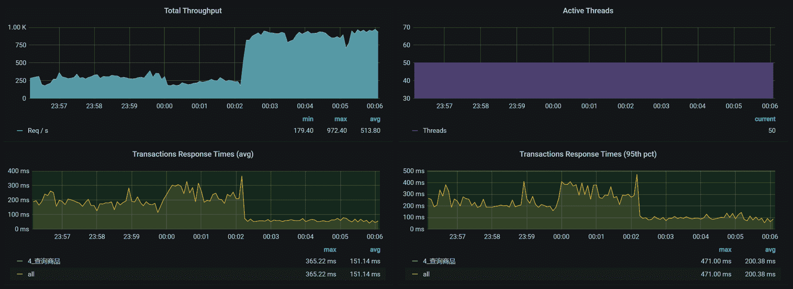

呀呀呀，你看 TPS 压都压不住呀，很快涨到 900 左右了！这个优化结果很好。

现在回过头来看第一个阶段，我们加 CPU 没有效果，主要还是因为副本数量太少。其实，在 ES 的优化中，还有很多细节可以玩。只不过，在我们这个课程中，我希望给你的是一个整体的分析思路和逻辑，而不是纠结于每个细节上的参数。所以，在这里，我们就不再说具体参数的调整了。

如果你想在 ES 上做更多的优化，可以在分析完业务之后，确定一下 ES 的架构、数据索引、分片等信息，然后再来设计一个合理的 ES 部署。

## 总结

在这节课中，我们看到 APM 工具也有无能为力的地方。所以说，当我们分析到一个具体组件之后，要想再往下分析，就得靠自己的技术功底了。

在出现请求不均衡的时候，我们一定要先去看负载均衡的逻辑有没有问题。当看到 ES client 不均衡时，我们去看了 iptables 的原理，在发现 iptables 只有一个转发规则的时候，接下来要做的当然就是重刷转发规则了。

在 ES client 转发均衡了之后，我们在 ES data 单节点上又看到 CPU 使用率过高。由于 ES data 在 POD 当中，我们自然就要想到去看 cgroup 的限制。

而在添加了 CPU 之后，我们发现 TPS 并没有提高，这时候就要去看 ES 的逻辑了。ES 的强大之处就在于多副本多分片的查询能力，所以，我们增加了副本之后，CPU 就用起来了，这是一个合理的优化结果，TPS 也自然提高了。

经过一系列的动作，我们终于把资源给用起来了。这也是我一直在强调的，**性能优化第一个阶段的目标，就是把资源给用起来，然后再考虑更细节的优化**。

## 课后作业

最后，我给你留两道题，请你思考一下：

1. 当负载出现不均衡时，主要的分析方向是什么？
2. 什么时候才需要去看组件内部的实现逻辑？

记得在留言区和我讨论、交流你的想法，每一次思考都会让你更进一步。

如果你读完这篇文章有所收获，也欢迎你分享给你的朋友，共同学习进步。我们下一讲再见！
